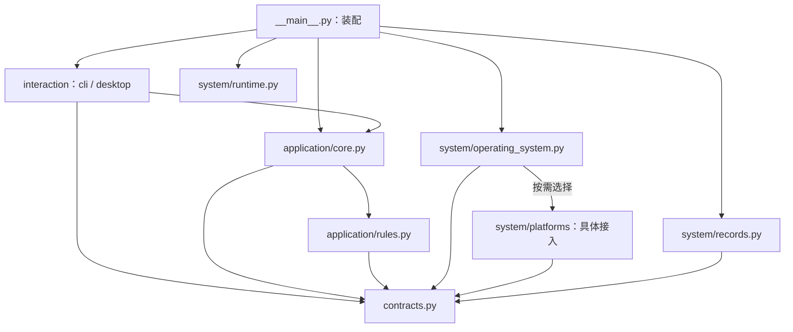

更新日期：2026年10月22日。英文名称：Code Structure Design。状态：三层模块目录与职责分离已实施，验证范围见第六章。本文约束 `src/cpu_memory_cleanup/` 内部结构，依据 [架构设计](<CPU 内存清理 架构设计.md>) 的用户交互、功能、系统三层完成源码映射。迁移映射、完成情况与剩余限制见第五、六章，机制证据见 [通用调研](<CPU 内存清理 通用调研.md>)。

# 一、设计范围与约束强度
硬约束是产品源码包内部的模块目录、文件职责、公开入口、状态归属和依赖方向。目标以 `interaction/`、`application/`、`system/` 三个实际包组织三层职责，每个包封装相关实现，通过明确入口协作。根包只保留包标识、启动装配和层间共享合同。

仓库外围的脚本、测试、文档、安装配置与产物位置见 [README](../README.md)，布局属于软约定。调整时同步受影响的包发现、入口、测试清单和引用，测试质量与执行授权仍按适用规范落实。本文不固定整仓目录树。

# 二、模块目录
## （一）产品源码结构
以下目录与文件已经建立。所有产品逻辑仍位于 `src/cpu_memory_cleanup/`，运行依赖保持标准库，保留 `python -m cpu_memory_cleanup` 启动方式。

```text
src/
└── cpu_memory_cleanup/
    ├── __init__.py              # 根包标识，导入无运行副作用
    ├── __main__.py              # 启动装配与入口选择
    ├── contracts.py             # 共享信息与最小能力合同
    ├── interaction/             # 用户交互层
    │   ├── __init__.py
    │   ├── cli.py               # 命令行输入、报告与退出码
    │   └── desktop.py           # 桌面控件、工作线程与主线程呈现
    ├── application/             # 功能层
    │   ├── __init__.py
    │   ├── core.py              # 业务流程、状态、取消与历史语义
    │   └── rules.py             # CPU、内存与对照的纯分析
    └── system/                  # 系统层
        ├── __init__.py
        ├── operating_system.py # 选择已有操作系统接入，提供能力信息
        ├── records.py          # 记录的实际存储访问与关闭事实
        ├── runtime.py          # 运行环境、构建信息与诊断输出
        └── platforms/          # 具体操作系统接入
            ├── __init__.py
            └── windows.py      # 当前已有平台实现的迁入位置
```

三个层包是实际模块边界。`system/platforms/` 统一收纳具体操作系统实现，当前只迁入已有实现，不创建未实现的平台文件或空目录。系统层的记录访问和运行支撑都有现有职责来源，不增加服务、插件容器或通用管理平台。

各级 `__init__.py` 仅声明包和必要元信息，不聚合导入全部子模块、不取得系统资源、不启动流程。共享合同不是第四个业务层，启动装配负责连接具体对象，也不承担业务职责。
## （二）架构职责到模块目录的映射
| **架构责任** | **目标目录** | **内部职责与对外边界** |
| --- | --- | --- |
| 用户交互层 | `interaction/` | 两种入口接收输入并调用功能入口，只保留交互与展示状态 |
| 功能层 | `application/` | 统一组织观察、回看和维护，拥有业务状态、分析规则与记录顺序 |
| 系统层的接入 | `system/platforms/` | 各操作系统封装具体采集、维护、权限和资源生命周期 |
| 系统层的选择与支撑 | `system/` | 选择可用接入、报告能力、完成记录访问、取得运行信息和输出诊断 |
| 层间合同与启动 | 根包的 `contracts.py`、`__main__.py` | 描述共同约定，按需装配，避免上下层直接引用彼此内部实现 |

模块化需要职责封装和依赖边界共同成立。只移动文件而继续跨包调用私有函数、直接访问资源或重复管理业务终态，不能算完成迁移。

# 三、各模块内部的文件职责
## （一）启动与共享合同
| **目标文件** | **负责什么** | **限制** |
| --- | --- | --- |
| `__main__.py` | 解析入口选择，按实际需要装配功能对象、系统能力和交互入口 | 离线回看不要求加载具体操作系统接入，桌面按需加载，不组织业务阶段 |
| `contracts.py` | 保留 `Sample`、`ActionRequest`、`RunReport` 及读取、维护合同，提供记录访问、运行支撑和能力信息的最小合同 | 不包含平台句柄、具体状态码规则、控件、存储访问或业务运行状态 |

通用合同区分支持、不支持、权限不足、未知与调用事实，平台原始结果由具体接入保留并映射。维护机制由接入提供的能力信息限定，共享动作校验保留调用事实和平台原始状态，具体状态码含义由接入解释。其他操作系统接入尚未实现。
## （二）用户交互模块 interaction
| **目标文件** | **负责什么** | **状态归属** |
| --- | --- | --- |
| `interaction/cli.py` | 参数解析、输入转换、调用用例、中文或结构化输出、退出码映射 | 结果和业务完成度来自功能报告 |
| `interaction/desktop.py` | 控件、指标卡、用户确认、单个工作线程、结果队列、刷新、取消与关闭 | 拥有控件和待提交请求，已接收业务的准入与终态由功能层决定 |

交互不导入系统层，不直接读写运行记录，不调用平台维护。桌面工作线程只执行功能入口，主线程更新控件，关闭窗口时停止新请求并等待必要收尾。展示辅助函数留在各自文件，不因使用目录而强制拆成单控件文件。
## （三）功能模块 application
| **目标文件** | **负责什么** | **限制** |
| --- | --- | --- |
| `application/core.py` | `Application` 的观察、回看、维护、准入、取消与关闭，统一业务状态、记录内容及保存顺序，解释历史版本与运行事实 | 通过注入合同使用系统能力，不加载具体接入、不直接访问文件或采集环境 |
| `application/rules.py` | CPU 差分与覆盖、内存解释、历史聚合、纯对照与收益证据 | 只处理显式输入，不读系统、不读文件、不读取真实时钟、不生成维护确认 |

CPU、内存和比较在规则文件中按函数职责组织，当前不重复建立三套流程、记录和交互模块。业务运行身份、活动阶段、派发边界、安全阻断与整体完成度由 `Application` 唯一管理。分析无跨运行可变状态。

回看中的版本兼容、样本归属、动作合法性和证据缺口仍在功能模块解释，实际读取由系统层返回。取消检查设在功能流程的有界阶段，纯规则不读取全局取消标记。维护仍须明确确认、单一机制、至多一次调用，后置失败保留已发生事实，未知不重放。
## （四）系统模块 system
| **目标文件或目录** | **负责什么** | **限制** |
| --- | --- | --- |
| `system/operating_system.py` | 识别当前操作系统，按需选择已实现接入，返回读取、维护等能力信息 | 选择过程不执行采样或维护，不把平台名称当作能力完整的证明，不要求未适配系统加载其他平台实现 |
| `system/platforms/windows.py` | 当前平台的原生定义、只读会话、单项维护、互斥、临时权限与恢复、句柄和查询关闭 | 仅此类具体接入依赖平台专有细节，不反向导入功能或交互，不宣布业务终态或加速收益 |
| `system/records.py` | 显式位置的独立运行记录，受限读取、追加、刷新、关闭及终态文件提交，返回存储事实 | 不决定业务阶段、不解释收益、不重放动作，不把调用与文件提交宣称为统一事务 |
| `system/runtime.py` | 按请求取得运行环境和构建信息，将业务提供的诊断事件输出到现有日志设施 | 不拥有业务终态，不启动后台任务，不增加独立日志框架，输出失败不能抹去业务事实 |

记录能力承接当前实际文件访问，功能模块继续决定记录内容与先后顺序。系统层的资源关闭结果保留阶段、关闭状态和经脱敏错误，原生句柄不越界。无法确认恢复时保留资源与阻断事实，由功能层决定是否停止接单。

未适配操作系统的实时能力明确不可用，离线回看仍应能独立运行。新增具体接入时，只有确已实现的文件进入 `platforms/`，并按能力合同验证单位、覆盖、权限、结果与收尾语义。

# 四、源码依赖硬约束
下图是本轮实现的依赖约束，箭头指向被依赖者，包标识文件省略。运行时功能对象会调用已注入的系统对象，源码中不直接导入其具体实现。



| **模块或文件** | **允许的项目内依赖** | **禁止越过的边界** |
| --- | --- | --- |
| 根包 `__main__.py` | 交互、功能入口、系统选择与支撑、共享合同 | 不包含业务规则或业务阶段 |
| 根包 `contracts.py` | 无，仅必要标准库 | 不反向依赖任何层 |
| `interaction/` | 功能公共入口、共享合同 | 不导入 `system/`，不互调 CLI 与桌面内部函数 |
| `application/core.py` | 同包规则、共享合同 | 不导入具体系统实现、界面或文件访问设施，系统能力通过装配提供 |
| `application/rules.py` | 共享合同 | 不导入其他层，不进行真实副作用 |
| `system/operating_system.py` | 按需选择同层具体接入、共享合同 | 不导入功能或交互，不执行实时业务 |
| `system/platforms/`、`system/records.py` | 共享合同与必要标准库 | 不导入功能或交互，不共享业务可变状态 |
| `system/runtime.py` | 必要标准库，需要合同数据时引用共享合同 | 不拥有业务控制权，不加载交互 |

跨模块只调用公共入口。单模块使用的小函数保留私有，包内文件也不绕过边界调用其他模块私有实现。静态导入、动态加载、资源生命周期和数据泄漏分别核对，导入图不能替代运行行为验证。

# 五、从当前平铺实现到目标目录
## （一）文件与职责迁移映射
本表左列为迁移前标识，右列为当前位置。迁移包含职责分离，不是一对一改名。

| **迁移前文件** | **当前位置** | **迁移重点** |
| --- | --- | --- |
| `__init__.py` | 根包 `__init__.py`，各模块另有包标识 | 导入仍无采样、维护或界面副作用 |
| `__main__.py` | 根包 `__main__.py` | 改为按需选择系统接入，离线路径与具体平台加载分开 |
| `contracts.py` | 根包 `contracts.py` | 保留共享信息，补齐记录、能力及通用结果语义，核对全部调用方 |
| `cli.py`、`desktop.py` | `interaction/cli.py`、`interaction/desktop.py` | 只调整模块连接和必要能力呈现，不转移业务状态权威 |
| `core.py` | `application/core.py`、`system/records.py`、`system/runtime.py` | 分离实际文件访问、环境取得与诊断输出，历史语义和业务顺序保留在功能层 |
| `rules.py` | `application/rules.py` | 保留纯分析、完整 CPU 输入和证据门槛，不因搬迁改变口径 |
| `windows.py` | `system/platforms/windows.py` | 原生资源和恢复责任留在接入内部，保留读取与维护的不同合同 |

`_Journal` 和 `_read_lines` 中的实际存储访问迁入记录能力，`_load_run` 的历史业务解释仍在功能层。`_header` 取得构建、环境的部分迁入运行支撑，报告字段与业务内容仍由功能层组合。`_error` 更新报告的责任保留，实际诊断输出通过系统支撑完成。
## （二）迁移顺序与完成条件
已按共享合同、模块迁入、记录与运行支撑分离、启动装配的顺序完成迁移。G01 至 G04 的处理状态见第六章。后续修改继续核对各层责任，不能只凭目录存在判定正确。

包发现已包含全部产品子包，镜像测试、替换位置和清单已更新。兼容脚本仍转发根包统一入口，运行支撑的构建指纹递归覆盖产品源码并按相对路径稳定排序。包标识不聚合导入平台实现，离线与只读路径分别检查零实时系统访问或零维护。

具体测试位置与实际回执由测试说明维护，不在本文复制整套外围目录树。旧回执保留旧路径，迁移后的目录、入口、合同及关键失败路径使用新的离线回执确认，平台与效果验证仍须本次明确授权。

# 六、实施状态与验证边界
## （一）实际完成范围
2026年10月22日基于提交 `8c0c154` 加工作区变更，完成三层分包、系统能力选择、记录与运行支撑分离。产品现有15个 Python 文件，其中5个为包标识。测试按实际源码目录镜像，运行与预算入口仍见 [测试说明](../tests/README.md)。

| **职责** | **当前位置与公共入口** | **状态归属** |
| --- | --- | --- |
| 启动与交互 | [__main__.py](../src/cpu_memory_cleanup/__main__.py)、[interaction/cli.py](../src/cpu_memory_cleanup/interaction/cli.py)、[interaction/desktop.py](../src/cpu_memory_cleanup/interaction/desktop.py) | 启动只装配，交互只呈现并持有待提交状态 |
| 功能与分析 | [application/core.py](../src/cpu_memory_cleanup/application/core.py) 的 `Application`，[application/rules.py](../src/cpu_memory_cleanup/application/rules.py) 的 `analyze`、`compare` | 功能统一管理业务状态与记录顺序，规则只处理数据 |
| 系统选择与具体接入 | [system/operating_system.py](../src/cpu_memory_cleanup/system/operating_system.py) 的 `select_backend`，[system/platforms/windows.py](../src/cpu_memory_cleanup/system/platforms/windows.py) 的 `WindowsBackend` | 选择不采样，平台会话拥有查询、互斥、权限和原生资源 |
| 记录与运行支撑 | [system/records.py](../src/cpu_memory_cleanup/system/records.py) 的 `RecordStore`，[system/runtime.py](../src/cpu_memory_cleanup/system/runtime.py) 的 `Runtime` | 记录读写和关闭事实由系统层提供，业务含义留在功能层 |
| 共同约定 | [contracts.py](../src/cpu_memory_cleanup/contracts.py) 的共享数据、`Capabilities` 及最小能力合同 | 不持有业务运行状态，不依赖具体操作系统 |

桌面继续提供只读诊断和明确的单项维护，离线回看由 CLI 提供。维护选项来自实际能力信息，当前仅有 Windows 实时接入，不能由通用合同或未适配系统的离线测试宣称其他操作系统已支持。
## （二）迁移前差距的处理
| **编号与迁移前事实** | **本轮处理** | **仍需明确的边界** |
| --- | --- | --- |
| G01 记录、环境取得和诊断输出混在功能编排中 | 实际访问迁入系统支撑，通过启动注入，功能层保留版本兼容、动作合法性与记录顺序 | 记录关闭失败仍阻断，系统调用与文件提交没有统一事务 |
| G02 回看接受取消后没有检查 | 在读取记录、分析前后检查取消，保留取消标记与已取得结果，始终关闭读会话 | 有界阶段之间协作取消，不强停正在运行的纯分析或线程 |
| G03 关闭细节被通用错误覆盖 | 报告保存资源关闭状态与错误事实，再由功能层汇总并设置安全阻断 | 不外泄原生句柄，不自动解除阻断，不把已知失败改写成成功 |
| G04 启动和合同绑定单一平台 | 启动按需选择已有接入，离线不选择平台，机制来自能力，原始状态与通用调用事实分别保留 | 其他操作系统接入未实现，平台指标、权限、原生状态映射和效果仍需分别验证 |

迁移前曾按八文件平铺基线核对源码，这些发现是本表左列的来源，不作为当前结构已经通过验证的证据。旧回执继续保留原路径与标识，不改写为新目录的结果。
## （三）验证与剩余限制
本轮验证只运行离线与假接入测试，包含默认零维护、维护至多一次、未知不重放、取消、关闭失败、存储边界、能力选择、递归构建指纹及层间依赖。实际计划、预算、数量、环境和回执统一见测试说明，本文不重复维护计数。

真实平台采集、产品 GUI 显示、原生维护、权限调整与效果实验未执行，其他操作系统也未进行实机验证。静态导入、假接入、文档图示、打包检查分别说明结果，不互相代替。没有执行或未通过的项目不得记为完成。

设计依据与原始阅读范围见架构设计第八章，规范分享入口见 [项目协作约定](../AGENTS.md)。本轮按已读取的代码、测试及飞书文档规范落实职责、镜像、清单与证据状态，不据此声称云端最新内容已回读。
