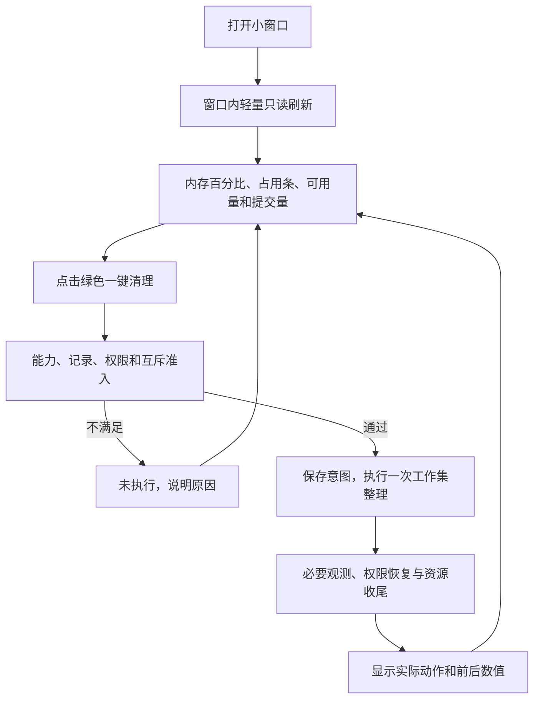

更新日期：2026年10月26日。本文维护开发目标、任务范围、依赖与验收条件。本阶段产品重规划以第七章为准，先确定用户交互、功能范围和流程，再按第八章推进代码。已有优化工作的计划基线来自2026年10月23日的优化实施计划，其完成条目及后续修复见 [开发记录](<开发记录/2026-10-23至24 边界修复.md#四2026年10月23日至24日的优化完成记录>)。后续建议与已有计划基线分别列出，文档中的任务不构成真实运行授权。

# 一、目标与范围
目标是做一个以360资源看板与快捷操作为参考的 CPU、内存桌面工具，让用户看清内存状态，点击一次完成明确的工作集整理并核对结果。三层职责、事实记录和离线验证为这条用户流程提供支撑。

沿用现有三层模块与标准库依赖。任务落实到拥有相应状态的模块，具体职责与源码映射见 [代码结构设计 Code Structure Design](<CPU 内存清理 代码结构设计 Code Structure Design.md#二架构职责到源码的映射>)，需求与质量依据见 [架构设计 Architecture Design](<CPU 内存清理 架构设计 Architecture Design.md#二质量目标推导职责边界>)。

# 二、已有优化工作的计划基线
下表提取原计划的工作目标与验收条件，不重复其完成清单、执行次数和测试通过数。原计划后续按已复现故障扩大了边界检查，实际采用与完成情况以开发记录及测试回执为准。

| **任务** | **对应职责与范围** | **验收条件** | **完成证据入口** |
| --- | --- | --- | --- |
| DEV-01 测试工作进程收尾 | 测试执行器及其自身工作进程，不属于产品运行模块 | 收尾失败保留原结果并阻断放行，中断与超时不丢证据，不影响无关进程 | [运行记录：任务一](<运行记录/2026-10-23 测试与构建.md#任务一测试工作进程收尾>) |
| DEV-02 取消终态与回看归属 | AR-02 流程协调、AR-05 记录访问 | 终态封存后不再接纳无法兑现的取消，记录归属与顺序一致，未知不重放 | [运行记录：任务二](<运行记录/2026-10-23 测试与构建.md#任务二取消终态与回看归属>) |
| DEV-03 指标质量与比较口径 | AR-03 分析解释、AR-04 系统接入 | 未知首拍与持续缺口分别保留，单位与窗口一致，证据缺失不支持收益 | [运行记录：任务三](<运行记录/2026-10-23 测试与构建.md#任务三指标质量与比较口径>) |
| DEV-04 命令行缺口呈现 | AR-01 用户交互 | 文本与结构化结果均能定位样本时刻、序号及读取原因 | [运行记录：任务四](<运行记录/2026-10-23 测试与构建.md#任务四cli-缺口呈现>) |

# 三、后续建议与执行前提
下表保留既有事项与执行前提。当前优先级以第七、八章的内存清理小窗口为准，实机验证后置；已完成的工作只链接独立证据。

| **顺序** | **工作项** | **依赖与执行前提** | **完成条件** |
| --- | --- | --- | --- |
| 1 | 验证分析模块改名后的安装产物 | 基于实际固定源码，在隔离目录离线构建，不复用旧缓存 | 验收条件已由 [10月26日运行记录](<运行记录/2026-10-26 测试结构与文档对齐.md#三干净构建与隔离安装>) 提供证据；后续源码变更按影响重新选择验证 |
| 2 | 准备只读实机验收 | 固定目标提交、操作系统配置、普通权限上下文、资源监管和本次明确执行授权 | 按 [只读诊断验收计划 Read-only Acceptance Plan](<CPU 内存清理 开发计划 Development Plan.md#五只读诊断验收计划>) 逐项记录结果与未覆盖原因，维护零调用独立成立 |

首版不自动增加其他操作系统实现、后台维护、权限帮助进程或 CI/CD。真实维护及收益实验须在只读验收后另行评审范围与授权。

# 四、实施与验收规则
1. 从架构职责与质量场景定位变更，在代码结构设计中确认源码与状态归属。
2. 对缺陷先保存最小离线复现，再在现有状态所有者处修复，检查全部调用方。
3. 同步镜像测试与唯一清单，按影响选择离线计划，保存环境、目标版本、指纹及逐项证据。
4. 必需项失败、缺失、超时或预算失控时保留阻断。中断及关闭异常不能覆盖原事实，未知结果不记为成功。
5. 代码演进摘要写开发记录，具体问题写缺陷记录，详细修复验证、采样、实验、测试与打包执行按日期写运行记录，避免复制多份计数。

真实采样、GUI、维护或权限操作遵守 [项目约定](<../AGENTS.md>) 的当前执行边界。历史命令、计划和假接入通过均不产生新授权。

# 五、只读诊断验收计划
唯一计划正文位于 `tests/manifest.json`：`plans.readonly_offline` 是可执行的离线准备计划，`acceptance_plans.readonly_diagnostics` 是禁用的实机验收草案。后者记录目标、五维、依赖、资源、预算、步骤、预期、证据及离线用例映射，不注册为可运行的 unittest，也不进入 quick、regression 或 `--all` 的执行清单。`--plan readonly_diagnostics` 当前会被拒绝，资源参数不能启用该草案。

## （一）目标与顺序
验收目标为只读数据口径、缺失解释、持久化、界面及生命周期正确性，不判断清理收益。先完成 readonly_offline 和 regression，再在实际执行获明确授权、环境与监管能力齐备后检查实机。维护 API、特权调整、业务进程结束、服务和系统设置变更均不在范围内。实际 GUI 布局可先使用假 Reader，实机只读入口只向 Application 提供 Reader，Maintainer 留空。

| **检查标识** | **定位对象与预期** | **主要证据** | **当前状态** |
| --- | --- | --- | --- |
| ro_default | 默认只读，维护会话和原生维护调用为 0 | 装配、启动参数、运行头与终态 | 未执行 |
| ro_cpu | 首拍未知，后续累计差分正确，处理器组与覆盖不冒充全机 | 时间戳、累计 CPU 时间、处理器信息及参考口径 | 未执行 |
| ro_memory | bytes 与 GiB 一致，物理容量与提交量分开，未知和零可区分 | 同一份原始数据、换算与界面文字 | 未执行 |
| ro_gaps | PDH 预热、不可读项及权限缺口保留原因 | 样本 errors、预热记录和未覆盖条件 | 未执行 |
| ro_processes | top 仅限制排名，CPU 使用全部可读输入，身份与覆盖完整记录 | 进程创建身份、枚举计数及排名 | 未执行 |
| ro_records | 新目录保存，离线回看零系统接入，不完整记录不支持收益 | 样本、运行头、终态、回看退出码 | 未执行 |
| ro_lifecycle | 刷新不重入，取消与关闭以核心收尾为准，关闭后无新派发 | 交互顺序、报告和自身线程收尾 | 未执行 |
| ro_gui | 指标、时间、状态和维护区可辨，缩放与键盘操作可用 | 各缩放配置的图像或人工记录 | 未执行 |
| ro_cost | 记录只读执行的实际墙钟及自身 Job 提交量，不作收益判定 | ms、bytes、方法、样本量和预算状态 | 未执行 |

这些是验收检查标识，未执行项不计入自动化用例通过数。每项映射到已存在的离线回归方法，完整方法 ID 与步骤以清单为准。维护零调用是独立必需条件，读数正常或窗口能打开不能代替该证据。

## （二）环境、数据和预算
草案以当前 `master` 的 `8c0c154` 为比较基线。执行前另行固定实际目标提交、源码指纹、wheel 校验值、Windows 完整构建、Python 版本、体系结构和普通权限上下文，不能复用旧回执冒充当前产物。配置矩阵为 Windows 11 / x64 / Python 3.13 与 Windows 10 / x64 / Python 3.10，当前均未核验。未覆盖配置保留未执行及原因，不能宣称已支持。

只读数据样本固定为 5 拍、1 秒间隔、单工作单元，第一拍保留而不计算不存在的前向差分。跨工具对照记录范围、单位、窗口和读取时差，不给异步瞬时 CPU 百分比编造相等阈值。GUI 的 100%、150%、200% 缩放通过预配置环境或进程内 Tk 缩放检查，不修改系统全局显示设置，每个配置单列结果。

单项按 c2 上限 60 秒 / 2 GiB，每个系统配置整批最多 600 秒，两个配置总预算 1200 秒，并发为 1。准备、采样、保存、收尾和人工交互都计入成本，内存仍为自身测试 Job 的提交量。以上是待落实的执行上限，不是性能合格阈值；控制器和整机内存不在该上限内。监管能力、资源或目标版本未准备好时不能开始实机验收。本轮不新增实机执行器，也不宣称已落实其实机监管。

## （三）证据、判定与阻断
每个配置使用新的独立验证目录，保留实际命令、产物、环境、原始样本、运行头与终态、界面证据、交叉核对口径和未执行原因，沿用第四节结果字段。功能检查有明确断言才记 passed，成本测量只有有效数据时记 measured，不混入质量通过率。无自然条件触发的读取异常保留未覆盖，离线故障注入结果单列。

任一必需项缺失、失败、超时、预算失控或环境不可用，都不能标记该配置验收通过。支持范围、测量完成和性能达标分别判断，当前没有清理或性能改善阈值。准备计划完成只说明具备进一步验证材料，实机检查仍保持 `not_run`。

# 六、2026年10月26日的一致性整理
本轮依据已同步的飞书通用测试规范及本地代码、文档规范开展，不新增通用规范副本。持久目标跟踪文档、源码、测试与脚本的一致性，实际完成与验证另记对应日期记录。

| **阶段** | **处理范围** | **完成条件** |
| --- | --- | --- |
| 文档与合同 | 核对所有现行 Markdown 及历史记录边界，完善架构到源码、测试与脚本的映射 | 当前文档可沿职责追溯到实现与验证；历史事实不被冒充为本次执行 |
| 产品源码 | 核对既有三层模块、分析模块命名、公共入口和副作用边界 | 仅修复确有调用或契约依据的问题，不新增无需求的抽象 |
| 测试结构 | 将共享离线装配集中在 `tests/fixtures.py`，更新使用方 | 镜像目录只放对应测试，辅助职责明确，配置与实际方法一致 |
| 脚本 | 收敛为桌面启动和测试执行两个入口，核对转发、输出位置说明及测试运行入口 | 不复制产品业务逻辑，脚本契约与文档一致，离线验证可定位 |
| 集成验证 | 执行完整离线计划、只读准备计划和干净安装包检查 | 结果、环境、指纹与产物关联，失败保留；真实采样、GUI、清理和权限操作不执行 |

本轮阶段落实情况见 [开发记录](<开发记录/2026-10-26 测试结构.md>)，执行证据见 [运行记录](<运行记录/2026-10-26 测试结构与文档对齐.md>)。只读实机验收继续待授权与环境准备。

按后续确认，测试和脚本精简完成后暂停实施，先重新规划产品方向。当前变更与验证见 [测试与脚本精简记录](<运行记录/2026-10-26 测试与脚本精简.md>)，本计划不自动授权继续界面开发或实机验证。

后续单独授权的配置树试验及其等价性验证见 [测试配置树记录](<运行记录/2026-10-26 测试配置树.md>)；该试验不扩展产品界面开发或实机执行范围，完成后继续等待重新规划。

# 七、内存清理插件的产品基线
2026年10月26日纠正方向：产品目标回归历史提交中的360加速球式一键内存释放小工具。现有历史证据对应独立桌面小窗口，尚没有特定浏览器、编辑器或其他宿主的插件协议。本阶段按此小窗口形态实施，不宣称已有宿主集成。

## （一）核心任务
用户打开后看内存占用，点击绿色“一键清理”，随后看可用量和提交量的前后变化。CPU 看板、占用排名、先诊断再选方案不进入主窗口。

| **功能** | **当前行为** | **边界** |
| --- | --- | --- |
| 内存状态 | 大字号物理占用百分比、占用条、可用量与总量、提交量 | 百分比为总量减可用量后除以总量，未知不补零 |
| 一键清理 | 绿色主按钮固定提交一次系统工作集整理 | 点击就是该次明确执行请求，不清 Standby、不结束进程、不自动提权 |
| 结果反馈 | 实际调用、整体完成度、前后可用量和提交量、记录与错误 | 不把数值变化等同实际提速，不自动重试 |
| 辅助操作 | 刷新内存、取消当前请求、展开详情 | 忙时不排队，关闭时等待必要收尾 |

窗口打开期间约每500毫秒尝试轻量读取内存显示，清理中继续更新，关闭后停止。不建立窗口之外的后台任务，不自动清理。用户不需要先运行诊断、选进程或进入方案页。主窗口不进行进程排名采集。保留的命令行与历史分析工具是辅助能力，不作为使用清理按钮的前置任务。

记录默认保存在当前用户主目录下的 `.cpu-memory-cleanup/runs/`，可由已有启动参数指定其他位置。单次清理在其下创建独立运行目录，记录不可写则核心阻止动作。仅打开窗口不创建维护记录或修改系统设置。

## （二）操作流程

第一版固定工作集方式，实际系统不支持时禁用清理按钮并解释，不自动切换其他机制。清理中的重复点击、刷新和新维护均拒绝，不维护待执行队列。派发前取消可阻止动作，派发后不承诺撤销或回滚。

## （三）历史依据与旧方向处理
`fc26a00` 记录360式一键内存释放目标，`571d29b` 和 `74284f9` 提供小窗口、绿色主操作及内存显示，`00dbcb2` 明确打开只读、点击才释放。此次回到这个用户任务，保留目前核心的事实记录及安全收尾，不以旧提交覆盖当前工作区。

此前以 CPU、内存诊断面板为主的方案已经被本次用户纠正取代。其研究证据和执行记录按原日期保留，不再作为本阶段产品目标。

# 八、当前实现与后续安排
主窗口、主按钮、内存显示及结果区已按本章重写。数值与占用条在实际读数间缓动约400毫秒，未知读数立即显示未知。显示只读线程与单次清理执行分离，均在关闭时收尾。对应假控件和假接入测试同步调整，底层核心与系统安全检查继续保留，验证以本轮运行记录为准。

桌面默认使用 `.pyw` 无控制台入口，CMD 兼容启动改用窗口版 Python。下一阶段先用假数据核对真实窗口的尺寸、文字、进度条、按钮与结果布局，再按单独明确指令安排真实读取或清理。是否进一步做托盘、悬浮球、快捷键或宿主插件，需要围绕实际使用形态确定，不先增加这些功能。测试配置树仅服务必要验证，不作为产品主线继续扩建。
