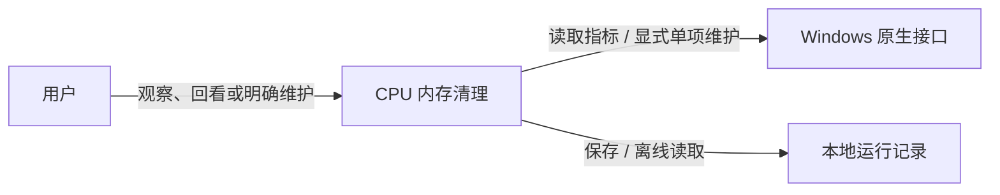
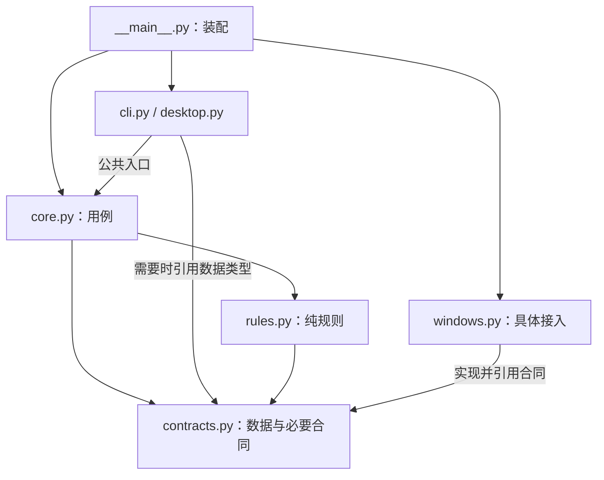
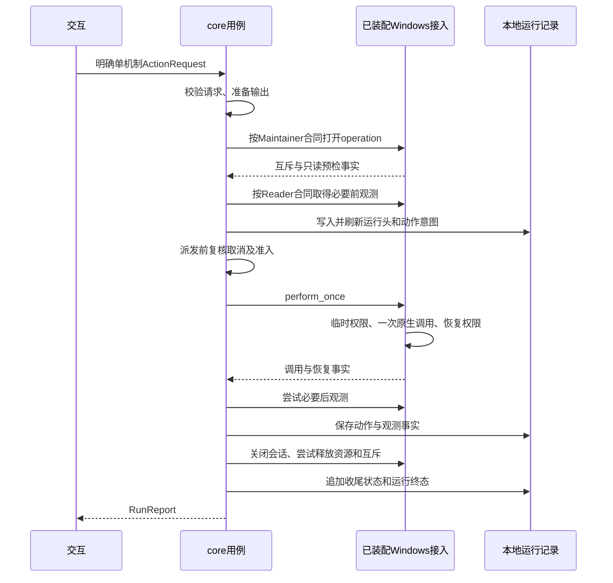
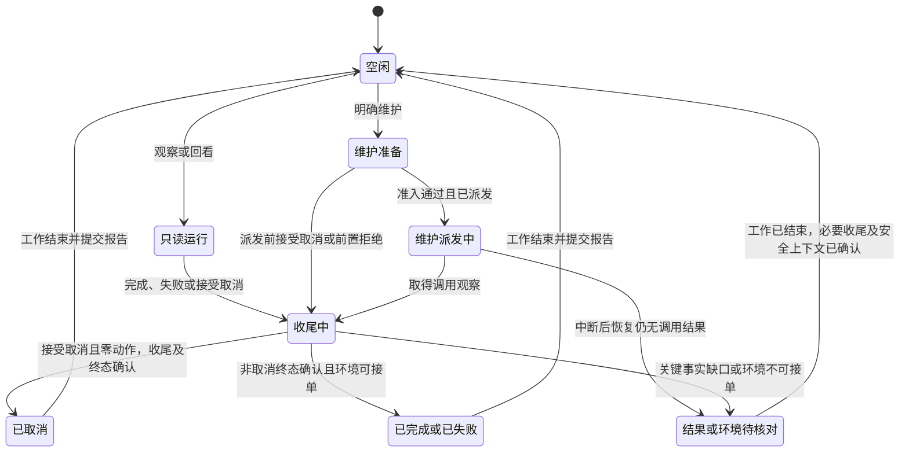

**CPU 内存清理 架构设计**
更新日期：2026年10月21日。状态：目标设计，尚未实施。机制、360 产品证据和历史结果见 [CPU 内存清理 通用调研](<CPU 内存清理 通用调研.md>)。方法依据为项目关联 DreamSoul 文档库《软件架构设计 Software Architecture Design 通用调研》及《端侧智能体案例》，阅读范围见第八章。

# 一、架构驱动力、范围与选择
## （一）目标与系统上下文
用户需要看见并理解 CPU 和内存状态，明确选择一次维护，回看真实结果。CLI 与桌面界面提供一致行为，打开工具和分析历史数据均不触发维护。

这是系统上下文图，箭头表示系统与外部对象的交互，返回值省略。360 是产品参考，不是运行依赖。工具宿主回收、云端服务、任意进程终止、服务控制和系统配置管理不进入首版范围。

现有代码仅用于确认行为和故障反例。模块数量、文件组织和内部调用方式从以下目标重新推导，不以旧目录作为设计起点。
## （二）质量场景决定边界
优先级首先是动作可控、结果真实和可恢复解释，其次是界面响应与改动范围。下列是目标验收条件，不是已测结果。

| **场景** | **触发及期望响应** | **架构决定** | **验收信号** |
| --- | --- | --- | --- |
| Q01 默认只读 | 打开界面、观察、离线回看或解析外部文件 | 交互不直连 Windows，读取合同不包含维护操作 | 维护调用为0，离线 Windows 调用为0 |
| Q02 结果真实 | 原生调用成功后，后观测、恢复或落盘失败 | 用例唯一拥有整体状态，系统只报告原始事实 | 最多1次调用，已成功事实保留，整体不伪报成功 |
| Q03 可追溯 | 中断或版本变化后回看已有运行 | 保存有效参数、版本、观察及未完成状态 | 按原条件回看，未知动作不重放，必要元数据缺失不判收益 |
| Q04 可修改 | 更换 Windows 读取实现而保持合同语义 | 核心依赖合同，接入由装配提供 | 改动限于接入、装配及合同测试，UI和规则不感知新DLL细节 |
| Q05 取消与交互 | 观察中关闭窗口，或维护前请求取消 | 单实例串行派发，用例决定取消是否已生效 | 已接受的派发前取消为0动作，进入调用后仍跟踪结果与收尾 |

时间、内存及性能改善阈值需按目标设备和负载校准，当前不编造“立即取消”或固定加速幅度。Q04只适用于新实现确实满足原合同，能力或语义变化时重新评审合同。
## （三）最小方案与代价
选择单机、单进程的模块化应用。用例承担运行顺序，纯规则承担解释，Windows 接入承担外部技术，两个入口共同使用用例。该选择来自双入口一致性、真实系统调用需隔离测试和离线分析三个实际场景，不以固定层数为目标。

不建设服务、事件总线、通用插件、方案执行平台、SQLite会话库或宿主回收适配层。保留少量共享合同是为了隔离真实副作用和检查替代实现，不为每个函数增加端口。方法裁剪依据见本地架构调研第四、十一至十五、十七章。

# 二、构建块、合同与源码依赖
## （一）黑盒职责与状态权威
| **构建块与目标代码** | **提供能力** | **需要什么** | **独占状态与隐藏细节** |
| --- | --- | --- | --- |
| 交互 cli.py / desktop.py | 输入、明确选择、进度和报告显示 | 用例公共入口 | 只拥有控件和显示缓存，不另判最终状态，不接触ctypes |
| 用例 core.py | inspect、review、maintain | 资源规则、读取/维护合同、本地记录 | 唯一拥有运行ID、阶段、取消处理、整体完成度和持久化顺序 |
| 资源规则 rules.py | analyze、compare | 已校验Sample、条件及版本 | 无跨运行可变状态，只给解释与收益证据，不派发动作 |
| Windows接入 windows.py | 只读会话、单项操作会话 | 共享合同与原生API | 拥有句柄、PDH查询、互斥和特权恢复事实，不宣布产品加速 |

记录是用例拥有的数据格式和内部读写函数，标准logging用于诊断。二者不作为独立产品服务。contracts.py集中三个共享数据及必要接口形状，没有业务流程或可变状态；多个调用方使用同一合同，避免循环导入与重复DTO。
## （二）目标源码依赖

这张图只表示目标源码的导入或类型引用，不表示数据流。运行时用例会调用已注入的Windows接入，源码中不导入具体接入。装配只选择实现和入口，不承载诊断、权限或记录规则。

目标目录、各 Python 文件职责及测试镜像集中维护于 [CPU 内存清理 代码结构设计](<CPU 内存清理 代码结构设计.md>)，尚未实施。源码落位从职责和可检查关系推导，不按旧文件逐一搬迁。

规则：core不导入cli、desktop、tkinter、windows或ctypes；rules的项目内依赖限于contracts，contracts不依赖其它业务模块，两者都不做Windows调用、文件操作或真实时钟读取；windows不导入core及交互。记录IO留在core，Windows原始类型和句柄不越过接入边界。动态导入同样受这些边界约束，静态import检查不能独自证明它们成立。
## （三）用例与数据合同
| **入口** | **输入 → 输出** | **副作用与完成含义** |
| --- | --- | --- |
| inspect(options) | 有界采样要求 → RunReport | 只读系统，按请求保存，不维护 |
| review(path, comparison=None) | 已存数据及对照条件 → RunReport | 只读文件，不查询当前机器，不维护 |
| maintain(request, output_dir) | 明确单机制ActionRequest → RunReport | 唯一维护流程，至多一次原生调用，不自动重试 |

Sample保存运行/序号、时刻、原始指标与单位、CPU累计时间及覆盖、缺失原因和必要进程身份。ActionRequest保存本次机制、真实范围及明确确认来源，不能由分析结果自动生成确认。RunReport保存观测、解释、动作事实、恢复、记录、阶段及完成度，UI只能呈现它。

使用明确字段字典或小型dataclass即可。持久化根记录保留schema_version。CPU记录逻辑处理器数、processor_group、scope、coverage；首拍、非正间隔、身份变化、计数倒退、范围未知或变化均不能补0或跨范围计算。测量定义见通用调研第三章。
## （四）Windows合同的行为语义
同一Windows接入提供两个窄合同，可以用少量Protocol或明确callable表达，不要求继承框架。

| **合同项** | **读取合同 Reader** | **维护合同 Maintainer** |
| --- | --- | --- |
| 输入与范围 | 明确需读的主机/进程指标，不接受维护机制 | 一个已确认机制与实际范围，不接受任意命令或回退机制 |
| 提供操作 | 打开observation会话、read、close | 打开operation会话、只读预检、perform_once、close |
| 返回 | Sample、缺失和读取错误，原生句柄不外泄 | NT状态、是否确认进入、权限恢复及资源收尾事实 |
| 资源责任 | 接入创建及关闭查询/句柄，用例决定节拍与会话结束 | 接入持有限定范围互斥，perform_once内部临时权限及恢复 |
| 并发与重复 | 一个会话按用例顺序读取，不保证原子全机快照 | 同一操作会话最多调用一次，重复调用明确拒绝；争抢不排队 |
| 取消 | 用例在读取间隔停止派发并关闭会话 | 派发边界前接受取消则零动作；进入后端后不承诺强停或回滚 |
| 失败与兼容 | 不可读保留未知，新增字段/覆盖范围核对读端 | 缺权限/不支持则拒绝，不自动提权，后置失败不抹调用事实 |

读取流程只使用Reader合同。维护流程才同时需要Reader和Maintainer。真实接入和假后端必须通过同一合同检查，方法同名不能视为语义等价。这是代码及测试边界，不是恶意代码的OS安全隔离。

# 三、运行、状态与部署
## （一）部署与并发视图
| **运行位置** | **部署内容** | **职责与边界** |
| --- | --- | --- |
| 一台Windows主机、一个应用进程 | CLI或GUI启动方式、用例、规则、Windows接入 | 同进程模块，无网络服务；CLI可同步等待 |
| GUI主线程 | 输入和控件更新 | 只提交请求、展示RunReport，不等待原生调用完成 |
| 有界工作单元 | 一次观察、回看或维护 | 同实例最多一个活动流程，控制取消与收尾，不建通用任务队列 |
| Windows与本地文件系统 | 原生调用、进程当前令牌、独立运行目录 | OS权限和文件权限来自实际安全上下文，模块命名不提供隔离 |

首版不自动提权或安装服务。当前进程没有所需特权时拒绝维护，因此普通权限启动不保证能够清理全局页面。若将来要求普通权限GUI仍能做高权限维护，必须另行设计受限提升帮助进程及IPC合同，不能把它隐藏在当前单进程图里。

GUI的周期观察使用短的有界流程，维护选择先停止后续观察派发，等待当前读取关闭后再进入维护。忙时拒绝重复请求，窗口关闭撤销尚未派发请求。取消只表示请求停止后续工作，只有用例在派发边界前确认接受时才能显示“已取消”。
## （二）只读与一次维护的运行路径
inspect打开只读会话、按有界节拍取得Sample、调用analyze并保存所需观察，最后关闭会话并返回报告。review直接读取已存条件与数据，再回看或明确重算，不打开Windows会话。

这是满足前提的主路径，箭头表示运行调用而非import。进入perform_once前，必要条件未知、输出不可写或取消已接受均为零动作。权限启用失败同样为零动作。调用失败或未知不重试、不换机制。

互斥覆盖必要后观测及动作记录尝试，收尾和终态须包含资源释放结果。取消或窗口关闭不能跳过特权恢复、句柄关闭和动作结果保存。关闭失败须保留错误，不把finally块执行过视为已经恢复成功。
## （三）状态权威与取消边界

用例是唯一运行状态权威。UI保存展示缓存，规则只产生解释，Windows只提供系统事实，记录只保存已确认观察。派发进入Windows接入不代表已进入实际原生维护调用，权限启用仍可能失败。取消与前置拒绝也必须先关闭已取得的会话和互斥，记录必要收尾，才能提交终态。

Unknown不代表原生调用已停止。当前工作仍在执行、资源释放未确认或特权恢复失败时，保留执行句柄与忙状态，阻止新维护；只有工作已结束且必要收尾与安全上下文重新确认后才可接单。展示报告不是解锁条件。重启后review读取的历史未知只是记录事实，不恢复活动任务、不自动重放；新的维护仍须通过当前环境的完整准入。

取消到达Calling之后，保留cancel_requested并完成可做的收尾，不能显示为“动作已撤销”。调用状态、整体完成度与收益是不同维度。completion为success、partial、failed、unknown或派发前确认的cancelled；success只表示必要流程完整，不表示用户任务变快。

| **事实或阶段** | **报告语义** | **继续条件** |
| --- | --- | --- |
| 请求/记录/预检/权限启用失败 | attempted=false，call_outcome=not_started | 返回明确阶段，零动作 |
| 已确认进入实际原生维护调用 | attempted=true，call_outcome为success/failure/unknown | 保留状态码，不重试 |
| 仅有调用前记录，无调用确认 | attempted=null，call_outcome=unknown | 保留不确定，不重放 |
| 调用成功但恢复/必要观测/保存失败 | 调用仍为success，整体partial或unknown | 不伪报未执行或全成功 |
| 已有调用结果但缺运行终态 | 保留已知调用，整体未确认 | 不用整体unknown覆盖已知事实 |

只协调明确覆盖的本项目实例，用户会话内互斥不等于跨用户、会话或外部清理器的系统级互斥。跨会话场景须先定义Global命名空间、访问控制和共享状态，能力不足则阻断。首版无自动重复维护，也不编造持久化冷却阈值；频率限制须先按场景校准。

# 四、输入、记录与恢复
## （一）只保留必要记录
每个实际保存的运行使用独立目录。一份 samples.jsonl 保存测量，一份 operation.jsonl 保存动作意图与结果，报告由它们重建。无动作运行不创建空动作文件。两类业务数据由流程负责，日志用于排错，三者不需要独立存储框架。

在 samples.jsonl 内以 record_type 区分运行头、样本、分析结果和运行结束记录。运行头保存 schema_version、程序/规则版本、环境与构建、有效采样/分析/比较参数及预期次数和间隔。结束记录保存正常完成/取消/异常、实际次数和缺口，缺结束记录即为未确认完成，不能由样本数猜测正常结束。operation.jsonl 保存本次机制、范围及确认来源，并关联同一运行头。

离线回看使用已存参数和分析结果，不查询当前环境或悄悄套用新版默认值。需要用新规则重算时另记版本、条件与新结论，不覆盖原结论。必要元数据缺失则报告不完整，不能支持收益。上述信息仍写入现有记录，不新增领域对象或存储模块。

动作意图在调用前刷新，实际结果在确认后保存。写入结果不会与 Windows 调用组成事务，fsync 也不能保证恰好一次。缺调用确认时动作未知，缺运行终态时完成状态未确认，已保存的调用事实仍保留。恢复只识别已完成、未完成与需核对部分，不回放动作。普通诊断 sink 失败不能改变业务事实，必要业务记录不可写则阻止动作。

不重建已删除的历史 logs。目录、容量、保留期、文件权限与清理责任在实际运行计划中明确。日志按规范保留 timestamp/level/event/logger/message/app_name/app_version/runtime_id/process_name/pid 等来源字段，可选未知字段省略，排除凭据、正文、命令载荷和个人目录。
## （二）信任边界
输入参数、文件和 Windows 返回值都检查实际必需条件：形状、版本、有限数值、单位、合理范围、来源、大小和数量上限。bool 不充当数值，NaN/Infinity 不进入统计，错误定位到字段或行。上限按实际功能明确，不用通用配置体系替代校验。

实时跟随可等待半行并报告坏行，离线分析不得静默丢弃损坏后宣布数据完整。缺样、重复序号、混合运行和不兼容采样范围分别记录，不能拼成连续有效窗口。

# 五、技术方法与效果验证
## （一）机制选择
| **对象与方法** | **首版设计定位** | **必须说明** |
| --- | --- | --- |
| CPU 消耗归因、减工作量与应用协作建议 | 分析规则的一组函数 | 有用计算、竞争和等待分开，不以低 CPU 推定可关闭 |
| 工作集整理 | 显式单项实验机制 | 改变驻留，提交量不保证下降，后续可能缺页或回写 |
| Standby 维护 | 另一种显式单项实验机制 | Standby 已计入可用，Free 上升不等于新增收益 |
| 应用释放、正常退出、优先级、EcoQoS、Job 配额 | 技术候选，取得实际对象与接口契约后再决定 | 当前不创建空执行器或任意进程接管能力 |

CPU 首版只做诊断与建议，原因是尚无可安全接管的应用工作及保存/恢复契约，不能由“CPU 高”决定外部关闭。该边界来自能力证据，不由现有函数是否实现决定。宿主引用、队列和保存契约仍作为通用调研的独立问题，不进入本产品核心依赖。

首版维护请求一次只选一种机制，没有默认 both 或后台组合。现有命令的组合和参数属于现状，实施时需要单独决定弃用、报错或保留兼容，不能在重构中暗改语义，也不能为保留旧文件强制新架构接受多步计划。
## （二）怎样判断效果
普通运行展示可取得的前后变化，不据此宣布加速。收益需要同负载对照、应用吞吐或响应、CPU 时间、提交与驻留、缺页、I/O 和恢复窗口。数据覆盖不到的指标不作结论。

A/A、A/B 和校准只是验证安排：由验证流程按顺序调用相同 inspect 与 maintain，再交 compare 计算，不成为新的生产执行模块。失败或未知动作停止后续实验，动作未完整成功、权限未恢复、少拍、混 run、缺必要速率或校准时不能支持收益。实验意图及方案先保存，异常和中断仍能识别未完成窗口。

每次真实实验预先固定负载、构建、权限、机制、窗口、阈值、重复与恢复条件，不在看到结果后调整门槛。0.5 GiB、1.5倍及历史窗口长度只是旧提案，无原始日志的历史结果不能重算，不能代替新校准。

# 六、与模块对应的验证设计
## （一）先验证行为边界
测试依照最终实际源码完整镜像，层级使用 unit/integration/e2e 标签，不用这三个名称建立额外一级目录。排除项及理由登记 tests/README.md，最小合成数据和假后端只在真实复用时共享。目录镜像随实施落位，不从旧文件清单倒推架构。

| **验证对象** | **重点输入与故障** | **必须取得的信号** |
| --- | --- | --- |
| 交互，unit/integration | 无参数、明确维护、重复点击、窗口销毁、中文路径 | 默认只读，各入口同一请求同一结果，动作中不重复提交，不写已销毁控件 |
| 分析 CPU，unit | 首拍、零间隔、PID复用、计数倒退、多组/超过64处理器、覆盖未知或变化 | 同单位计算，单核/组内/全机口径分开，未知不作0或全机 |
| 分析内存，unit | Standby大、提交增长、共享页、缺指标、阈值边界 | 解释正确，CPU问题不推荐自动清页，残差不作可回收量 |
| 纯比较，unit | 工作集降而提交不变、CPU降但有效吞吐降、少拍/混run/无校准 | 保留数值、范围与代价，证据不足不支持收益 |
| 只读流程，integration | 有界节拍、提前取消、异常、半行/坏行、文件不可写 | 资源关闭、缺口完整，动作 spy 始终为0 |
| 单次维护，integration | 缺确认、机制/范围不符、互斥忙、预检未知、启用失败 | 零原生调用，不回退或换机制 |
| 单次维护后置失败，integration | NT失败/未知、恢复失败、后读取失败、结果写失败 | 一次调用上限，保留事实及所有相关错误，整体不伪报成功 |
| Windows 边界，unit | 假 DLL 状态、LastError、句柄与查询关闭、原有特权、互斥范围 | ABI/状态处理正确，恢复原状态，只有明确范围内协调 |
| 记录与恢复，unit/integration | 截断/写满、控制字符、敏感异常、缺最终确认或运行头、默认值和版本变化 | 按原条件回看并区分新分析，元数据缺失不支持收益，未知不重放，日志故障不抹事实 |
| 用户旅程，e2e | CLI或GUI诊断到结果、一次明确维护、离线回看 | 外部输入到可见结果完整贯通，维护使用假后端，不称真实系统E2E |

每行实施为多个单信号用例，分别赋予稳定 test_id，不用一个大断言覆盖整行。真实平台接口、GUI环境和实际交付产物需要另外明确条件和执行范围。本轮不运行它们。
## （二）分开验证结构、合同和场景
目标源码落位后，先检查core/rules/contracts不导入具体Windows或UI实现、交互不导入Windows，以及Windows不反向引用core。可先人工复核与少量AST规则验证关键边，出现重复维护成本后再采用依赖检查工具。导入检查不代替真实调用与数据泄漏检查，不为图形符合性引入完整建模平台。

| **场景及关联目标** | **目标路径** | **关键验证** |
| --- | --- | --- |
| 默认观察与离线回看，Q01/Q03 | cli或desktop → core → rules，观察另用Reader | 假Maintainer调用为0，离线Reader调用为0，原参数与版本不被替换 |
| 调用成功后读取失败，Q02 | core → Maintainer → Reader故障 → 记录 → 报告 | 仅1次原生调用，调用success保留，整体不完整 |
| 取消与重复请求，Q05 | UI → core派发边界 → 维护或拒绝 | 派发前接受取消后完成必要收尾，零动作；派发后不丢失收尾，活动或安全上下文未确认时持续拒绝新维护 |
| 替换采集实现，Q04 | 新windows实现 → 原Reader合同 → core/rules | 同一合成合同数据取得一致解释，缺能力明确拒绝，不把新后端字段传进UI |

Windows读取与维护分别做合同测试，真实接入还需在明确平台条件下验证ABI、权限及资源关闭。假后端路径通过不代表这些真实条件已验证。Mermaid解析、源码依赖、接口合同和运行场景分别报告结果，不互相代替。
## （三）落实测试规范的最小方案
保留 unittest，统一入口只做选择、条件检查、执行和保存结果，不作为产品模块。不开发插件系统、任务平台或自建通用资源监督器。缺少现成入口时，以小型 scripts/run-tests.py 适配 TestLoader/TestResult，元数据和计划由唯一 tests/manifest.json 提供。

每项声明五维：level、type、cost_class、result_type/result_detail、priority。level、type、priority 各为互斥单值；location 仅用于 unit，结果类型只有 categorical/numeric。展开参数和 subTest 后每项有独立 ID 与每次 attempt 结果。支持按计划、文件、方法、目标、标签及五维筛选，执行前展示必需清单。

| **计划** | **触发、选择与依赖** | **初始预算、资源及输出** |
| --- | --- | --- |
| quick | 改动后先校验清单，选受影响 P1/P2且已知 C1的离线项 | 串行，整批60秒/256 MiB起点，无网络、GUI或真实OS调用；分类概览及失败证据 |
| regression | quick后检查共享调用、持久化和失败路径，选必需C1/C2 | 串行，整批600秒/2 GiB起点，仅合成文件与假OS；数值至少metrics |
| platform | 平台、GUI或交付变更确需验证且条件齐备，依赖相关离线项 | 固定Windows/运行时及受控资源，逐项声明单项/批次预算；保留真实范围、产物和成本 |

预算是待实测的起点，不是测量结果。计划必须记录展开选择、必需项、依赖顺序、配置矩阵、资源要求与实际 resources、单项与整批预算、并发、结果粒度、停止/重跑规则和超时责任方。只写计划名不能执行。需要硬超时或内存约束但环境无法落实时，执行前阻断相关计划，不能用事后计时冒充监管。
## （四）结果与放行
每轮独立保存 manifest.json、events.jsonl、可重建 report.md 及必要 artifacts。manifest 记录 plan_id、计划正文、batch_cost_class、实际提交/脏变更依据、目标基线、命令、环境/依赖、environment_id、已选/必需/未执行项、配置矩阵、resources、预算及估计/实际成本和共享准备。

逐用例沿用规范字段：run_id、attempt、test_id、level、type、priority、tags、target、result_type、plan_id、cost_class、result_detail、environment_id、verdict、category、metrics、cost、status、duration_ms、started_at、failure、artifacts。结束后立即追加并刷新，报告可从磁盘重建，中断也保留部分结果。

有质量断言才使用 passed/failed 与 pass/fail。纯测量有效为 measured、verdict=null，无质量映射的分类为 completed；初始化/采集/清理异常为 error，未完成超时为 timeout，跳过为 skipped，xfail/xpass 需有缺陷依据。失败与teardown再失败都保留，不能丢失最初原因。numeric 超时仍为 numeric，不改变信号类型。

必需项 failed/error/timeout、缺结果或不允许的 skipped 均阻断。纯测量完成不算质量通过，阻断缺陷不能以 xfail 豁免。结果和报告写不出时入口非零，不能报告验证完整。报告区分用例数、尝试数、采集完成、质量通过与交付放行，列明未覆盖范围。

# 七、实施与交付
## （一）关键设计决定
以下为待实施的设计决定，裁剪本地资料的ADR做法，保留在本文，不另建决策文件群。

| **决定与背景** | **选择及替代方案** | **代价与升级条件** |
| --- | --- | --- |
| A01 小型本地工具，无独立服务需求 | 单进程模块化，暂不增加提升帮助进程或服务 | 缺特权即拒绝维护；确需普通权限GUI完成高权限任务时再设计受限IPC和隔离 |
| A02 双入口且需离线验证真实副作用 | 用例依赖共享合同，Windows接入由装配提供；不让核心直连DLL | 少量合同及装配成本；新能力无法满足旧语义时修改合同，不静默统一 |
| A03 调用与文件没有统一事务 | 记录意图、系统观察与终态，未知不重放；不建立事件溯源平台 | 中断后可能需人工核对；只有具体可查询/幂等机制成立才研究自动恢复 |
| A04 方法与实验范围有限 | 单机制请求、普通函数规则，对照复用相同用例；不建通用策略/任务系统 | 多种真实扩展重复且有稳定共同语义时再拆模块，不能以未来可能需要作为依据 |

每个新层、接口或进程都说明解决哪个场景、不增加的代价、持续维护成本及复核条件。当前没有真实频率和工时证据，不估算虚假的技术债金额或偿债收益。
## （二）按用户旅程落地
| **增量** | **交付行为** | **完成条件** |
| --- | --- | --- |
| 1. 观察与离线解释 | CPU/内存数据口径、只读采集、纯分析与回看 | 合成数据可定位地验证，读取失败保留未知，所有只读旅程零动作 |
| 2. 单次维护闭环 | 明确单机制请求、真实范围、互斥/权限、意图及结果 | 全部前置拒绝零动作，最多一次原生调用，后置失败不抹事实，未知不重放 |
| 3. 两个入口一致 | CLI和桌面只调用三个流程入口 | 默认只读，选择和退出语义一致，关闭/重复请求正确 |
| 4. 平台与效果验证 | 受控平台、实际产物和必要对照 | 环境/预算/授权齐备，有原始证据和恢复说明，必需项缺失不放行 |

每个增量同时实现相应测试、状态归属与结果保存，核对源码依赖和运行视图一致，规范适配按需要补齐。现有算法只有通过新契约的合成数据和行为检查后才考虑复用，不先列旧文件到新文件的迁移表。需要保留的外部命令和数据格式逐项确认，旧调用关系、错误成功判定和文件组织不作为设计依据。
## （三）本地验证与 CI/CD
验证关联实际提交、变更和目标基线，先低成本关键用例，再扩展必需平台范围。当前没有配置的流水线不能称 CI 已通过，不自动创建分支、启用 Actions、改变保护规则或发布。

未来 CI 复用同一最小入口和结果协议，失败、中断、超时及漏收集均阻断。发布还需关联实际交付文件、版本、校验值、目标平台启动和核心旅程证据。没有产物就不虚构发布验收。

# 八、学习来源与维护
本设计依据项目关联的DreamSoul文档库以下资料。目录为相对于实际关联资料库的逻辑位置，不能固定个人盘符。

`研发/研究/软件开发 Software Engineering/软件架构设计 Software Architecture Design/`

| **本地资料** | **实际阅读与采用** | **证据边界** |
| --- | --- | --- |
| 软件架构设计 Software Architecture Design 通用调研.md | 主报告正文，重点第三至六、十一至十五、十七至十八章；采用驱动力、黑盒合同、多视图、验证和简约取舍 | 是本地对原始方法的整理，本文做项目裁剪，不声称正式ATAM评估或标准符合性 |
| 软件架构设计 Software Architecture Design 端侧智能体案例.md | 案例正文，重点第四至九章；采用状态唯一归属、取消/未知语义、部署边界和决策记录 | 不照搬模型路由、工具平台或多进程架构，不视为本工具已实现能力 |
| 软件架构设计 Software Architecture Design 来源索引.md及大纲 | 核对方法分类、S01至S09及架构/质量条目的阅读范围 | 原标准、论文和上游源码未在本轮逐项重新精读，不把索引当原文阅读 |

上述资料日期为2026年10月21日，本轮本地读取。软件架构方法及采纳映射亦记于通用调研M01至M03，避免与CPU/内存机制重复研究。

研发规范入口：[代码](https://dreamsoul.feishu.cn/docx/FKrsdHO9bolq4YxV2KAcosghnme)、[测试](https://dreamsoul.feishu.cn/docx/KE4IdW6EWoKdvExSkdvcjTJFnsf)、[日志](https://dreamsoul.feishu.cn/docx/RBlFdcSSBo93q9x6p8kcdU6wnYb)、[CI/CD](https://dreamsoul.feishu.cn/docx/NrJ4d0WVGo9t4uxAVwScFTBVnRb)。规范正文与实际阅读范围见通用调研第十、十一章。

本文维护目标架构与测试约束，代码结构设计维护目录和文件职责，通用调研维护机制、来源和实际证据。设计变更同步合同、图、源码与测试落位及验证条件。目标设计尚未实施。图语法验证不等于实现正确，飞书呈现仍需原生“文本绘图”及实际回读核验。
