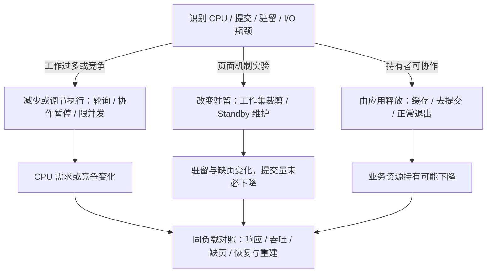
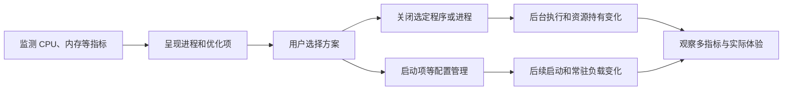
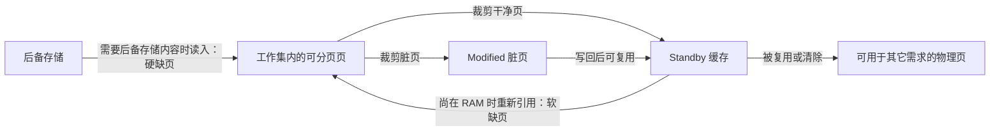
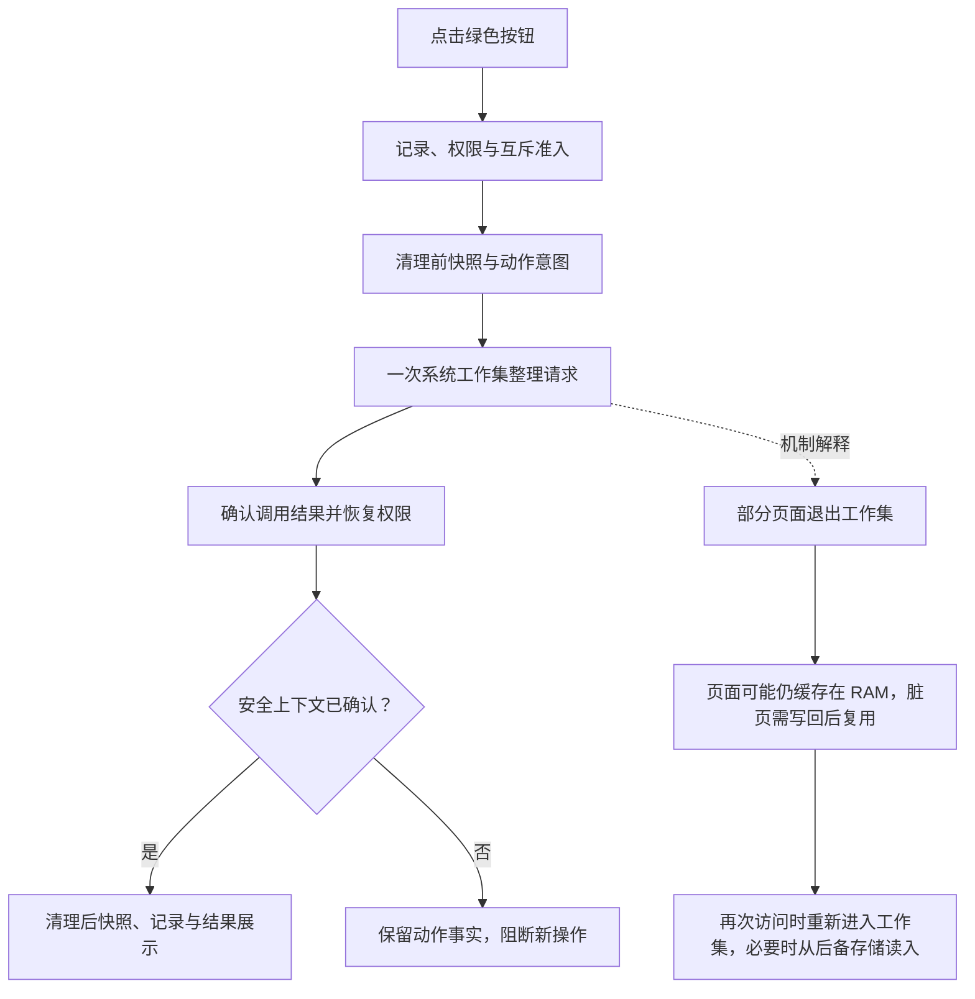

机制资料信息截止：2026年10月21日。360 公开页面与本仓库界面源码于2026年10月26日定向复核，具体范围见第二章第三节。本文研究技术机制、工具比较、方案取舍及证据限制，不维护代码演进或逐次运行结果。2026年10月27日补充当前按钮的源码调用链，并定向复读三篇 Microsoft 机制与接口文档，范围见第四章第五节。未执行主机实验。设计输入见 [架构设计 Architecture Design](<CPU 内存清理 架构设计 Architecture Design.md>)，资料入口见 [项目协作约定](<../AGENTS.md>)。

# 一、研究目标、范围与技术全景
## （一）核心问题
本项目研究 Windows 上如何诊断并减少 CPU 与内存带来的资源压力。360 安全卫士 PC 端加速球和优化加速是主要产品对照，Windows 官方机制与可读开源实现用于解释技术路线。读者是项目开发者和使用者，输出用于选择方法、设计模块和确定验证方式。

| **问题** | **需要回答** | **主要证据** |
| --- | --- | --- |
| Q1 360 做了什么 | 展示、分类、程序关闭、启动管理分别怎样作用，哪些内部细节未知 | 360 官方产品页、2025隐私政策、历史官方产品说明 |
| Q2 CPU 怎样治理 | 如何采样归因，减工作量、优先级、EcoQoS、配额分别解决什么 | Microsoft CPU/调度文档及公开应用生命周期机制 |
| Q3 内存怎样清理 | 应用释放、工作集、Standby、Modified、提交量的区别和代价 | Microsoft 文档与固定提交的开源动作实现 |
| Q4 方法如何用于本项目 | 各路线需要哪些输入、能力与安全条件，哪些结论仍缺验证 | 接口契约、固定提交源码、历史缺陷与验证限制 |
| Q5 怎样评估 | 指标下降是否改善响应，怎样对照、恢复、测试和阻断不完整结果 | 历史 A/A、A/B，计数器定义与研发规范 |

平台为 Windows 10/11 PC。CPU 研究包含负载治理，不将 CPU 硬件缓存作为清理对象。内存研究包含物理驻留与提交。磁盘垃圾、自启动、服务和应用关闭用于解释竞品及候选技术，本轮不扩展执行能力，不安装运行 360，不采样主机、不结束进程、不变更系统设置。
## （二）技术全景与主要结论

图1：依据第二至五章一手来源绘制的分析示意，Mermaid 源码直接维护于本文。箭头表示方法到资源变化及复测的关系，逻辑框不代表独立进程，也不代表 360 的内部实现。

CPU 治理应先识别谁在持续执行什么，再减少不必要工作或调整竞争。内存页维护主要改变驻留，应用协作释放有机会减少业务持有资源。360 提供的是多类优化组合，不能仅用“清空 Standby”解释整个产品。本项目优先采用 CPU 归因与内存观察，页面维护按单一机制、明确确认和独立效果验证处理。方法适用条件见第六章。

收益必须同时看响应、吞吐、恢复和副作用。工作集下降、Free 上升、综合分下降或 CPU 百分比降低，单独都不足以证明用户任务更快。

# 二、360 的产品行为与可确认机制
## （一）产品与版本边界
研究对象是 PC 端 360 安全卫士的加速球及优化加速。安全浏览器、极速浏览器和手机卫士分别是其它产品，下载目录名称也不能用来确定研究对象。未安装或核验当前二进制构建，公开页面按自己的版本与日期使用。

| **产品能力** | **直接来源确认的行为** | **技术含义与未知** |
| --- | --- | --- |
| 资源看板 | 产品页展示 CPU、内存、温度与网速，极速版2022主帖描述看板和入口改版 | 是观察与交互，不直接证明使用某个清页 API。[360 清理加速产品页](https://weishi.360.cn/clear/)、[极速版加速球说明](https://bbs.360.cn/thread-16074034-1-1.html) |
| 智能显示值 | 12.0说明将 CPU、内存、I/O、网络按场景组合，可切换内存值 | 2018历史显示契约，权重未公开，不等于内存占用百分比。[12.0 智能数值说明](https://bbs.360.cn/thread-15621325-1-1.html) |
| 清理运行软件 | 2025政策说明加速球可关闭不用的进程，2019教程说明用户选择待结束程序 | 减少后台工作与资源持有；实际关闭 API、是否优雅退出未知。[360 安全卫士隐私政策](https://weishi.360.cn/privacy.html)、[电脑卡慢优化方案](https://www.360.cn/n/10778.html) |
| 启动与持续负载管理 | 公开列有软件、自启、服务等管理及优化恢复记录 | 针对后续启动和常驻工作，不是一次页面整理。[360 清理加速产品页](https://weishi.360.cn/clear/)、[360 安全卫士隐私政策](https://weishi.360.cn/privacy.html) |
| 页面整理细节 | 上述来源未披露完整算法和调用路径 | 不把 EmptyWorkingSet、全局 NT 命令、申请大块内存等猜测写成 360 已确认实现 |

直接依据：[产品页](https://weishi.360.cn/clear/)、[2025隐私政策第7节](https://weishi.360.cn/privacy.html)、[2019优化教程](https://www.360.cn/n/10778.html)、[12.0智能值说明](https://bbs.360.cn/thread-15621325-1-1.html)、[极速版看板说明](https://bbs.360.cn/thread-16074034-1-1.html)。
## （二）从行为理解实现路径

图2：根据官方公开行为绘制的产品流程示意，覆盖范围分别由 360 产品页、隐私政策、优化教程和12.0智能值说明（链接见本章） 支撑，未复原内部分类算法、结束方式、时序或清页实现。减少后台工作可能降低 CPU，进程退出可能释放其私有资源，具体变化须按负载测量。

2025年隐私政策记载优化功能会读取并上传部分启动、服务和任务信息，因此不能笼统沿用旧资料的“所有优化都仅在本地”结论。PC 当前保护白名单、自动选择规则、清页算法和各模式收益仍待版本核验。手机清理忽略名单不能填补 PC 证据缺口。[政策第7节](https://weishi.360.cn/privacy.html)
## （三）本项目可采用的产品思路
采用独立可见指标、诊断说明、候选方案、用户选择、实际结果和复测的闭环。每种动作明确作用范围、前提、权限、可逆性和预期信号。综合评分若无公开规则和校准就不加入首版。程序关闭、启动项、服务变更均保留为技术比较，当前项目不据此执行或新增通用进程清理器。

## （三）2026年10月26日的产品交互复核
### 1. 本次实际读取的来源
| **来源与范围** | **可确认内容** | **本项目采用方式** |
| --- | --- | --- |
| [360 清理加速产品页](https://weishi.360.cn/clear/) 的优化加速、悬浮加速球章节 | 页面说明资源监控、进程分类、方案入口，以及启动和服务等管理范围 | 借鉴状态、来源和快捷操作的组织，不推断内部清页算法 |
| [360 安全卫士隐私政策](https://weishi.360.cn/privacy.html) 的日期及第7节 | 页面标注2025年9月8日，说明优化条目、记录恢复及加速球关闭进程等产品行为 | 进程关闭和系统配置管理与页面整理是不同路线，首版不提供前两类执行 |
| [本仓库绿色按钮版本](https://github.com/DreamSoul-AI/cpu-memory-cleanup/blob/571d29b7b3216edf2c8b6209cad055c28a8a8782/cpu_memory_cleanup/desktop_ui.py) | 源码定义大字号内存值、进度条、绿色“一键加速”按钮和前后结果，按钮调用工作集整理 | 恢复醒目主操作和结果反馈，不恢复该版本直接调用、无确认的行为 |
| [后续平滑显示版本](https://github.com/DreamSoul-AI/cpu-memory-cleanup/blob/74284f94129b559516a5ef987f1ce63e493772a1/cpu_memory_cleanup/desktop_ui.py) | 源码按物理总量与可用量推导占用百分比，并加入缓动 | 数值口径可复用，动画只影响展示，不能制造观测变化 |
| 本轮重写前的桌面源码 | 有诊断刷新、取消和维护按钮，以及三张指标卡，但维护方式默认选中、操作与目录选择合并，缺少诊断到方案的呈现 | 现状用于识别交互差距，不据现有控件反推产品范围 |

访问日期均为2026年10月26日。360 公开页为 HTML 正文阅读，产品页带历史版权和版本素材，不能据此确认当前安装包的精确布局、按钮颜色或行为细节。仓库历史与当前界面为源码阅读，没有启动历史版本、当前产品或360，也没有取得真实屏幕截图。

### 2. 回到一键内存释放的产品目标
历史提交 `fc26a00` 的目标说明明确为360加速球式一键内存释放，`571d29b` 和 `74284f9` 实现内存小窗口，`00dbcb2` 保持打开只读、点击按钮才释放。它们共同说明主要用户任务是查看内存、执行一次整理、查看前后数值。上一轮将 CPU 诊断、排名和方案选择提升为主流程，偏离了这个目标，本轮予以取代。

当前产品采用紧凑内存窗口、绿色主操作和直接结果反馈。CPU 机制研究与历史分析作为辅助资料保留，不作为使用主按钮的前置。主按钮固定工作集方式，打开只读，点击形成一次明确请求，底层继续保留记录、准入、权限恢复、互斥、取消和未知不重放。

这种交互定位不改变机制证据：工作集整理不保证降低提交量或改善任务速度，360 的进程关闭等能力也没有在本项目实现。首版不结束进程、不修改服务或系统设置，不将尚未定义的宿主插件协议声称为已实现集成。当前范围见 [开发计划](<CPU 内存清理 开发计划 Development Plan.md#七内存清理插件的产品基线>)。

# 三、CPU 负载治理的方法与实现
## （一）先测量和归因
CPU 是单位时间内执行工作的能力。治理对象是计算需求、唤醒与调度竞争，没有一个对应 RAM 缓存页列表的“CPU 可清空容量”。进程占用先按稳定身份进行同窗测量：两次 `GetProcessTimes` 的内核加用户累计时间差，除以实际间隔。所有线程累计时间可以大于墙钟时间，需分别标注单逻辑处理器等价值和全机归一百分比。首拍、非正间隔、身份变化及读取失败保留未知。[GetProcessTimes](https://learn.microsoft.com/en-us/windows/win32/api/processthreadsapi/nf-processthreadsapi-getprocesstimes)

系统 `GetSystemTimes` 的 Kernel 包含 Idle，忙碌比例使用同窗增量 `(ΔKernel + ΔUser - ΔIdle) / (ΔKernel + ΔUser)`，时间单位相同且分母须大于0。超过64逻辑处理器时该 API 只覆盖调用线程所在的主处理器组，未确认覆盖范围不能标为全机。PID 加创建时间避免复用，同名进程不合并为单个所有者。[GetSystemTimes](https://learn.microsoft.com/en-us/windows/win32/api/processthreadsapi/nf-processthreadsapi-getsystemtimes)

CPU 排名提供消耗线索。热点、调用栈、Ready 等待、DPC/ISR 和用户关键路径需要 WPR/WPA 等进一步归因。高占用可能是有用计算，低 CPU 也可能正在等待 I/O，是否需要处理取决于任务和体验。[CPU Analysis](https://learn.microsoft.com/en-us/windows-hardware/test/wpt/cpu-analysis)
## （二）方法比较
| **方法** | **如何实现** | **目标与代价** | **本项目定位** |
| --- | --- | --- | --- |
| 减少实际工作 | 降低无必要轮询、减少重复计算 | 可减少计算需求，但可能影响时效或增加缓存 | 首要诊断与建议路线，应用决定业务取舍 |
| 限制并发与工作节奏 | 减少同时执行任务数、分批调度 | 平滑资源竞争与峰值，不保证总计算量下降 | 应用协作的节奏控制，需复测完成时间 |
| 应用协作暂停/正常退出 | 持有者在可保存、可恢复边界停任务或释放实例 | 同时影响 CPU 与内存，需完整状态契约 | 取得受支持接口前为仅建议 |
| 调低优先级 | SetPriorityClass 改变相对调度顺序 | 可缓解前台竞争，空闲时仍可持续占用 CPU | 可研究的调度选项，不等于减少总工作 |
| EcoQoS | ProcessPowerThrottling 提示非关键工作按节能策略执行 | 影响选核与频率，可能延长后台任务 | Windows 11 的 EcoQoS 需版本准入，函数的 Windows 8 支持不能代替该能力支持 |
| Job CPU 配额 | 受管理 Job 的权重或 CPU 硬上限 | 上限可限制调度时间，代价是吞吐或延迟；既有 Job/嵌套关系要核对 | 只适合项目拥有的受管理任务，不接管任意业务进程 |
| 外部强制挂起 | SuspendThread 停止线程执行 | 可能停在持锁和未保存状态，官方主要定位调试器 | 不作为本项目通用优化路线 |

接口依据：[优先级](https://learn.microsoft.com/en-us/windows/win32/api/processthreadsapi/nf-processthreadsapi-setpriorityclass)、[EcoQoS及版本](https://learn.microsoft.com/en-us/windows/win32/api/processthreadsapi/nf-processthreadsapi-setprocessinformation)、[Job配额](https://learn.microsoft.com/en-us/windows/win32/api/winnt/ns-winnt-jobobject_cpu_rate_control_information)、[线程挂起](https://learn.microsoft.com/en-us/windows/win32/procthread/suspending-thread-execution)。这些方法未在当前项目实现或执行。
## （三）公开应用协作实例
Chromium 页面生命周期将冻结与丢弃分开。冻结限制可冻结队列中的定时器和回调工作，丢弃卸载页面，回来时需要恢复或重新加载。两者分别说明减少工作与释放资源的不同路径，页面持有者必须准备状态。这是公开技术实例，不能据此宣称 360 使用相同策略或当前浏览器工具连接可直接丢弃。[Page Lifecycle API](https://developer.chrome.com/docs/web-platform/page-lifecycle-api)

# 四、内存清理的对象、方法与代价
## （一）指标与机制
`PhysicalAvailable` 为可立即复用的 standby、free、zero 页之和。`CommitTotal` 在提交时变化，驻留与提交分开。容量字段按页大小换算，复合系统缓存不能重复相加。[Microsoft 指标定义](https://learn.microsoft.com/en-us/windows/win32/api/psapi/ns-psapi-performance_information)

工作集描述当前驻留的可分页页。共享页面不能跨进程简单求和。移出工作集后的页面可能继续缓存在 RAM，脏页在复用前要回写。重新访问是否需要读盘取决于页面状态。[Microsoft 工作集说明](https://learn.microsoft.com/en-us/windows/win32/memory/working-set)

| **路线** | **公开契约与操作范围** | **代价及采用条件** |
| --- | --- | --- |
| PSAPI/PDH 只读观察 | 读取主机容量与速率，可作为只读观察路线 | 有采样时差与读取缺口，不提供工具所有权 |
| `EmptyWorkingSet` | 有公开文档，指定进程句柄需要查询权限与 `PROCESS_SET_QUOTA` | 是独立的逐进程路线，不能用它证明全局 NT 命令的权限或支持范围。本项目不新增逐 PID 释放 |
| 全局内存列表命令 | 可见实现使用类80及命令2、4，需要按构建和特权验证 | 对整个系统页面列表生效，没有业务进程排除保证，保留为显式实验后端 |
| 宿主正常释放连接 | 根据业务引用和正常关闭契约回收工具 | 需要宿主证据及接口，不由 Windows 内存列表代替 |

`NtSetSystemInformation` 函数本身存在 Microsoft 官方说明。该说明没有给出 `SystemMemoryListInformation=80`、命令2和4的稳定支持契约，因此准确边界是“函数有文档，当前内存列表信息类与命令不具备该页给出的 SDK 支持保证”。不能笼统称整个函数完全未文档化，也不能将代码注释中的“publicly documented commands”作为 ABI 依据。[函数说明](https://learn.microsoft.com/en-us/windows/win32/sysinfo/ntsetsysteminformation)、[逐进程接口](https://learn.microsoft.com/en-us/windows/win32/api/psapi/nf-psapi-emptyworkingset)
## （二）应用释放与页面维护的差异
应用知道对象、任务和缓存是否还会使用。释放应用对象后，分配器可能保留内存池，因此系统提交量不保证立即下降。持有者调用 `VirtualFree(MEM_DECOMMIT)` 可明确把指定已提交页面变回保留状态，原数据丢失，访问前需重新提交。它不是外部工具扫描到一个 PID 后就能安全替应用执行的通用清理。[VirtualFree](https://learn.microsoft.com/en-us/windows/win32/api/memoryapi/nf-memoryapi-virtualfree)

以下是依据 Microsoft 页面状态说明绘制的分析示意，表示保留内容页从所有工作集移出后的典型简化路径。共享页仅从一个工作集移出时，可能仍驻留在其它工作集。箭头是状态变化，不是独立进程，也不代表 360 内部调用：

`Available` 已包括 Standby、Free 和 Zero。修剪会改变驻留状态，提交与地址空间另有状态体系，不能叠画为“释放同一种内存”。Standby 转成 Free 时，可用内存通常不会按 Free 的增量同幅增加。Modified 写回会产生 I/O，之后重新访问也可能付出缺页成本。[工作集](https://learn.microsoft.com/en-us/windows/win32/memory/working-set)、[容量口径](https://learn.microsoft.com/en-us/windows/win32/api/psapi/ns-psapi-performance_information)
## （三）权限与并发
`AdjustTokenPrivileges` 只能调整令牌已持有的特权，BOOL 非零仍须检查 `ERROR_NOT_ALL_ASSIGNED`，原状态可通过 `PreviousState` 保存并恢复。[官方返回与恢复语义](https://learn.microsoft.com/en-us/windows/win32/api/securitybaseapi/nf-securitybaseapi-adjusttokenprivileges)

该权限语义要求在启用失败时停止动作，临时调整后核对原状态，恢复结果与动作结果分别保留。互斥还需明确进程、用户会话与跨会话范围，不能从某个命名空间推定已经覆盖全部实例。[对象命名空间](https://learn.microsoft.com/en-us/windows/win32/termserv/kernel-object-namespaces)、[CreateMutexW](https://learn.microsoft.com/en-us/windows/win32/api/synchapi/nf-synchapi-createmutexw)。具体实现和验证状态由代码结构设计及测试规范维护。
## （四）计数器、因果与收益
PDH 速率通常需要至少两次采集，首拍未知不能补0，记录实际间隔。进程实例名可能变化，当前逐进程 CPU 比较使用 PID 与创建时间，名称用于展示。[采集流程](https://learn.microsoft.com/en-us/windows/win32/perfctrs/collecting-performance-data)

`Page Reads/sec` 为满足硬缺页的读操作数，`Pages Input/sec` 为读入页数。全盘读写还包含普通文件及程序活动，无法单独归因到清理。旧比较器的0.5 GiB、1.5倍和绝对底数均是本项目提案，不是 Windows 的普适性能阈值。[计数器定义](https://learn.microsoft.com/en-us/biztalk/technical-guides/system-level-bottlenecks)、[磁盘计数器定义](https://learn.microsoft.com/en-us/previous-versions/aa394308(v=vs.85))

收益验证应采用同负载 A/A 噪声参照、分机制 A/B、恢复窗口及应用吞吐/延迟，保留每次动作与窗口完整性。仅 standby→free、瞬时容量变高、或全盘 I/O 变化均不足以证明加速。未测业务指标时结论收窄到主机侧观察。

## （五）本项目绿色按钮如何改变内存显示
2026年10月27日针对合并提交 `fe12a73` 读取桌面交互、功能协调及 Windows 接入的相关源码，并重新阅读 Microsoft 的工作集、容量字段和系统信息设置接口正文。以下区分源码行为与机制解释，没有执行真实清理或验证当前主机收益。

当前桌面固定提交 `working-set` 请求。功能层先准备记录，检查能力、权限与互斥，读取清理前快照并保存意图。Windows 接入在当前令牌持有条件满足时临时启用所需特权，向 `NtSetSystemInformation` 传入信息类 `80` 和命令 `2`，至多调用一次，然后恢复并核对原特权状态。功能层保存动作结果，安全上下文确认后读取清理后快照并完成收尾。源码定位为 `interaction/desktop.py` 的 `maintain`、`application/core.py` 的 `maintain` 和 `system/platforms/windows.py` 的 `_Operation.perform_once`，均相对于 `src/cpu_memory_cleanup/`。这些是当前程序的调用事实，类与命令的兼容性仍需按操作系统构建验证。[接口文档及支持范围](https://learn.microsoft.com/en-us/windows/win32/sysinfo/ntsetsysteminformation)

页面变化是工作集机制的简化解释，不表示当前调用必然裁剪全部页面或产生固定容量变化。应用的逻辑分配与驻留分别管理，工作集裁剪不能证明应用已释放对象或提交量。再次访问可能发生软缺页或需要读后备存储的硬缺页，响应可能受影响。[工作集与缺页机制](https://learn.microsoft.com/en-us/windows/win32/memory/working-set)

| **用户看到的现象** | **机制解释** | **结论边界** |
| --- | --- | --- |
| 占用下降、可用量增加 | 显示按 `(PhysicalTotal − PhysicalAvailable) / PhysicalTotal` 计算，页面状态和并发系统活动都会改变数值 | 瞬时差额不能全部归因于工具或称为永久释放量 |
| 提交量基本不变 | 驻留改变后，应用仍可持有逻辑分配 | 不能据此认定失败，也不能声称回收了应用泄漏 |
| 随后占用回升 | 页面被再次访问或程序产生新分配 | 不能只因回升判定失败，不自动反复清理来维持低占用 |
| 调用成功但数值变化小 | 成功返回与容量收益分别判断 | 如实显示前后值，不补造释放量 |
| 清理后短时变慢 | 页面重新装入、写回或并发负载是候选原因 | 没有缺页和任务测量时不作因果定案 |

`PhysicalAvailable` 包含 Standby、Free 和 Zero，转入 Standby 的页面仍可能保有内容且计入可用量。因此界面上的占用减少不能理解为内容消失。[容量字段定义](https://learn.microsoft.com/en-us/windows/win32/api/psapi/ns-psapi-performance_information)

桌面独立使用 `GetPerformanceInfo` 只读刷新，并在读数间缓动。动作结果使用记录中的前后快照，动画值不进入记录，实时变化本身不能证明清理成功。360 是产品对照，其内部调用仍未知，本项目的 NT 路线不能用作 360 实现的证据。交互反馈与验收安排见 [开发计划第七章](<CPU 内存清理 开发计划 Development Plan.md#四实现机制与用户反馈的对应>)。

# 五、现有工具与可见实现比较
## （一）按同一任务比较
| **对象** | **主路径与接口可见性** | **可借鉴内容** | **采用限制** |
| --- | --- | --- | --- |
| Windows 自身内存管理 | 根据页面访问与压力管理工作集和缓存，机制文档公开 | 保留正常管理作为对照，先确认是否真有压力 | 无需默认增加定时清空操作 |
| 360 安全卫士 PC | 监测、分类、选择运行软件、启动管理，具体底层未公开 | 产品闭环、作用对象、记录与恢复呈现 | 不推断同一清页 API，不直接复制关闭/系统设置功能 |
| Mem Reduct | 固定源码可见多种页面维护动作及自动选择规则 | 机制分开、按选项调用、记录调用失败状态 | NT 路线须独立核验，不复制自动或高权限路径 |
| System Informer | 固定源码将工作集、Modified、Standby等作为独立操作 | 原始状态码与不同动作边界 | 不照搬服务提权回退，工具实现不等于稳定系统契约 |
| 应用自身生命周期 | 正常退出、缓存释放、冻结/丢弃等由持有者协调 | 业务状态、所有权和可恢复性 | 接口与版本逐应用核查，不能由外部低 CPU 推断 |

本表比较职责和技术路径，不对未经同机同负载实测的产品排列性能名次。
## （二）开源程序大概怎样做
Mem Reduct 在 `_app_memoryclean` 中先按清理选项和运行模式筛选，再分别准备信息结构或枚举值，调用对应系统接口并处理状态。工作集、文件缓存、Modified、Standby、低优先级 Standby 和内存合并是独立分支。其自动模式默认剔除源码标记易产生停顿的 Standby/Modified 动作，用户可通过 `IsAllowStandbyListCleanup` 显式允许，不把所有选项无条件打包。实际阅读定位为固定提交 `04402de` 的315至319、390至466行。[源码](https://github.com/henrypp/memreduct/blob/04402de8b6a8ff9d1c5517c675d87c346655323c/src/main.c#L315)

System Informer 用统一的小函数传入不同内存列表命令，封装工作集、Modified、Standby和低优先级 Standby，分别呈现 NTSTATUS。其源码还包含提权服务回退，本项目不采用。实际阅读定位为提交 `2e1349b` 的196至299行。[源码](https://github.com/winsiderss/systeminformer/blob/2e1349b065e5cf187db390697062fc95c846de33/SystemInformer/memlists.c#L196)

这些源码解释了常见“内存整理”工具如何落到系统调用，但不能证明 360 采用相同实现。依照产品资料，本项目先把“减少后台工作”“持有者释放”“改变页面驻留”建成不同的诊断与方案类型，再决定是否有足够能力执行。

# 六、项目适用性与验证要求
## （一）从机制研究得到的工程要求
CPU 诊断需要稳定进程身份、一致采样窗口、明确覆盖和缺失原因。内存观察应分别记录提交、驻留、可用物理量和缺页代价。维护动作要求明确确认、单一机制、前置能力检查，并分开保存调用事实、恢复状态与整体完成度。

历史实现的缺陷说明，缺字段、非有限指标、组合动作和后置失败都可能破坏解释或执行语义。具体复现与处理见 [缺陷记录 Bug Report](<运行记录/2026-10-21 重构前缺陷.md>)。这些证据用于推导输入校验和事实保留要求，不替代当前版本验证。

模块职责与协作由 [架构设计 Architecture Design](<CPU 内存清理 架构设计 Architecture Design.md>) 维护，当前源码映射由 [代码结构设计 Code Structure Design](<CPU 内存清理 代码结构设计 Code Structure Design.md>) 维护，重构前后结构及实施过程见 [开发记录](<开发记录/README.md>)。实机验收计划、离线验证和未执行项见 [通用测试规范 Test Specification](https://dreamsoul.feishu.cn/docx/KE4IdW6EWoKdvExSkdvcjTJFnsf)。
## （二）测量、动作与诊断的记录语义
日志规范要求正常日志有运行和来源字段，未知可选字段省略，结果确认后再记录，敏感内容在源头排除。日志写不出不能改变已发生业务事实。[日志规范](https://dreamsoul.feishu.cn/docx/RBlFdcSSBo93q9x6p8kcdU6wnYb)

因此三种文件不混用：测量数据保存未知指标和采样缺口，动作记录保存意图及真实执行结果，诊断日志解释事件。前两者是业务数据，其关键持久化失败可阻止后续动作。普通诊断 sink 故障采取应急说明与受限退化，但不能把已完成 NT 调用改成“未执行”。详细数据协议见架构设计的记录与结果章节。

# 七、历史证据对方案选择的限制
[运行记录](<运行记录/README.md>) 保存2026年10月17日至20日的主机观察和 A/A、A/B 摘要。原始 `logs/` 已删除，现存文字无法直接复算，也不代表当前主机或当前程序状态。

| **历史证据支持的认识** | **对方案选择的影响** | **证据限制** |
| --- | --- | --- |
| 自然波动可触发原比较规则的代价判定 | 先用同负载 A/A 估计噪声，再做分机制 A/B 并观察恢复窗口 | 旧阈值和旧校准不直接迁移到新版本、新设备或新负载 |
| 页面维护后容量数字改善可同时伴随缺页与 I/O 代价 | 保留提交、缺页、读写与任务响应等独立指标 | 历史桌面实验未证明持续净收益，也不能证明所有场景都无收益 |
| 进程数量、年龄和短窗 CPU 不能解释完整生命周期 | 应用协作回收需要所有权、活动任务及可恢复性证据 | 缺少连接和消费者信息时，不据此关闭实例 |
| 提交残差和进程排名只提供观测线索 | 保留未知归属，避免把残差或排名换算成可清理量 | 原始样本缺失，原因和归属无法由现存摘要补证 |

具体日期、样本窗口、数值、中断及权限路径限制见运行记录。本文仅使用这些认识约束研究结论与后续验证方法。

# 八、应用协作回收案例：Codex 工具实例
## （一）已有证据能证明什么
DreamSoul《Codex 闲置工具进程安全回收调研》研究日期为2026年10月19日，桌面版本26.1013.40934、构建20770。它定位了部分 OS 进程身份、父链、桌面退订器、执行记录与强制中断代码，未验证本版 app-server 的 Rust transport 析构实现。报告的逻辑位置与阅读范围见第十一章的《Codex 闲置工具进程安全回收调研》条目。

历史资料能够匹配部分进程身份和生命周期事件，但连接、消费者、在途工作及正常释放入口仍缺证据。具体计数与历史复核范围见 [运行记录中的宿主研究证据](<运行记录/2026-10-17至21 主机观察.md#二引用的宿主研究证据>)。

| **证据** | **可支持** | **不能支持** |
| --- | --- | --- |
| PID＋精确创建时间＋有效父链 | 匹配采样对象与宿主身份 | 当前存活、独占、无使用者 |
| 同一 PID 的短窗 CPU 差为0 | 当时短窗未观察到累计 CPU 增长 | 工具闲置、无等待或可关闭 |
| `active_execs` 正向匹配 | 部分执行与进程标识关联 | 空目录代表全部请求为空 |
| 退订事件和 `turn/completed` | 对应聊天或回合的生命周期事实 | 指定连接已关闭、业务状态已保存 |
| 文件已落盘 | 该文件的持久化事实 | JS 堆、Promise、浏览器控制权与下载过程均可恢复 |

## （二）公开协议的适用边界
21日重新针对性阅读 OpenAI 官方 App Server：`thread/unsubscribe` 作用于当前连接订阅，最后订阅者离开后经过无订阅且无活动的宽限期可卸载聊天。`mcpServerStatus/list` 可带 `threadId` 复用聊天连接。这些是聊天与状态读取契约，不能推导为任意工具 PID 的正常退出接口。[官方协议](https://learn.chatgpt.com/docs/app-server)

配置参考中的 `startup_timeout_sec` 与 `tool_timeout_sec` 分别限定启动与单次调用，不能解释为空闲 TTL。其是否适用于内置运行时需要单独核验。[配置参考](https://learn.chatgpt.com/docs/config-file/config-reference)

历史桌面3小时退订选择条件与服务端宽限期处于不同状态层。公开滚动协议与旧安装包实现分别成立，不能相加承诺某进程固定退出时间。没有取得本机构建的完整连接级受支持释放能力时，保持“证据不足，保留实例”。
## （三）目标契约及研究停止点
宿主应提供实例 ID、代次、PID 与创建时间、全部消费者、活跃/排队/挂起/待返回集合、保存状态和正常关闭确认。释放由同一个连接所有者在停止接入的协调范围内复核，共享实例只能释放当前使用者引用。

这是基于缺口的目标要求，不是假定已存在的 API。缺少能力时不实现外部注册表来猜所有权，不伪造通知、不调用强制中断，也不把自建假宿主测试称为真实 E2E。下一步首先是核对接口与版本，不是选择历史 PID 做试验。

# 九、方案取舍与后续验证
## （一）架构输入
| **决策** | **依据** | **目标与验收信号** |
| --- | --- | --- |
| D01 从驱动力推导最少边界 | Q4、产品行为、软件架构设计通用调研、端侧智能体案例及来源索引（定位见第十一章） | 质量场景对应状态权威、黑盒合同与可检查源码依赖，旧代码框架不约束设计 |
| D02 唯一动作入口保留事实 | [动作与后置失败缺陷](<运行记录/2026-10-21 重构前缺陷.md>)、权限契约 | 前置失败零动作，首错停止，后置失败不抹调用结果 |
| D03 三类记录语义分别管理 | 日志规范 | 测量与动作由流程保存，诊断复用 logging，区分权威与失败语义，不各建存储子系统 |
| D04 对照数据先准入 | Q5、[非有限数缺陷](<运行记录/2026-10-21 重构前缺陷.md>)、[历史窗口](<运行记录/README.md>) | 少拍、混 run、部分成功和未校准不支持收益 |
| D05 测试跟随模块与旅程 | 测试规范、现有 fake | CPU/策略/共享入口优先覆盖，元数据与逐项结果可定位 |
| D06 本地验证先行 | CI/CD规范 | 关联实际提交和产物，必需项未完成阻断 |
| D07 应用协作能力核验 | Q2/Q3、Codex证据缺口 | 无受支持接口不关闭实例，保留共享引用和状态 |
| D08 CPU 与内存规则分开 | Q2/Q3及机制比较 | 同一分析模块内部按问题处理，CPU 问题不自动触发清页，方法能力状态可见 |
| D09 以360产品闭环作主要对照 | Q1、第二章的360产品资料 | 观察、解释、选择、结果与效果可追溯，不把每个步骤都提升为独立模块，内部未知不补造 |

## （二）待验证事项
360 当前构建的进程关闭方式、内存整理 API、保护名单、综合评分权重和净收益尚未知。若继续做版本验证，应先固定产品、构建、模式和受控无业务状态环境，区分“只整理页面”和“确实退出进程”，记录 CPU 时间、Commit、工作集、Available、缺页及任务响应。当前没有安装或执行授权，本研究不启动该实验。

Windows 内部内存列表命令兼容性、真实权限恢复、跨会话协调、CPU 处理器组覆盖和应用动作接口仍待实机或接口核验。历史 A/B 无原始 logs，不能复算。应用协作治理和真实收益仍缺证据，实现进展见开发记录及代码结构设计。后续验证须分别覆盖平台调用合同、资源恢复和同负载用户任务表现。

## （三）软件架构方法的采用
2026年10月21日读取项目关联DreamSoul文档库的软件架构设计课题。将其方法用于这个小型工具，而不把案例中的智能体运行时、模型路由或服务拆分带入产品。

| **资料方法与定位** | **本项目采用** | **检查方式** |
| --- | --- | --- |
| 主调研第十一章：从场景和质量目标出发 | 默认只读、结果真实、离线回看、接入替换和取消五个场景 | 对应架构Q01至Q05，不以笼统质量口号验收 |
| 第三、十三章：黑盒与行为合同 | 明确用例状态权威、Reader/Maintainer范围、错误、并发和资源责任 | 核对真实与假实现是否满足同一语义 |
| 第四、十四章：多视图分工 | 上下文、源码依赖、运行时序/状态和简短部署视图 | 不把运行箭头当import，不把模块当进程或权限沙箱 |
| 第十五章及案例第四至八章：设计到验证 | 目标代码集合、依赖规则和关键异常/变更场景 | 分开图语法、源码结构、合同及场景验证 |
| 第十七、十八章：简约和债务 | 本文保留少量决定、代价与升级触发条件 | 无工时/频率证据不计算虚假技术债，不以模块数量评价架构 |

这些是对本地研究的裁剪应用，不能称为重新精读全部原始标准或完成正式方法评估。具体来源与阅读范围见软件架构设计通用调研、端侧智能体案例及来源索引（定位见第十一章），行为与约束维护于架构设计，文件落位维护于 [CPU 内存清理 代码结构设计 Code Structure Design](<CPU 内存清理 代码结构设计 Code Structure Design.md>)。

# 十、依据、方法与证据分级
## （一）规范基线
下表为2026年10月21日研究时保留的阅读状态。2026年10月25日整理另行读取本地通用调研规范的范围、分类、引用与证据管理条款，以及飞书文档规范的命名、层级和表格要求，未回读云端或重新核验其他来源。
从当前项目关联的 DreamSoul 文档库读取实际文件，再沿其既有分享链接核对。路径相对于实际定位的文档库，不固定个人机器目录。

| **依据** | **读取范围与状态** | **用于本研究的要求** |
| --- | --- | --- |
| 通用调研规范 | 本地全文，飞书修订号2正文已读取 | 问题先行、直接来源、阅读深度、版本、比较轴和验证边界 |
| 飞书文档规范 | 本地全文，飞书修订号38正文已读取 | 中文混排、正文一级章节、表头加粗、就近引用、删除聊天痕迹 |
| 代码规范 | 本地与飞书修订号3全文 | 复用现有层次、最小防御、输入与持久化边界、清晰失败 |
| 测试规范 代码 | 本地921行全文，云端修订号53目录核对，未逐字比较云地全文 | 五维、目录镜像、稳定用例 ID、计划、状态协议、结果持久化 |
| CI CD 执行规范 | 本地全文，云端修订号30目录核对，未逐字比较云地全文 | 验证与提交/产物关联，必需项放行，允许本地验证策略 |
| 日志规范 | 本地全文，云端链接由现行总索引核对，未重新读完整云端正文 | 日志不作业务权威、未知可选字段省略、结果确认后记录、隐私与故障隔离 |

规范正文与入口见参考资料 第十一章的通用调研、飞书文档、代码、测试、CI/CD 和日志规范条目。目录核对不代表云地内容完全一致，也不代表当前程序已符合规范。
## （二）研究方法与停止条件
按“对象和状态 → 读取或调用路径 → 完成与异常 → 可观察证据 → 架构及测试约束”分析。先读取 DreamSoul 相关成果和本仓库历史研究，再按产品行为、CPU、内存及开源实现分别核查 360、Microsoft、Chromium 与固定提交源码。Codex 回收作为应用协作的一个案例。直接来源未覆盖的部分保留未知。

阅读与验证深度分为：公开文档规定、当前源码行为、历史实测摘要、离线假调用复核、工程建议。网页为滚动版本时记录访问日，不用抓取日冒充发布日期。主机和宿主构建未重新采集，历史版本均带日期。

同类实现按产品治理、页面维护、应用协作三条路线比较，以 360 为主要产品对照，以固定提交的 Mem Reduct 和 System Informer 解释可见实现。核心机制、失败路径和工程约束已足以支持设计时停止补查。宿主所有权与真实收益缺口需要新的受支持接口或另获授权的实验，不能靠增加阅读数量补齐。

# 十一、参考资料与定位
下表沿用2026年10月21日研究的外部访问与阅读范围，2026年10月25日未重新访问这些外部来源。2026年10月27日仅定向复读 Working Set、PERFORMANCE_INFORMATION 和 NtSetSystemInformation 正文，其他来源沿用原访问状态。Microsoft、OpenAI 及仓库滚动分支未固定文档提交，不能保证后续不变。规范和 DreamSoul 资料从项目关联文档库按名称及下列逻辑位置定位，避免个人盘符成为共享依赖。

| **来源及定位** | **版本/日期、阅读范围与用途** |
| --- | --- |
| DreamSoul文档库 `研发/研究/软件开发 Software Engineering/软件架构设计 Software Architecture Design/软件架构设计 Software Architecture Design 通用调研.md` | 2026年10月21日，本地主报告正文，重点第三至六、十一至十五、十七至十八章；驱动力、多视图、合同、验证与简约 |
| 同目录 `软件架构设计 Software Architecture Design 端侧智能体案例.md` | 同日，本地案例正文，重点第四至九章；状态、取消/恢复、部署与决策，非本项目实现证据 |
| 同目录 `软件架构设计 Software Architecture Design 来源索引.md`及`通用调研 大纲.md` | 同日，核对分类与相关条目阅读范围；原标准/论文未在本轮逐项重读 |
| [通用调研规范](https://dreamsoul.feishu.cn/docx/YcWIdE4INoLqoLxR5O8cbl7hnTf) | 修订号2，本地与云端全文，问题定义、来源、比较及验证边界 |
| [飞书文档规范](https://dreamsoul.feishu.cn/docx/DdmxdrNvBo9AMXxkAYmc4EJ6nwe) | 修订号38，本地与云端全文，正式文档结构与引用 |
| [代码规范](https://dreamsoul.feishu.cn/docx/FKrsdHO9bolq4YxV2KAcosghnme) | 修订号3，本地与云端全文，简单结构、输入和持久化边界 |
| [测试规范 代码](https://dreamsoul.feishu.cn/docx/KE4IdW6EWoKdvExSkdvcjTJFnsf) | 本地全文，云端目录修订号53。重点第一至五章，含执行和状态协议 |
| [CI CD 执行规范](https://dreamsoul.feishu.cn/docx/NrJ4d0WVGo9t4uxAVwScFTBVnRb) | 本地全文，云端目录修订号30。重点总体流程、验证与产物追溯 |
| [日志规范](https://dreamsoul.feishu.cn/docx/RBlFdcSSBo93q9x6p8kcdU6wnYb) | 本地全文、现行索引链接核对，重点字段、结果事实、隐私与故障隔离 |
| DreamSoul 文档库 `研发/研究/软件开发 Software Engineering/Codex 闲置工具进程安全回收调研.md` | 19日研究，21日相关章节复读。代码清单、台账及元数据按报告原相对链接定位 |
| DreamSoul 文档库 `tmp/node-runtime-audit-20261019/` 的 `candidate-direct-evidence-20261019-014800.json`、`host-lifecycle-metadata-20261019-014500.json` | 历史身份与限定事件，不代表当前状态。已核对其字段和计数 |
| [PERFORMANCE_INFORMATION](https://learn.microsoft.com/en-us/windows/win32/api/psapi/ns-psapi-performance_information) | 页面更新2024年2月22日，容量成员与换算 |
| [Working Set](https://learn.microsoft.com/en-us/windows/win32/memory/working-set) | 页面更新2021年6月4日，驻留、共享、软硬缺页及脏页路径 |
| [EmptyWorkingSet](https://learn.microsoft.com/en-us/windows/win32/api/psapi/nf-psapi-emptyworkingset) | 页面更新2022年8月23日，参数、权限与返回值 |
| [NtSetSystemInformation](https://learn.microsoft.com/en-us/windows/win32/sysinfo/ntsetsysteminformation) | 页面更新2023年2月16日，函数级契约与信息类子集限制 |
| [AdjustTokenPrivileges](https://learn.microsoft.com/en-us/windows/win32/api/securitybaseapi/nf-securitybaseapi-adjusttokenprivileges) | 页面更新2021年10月13日，BOOL 与 LastError、持有范围及 PreviousState |
| [Collecting Performance Data](https://learn.microsoft.com/en-us/windows/win32/perfctrs/collecting-performance-data) | 页面更新2025年7月14日，两次采集及进程实例警告 |
| [System-Level Bottlenecks](https://learn.microsoft.com/en-us/biztalk/technical-guides/system-level-bottlenecks)、[PhysicalDisk 定义](https://learn.microsoft.com/en-us/previous-versions/aa394308(v=vs.85)) | 针对性读计数器定义，未采用其业务特定阈值 |
| [Kernel object namespaces](https://learn.microsoft.com/en-us/windows/win32/termserv/kernel-object-namespaces)、[CreateMutexW](https://learn.microsoft.com/en-us/windows/win32/api/synchapi/nf-synchapi-createmutexw) | 针对性读会话与全局命名空间、互斥创建和访问规则；不能用用户本地状态承诺跨用户冷却 |
| [OpenAI App Server](https://learn.chatgpt.com/docs/app-server)、[配置参考](https://learn.chatgpt.com/docs/config-file/config-reference) | 滚动文档，仅读订阅、MCP 状态及启动/调用超时相关条款，不证明本机构建内部实现 |
| [Python 3.10 unittest](https://docs.python.org/3.10/library/unittest.html) | TestResult 与 addSubTest，采用已在项目最低版本存在的能力，不升级依赖 |
| [重构前核验源码](https://github.com/DreamSoul-AI/cpu-memory-cleanup/tree/a0afe76168d2d649b44d13e0cc74a02358c3c9c3)、[重构前合并基线6938f10](https://github.com/DreamSoul-AI/cpu-memory-cleanup/tree/6938f10447b250958856a845fc5448aa1185b52d) | 21日旧源码与测试静态分析、P01 至 P04 离线复核。两者运行逻辑相同，属于本轮重构之前的证据，真实系统边界全部使用假调用 |
| [旧验证正文](https://github.com/DreamSoul-AI/cpu-memory-cleanup/blob/00dbcb20f78fe9895121b25450b0c411527dbdc1/docs/validation.md) | 旧 Git 提交可复查文字，原始 logs 已删除，不代表可复算实验 |

开源来源现已固定到下列提交，针对性读取动作及自动筛选实现。未审查完整程序、完整许可证链、构建或驱动，不复制代码或服务提权路径。公开源码不能证明 Windows 内部 ABI 稳定，也不能反推 360 内部实现。

| **来源及定位** | **日期、阅读范围与证据边界** |
| --- | --- |
| [360 清理加速产品页](https://weishi.360.cn/clear/) | 访问2026年10月21日，产品功能段全文，页面未标具体构建号，不用宣传文案作性能测量 |
| [360 安全卫士隐私政策](https://weishi.360.cn/privacy.html) | 更新/生效2025年9月8日，针对性读第3、5、7节，确认进程关闭、启动项管理与数据处理范围 |
| [电脑卡慢优化方案](https://www.360.cn/n/10778.html) | 2019年7月23日，针对性读程序选择、进程结束和自启段落，属于历史产品说明 |
| [12.0 智能数值说明](https://bbs.360.cn/thread-15621325-1-1.html) | 2018年11月12日，编辑11月30日，主帖全文，确认指标组成，不提供算法权重 |
| [极速版加速球说明](https://bbs.360.cn/thread-16074034-1-1.html) | 2022年12月23日，主帖全文，界面与看板变化，不提供底层动作证据 |
| [Mem Reduct main.c](https://github.com/henrypp/memreduct/blob/04402de8b6a8ff9d1c5517c675d87c346655323c/src/main.c#L270) | 提交04402de，2026年10月7日，读取270至466行相关动作/筛选及 [main.h](https://github.com/henrypp/memreduct/blob/04402de8b6a8ff9d1c5517c675d87c346655323c/src/main.h)，未构建或运行 |
| [System Informer memlists.c](https://github.com/winsiderss/systeminformer/blob/2e1349b065e5cf187db390697062fc95c846de33/SystemInformer/memlists.c#L196) | 提交2e1349b，2026年10月20日，读取196至299行系统调用和包装，未构建或运行 |
| [GetProcessTimes](https://learn.microsoft.com/en-us/windows/win32/api/processthreadsapi/nf-processthreadsapi-getprocesstimes) | 更新2022年11月1日，累计线程时间、创建时间和多核口径 |
| [GetSystemTimes](https://learn.microsoft.com/en-us/windows/win32/api/processthreadsapi/nf-processthreadsapi-getsystemtimes) | 更新2025年8月15日，Kernel 含 Idle 及处理器组限制 |
| [CPU Analysis](https://learn.microsoft.com/en-us/windows-hardware/test/wpt/cpu-analysis) | 更新2021年3月25日，CPU 热点、关键路径、Ready 与归因方法 |
| [SetPriorityClass](https://learn.microsoft.com/en-us/windows/win32/api/processthreadsapi/nf-processthreadsapi-setpriorityclass) | 更新2022年11月1日，相对优先级、后台模式及访问边界 |
| [SetProcessInformation](https://learn.microsoft.com/en-us/windows/win32/api/processthreadsapi/nf-processthreadsapi-setprocessinformation) | 更新2024年10月31日，ProcessPowerThrottling 与 EcoQoS 版本边界 |
| [Job CPU rate control](https://learn.microsoft.com/en-us/windows/win32/api/winnt/ns-winnt-jobobject_cpu_rate_control_information) | 更新2021年4月2日，权重、硬上限、版本和 DFSS 限制 |
| [Suspending Thread Execution](https://learn.microsoft.com/en-us/windows/win32/procthread/suspending-thread-execution) | 更新2025年7月14日，挂起用途及同步风险 |
| [Page Lifecycle API](https://developer.chrome.com/docs/web-platform/page-lifecycle-api) | 页面更新2026年10月16日，针对性读 freeze/discard/恢复，不代表 360 实现 |
| [VirtualFree](https://learn.microsoft.com/en-us/windows/win32/api/memoryapi/nf-memoryapi-virtualfree) | 更新2024年2月5日，去提交、释放地址空间、数据与再访问边界 |
