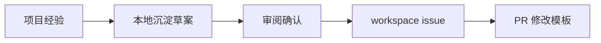

状态：按用户确认已同步到[workspace issue #4](https://github.com/DreamSoul-AI/workspace/issues/4)。此处仍是建议，不表示已修改AGENTS.md、研发模板或共用规范。

# 一、建议设置 Workspace 沉淀目录
建议各项目按需使用 docs/Workspace 沉淀/ 保存经验和待讨论的共用改进建议。目录用于积累实际做法，不把经验直接写进原始AGENTS.md。

```text
docs/
└── Workspace 沉淀/
    ├── experience.md
    └── 日期 主题建议.md
```

workspace仓库可以设置experience/，按来源项目汇集经验，例如experience/CPU 内存清理.md。先汇集，不要求每条经验都有完整结论，也不提前制定统一分类。目录安排本身仍是建议，不要求所有项目创建空目录。

# 二、建议独立维护 experience.md，留下具体解决方法
experience.md记录的不只是“要做真实验证”之类的结论，还包括遇到了什么问题、Codex实际怎样处理、用了哪些工具、如何确认有效，以及还有什么不确定。

例如本项目可以写：网页测试通过但用户仍觉得不对，Codex随后用Computer Use在内置浏览器打开正式localhost页面，观察按钮反馈、实时读数和清理后的回弹，再结合页面阶段记录与真实报告定位问题。这样的经验能让其他项目知道如何开展验证，而不只是知道“应当验证”。

经验可以保留必要技术细节来解释方法，但不复制长篇调试日志、全部测试数字和逐条提交。详细过程通过开发记录、运行记录或复盘链接查阅。单个项目的有效做法暂不升级成所有项目的要求。

# 三、保留从项目经验到模板修改的顺序
先在项目里形成真实经验，写入experience.md，再逐步汇集到workspace。积累后比较不同项目的做法，确实有值得改模板的内容时，另写修改建议给用户审阅，确认后再提issue，经PR讨论和修改。经验收集与模板修改是两个阶段。



这个顺序是为了避免把一次项目经历直接写成共用规则，不要求每条经验都开issue。目录和经验的收集可独立开展，尚未归纳成熟的内容继续保留，不设置抽象验收清单。

# 四、当前处理范围
本地先整理这份草案与[experience.md](experience.md)，供用户审阅。issue #4已按本次授权更新，并附experience.md全文。AGENTS.md与模板保持原样，后续修改由workspace项目接续讨论。
