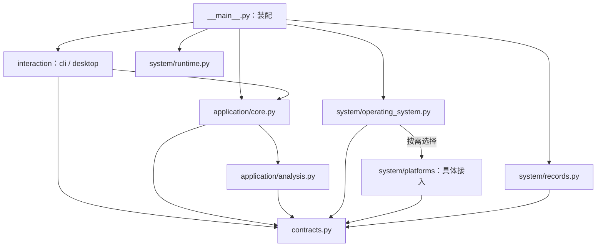

更新日期：2026年10月26日。英文名称：Code Structure Design。状态：三层模块目录与职责分离已实施，验证范围见第六章。本文约束 `src/cpu_memory_cleanup/` 内部结构，依据 [架构设计 Architecture Design](<架构设计 Architecture Design CPU 内存清理.md>) 的用户交互、功能、系统三层完成源码映射。开发历史见 [开发记录](<开发记录/README.md>)，当前实现与限制见第六章，机制证据见 [通用调研](<通用调研 CPU 内存清理.md>)。 2026年10月26日产品重规划的实施位置与剩余差距见第八章，主窗口已按内存清理小工具重写，验证范围须关联最新记录。

# 一、设计范围与约束强度
硬约束是产品源码包内部的模块目录、文件职责、公开入口、状态归属和依赖方向。目标以 `interaction/`、`application/`、`system/` 三个实际包组织三层职责，每个包封装相关实现，通过明确入口协作。根包只保留包标识、启动装配和层间共享合同。

仓库外围的脚本、测试、文档、安装配置与产物位置见 [README](<../README.md>)，布局属于软约定。调整时同步受影响的包发现、入口、测试清单和引用，测试质量与执行授权仍按适用规范落实。本文不固定整仓目录树。

# 二、模块目录
## （一）产品源码结构
以下目录与文件已经建立。所有产品逻辑仍位于 `src/cpu_memory_cleanup/`，运行依赖保持标准库，保留 `python -m cpu_memory_cleanup` 启动方式。

```text
src/
└── cpu_memory_cleanup/
    ├── __init__.py              # 根包标识，导入无运行副作用
    ├── __main__.py              # 启动装配与入口选择
    ├── contracts.py             # 共享信息与最小能力合同
    ├── interaction/             # 用户交互层
    │   ├── __init__.py
    │   ├── cli.py               # 命令行输入、报告与退出码
    │   └── desktop.py           # 桌面控件、工作线程与主线程呈现
    ├── application/             # 功能层
    │   ├── __init__.py
    │   ├── core.py              # 业务流程、状态、取消与历史语义
    │   └── analysis.py          # CPU、内存与对照的纯分析
    └── system/                  # 系统层
        ├── __init__.py
        ├── operating_system.py # 选择已有操作系统接入，提供能力信息
        ├── records.py          # 记录的实际存储访问与关闭事实
        ├── runtime.py          # 运行环境、构建信息与诊断输出
        └── platforms/          # 具体操作系统接入
            ├── __init__.py
            └── windows.py      # 当前已有平台实现的迁入位置
```

三个层包是实际模块边界。`system/platforms/` 统一收纳具体操作系统实现，当前只迁入已有实现，不创建未实现的平台文件或空目录。系统层的记录访问和运行支撑都有现有职责来源，不增加服务、插件容器或通用管理平台。

各级 `__init__.py` 仅声明包和必要元信息，不聚合导入全部子模块、不取得系统资源、不启动流程。共享合同不是第四个业务层，启动装配负责连接具体对象，也不承担业务职责。
## （二）架构职责到源码的映射
职责标识与 [架构设计的职责索引 Architecture Design](<架构设计 Architecture Design CPU 内存清理.md#七架构职责索引>) 一致。架构定义职责、能力和状态归属，本表负责将它们映射到源码。一个职责可以由多个文件共同承接，多个职责也可以在同一层内协作，不要求机械地一职责一文件。

| **架构职责** | **源码承接位置，相对于 src/cpu_memory_cleanup/** | **公开入口或数据约定** | **验证定位，相对于 tests/src/cpu_memory_cleanup/** |
| --- | --- | --- | --- |
| AR-01 用户交互 | `interaction/cli.py`、`interaction/desktop.py` | CLI 的 `parse_args`、`run`，桌面的 `MemoryWindow`、`run` | `interaction/test_cli.py`、`interaction/test_desktop.py` |
| AR-02 流程协调 | `application/core.py` | `Application.inspect`、`review`、`maintain`、`request_cancel`、`shutdown` | `application/test_core.py` |
| AR-03 分析解释 | `application/analysis.py` | `analyze`、`compare` 及其纯分析函数 | `application/test_analysis.py` |
| AR-04 系统接入 | `system/operating_system.py`、`system/platforms/windows.py` | `select_backend`、`WindowsBackend`，读取与操作会话合同 | `system/test_operating_system.py`、`system/platforms/test_windows.py` |
| AR-05 记录访问 | `system/records.py` | `RecordStore`、`Journal`、`RunReader` | `system/test_records.py`，跨模块顺序由 `application/test_core.py` 检查 |
| AR-06 运行支撑 | `system/runtime.py` | `Runtime.now`、`information`、`diagnostic` | `system/test_runtime.py`，输出失败由 `application/test_core.py` 检查 |
| AR-07 启动连接与共同约定 | `__main__.py`、`contracts.py` | `main`，共享数据、`Capabilities` 与能力合同 | `test_main.py`、`test_contracts.py`，层间依赖见 `test_package.py` |

各层目录分别承接架构中的用户交互、功能与系统层。包根的启动和合同只负责连接，不构成第四层。各文件的限制与状态归属见第三章，允许的源码依赖见第四章。
## （三）流程与质量要求的关联
三条业务流程依据 [架构流程视图](<架构设计 Architecture Design CPU 内存清理.md#一三条跨层业务流程>) 落到同一套模块，不为每条流程重复建设交互、存储和接入。

| **架构流程** | **源码协作** | **必须保留的约束** |
| --- | --- | --- |
| 只读观察 | 交互 → `Application.inspect` → 读取会话、`analysis.analyze` 与可选记录 | 只读零维护，未知不补零，关闭事实可见 |
| 离线回看 | CLI → `Application.review` → `RunReader`、历史解释与分析 | 不选择实时接入，不重放动作，主运行与比较运行事实分别保留 |
| 单次维护 | 交互确认 → `Application.maintain` → 记录、操作与读取会话 → 分项报告 | 前置能力与确认齐备，至多一次调用，恢复或结果未知时阻断 |

[架构质量场景 Q01 至 Q05](<架构设计 Architecture Design CPU 内存清理.md#二质量目标推导职责边界>) 分别检查默认只读、调用与整体结果分离、记录可追溯、接入可替换和取消响应。本节仅定位实现与检查入口，实际结果须关联 [运行记录](<运行记录/README.md>) 中的源码指纹和回执；对应测试文件存在不代表已通过实机验收。

# 三、各模块内部的文件职责
## （一）启动与共享合同
| **目标文件** | **负责什么** | **限制** |
| --- | --- | --- |
| `__main__.py` | 解析入口选择，按实际需要装配功能对象、系统能力和交互入口 | 离线回看不要求加载具体操作系统接入，桌面按需加载，不组织业务阶段 |
| `contracts.py` | 保留 `Sample`、`ActionRequest`、`RunReport` 及读取、维护合同，提供记录访问、运行支撑和能力信息的最小合同 | 不包含平台句柄、具体状态码规则、控件、存储访问或业务运行状态 |

通用合同区分支持、不支持、权限不足、未知与调用事实，平台原始结果由具体接入保留并映射。维护机制由接入提供的能力信息限定，共享动作校验保留调用事实和平台原始状态，具体状态码含义由接入解释。其他操作系统接入尚未实现。
## （二）用户交互模块 interaction
| **目标文件** | **负责什么** | **状态归属** |
| --- | --- | --- |
| `interaction/cli.py` | 参数解析、输入转换、调用用例、中文或结构化输出、退出码映射 | 结果和业务完成度来自功能报告 |
| `interaction/desktop.py` | 控件、指标卡、用户确认、单个工作线程、结果队列、刷新、取消与关闭 | 拥有控件和待提交请求，已接收业务的准入与终态由功能层决定 |

交互不导入系统层，不直接读写运行记录，不调用平台维护。桌面工作线程只执行功能入口，主线程更新控件，关闭窗口时停止新请求并等待必要收尾。展示辅助函数留在各自文件，不因使用目录而强制拆成单控件文件。
## （三）功能模块 application
| **目标文件** | **负责什么** | **限制** |
| --- | --- | --- |
| `application/core.py` | `Application` 的观察、回看、维护、准入、取消与关闭，统一业务状态、记录内容及保存顺序，解释历史版本与运行事实 | 通过注入合同使用系统能力，不加载具体接入、不直接访问文件或采集环境 |
| `application/analysis.py` | CPU 差分与覆盖、内存解释、历史聚合、纯对照与收益证据 | 只处理显式输入，不读系统、不读文件、不读取真实时钟、不生成维护确认 |

CPU、内存和比较在规则文件中按函数职责组织，当前不重复建立三套流程、记录和交互模块。业务运行身份、活动阶段、派发边界、安全阻断与整体完成度由 `Application` 唯一管理。分析无跨运行可变状态。

回看中的版本兼容、样本归属、动作合法性和证据缺口仍在功能模块解释，实际读取由系统层返回。取消检查设在功能流程的有界阶段，纯规则不读取全局取消标记。维护仍须明确确认、单一机制、至多一次调用，后置失败保留已发生事实，未知不重放。

桌面为每次提交创建取消事件，`Application.inspect` 与 `Application.maintain` 通过可选的 `cancel_event` 接收，准入时不清除提前取消。事件只表达请求，核心仍拥有派发、完成度与安全阻断；收尾开始冻结取消事实，后续信号不能改写已经提交的终态。中断事实在必要记录与资源收尾后随原始中断传播，失败路径保留已校验的记录前缀。
## （四）系统模块 system
| **目标文件或目录** | **负责什么** | **限制** |
| --- | --- | --- |
| `system/operating_system.py` | 识别当前操作系统，按需选择已实现接入，返回读取、维护等能力信息 | 选择过程不执行采样或维护，不把平台名称当作能力完整的证明，不要求未适配系统加载其他平台实现 |
| `system/platforms/windows.py` | 当前平台的原生定义、只读会话、单项维护、互斥、临时权限与恢复、句柄和查询关闭 | 仅此类具体接入依赖平台专有细节，不反向导入功能或交互，不宣布业务终态或加速收益 |
| `system/records.py` | 显式位置的独立运行记录，受限读取、追加、刷新、关闭及终态文件提交，返回存储事实 | 不决定业务阶段、不解释收益、不重放动作，不把调用与文件提交宣称为统一事务 |
| `system/runtime.py` | 按请求取得运行环境和构建信息，将业务提供的诊断事件输出到现有日志设施 | 不拥有业务终态，不启动后台任务，不增加独立日志框架，输出失败不能抹去业务事实 |

记录能力承接当前实际文件访问，功能模块继续决定记录内容与先后顺序。系统层的资源关闭结果保留阶段、关闭状态和经脱敏错误，原生句柄不越界。无法确认恢复时保留资源与阻断事实，由功能层决定是否停止接单。

未适配操作系统的实时能力明确不可用，离线回看仍应能独立运行。新增具体接入时，只有确已实现的文件进入 `platforms/`，并按能力合同验证单位、覆盖、权限、结果与收尾语义。

# 四、源码依赖硬约束
下图是本轮实现的依赖约束，箭头指向被依赖者，包标识文件省略。运行时功能对象会调用已注入的系统对象，源码中不直接导入其具体实现。



| **模块或文件** | **允许的项目内依赖** | **禁止越过的边界** |
| --- | --- | --- |
| 根包 `__main__.py` | 交互、功能入口、系统选择与支撑、共享合同 | 不包含业务规则或业务阶段 |
| 根包 `contracts.py` | 无，仅必要标准库 | 不反向依赖任何层 |
| `interaction/` | 功能公共入口、共享合同 | 不导入 `system/`，不互调 CLI 与桌面内部函数 |
| `application/core.py` | 同包规则、共享合同 | 不导入具体系统实现、界面或文件访问设施，系统能力通过装配提供 |
| `application/analysis.py` | 共享合同 | 不导入其他层，不进行真实副作用 |
| `system/operating_system.py` | 按需选择同层具体接入、共享合同 | 不导入功能或交互，不执行实时业务 |
| `system/platforms/`、`system/records.py` | 共享合同与必要标准库 | 不导入功能或交互，不共享业务可变状态 |
| `system/runtime.py` | 必要标准库，需要合同数据时引用共享合同 | 不拥有业务控制权，不加载交互 |

跨模块只调用公共入口。单模块使用的小函数保留私有，包内文件也不绕过边界调用其他模块私有实现。静态导入、动态加载、资源生命周期和数据泄漏分别核对，导入图不能替代运行行为验证。

# 五、结构变更与开发记录
结构变更应同步调用方、包发现、镜像测试、清单和文档引用，并验证依赖方向、离线隔离与必要的失败路径。当前约束以本文第二至四章为准，旧路径不作为兼容承诺。

平铺实现向三层目录迁移的映射、职责拆分、差距处理与后续命名调整维护于 [开发记录](<开发记录/README.md>)。本设计不重复维护开发时间线或历次测试回执。

# 六、实施状态与验证边界
## （一）实际完成范围
产品已按三层分包，系统能力选择、记录与运行支撑独立于功能流程。当前源码包含15个 Python 文件，其中5个为包标识。测试按实际源码目录镜像，运行与预算入口仍见 [通用测试规范 Test Specification](https://dreamsoul.feishu.cn/docx/KE4IdW6EWoKdvExSkdvcjTJFnsf)。

| **职责** | **当前位置与公共入口** | **状态归属** |
| --- | --- | --- |
| 启动与交互 | [__main__.py](<../src/cpu_memory_cleanup/__main__.py>)、[interaction/cli.py](<../src/cpu_memory_cleanup/interaction/cli.py>)、[interaction/desktop.py](<../src/cpu_memory_cleanup/interaction/desktop.py>) | 启动只装配，交互只呈现并持有待提交状态 |
| 功能与分析 | [application/core.py](<../src/cpu_memory_cleanup/application/core.py>) 的 `Application`，[application/analysis.py](<../src/cpu_memory_cleanup/application/analysis.py>) 的 `analyze`、`compare` | 功能统一管理业务状态与记录顺序，规则只处理数据 |
| 系统选择与具体接入 | [system/operating_system.py](<../src/cpu_memory_cleanup/system/operating_system.py>) 的 `select_backend`，[system/platforms/windows.py](<../src/cpu_memory_cleanup/system/platforms/windows.py>) 的 `WindowsBackend` | 选择不采样，平台会话拥有查询、互斥、权限和原生资源 |
| 记录与运行支撑 | [system/records.py](<../src/cpu_memory_cleanup/system/records.py>) 的 `RecordStore`，[system/runtime.py](<../src/cpu_memory_cleanup/system/runtime.py>) 的 `Runtime` | 记录读写和关闭事实由系统层提供，业务含义留在功能层 |
| 共同约定 | [contracts.py](<../src/cpu_memory_cleanup/contracts.py>) 的共享数据、`Capabilities` 及最小能力合同 | 不持有业务运行状态，不依赖具体操作系统 |

桌面提供内存状态与绿色一键工作集整理，离线回看和 CPU 分析由辅助 CLI 提供。维护选项来自实际能力信息，当前仅有 Windows 实时接入，不能由通用合同或未适配系统的离线测试宣称其他操作系统已支持。
## （二）验证与剩余限制
本轮验证只运行离线与假接入测试，包含默认零维护、维护至多一次、未知不重放、取消、关闭失败、存储边界、能力选择、递归构建指纹及层间依赖。实际计划与预算见测试规范，执行数量、环境和回执见运行记录，本文不重复维护计数。

真实平台采集、产品 GUI 显示、原生维护、权限调整与效果实验未执行，其他操作系统也未进行实机验证。静态导入、假接入、文档图示、打包检查分别说明结果，不互相代替。没有执行或未通过的项目不得记为完成。

设计依据与原始阅读范围见架构设计第八章，规范分享入口见 [项目协作约定](<../AGENTS.md>)。本轮按已读取的代码、测试及飞书文档规范落实职责、镜像、清单与证据状态，不据此声称云端最新内容已回读。

# 七、测试与兼容脚本的实现映射
本章说明如何验证上述源码约束，不将测试与脚本外围布局提升为产品源码硬约束。 CFG-01 已修复并完成本轮离线回归：根入口恢复分层加载，旧格式与局部清单并存时拒绝静默回退，见 [修复记录](<运行记录/2026-10-26 桌面诊断与配置修复.md#二cfg-01-的核对与修复>)。通用规则直接采用飞书《测试规范 代码》，本项目从根 `tests/manifest.json` 加载全局政策，沿测试目录汇总局部默认值和方法差异。
## （一）测试目录职责
| **位置** | **职责** | **边界** |
| --- | --- | --- |
| `tests/src/cpu_memory_cleanup/` | 按产品源码的有效目录骨架组织测试 | 路径对应产品文件或调用入口，层级用标签表达 |
| `tests/scripts/` | 镜像启动脚本与测试执行器 | 启动脚本只做静态转发验证，执行器只管理自身测试工作单元 |
| `tests/fixtures.py` | 构造离线测试应用，注入合成运行信息、假能力和记录访问 | 不属于产品能力，辅助函数不以 `test_` 命名，不开真实系统会话，不建设通用测试容器 |
| `tests/manifest.json` | 根测试配置 | 全局默认值、计划依赖、成本上限、预算和禁用实机验收草案；计划所选项全部必需 |
| 测试目录中的 `manifest.json` | 就近配置目录与文件 | 只允许 `defaults`、`files`，文件下的 `cases` 只记录方法差异；不覆盖全局计划、资源许可和实机开关 |

`tests/fixtures.py` 是普通 Python 模块，运行时由测试显式导入。`create_application` 只承接多个测试共同需要的最小装配。各模块独有的假对象继续留在对应测试文件，避免把所有替身挤进一个公共文件。共享数据只有产生真实复用需求时才另设目录。

镜像排除包标识的递归测试、测试辅助代码、文档、配置、构建产物、第三方依赖、缓存、虚拟环境和测试结果。按当前用户约定不创建测试目录 README，通用规范中要求登记于该 README 的排除与例外在本章登记；执行命令由根 README 提供，实际回执写运行记录。
## （二）关键验证路径
| **起点与终点** | **参与单元与条件** | **预期信号与资源** |
| --- | --- | --- |
| CLI 输入到最终报告 | 解析 → Application → 记录与分析；注入假接入或合成文件 | 退出码反映整体完成度，离线零系统调用，临时文件隔离 |
| 桌面提交到主线程呈现 | 假 Tk → 单工作线程 → Application → 队列 → 呈现 | 只读零维护、取消与关闭遵从核心状态，不创建真实窗口 |
| 单次维护到结束记录 | 明确确认 → 核心准入 → 假操作会话 → 记录与收尾 | 至多一次调用，未知不重放，失败保留已知事实，维护及权限调用均为假函数 |
| 历史文件到回看或比较 | 记录读取 → 核心归属与版本校验 → 纯分析 → 报告 | 记录缺口和损坏可定位，主运行事实保留，实际文件只在临时目录 |

具体方法与成本以执行器展开后的清单为准，质量通过、数值测量、执行错误和未执行分开保存。上述路径说明只定位验证，不构成真实采样、GUI 或维护授权。
## （三）兼容脚本
保留桌面启动与测试执行两类入口，桌面有无控制台文件及 CMD 兼容方式。桌面启动只定位仓库、设置本次子进程的源码路径并转发统一入口，业务流程仍归功能层；测试执行器按清单选择离线检查并保存回执。有界采样、离线回看与显式维护使用产品命令入口，不再维护独立按钮或采样脚本。维护参数指向输出基目录，每次运行再创建独立身份的子目录，不要求基目录本身不存在。

## （四）配置树的展开合同
配置按目录深度从父到子加载。根清单提供全局默认值，子目录的 `defaults` 只作用于其子树，`files` 只描述当前目录的测试文件。优先级为根默认值、最近目录默认值、文件设置、方法差异；字典字段按键合并，其余字段覆盖。没有差异的目录不建 JSON。

执行器只解析 `test_*.py` 的语法树，发现类内直接定义的 `test_` 方法，不在发现阶段导入测试或运行产品。文件必须能取得有效的目标和元数据，拼错的方法例外、未知计划、越界文件或超预算配置均报错。当前发现合同适用于现有的直接定义方法；采用继承测试方法或动态生成测试前须扩展发现机制，不能据当前规则声称支持这些写法。

方法归属通过 `plans` 继承或覆盖，根计划声明 `required: "all"`，执行时生成完整名单与必需项。全局依赖、预算、可用资源和禁用实机草案不下放；子目录不声明资源许可。测试选择仍不构成真实资源操作授权。

`--list` 显示最终条目及 `config_sources` 配置来源链，运行回执保存同一来源链。指纹包括参与展开的全部配置文件内容摘要，局部 JSON 变化会使旧回执不能继续恢复。历史单清单回执仍可直接重建报告，旧版平铺配置继续供执行器自检使用，不作为现行项目配置形式。

## （五）独立网页演示的验证例外
`demo/` 是独立静态展示，不进入 `src/cpu_memory_cleanup/` 的三层产品合同。其脚本镜像测试位于 `tests/demo/app.test.cjs`，使用 `node --test tests/demo/app.test.cjs` 验证预设状态、动画、防重入、复位和减少动态效果。该入口不由只发现 Python 方法的现有执行器展开，也不计入 quick、regression 或 readonly_offline 的通过数。浏览器布局与交互检查单列运行记录，不用网页模拟证明操作系统清理效果。若后续网页发展成实际产品，再统一其执行与回执协议，当前不扩展 Python 执行器。

# 八、内存清理小窗口的实现映射
本章依据 [当前产品基线](<开发计划 Development Plan CPU 内存清理.md#七内存清理插件的产品基线>)，取代上一轮以 CPU 诊断面板为主的桌面方案。三层目录保持，产品入口围绕内存状态、一次工作集整理与结果核对重新实现。

| **职责** | **实现位置** | **行为** |
| --- | --- | --- |
| 绿色清理按钮与内存小窗口 | `interaction/desktop.py` | 大字号物理占用、占用条、可用量、提交量、清理前后值。没有 CPU 卡片、排名、方案页或诊断前置 |
| 单次业务与安全状态 | `application/core.py` | 按钮提交已确认的一次工作集请求，继续校验记录、准入、取消和收尾，至多一次调用 |
| 系统清理与记录访问 | `system/platforms/windows.py`、`system/records.py` | 保留原生资源与权限恢复边界，记录不可写则阻止动作，不为按钮跳过安全控制 |
| 启动与辅助能力 | `__main__.py`、`interaction/cli.py` | 桌面由现有启动脚本进入，历史命令与分析工具保留为辅助，不进入主窗口操作流程 |

桌面构造需要明确输出基目录，实际启动默认使用用户主目录下的 `.cpu-memory-cleanup/runs/`，也接受已有输出目录参数。目录不在打开窗口时创建，由核心在用户明确清理后准备记录。主按钮固定 `working-set`，不支持时禁用，不自动选择 Standby。

`start` 在具备轻量接入时启动窗口内显示刷新，约500毫秒尝试一次，只允许一个在途读取；兼容接入仍可执行一次普通只读更新。显示与清理各自一个线程，关闭时都等待收尾。主线程呈现，每类执行仅一个在途任务，关闭与中断保留收尾。镜像测试重写为内存小窗口旅程，核心、平台及历史分析安全测试保留，不能用桌面裁剪删除底层故障验证。

## （一）显示刷新与平滑过渡
`Application.memory_snapshot` 通过可选的 `MemoryDisplayReader` 使用 `read_memory`，不进入业务运行状态。关闭或安全上下文未知时拒绝读取，读取后再次核对。`WindowsBackend.read_memory` 只使用缓存绑定的 `GetPerformanceInfo`，不建立 PDH、进程枚举或维护会话。

`MemoryWindow` 持有显示线程、显示结果队列、刷新计时器和动画状态。读取结果由主线程接收，按约400毫秒缓动同步绘制百分比、占用条、可用量和提交量。新目标从当前画面接续，未知不从零补值，读取失败保留原时间。动画值不写业务记录，不代替最终动作结果。

桌面调用 `maintain(..., lightweight=True)`，通过 `open_memory_observation` 取得前后内存快照，记录头标注 `observation_scope=memory-only`，缺能力时拒绝。现有默认维护和命令行保持完整观察，不把省略的速率伪装成零。两条路径共用准入、记录和单次调用控制。

## （二）桌面启动
`scripts/desktop-memory-ui.pyw` 定位源码并转发统一 GUI 入口，以窗口版 Python 启动，不创建控制台。原 CMD 兼容入口使用 `start` 脱离启动 `pythonw` 后退出，不能把其返回码当应用最终运行结果。`.pyw` 的启动异常以窗口消息呈现，双击方式依赖系统文件关联。执行器指纹包含 `.pyw`，避免启动文件变化未关联到回执。
