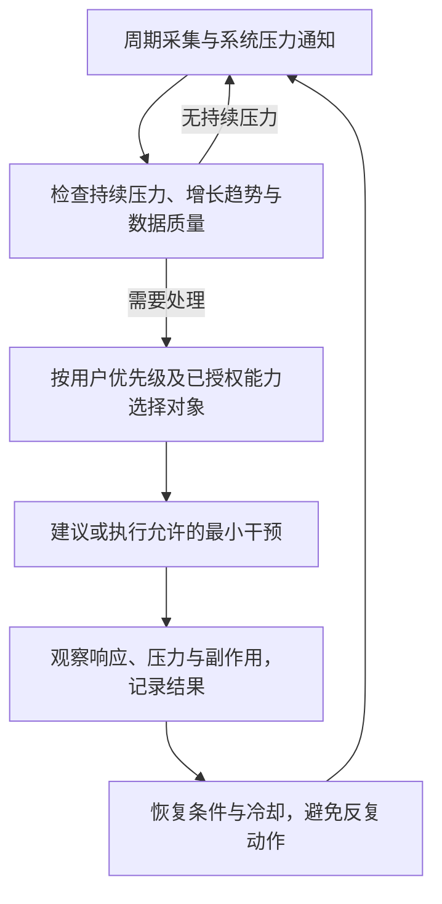

更新日期：2026年10月30日。本文只维护未完成事项、优先级、执行前提与验收条件。已交付阶段及原产品决策已移入 [阶段完成与计划整理](<开发记录 Development Record/2026-10-30 阶段完成与计划整理.md>)，当前产品能力见 [README](<../README.md>)。登记计划不产生真实操作或发布授权。

# 一、当前基线与目标
Package 公共 API、CLI/Tool 和紧凑桌面已实现，并完成离线与隔离安装验收，证据见 [包与工具接入记录](<运行记录 Run Record/2026-10-30 包与工具接入.md>)。这不代表真实效果、跨平台或宿主验收通过。PR #10 已创建，尚未合并。下一阶段目标是让别人能安装、理解并复用现有能力，不继续堆清理机制。

同类源码与采用理由见 [通用调研第十二章](<通用调研 General Research CPU 内存清理.md#十二同类源码与包分发方案>)。WinMemClean 的核心库与 CLI 分离支持现有方向，WinMemoryCleaner 的服务调用与结果呈现提供界面参考。采用职责分离，不复制外部实现或自动策略。

# 二、下一步开发任务
以下为按本次调研提出的建议顺序，尚未实施。REL-01 的 MIT 与基础元数据已按用户确认落实，REL-02 继续验证并发布 GitHub 预览版本。PyPI 不在本次范围。

| **顺序与标识** | **工作与依赖** | **验收条件** | **状态** |
| --- | --- | --- | --- |
| 1 REL-01 发布准备 | 核对代码来源和许可证，由仓库所有者确认许可选择；完善 pyproject 的项目地址、平台与版本说明，确认包名及首发版本。已有 wheel 仅是本地验证产物 | 有准确的包元数据、可选许可方案与依据、无真实清理的安装示例、三入口使用说明，区分支持和未验收平台。不擅自写入许可决定 | 已完成准备，见许可证与发布记录 |
| 2 REL-02 可分发产物 | 依赖 REL-01。固定源码，准备 wheel 和 sdist，检查内容、版本和干净环境安装；优先 GitHub Release，PyPI 为后续渠道 | 产物内容可追溯、有校验值、源码目录外可导入，工具目录与合成链路通过；发布前列明渠道与目标版本 | 待实施，构建与正式发布分开 |
| 3 INT-01 Knowledge 接入说明 | 依赖稳定包版本及安装来源，先确认具体消费者 | Knowledge 只维护安装、调用和授权说明或薄入口，不复制核心；同进程调用包，跨进程调用 CLI，宿主能回看同一记录。先用合成链路验证 | 建议，未修改 Knowledge |
| 4 VAL-01 真实只读验收 | 固定实际提交和安装产物，满足第五章环境、预算及明确运行授权 | 核对内存数值、更新时间、界面反馈和关闭行为，保存真实证据。CPU 等辅助检查保留独立范围，不做主流程前置 | 待授权，当前不运行 |
| 5 VAL-02 单次整理与效果 | 先完成目标环境的只读检查，再另行确认真实动作范围和受控负载 | 单次动作、记录与回看成立。前后可用量与恢复后任务响应分别判断；缺页、I/O 和提交量辅助解释，不能以数字下降代替收益 | 待授权，当前不运行 |

本次已获授权创建 GitHub tag 与 Release，采用 v0.2.0 预览版本，待产物验证成功后发布。PyPI 与 TestPyPI 当前不执行。不开后台服务、自动清理、额外原生机制或新测试框架。

# 三、工具与前端的复用约束
Package 是能力唯一实现，CLI 负责参数、JSON 和退出码，桌面负责按钮与呈现，两者并列依赖包。Knowledge 的 Tool 是分发和接入入口，不是另一个清理执行器。已有 `--tool-info` 与三个工具不是 MCP 服务，只有明确宿主只能接 MCP 时才评估薄适配。

# 四、实施与验收规则
按受影响职责更新实现、代码结构、文档和必要测试。复用现有统一测试入口，保留实际版本、指纹、运行 ID 与未覆盖项。已完成任务移到日期开发记录，实际运行进入运行记录，不把完成清单长期留在计划中。

真实采样、GUI、清理和发布遵守 [README 执行边界](<../README.md#运行与验证限制>)。当前不运行真实采样或清理，离线测试不能替代真实平台证据。

# 五、只读诊断验收计划
唯一计划正文位于 `tests/manifest.json`：`plans.readonly_offline` 是可执行的离线准备计划，`acceptance_plans.readonly_diagnostics` 是禁用的实机验收草案。后者记录目标、五维、依赖、资源、预算、步骤、预期、证据及离线用例映射，不注册为可运行的 unittest，也不进入 quick、regression 或 `--all` 的执行清单。`--plan readonly_diagnostics` 当前会被拒绝，资源参数不能启用该草案。

## （一）目标与顺序
验收目标为只读数据口径、缺失解释、持久化、界面及生命周期正确性，不判断清理收益。先完成 readonly_offline 和 regression，再在实际执行获明确授权、环境与监管能力齐备后检查实机。维护 API、特权调整、业务进程结束、服务和系统设置变更均不在范围内。实际 GUI 布局可先使用假 Reader，实机只读入口只向 Application 提供 Reader，Maintainer 留空。

| **检查标识** | **定位对象与预期** | **主要证据** | **当前状态** |
| --- | --- | --- | --- |
| ro_default | 默认只读，维护会话和原生维护调用为 0 | 装配、启动参数、运行头与终态 | 未执行 |
| ro_cpu | 首拍未知，后续累计差分正确，处理器组与覆盖不冒充全机 | 时间戳、累计 CPU 时间、处理器信息及参考口径 | 未执行 |
| ro_memory | bytes 与 GiB 一致，物理容量与提交量分开，未知和零可区分 | 同一份原始数据、换算与界面文字 | 未执行 |
| ro_gaps | PDH 预热、不可读项及权限缺口保留原因 | 样本 errors、预热记录和未覆盖条件 | 未执行 |
| ro_processes | top 仅限制排名，CPU 使用全部可读输入，身份与覆盖完整记录 | 进程创建身份、枚举计数及排名 | 未执行 |
| ro_records | 新目录保存，离线回看零系统接入，不完整记录不支持收益 | 样本、运行头、终态、回看退出码 | 未执行 |
| ro_lifecycle | 刷新不重入，取消与关闭以核心收尾为准，关闭后无新派发 | 交互顺序、报告和自身线程收尾 | 未执行 |
| ro_gui | 指标、时间、状态和维护区可辨，缩放与键盘操作可用 | 各缩放配置的图像或人工记录 | 未执行 |
| ro_cost | 记录只读执行的实际墙钟及自身 Job 提交量，不作收益判定 | ms、bytes、方法、样本量和预算状态 | 未执行 |

这些是验收检查标识，未执行项不计入自动化用例通过数。每项映射到已存在的离线回归方法，完整方法 ID 与步骤以清单为准。维护零调用是独立必需条件，读数正常或窗口能打开不能代替该证据。

## （二）环境、数据和预算
原草案采用过 `8c0c154`，该历史基线不再代表当前交付。执行前另行固定实际目标提交、源码指纹、wheel 校验值、Windows 完整构建、Python 版本、体系结构和普通权限上下文，不能复用旧回执冒充当前产物。配置矩阵为 Windows 11 / x64 / Python 3.13 与 Windows 10 / x64 / Python 3.10，当前均未核验。未覆盖配置保留未执行及原因，不能宣称已支持。

只读数据样本固定为 5 拍、1 秒间隔、单工作单元，第一拍保留而不计算不存在的前向差分。跨工具对照记录范围、单位、窗口和读取时差，不给异步瞬时 CPU 百分比编造相等阈值。GUI 的 100%、150%、200% 缩放通过预配置环境或进程内 Tk 缩放检查，不修改系统全局显示设置，每个配置单列结果。

单项按 c2 上限 60 秒 / 2 GiB，每个系统配置整批最多 600 秒，两个配置总预算 1200 秒，并发为 1。准备、采样、保存、收尾和人工交互都计入成本，内存仍为自身测试 Job 的提交量。以上是待落实的执行上限，不是性能合格阈值；控制器和整机内存不在该上限内。监管能力、资源或目标版本未准备好时不能开始实机验收。本轮不新增实机执行器，也不宣称已落实其实机监管。

## （三）证据、判定与阻断
每个配置使用新的独立验证目录，保留实际命令、产物、环境、原始样本、运行头与终态、界面证据、交叉核对口径和未执行原因，沿用统一运行报告的结果字段。功能检查有明确断言才记 passed，成本测量只有有效数据时记 measured，不混入质量通过率。无自然条件触发的读取异常保留未覆盖，离线故障注入结果单列。

任一必需项缺失、失败、超时、预算失控或环境不可用，都不能标记该配置验收通过。支持范围、测量完成和性能达标分别判断，当前没有清理或性能改善阈值。准备计划完成只说明具备进一步验证材料，实机检查仍保持 `not_run`。

# 六、候选研究方向
2026年10月27日讨论形成的候选方向：周期观察应用内存和系统压力，在桌面严重卡顿前尝试干预。该方向用于研究跨应用资源协调，尚未实现，不替换当前一键工作集整理，也不授权启动持续监测、限额、进程终止或权限操作。

## （一）问题、可行范围与系统能力
目标是保护用户当前任务的响应，评估是否能减少持续资源竞争。仅降低内存占用数字不构成成功。Windows 已提供进程内存统计、系统低内存通知和 Job Object 限额等能力，Agent 负责将用户优先级与这些能力结合，不能声称系统没有资源管理。[进程内存指标](https://learn.microsoft.com/en-us/windows/win32/api/psapi/ns-psapi-process_memory_counters_ex)、[压力通知](https://learn.microsoft.com/en-us/windows/win32/api/memoryapi/nf-memoryapi-creatememoryresourcenotification)

周期监测读取的是当前用量与增长趋势，不能知道程序未来全部需求，也不能发现哪些业务对象已无用。拦截每次申请属于另一层能力，不能由普通外部 Agent 的轮询实现。应用可能从已申请的内存池分配对象，外部系统统计不等于逐次业务申请记录。

| **观察范围** | **候选信号** | **限制** |
| --- | --- | --- |
| 系统 | 可用物理内存、提交余量、换页读入及磁盘响应 | 低内存通知只覆盖系统可用物理内存条件，需要其他信号补充，不能保证预测所有卡顿 |
| 应用 | 工作集、私有提交量、增长速度、进程身份与应用分组 | 共享页不能跨进程简单相加，多进程应用需要正确归组。权限不足保留未知 |
| 用户任务 | 前台活动、用户保护名单、可重跑任务与保存状态 | 前台不等于唯一重要任务，后台保存、会议和计算也可能需要保护 |

## （二）候选闭环与动作分级

| **对象或阶段** | **可研究的干预** | **执行前提与代价** |
| --- | --- | --- |
| 通用观察阶段 | 提示压力来源，给出处理建议 | 无自动控制。不能仅凭高占用、低 CPU 或进程名称判断可关闭 |
| 有协作接口的应用 | 请求释放缓存、减少并发、停止接收新任务 | 逐应用核验接口、所有权、共享使用者、状态保存与完成确认 |
| 由 Agent 启动的受管任务 | 启动前设置预算，使用 Job Object 提交内存限额及通知 | 限额约束提交量，不等于物理 RAM 预留。硬上限可导致分配失败，需要应用处理，核验既有 Job、嵌套、子进程和权限 |
| 普通第三方应用 | 先提示，具备可靠接口时请求正常退出 | 无通用外部对象回收接口，不能随意修改堆或强制挂起 |
| 最后手段 | 评估明确授权下终止可重跑的受管任务 | 可能丢失状态，需另行修改并评审项目执行边界。本阶段不实现，不将按内存排名自动杀进程作为默认策略 |

Job Object 提供进程与任务组提交内存上限，另有只通知的阈值能力。硬限额交由系统执行，不能等同 Agent 每轮观察后的建议。[限额合同](https://learn.microsoft.com/en-us/windows/win32/api/winnt/ns-winnt-jobobject_extended_limit_information)、[通知合同](https://learn.microsoft.com/en-us/windows/win32/api/winnt/ns-winnt-jobobject_notification_limit_information_2)

## （三）AI 与执行器的职责
AI 适合解释趋势、梳理用户优先级和提出策略，轻量执行器落实身份、权限、规则、预算与记录。紧急判断不能依赖远程模型及时回复。采样周期、持续窗口和阈值先用合成轨迹校准，不预设通用内存百分比。动作后检查恢复并设置冷却，避免重复裁剪、误杀或规则振荡。

## （四）研究与验证顺序
1. 用合成轨迹验证持续增长、瞬时峰值、数据缺失、PID 复用、应用归组和多个压力来源，初版只输出建议
2. 另获授权后进行有界只读观测，记录监测自身开销、漏报、误报和用户任务响应，不接入真实清理
3. 优先在自有、可重跑的受管任务上比较无干预、规则干预和候选 AI 策略，分别验证预算、异常恢复与实际体验
4. 只有取得应用协作与效果证据后，再评审扩大自动动作范围。没有证据时保留建议模式

持续压力下的任务响应、误干预、动作次数及执行器自身成本共同评价，不能以可用量上升代替收益。内存瞬时暴涨、驱动故障、硬件异常和执行器自身失去调度仍可能造成卡顿，方案不承诺阻止所有死机。上述接口资料于2026年10月27日定向阅读，尚未实机验证。
