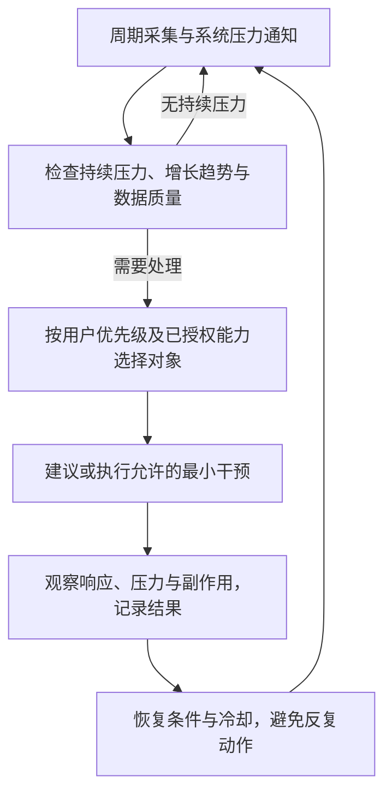

更新日期：2026年10月31日。本文维护下一轮未完成事项、依赖与验收条件。当前只完成计划编制，下列任务均未开始；登记计划不产生真实操作或发布授权。

# 一、当前基线与本轮目标
Package、CLI/Tool、紧凑桌面及单进程定向整理已实现；主项目PR #11与Knowledge PR #21已评审合并。既有离线回归、只读离线和隔离安装证据见 [上一阶段收尾记录](<运行记录 Run Record/2026-10-30 工具接入与计划收尾.md#六评审与合并收尾>)，不代表实际窗口体验或真实清理效果已经验收。已发布v0.2.0不含单进程能力，当前包元数据仍为0.2.0。

下一轮目标是让现有能力更容易体验、理解和复用：先检查实际窗口的假数据交互，再让网页演示表达相同的产品逻辑，最后准备一致的新预览产物。以紧凑窗口、绿色主按钮和可选单进程整理为中心，不扩展CPU诊断看板或后台自动策略。设计与机制依据继续使用现有架构、代码结构设计及 [通用调研](<通用调研 General Research CPU 内存清理.md#十二同类源码与包分发方案>)，发现职责变化时只更新受影响部分。

# 二、下一步开发任务
| **顺序与标识** | **工作与依赖** | **验收条件** | **状态** |
| --- | --- | --- | --- |
| 1 EXP-01 假数据窗口体验 | 复用现有依赖注入，为实际桌面窗口准备显式假数据装配；核对后再开展窗口交互验收 | 启动、刷新、目标选择、全局按钮、单进程按钮、结果保留和关闭均仅调用假接口；真实DLL加载、进程枚举、权限及清理调用为零；保留实际窗口图像与操作记录 | 未开始 |
| 2 EXP-02 窗口体验调整 | 依据EXP-01的实际观察调整布局、文案和操作反馈 | 主窗口紧凑，绿色按钮易辨；目标选择放在详情中；选中目标与动作范围清楚；处理中即时反馈，动画不冒充原生进度；结果区区分目标工作集与系统可用量；默认及150%进程内缩放下主要控件可见可操作，不修改系统缩放 | 未开始 |
| 3 DEM-01 网页能力演示 | 沿用EXP-02确认的交互语义，在现有demo中加入模拟目标列表及单进程整理 | 全局与选中进程两条模拟旅程均可完成及重置；定向旅程不改变其他模拟进程；展示前后值与再次使用后回升；清楚标注合成数据，保留GitHub入口，键盘可操作并尊重减少动画设置 | 未开始 |
| 4 PKG-01 新预览包准备 | EXP-02与DEM-01完成后统一版本、安装说明和本地产物 | 暂定0.3.0预览版，核对项目所有版本声明及其兼容意义；wheel与sdist含本轮功能、MIT与元数据；隔离安装可静态发现五工具并用假接口完成调用和回看；校验值可追溯固定源码；不改写v0.2.0 | 未开始 |
| 条件 VAL-01/02 实机验收 | 与以上假数据体验分开，取得真实只读或单次动作的明确授权后另行开展 | 固定环境、版本与预算，区分目标工作集、系统可用量及再次访问代价，不用容量变化证明提速 | 当前不执行 |

EXP-01的装配应复用生产窗口与Package，通过测试替身隔离操作系统，不另写一套演示窗口或清理执行器。假数据入口按现有脚本与测试组织选择最小落点，不默认加入正式CLI参数。实际窗口运行前必须确认不存在真实系统接入；本次仅编制计划，未启动GUI。

EXP-02只解决观察到的主要体验问题，避免预先扩展边缘情况矩阵。DEM-01可以使用网页自己的合成模型，交互与指标语义对齐产品，但网页不调用本机Package、网络清理接口或真实系统能力。

PKG-01只准备本地分发产物与发布说明；正式版本号在实现时核对，包版本、API版本、工具版本及记录schema不机械同步升级。GitHub Release、tag、GitHub Pages部署和PyPI发布均不在本次计划编制范围，后续按实际授权交付；没有真实平台验收时须明确预览版限制。

# 三、范围与复用约束
Package是产品能力唯一实现，CLI与桌面并列依赖包；Knowledge维护接入入口，不复制执行器。保留原绿色全局按钮和新增单进程路径，网页合成模型不能替代原生能力测试。当前不新增应用保护名单、整机批量遍历策略、自动阈值、服务、托盘、Linux适配或MCP服务。第六章的Agent方向仍是未采用的研究候选。

当前不运行真实采样、进程枚举、权限调整或清理，不结束程序、不更改系统设置、不自动提权。真实与假接口的GUI执行均核对 [README运行边界](<../README.md#运行与验证限制>)；计划不是启动命令或已获执行许可的证明。

# 四、实施、验证与收尾
按EXP-01 → EXP-02 → DEM-01 → PKG-01推进。先核对装配和行为，再围绕实际改动补测试、检查脚本及文档。后续实施中间节点用本地commit保存，整轮结束再统一同步与review，不为每个任务建立用户确认关卡；外部交付仍遵守已授权范围。

Python验证继续使用统一执行器和相关目录的既有清单，元数据按共用测试规范维护；针对目标选择、动作范围、重复点击控制和结果呈现补必要断言。网页通过 `node --test tests/demo/app.test.cjs` 独立验证，并记录实际浏览器交互结果，不算进Python计划通过数。最终源码变动后运行适用完整离线回归；只读离线计划在影响读取或记录路径时复核，未变化的证据不重复执行。包准备另做离线构建、源码包重建和隔离安装验收，禁止借安装检查触发真实接口。

EXP-01/02保留假数据场景、目标版本、窗口图像、操作结果及未覆盖条件；DEM-01保留浏览器与测试证据；PKG-01保留版本、构建命令、产物校验与隔离结果。运行记录只保存实际执行，未执行不写通过。完成的设计或实现摘要移入日期开发记录，当前缺陷进入缺陷记录并关联验证。整轮完成以四项验收均满足、受影响文档一致和没有阻塞缺陷为准；实际发布、真实效果与候选研究分别判断。

# 五、只读诊断验收计划
唯一计划正文位于 `tests/manifest.json`：`plans.readonly_offline` 是可执行的离线准备计划，`acceptance_plans.readonly_diagnostics` 是禁用的实机验收草案。后者记录目标、五维、依赖、资源、预算、步骤、预期、证据及离线用例映射，不注册为可运行的 unittest，也不进入 quick、regression 或 `--all` 的执行清单。`--plan readonly_diagnostics` 当前会被拒绝，资源参数不能启用该草案。

## （一）目标与顺序
验收目标为只读数据口径、缺失解释、持久化、界面及生命周期正确性，不判断清理收益。先完成 readonly_offline 和 regression，再在实际执行获明确授权、环境与监管能力齐备后检查实机。维护 API、特权调整、业务进程结束、服务和系统设置变更均不在范围内。实际 GUI 布局可先使用假 Reader，实机只读入口只向 Application 提供 Reader，Maintainer 留空。

| **检查标识** | **定位对象与预期** | **主要证据** | **当前状态** |
| --- | --- | --- | --- |
| ro_default | 默认只读，维护会话和原生维护调用为 0 | 装配、启动参数、运行头与终态 | 未执行 |
| ro_cpu | 首拍未知，后续累计差分正确，处理器组与覆盖不冒充全机 | 时间戳、累计 CPU 时间、处理器信息及参考口径 | 未执行 |
| ro_memory | bytes 与 GiB 一致，物理容量与提交量分开，未知和零可区分 | 同一份原始数据、换算与界面文字 | 未执行 |
| ro_gaps | PDH 预热、不可读项及权限缺口保留原因 | 样本 errors、预热记录和未覆盖条件 | 未执行 |
| ro_processes | top 仅限制排名，CPU 使用全部可读输入，身份与覆盖完整记录 | 进程创建身份、枚举计数及排名 | 未执行 |
| ro_records | 新目录保存，离线回看零系统接入，不完整记录不支持收益 | 样本、运行头、终态、回看退出码 | 未执行 |
| ro_lifecycle | 刷新不重入，取消与关闭以核心收尾为准，关闭后无新派发 | 交互顺序、报告和自身线程收尾 | 未执行 |
| ro_gui | 指标、时间、状态和维护区可辨，缩放与键盘操作可用 | 各缩放配置的图像或人工记录 | 未执行 |
| ro_cost | 记录只读执行的实际墙钟及自身 Job 提交量，不作收益判定 | ms、bytes、方法、样本量和预算状态 | 未执行 |

这些是验收检查标识，未执行项不计入自动化用例通过数。每项映射到已存在的离线回归方法，完整方法 ID 与步骤以清单为准。维护零调用是独立必需条件，读数正常或窗口能打开不能代替该证据。

## （二）环境、数据和预算
原草案采用过 `8c0c154`，该历史基线不再代表当前交付。执行前另行固定实际目标提交、源码指纹、wheel 校验值、Windows 完整构建、Python 版本、体系结构和普通权限上下文，不能复用旧回执冒充当前产物。配置矩阵为 Windows 11 / x64 / Python 3.13 与 Windows 10 / x64 / Python 3.10，当前均未核验。未覆盖配置保留未执行及原因，不能宣称已支持。

只读数据样本固定为 5 拍、1 秒间隔、单工作单元，第一拍保留而不计算不存在的前向差分。跨工具对照记录范围、单位、窗口和读取时差，不给异步瞬时 CPU 百分比编造相等阈值。GUI 的 100%、150%、200% 缩放通过预配置环境或进程内 Tk 缩放检查，不修改系统全局显示设置，每个配置单列结果。

单项按 c2 上限 60 秒 / 2 GiB，每个系统配置整批最多 600 秒，两个配置总预算 1200 秒，并发为 1。准备、采样、保存、收尾和人工交互都计入成本，内存仍为自身测试 Job 的提交量。以上是待落实的执行上限，不是性能合格阈值；控制器和整机内存不在该上限内。监管能力、资源或目标版本未准备好时不能开始实机验收。本轮不新增实机执行器，也不宣称已落实其实机监管。

## （三）证据、判定与阻断
每个配置使用新的独立验证目录，保留实际命令、产物、环境、原始样本、运行头与终态、界面证据、交叉核对口径和未执行原因，沿用统一运行报告的结果字段。功能检查有明确断言才记 passed，成本测量只有有效数据时记 measured，不混入质量通过率。无自然条件触发的读取异常保留未覆盖，离线故障注入结果单列。

任一必需项缺失、失败、超时、预算失控或环境不可用，都不能标记该配置验收通过。支持范围、测量完成和性能达标分别判断，当前没有清理或性能改善阈值。准备计划完成只说明具备进一步验证材料，实机检查仍保持 `not_run`。

# 六、候选研究方向
2026年10月27日讨论形成的候选方向：周期观察应用内存和系统压力，在桌面严重卡顿前尝试干预。该方向用于研究跨应用资源协调，尚未实现，不替换当前一键工作集整理，也不授权启动持续监测、限额、进程终止或权限操作。

## （一）问题、可行范围与系统能力
目标是保护用户当前任务的响应，评估是否能减少持续资源竞争。仅降低内存占用数字不构成成功。Windows 已提供进程内存统计、系统低内存通知和 Job Object 限额等能力，Agent 负责将用户优先级与这些能力结合，不能声称系统没有资源管理。[进程内存指标](https://learn.microsoft.com/en-us/windows/win32/api/psapi/ns-psapi-process_memory_counters_ex)、[压力通知](https://learn.microsoft.com/en-us/windows/win32/api/memoryapi/nf-memoryapi-creatememoryresourcenotification)

周期监测读取的是当前用量与增长趋势，不能知道程序未来全部需求，也不能发现哪些业务对象已无用。拦截每次申请属于另一层能力，不能由普通外部 Agent 的轮询实现。应用可能从已申请的内存池分配对象，外部系统统计不等于逐次业务申请记录。

| **观察范围** | **候选信号** | **限制** |
| --- | --- | --- |
| 系统 | 可用物理内存、提交余量、换页读入及磁盘响应 | 低内存通知只覆盖系统可用物理内存条件，需要其他信号补充，不能保证预测所有卡顿 |
| 应用 | 工作集、私有提交量、增长速度、进程身份与应用分组 | 共享页不能跨进程简单相加，多进程应用需要正确归组。权限不足保留未知 |
| 用户任务 | 前台活动、用户保护名单、可重跑任务与保存状态 | 前台不等于唯一重要任务，后台保存、会议和计算也可能需要保护 |

## （二）候选闭环与动作分级

| **对象或阶段** | **可研究的干预** | **执行前提与代价** |
| --- | --- | --- |
| 通用观察阶段 | 提示压力来源，给出处理建议 | 无自动控制。不能仅凭高占用、低 CPU 或进程名称判断可关闭 |
| 有协作接口的应用 | 请求释放缓存、减少并发、停止接收新任务 | 逐应用核验接口、所有权、共享使用者、状态保存与完成确认 |
| 由 Agent 启动的受管任务 | 启动前设置预算，使用 Job Object 提交内存限额及通知 | 限额约束提交量，不等于物理 RAM 预留。硬上限可导致分配失败，需要应用处理，核验既有 Job、嵌套、子进程和权限 |
| 普通第三方应用 | 先提示，具备可靠接口时请求正常退出 | 无通用外部对象回收接口，不能随意修改堆或强制挂起 |
| 最后手段 | 评估明确授权下终止可重跑的受管任务 | 可能丢失状态，需另行修改并评审项目执行边界。本阶段不实现，不将按内存排名自动杀进程作为默认策略 |

Job Object 提供进程与任务组提交内存上限，另有只通知的阈值能力。硬限额交由系统执行，不能等同 Agent 每轮观察后的建议。[限额合同](https://learn.microsoft.com/en-us/windows/win32/api/winnt/ns-winnt-jobobject_extended_limit_information)、[通知合同](https://learn.microsoft.com/en-us/windows/win32/api/winnt/ns-winnt-jobobject_notification_limit_information_2)

## （三）AI 与执行器的职责
AI 适合解释趋势、梳理用户优先级和提出策略，轻量执行器落实身份、权限、规则、预算与记录。紧急判断不能依赖远程模型及时回复。采样周期、持续窗口和阈值先用合成轨迹校准，不预设通用内存百分比。动作后检查恢复并设置冷却，避免重复裁剪、误杀或规则振荡。

## （四）研究与验证顺序
1. 用合成轨迹验证持续增长、瞬时峰值、数据缺失、PID 复用、应用归组和多个压力来源，初版只输出建议
2. 另获授权后进行有界只读观测，记录监测自身开销、漏报、误报和用户任务响应，不接入真实清理
3. 优先在自有、可重跑的受管任务上比较无干预、规则干预和候选 AI 策略，分别验证预算、异常恢复与实际体验
4. 只有取得应用协作与效果证据后，再评审扩大自动动作范围。没有证据时保留建议模式

持续压力下的任务响应、误干预、动作次数及执行器自身成本共同评价，不能以可用量上升代替收益。内存瞬时暴涨、驱动故障、硬件异常和执行器自身失去调度仍可能造成卡顿，方案不承诺阻止所有死机。上述接口资料于2026年10月27日定向阅读，尚未实机验证。
