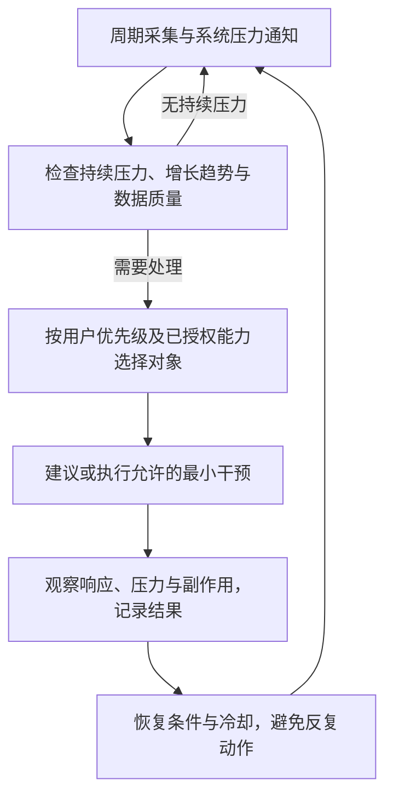

更新日期：2026年10月31日。本文维护本轮待办、依赖与验收条件。当前已完成三条主线的计划扩展，尚未开始对应实现；登记计划不产生真实操作或发布授权。

# 一、当前基线与本轮目标
Package、CLI/Tool、紧凑桌面及单进程定向整理已实现，主项目PR #11与Knowledge PR #21已合并。既有离线与隔离安装证据见 [上一阶段收尾记录](<运行记录 Run Record/2026-10-30 工具接入与计划收尾.md#六评审与合并收尾>)。用户反馈当前窗口与进程功能可用，这是体验反馈，不代替带环境、版本和操作范围的验收记录。已发布v0.2.0不含单进程能力，当前包元数据仍为0.2.0。

本轮围绕三件事完善现有工具：清理对象选得清楚，清理方式及执行时机合理，操作与结果看得明白。沿用轻量窗口与绿色按钮的产品方向，先完善已有能力，不扩展CPU诊断主界面。原EXP-01/02、DEM-01与PKG-01不再作为四条独立产品主线，分别纳入第三条主线和共同收尾，尚未执行的工作不标记完成。

# 二、下一步开发任务
| **主线** | **交付目标** | **实施内容与依赖** | **验收条件** | **状态** |
| --- | --- | --- | --- | --- |
| SCOPE-01 清理谁 | 用户能明确选择处理对象，并保存希望保护的范围 | 在现有单进程能力上完善查找与多选；设计可靠的应用归组、保护规则和必要偏好保存；先落实目标身份及批次合同，再接入桌面和工具入口 | 选中对象、应用组展开项和保护命中可见；执行按确认后的范围逐项核对身份；整理其余对象时实际跳过保护项；全局系统命令不能冒充支持排除；结果可区分成功、跳过及未完成 | 未开始 |
| METHOD-01 怎么清理 | 清理方式与手动、自动执行规则有明确含义 | 先梳理已有工作集与Standby入口、权限、影响及前置条件，按用途呈现；在SCOPE-01之上设计默认关闭的定时或持续压力规则，用合成数据实现并验证冷却、互斥和停用；其他清理区域先做采用判断，不以选项数量为目标 | 用户能理解方法、范围与代价；策略只能调用同一Package和范围规则，保护项不会被绕过；默认不调度真实任务，启用、停止及触发来源可追溯；合成轨迹下满足条件才派发，冷却与手动操作不重复派发 | 未开始 |
| EXPERIENCE-01 怎么用得舒服 | 范围选择、执行反馈和结果形成一个清楚的操作流程 | 从假数据实际窗口观察出发，随前两条主线逐步接入；统一布局、状态和结果，保存必要偏好，设计常驻入口、通知及关闭/退出语义；网页演示同步主要旅程 | 绿色主入口清楚，操作前能看懂处理范围；处理中及时反馈，完成结果不被刷新覆盖；目标工作集与系统可用量分开，不能把多进程工作集差额简单相加称为实际释放；缩放和键盘操作可用，合成演示清楚标识 | 未开始 |

三条主线是本轮完善范围，不将其细节拆成用户逐项确认的关卡。应用归组只有在关系证据可靠时启用；同名不足以证明同一应用，无法确定的对象继续独立显示与选择。保护规则需要区分当前PID身份与跨启动的应用匹配，不能把旧PID永久视作保护对象。批量动作不承诺原子性，已发生的逐项动作与后续未执行部分分别保存。

METHOD-01中的规则自动化纳入本轮设计与受控实现，替代此前“全部自动策略均不在范围”的安排；它不等于已启用真实后台清理。具体信号、阈值和触发规则先从同类源码及系统合同论证，再用合成轨迹确定，不直接照抄竞品数值。第六章涉及跨应用协调及AI决策的资源Agent仍是独立候选研究，不因增加简单规则而视为完成。

# 三、设计依据、实施顺序与边界
先校正 [通用调研](<通用调研 General Research CPU 内存清理.md#十二同类源码与包分发方案>) 中仍停留在单进程功能实现前的比较状态，补齐范围、保护、清理方法与常驻交互所需的固定源码证据。更新架构中的职责、流程与状态，再更新代码结构设计中的模块、公开合同和持久化映射，最后实现；不预先固定文件数量或为功能另造执行器。现有调研尚不能证明某种清理效果更好，真实效果保持待验证。

实施顺序为：对象范围与批次核心 → 清理方式和规则核心 → 窗口完整旅程 → 演示及分发收尾。EXPERIENCE-01从假数据观察开始，贯穿前两阶段，不等核心全部结束才发现交互不合理。每个阶段打通Package、CLI/Tool、桌面、记录和针对性测试，再继续下一阶段；原公共入口兼容性、工具发现及记录schema分别核对。

Package继续拥有唯一执行逻辑，桌面、CLI和规则调度复用同一范围与动作合同。Knowledge只维护接入说明；网页使用合成模型，不接入访客设备。常驻需求先按现有技术栈选择最小可行方式，避免为通知或托盘引入服务、自动启动或独立后台执行器。Linux、MCP及AI资源Agent不纳入本轮。

当前仍不运行真实采样、进程枚举、权限调整或清理，不结束业务程序、不更改系统设置、不自动提权。受控测试使用假Reader与Maintainer；实际窗口运行前核对全部系统接入已隔离，按 [README执行边界](<../README.md#运行与验证限制>) 处理。真实自动调度不得默认随安装或启动启用，真实验收仍按第五章及单次动作的具体授权另行开展。

# 四、验证与共同收尾
验证围绕三条产品主线，优先完整用户旅程，不预设庞大的边缘情况矩阵。重点覆盖范围与保护一致、逐项结果、策略触发与冷却、关闭停用、偏好恢复和结果解释。测试替身不代替平台效果证据。

Python继续使用统一执行器及局部清单，采用关联资料库共用测试规范；最终源码运行适用完整离线回归，影响读取或记录路径时核对只读离线计划。窗口以假数据检查默认及150%进程内缩放、键盘和主要操作，并记录实际图像与范围。网页通过 `node --test tests/demo/app.test.cjs` 独立验证，保留浏览器交互证据，不计入Python通过数。已有证据在源码与覆盖目标不变时复用，改变后才补相应检查。

完成三条主线后，统一README、调研、设计、接入说明和网页演示，准备新预览包。此前PKG-01改为共同收尾：0.3.0仅为候选版本，按最终兼容影响核对包版本，API、工具版本与记录schema不机械同步升级；离线构建wheel、sdist并重建、隔离安装，用假接口验证完整调用与离线回看，保留固定源码及产物校验。不得改写v0.2.0。GitHub Release、tag、Pages部署及PyPI发布按实际授权分别处理，本次计划修改不执行发布。

中间节点使用本地commit保存进度，整轮完成再统一同步、review与授权范围内的集成，不逐节点要求用户确认。发现需要改变已确认的范围或真实执行权限时，只暂停受影响部分，继续其他工作。三条主线验收、离线验证、文档一致及本地产物准备均完成且无阻塞缺陷，才记为本轮工程完成；实机效果、正式发布和候选研究不混算。完成摘要归日期开发记录，实际命令、环境、版本和未覆盖项归运行记录，活动问题归缺陷记录。

# 五、只读诊断验收计划
唯一计划正文位于 `tests/manifest.json`：`plans.readonly_offline` 是可执行的离线准备计划，`acceptance_plans.readonly_diagnostics` 是禁用的实机验收草案。后者记录目标、五维、依赖、资源、预算、步骤、预期、证据及离线用例映射，不注册为可运行的 unittest，也不进入 quick、regression 或 `--all` 的执行清单。`--plan readonly_diagnostics` 当前会被拒绝，资源参数不能启用该草案。

## （一）目标与顺序
验收目标为只读数据口径、缺失解释、持久化、界面及生命周期正确性，不判断清理收益。先完成 readonly_offline 和 regression，再在实际执行获明确授权、环境与监管能力齐备后检查实机。维护 API、特权调整、业务进程结束、服务和系统设置变更均不在范围内。实际 GUI 布局可先使用假 Reader，实机只读入口只向 Application 提供 Reader，Maintainer 留空。

| **检查标识** | **定位对象与预期** | **主要证据** | **当前状态** |
| --- | --- | --- | --- |
| ro_default | 默认只读，维护会话和原生维护调用为 0 | 装配、启动参数、运行头与终态 | 未执行 |
| ro_cpu | 首拍未知，后续累计差分正确，处理器组与覆盖不冒充全机 | 时间戳、累计 CPU 时间、处理器信息及参考口径 | 未执行 |
| ro_memory | bytes 与 GiB 一致，物理容量与提交量分开，未知和零可区分 | 同一份原始数据、换算与界面文字 | 未执行 |
| ro_gaps | PDH 预热、不可读项及权限缺口保留原因 | 样本 errors、预热记录和未覆盖条件 | 未执行 |
| ro_processes | top 仅限制排名，CPU 使用全部可读输入，身份与覆盖完整记录 | 进程创建身份、枚举计数及排名 | 未执行 |
| ro_records | 新目录保存，离线回看零系统接入，不完整记录不支持收益 | 样本、运行头、终态、回看退出码 | 未执行 |
| ro_lifecycle | 刷新不重入，取消与关闭以核心收尾为准，关闭后无新派发 | 交互顺序、报告和自身线程收尾 | 未执行 |
| ro_gui | 指标、时间、状态和维护区可辨，缩放与键盘操作可用 | 各缩放配置的图像或人工记录 | 未执行 |
| ro_cost | 记录只读执行的实际墙钟及自身 Job 提交量，不作收益判定 | ms、bytes、方法、样本量和预算状态 | 未执行 |

这些是验收检查标识，未执行项不计入自动化用例通过数。每项映射到已存在的离线回归方法，完整方法 ID 与步骤以清单为准。维护零调用是独立必需条件，读数正常或窗口能打开不能代替该证据。

## （二）环境、数据和预算
原草案采用过 `8c0c154`，该历史基线不再代表当前交付。执行前另行固定实际目标提交、源码指纹、wheel 校验值、Windows 完整构建、Python 版本、体系结构和普通权限上下文，不能复用旧回执冒充当前产物。配置矩阵为 Windows 11 / x64 / Python 3.13 与 Windows 10 / x64 / Python 3.10，当前均未核验。未覆盖配置保留未执行及原因，不能宣称已支持。

只读数据样本固定为 5 拍、1 秒间隔、单工作单元，第一拍保留而不计算不存在的前向差分。跨工具对照记录范围、单位、窗口和读取时差，不给异步瞬时 CPU 百分比编造相等阈值。GUI 的 100%、150%、200% 缩放通过预配置环境或进程内 Tk 缩放检查，不修改系统全局显示设置，每个配置单列结果。

单项按 c2 上限 60 秒 / 2 GiB，每个系统配置整批最多 600 秒，两个配置总预算 1200 秒，并发为 1。准备、采样、保存、收尾和人工交互都计入成本，内存仍为自身测试 Job 的提交量。以上是待落实的执行上限，不是性能合格阈值；控制器和整机内存不在该上限内。监管能力、资源或目标版本未准备好时不能开始实机验收。本轮不新增实机执行器，也不宣称已落实其实机监管。

## （三）证据、判定与阻断
每个配置使用新的独立验证目录，保留实际命令、产物、环境、原始样本、运行头与终态、界面证据、交叉核对口径和未执行原因，沿用统一运行报告的结果字段。功能检查有明确断言才记 passed，成本测量只有有效数据时记 measured，不混入质量通过率。无自然条件触发的读取异常保留未覆盖，离线故障注入结果单列。

任一必需项缺失、失败、超时、预算失控或环境不可用，都不能标记该配置验收通过。支持范围、测量完成和性能达标分别判断，当前没有清理或性能改善阈值。准备计划完成只说明具备进一步验证材料，实机检查仍保持 `not_run`。

# 六、候选研究方向
2026年10月27日讨论形成的候选方向：周期观察应用内存和系统压力，在桌面严重卡顿前尝试干预。该方向用于研究跨应用资源协调，尚未实现，不替换当前一键工作集整理，也不授权启动持续监测、限额、进程终止或权限操作。

## （一）问题、可行范围与系统能力
目标是保护用户当前任务的响应，评估是否能减少持续资源竞争。仅降低内存占用数字不构成成功。Windows 已提供进程内存统计、系统低内存通知和 Job Object 限额等能力，Agent 负责将用户优先级与这些能力结合，不能声称系统没有资源管理。[进程内存指标](https://learn.microsoft.com/en-us/windows/win32/api/psapi/ns-psapi-process_memory_counters_ex)、[压力通知](https://learn.microsoft.com/en-us/windows/win32/api/memoryapi/nf-memoryapi-creatememoryresourcenotification)

周期监测读取的是当前用量与增长趋势，不能知道程序未来全部需求，也不能发现哪些业务对象已无用。拦截每次申请属于另一层能力，不能由普通外部 Agent 的轮询实现。应用可能从已申请的内存池分配对象，外部系统统计不等于逐次业务申请记录。

| **观察范围** | **候选信号** | **限制** |
| --- | --- | --- |
| 系统 | 可用物理内存、提交余量、换页读入及磁盘响应 | 低内存通知只覆盖系统可用物理内存条件，需要其他信号补充，不能保证预测所有卡顿 |
| 应用 | 工作集、私有提交量、增长速度、进程身份与应用分组 | 共享页不能跨进程简单相加，多进程应用需要正确归组。权限不足保留未知 |
| 用户任务 | 前台活动、用户保护名单、可重跑任务与保存状态 | 前台不等于唯一重要任务，后台保存、会议和计算也可能需要保护 |

## （二）候选闭环与动作分级

| **对象或阶段** | **可研究的干预** | **执行前提与代价** |
| --- | --- | --- |
| 通用观察阶段 | 提示压力来源，给出处理建议 | 无自动控制。不能仅凭高占用、低 CPU 或进程名称判断可关闭 |
| 有协作接口的应用 | 请求释放缓存、减少并发、停止接收新任务 | 逐应用核验接口、所有权、共享使用者、状态保存与完成确认 |
| 由 Agent 启动的受管任务 | 启动前设置预算，使用 Job Object 提交内存限额及通知 | 限额约束提交量，不等于物理 RAM 预留。硬上限可导致分配失败，需要应用处理，核验既有 Job、嵌套、子进程和权限 |
| 普通第三方应用 | 先提示，具备可靠接口时请求正常退出 | 无通用外部对象回收接口，不能随意修改堆或强制挂起 |
| 最后手段 | 评估明确授权下终止可重跑的受管任务 | 可能丢失状态，需另行修改并评审项目执行边界。本阶段不实现，不将按内存排名自动杀进程作为默认策略 |

Job Object 提供进程与任务组提交内存上限，另有只通知的阈值能力。硬限额交由系统执行，不能等同 Agent 每轮观察后的建议。[限额合同](https://learn.microsoft.com/en-us/windows/win32/api/winnt/ns-winnt-jobobject_extended_limit_information)、[通知合同](https://learn.microsoft.com/en-us/windows/win32/api/winnt/ns-winnt-jobobject_notification_limit_information_2)

## （三）AI 与执行器的职责
AI 适合解释趋势、梳理用户优先级和提出策略，轻量执行器落实身份、权限、规则、预算与记录。紧急判断不能依赖远程模型及时回复。采样周期、持续窗口和阈值先用合成轨迹校准，不预设通用内存百分比。动作后检查恢复并设置冷却，避免重复裁剪、误杀或规则振荡。

## （四）研究与验证顺序
1. 用合成轨迹验证持续增长、瞬时峰值、数据缺失、PID 复用、应用归组和多个压力来源，初版只输出建议
2. 另获授权后进行有界只读观测，记录监测自身开销、漏报、误报和用户任务响应，不接入真实清理
3. 优先在自有、可重跑的受管任务上比较无干预、规则干预和候选 AI 策略，分别验证预算、异常恢复与实际体验
4. 只有取得应用协作与效果证据后，再评审扩大自动动作范围。没有证据时保留建议模式

持续压力下的任务响应、误干预、动作次数及执行器自身成本共同评价，不能以可用量上升代替收益。内存瞬时暴涨、驱动故障、硬件异常和执行器自身失去调度仍可能造成卡顿，方案不承诺阻止所有死机。上述接口资料于2026年10月27日定向阅读，尚未实机验证。
