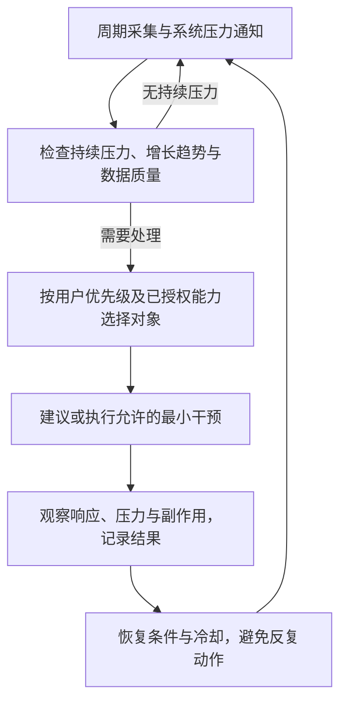

更新日期：2026年10月31日。本文维护实际剩余任务和验收条件，完成经过归开发记录，执行证据归运行记录。登记计划不产生真实操作或发布授权。

# 当前交付状态（优先阅读）
正式链路已实现：本地网页 → 回环HTTP服务 → 现有Package → 操作系统后端。正式启动使用`python -m cpu_memory_cleanup --web`，假数据脚本独立保留，页面明确展示模式。2026年10月31日补充本机真实读取、一次全局工作集动作及离线回看通过证据；当次原生返回0、权限恢复、记录完整，详见 [真实验收记录](<运行记录 Run Record/2026-10-31 真实网页验收与启动修正.md>)。

此前正式接入阶段的工程任务已完成，REAL-02的本机全局基本旅程已通过，完整平台矩阵及其他范围仍待验收。当前新增待办为第八章的网页与桌面共同体验优化，仅完成计划，尚未实施。受控通过不等于实机效果通过。见 [开发记录](<开发记录 Development Record/2026-10-31 正式网页与范围规则.md>) 与 [运行记录](<运行记录 Run Record/2026-10-31 正式网页与范围规则.md>)。

# 一、当前基线与本轮目标
当前候选版本0.3.0，仅本地准备wheel和sdist，未push、打tag、发布Release、部署Pages或上传PyPI。已发布v0.2.0及原提交不变。API_VERSION、tool_schema_version保持1；系统记录schema1、进程schema2和独立批次索引版本1分别管理。

三条主线“清理谁、怎么清理、怎么用得舒服”已完成本轮采用的实现、受控验证和本地分发准备。按本次确认，CMD启动的Tk桌面窗口与localhost网页一起纳入第八章体验优化，二者共用Package，桌面窗口不再整体后置。托盘及通知原型仍后置，不因桌面美化自动纳入。网页验收用内置浏览器；桌面先做注入假应用的受控测试，原生窗口视觉检查单列，不占用用户鼠标键盘。Linux、MCP、系统服务、开机任务和AI资源协调不纳入本轮工程完成范围。

# 二、下一步开发任务
## REAL-02 验收真实网页链路（基本旅程通过，扩展验收待开展）
- **目的**：核对实际平台权限、指标、动作事实及恢复代价，不能只观察内存数字下降。
- **依赖**：明确允许真实只读及指定范围维护；固定提交、安装包校验、系统版本、权限上下文、目标身份与预算。本轮用户已单独授权真实读取和一次全局工作集整理，不启用自动规则；该次动作已完成，不自动重试或视为后续持续授权。
- **顺序**：按第五章准备真实只读验收；再在单独明确维护范围下，核对网页请求、Package原记录和系统返回；工作集与系统可用量、再次访问代价分别观察。
- **验收**：保留原始值、失败、未知、覆盖和未执行项；没有真实证据不标记实机通过，不用假数据或假DLL证明性能收益。
- **状态**：本机Windows 10.0.26200/Python 3.13.9的内存读取、一次全局工作集与离线回看通过。CPU完整口径、跨版本矩阵、定向/批次/Standby真实动作、自动规则真实执行及性能收益均未验收；后续按具体需求与授权再执行，不因候选清单存在就全部运行。

下一轮具体实施任务见第八章，网页和桌面均需完成所选验收，不能仅以网页通过就声明两端完成。后续同步、review、合并、Release、Pages和PyPI属于独立交付动作，当前未执行，不从本轮工程任务自动取得发布授权。候选研究见第六章，不当作已决定开发任务。

# 三、本轮工程完成映射
下表保留原任务标识以关联已有设计；完成经过归日期记录，不继续列为待办。

| **任务** | **已完成范围** | **证据边界** |
| --- | --- | --- |
| REAL-01、WEB-01 | 正式API/CLI网页装配、模式/能力说明、仅回环服务、会话和单业务工作单元 | 正式工厂和Windows后端以假DLL验证，未运行真实读取 |
| WEB-02/03、EXPERIENCE-01 | 网页绿色主按钮单击执行、高级/批次明确确认、选择、回看及内置浏览器验收 | 合成数据、禁止真实DLL；取消时序由HTTP受控测试验证 |
| SCOPE-01/02 | 搜索、排序、身份多选、串行批次、取消后续项和原记录回看 | 身份和调用次数断言，不冒充全机覆盖 |
| SCOPE-03/04 | 完整程序文件路径分组、路径/实例保护、保存与移除、未保护范围 | 同路径文件组不是完整应用组；全局动作不支持保护 |
| METHOD-01/02 | 默认工作集、高级手动系统Standby；其他区域后置结论 | 采用理由见通用调研第十三章，不为选项数量新增系统调用 |
| METHOD-03 | 默认关闭的定时/持续压力、冷却、固定身份和保护快照、互斥及停止 | 注入时钟/信号验证，阈值不是已验证性能参数 |
| EXPERIENCE-02/03 | 实时轻量显示与平滑过渡、单击工作集、逐项结果、设置恢复、规则状态和显式退出；窄屏、150%缩放、键盘确认 | 页面重开不重放；关闭标签不停止服务；未验收原Tk/托盘原型 |
| EXPERIENCE-04 | 静态合成Demo增加选择、保护、结果、回升和重置 | 本地浏览器与Node验证，未部署 |
| DELIVERY-01 | 0.3.0候选元数据、wheel/sdist及重建、资源校验与隔离安装 | 本地候选产物，未发布，不改变v0.2.0 |

# 四、验证与共同收尾
采用仓库统一执行器与树状测试清单，完成完整离线回归、只读离线准备、Demo的Node检查及隔离安装。实际Run标识、源码指纹、命令、结果与本地产物SHA256见本轮运行记录，不将各计划有重叠的用例相加作唯一用例数。

源码与文档均以本地commit保存。本轮工程完成与REAL-02的真实验收分别判断；本机一次原生成功不能证明持续收益、性能改善、多平台支持或全部产品验收完成。

# 五、只读诊断验收计划
唯一计划正文位于 `tests/manifest.json`：`plans.readonly_offline` 是可执行的离线准备计划，`acceptance_plans.readonly_diagnostics` 是禁用的实机验收草案。后者记录目标、五维、依赖、资源、预算、步骤、预期、证据及离线用例映射，不注册为可运行的 unittest，也不进入 quick、regression 或 `--all` 的执行清单。`--plan readonly_diagnostics` 当前会被拒绝，资源参数不能启用该草案。

## （一）目标与顺序
验收目标为只读数据口径、缺失解释、持久化、界面及生命周期正确性，不判断清理收益。先完成 readonly_offline 和 regression，再在实际执行获明确授权、环境与监管能力齐备后检查实机。维护 API、特权调整、业务进程结束、服务和系统设置变更均不在范围内。实际 GUI 布局可先使用假 Reader，实机只读入口只向 Application 提供 Reader，Maintainer 留空。

| **检查标识** | **定位对象与预期** | **主要证据** | **当前状态** |
| --- | --- | --- | --- |
| ro_default | 默认只读，维护会话和原生维护调用为 0 | 装配、启动参数、运行头与终态 | 未执行 |
| ro_cpu | 首拍未知，后续累计差分正确，处理器组与覆盖不冒充全机 | 时间戳、累计 CPU 时间、处理器信息及参考口径 | 未执行 |
| ro_memory | bytes 与 GiB 一致，物理容量与提交量分开，未知和零可区分 | 同一份原始数据、换算与界面文字 | 未执行 |
| ro_gaps | PDH 预热、不可读项及权限缺口保留原因 | 样本 errors、预热记录和未覆盖条件 | 未执行 |
| ro_processes | top 仅限制排名，CPU 使用全部可读输入，身份与覆盖完整记录 | 进程创建身份、枚举计数及排名 | 未执行 |
| ro_records | 新目录保存，离线回看零系统接入，不完整记录不支持收益 | 样本、运行头、终态、回看退出码 | 未执行 |
| ro_lifecycle | 刷新不重入，取消与关闭以核心收尾为准，关闭后无新派发 | 交互顺序、报告和自身线程收尾 | 未执行 |
| ro_gui | 指标、时间、状态和维护区可辨，缩放与键盘操作可用 | 各缩放配置的图像或人工记录 | 未执行 |
| ro_cost | 记录只读执行的实际墙钟及自身 Job 提交量，不作收益判定 | ms、bytes、方法、样本量和预算状态 | 未执行 |

这些是验收检查标识，未执行项不计入自动化用例通过数。每项映射到已存在的离线回归方法，完整方法 ID 与步骤以清单为准。维护零调用是独立必需条件，读数正常或窗口能打开不能代替该证据。

## （二）环境、数据和预算
原草案采用过 `8c0c154`，该历史基线不再代表当前交付。执行前另行固定实际目标提交、源码指纹、wheel 校验值、Windows 完整构建、Python 版本、体系结构和普通权限上下文，不能复用旧回执冒充当前产物。配置矩阵为 Windows 11 / x64 / Python 3.13 与 Windows 10 / x64 / Python 3.10，当前均未核验。未覆盖配置保留未执行及原因，不能宣称已支持。

只读数据样本固定为 5 拍、1 秒间隔、单工作单元，第一拍保留而不计算不存在的前向差分。跨工具对照记录范围、单位、窗口和读取时差，不给异步瞬时 CPU 百分比编造相等阈值。GUI 的 100%、150%、200% 缩放通过预配置环境或进程内 Tk 缩放检查，不修改系统全局显示设置，每个配置单列结果。

单项按 c2 上限 60 秒 / 2 GiB，每个系统配置整批最多 600 秒，两个配置总预算 1200 秒，并发为 1。准备、采样、保存、收尾和人工交互都计入成本，内存仍为自身测试 Job 的提交量。以上是待落实的执行上限，不是性能合格阈值；控制器和整机内存不在该上限内。监管能力、资源或目标版本未准备好时不能开始实机验收。本轮不新增实机执行器，也不宣称已落实其实机监管。

## （三）证据、判定与阻断
每个配置使用新的独立验证目录，保留实际命令、产物、环境、原始样本、运行头与终态、界面证据、交叉核对口径和未执行原因，沿用统一运行报告的结果字段。功能检查有明确断言才记 passed，成本测量只有有效数据时记 measured，不混入质量通过率。无自然条件触发的读取异常保留未覆盖，离线故障注入结果单列。

任一必需项缺失、失败、超时、预算失控或环境不可用，都不能标记该配置验收通过。支持范围、测量完成和性能达标分别判断，当前没有清理或性能改善阈值。准备计划完成只说明具备进一步验证材料，实机检查仍保持 `not_run`。

# 六、候选研究方向
2026年10月27日讨论形成的候选方向：周期观察应用内存和系统压力，在桌面严重卡顿前尝试干预。该方向用于研究跨应用资源协调，尚未实现，不替换当前一键工作集整理，也不授权启动持续监测、限额、进程终止或权限操作。

## （一）问题、可行范围与系统能力
目标是保护用户当前任务的响应，评估是否能减少持续资源竞争。仅降低内存占用数字不构成成功。Windows 已提供进程内存统计、系统低内存通知和 Job Object 限额等能力，Agent 负责将用户优先级与这些能力结合，不能声称系统没有资源管理。[进程内存指标](https://learn.microsoft.com/en-us/windows/win32/api/psapi/ns-psapi-process_memory_counters_ex)、[压力通知](https://learn.microsoft.com/en-us/windows/win32/api/memoryapi/nf-memoryapi-creatememoryresourcenotification)

周期监测读取的是当前用量与增长趋势，不能知道程序未来全部需求，也不能发现哪些业务对象已无用。拦截每次申请属于另一层能力，不能由普通外部 Agent 的轮询实现。应用可能从已申请的内存池分配对象，外部系统统计不等于逐次业务申请记录。

| **观察范围** | **候选信号** | **限制** |
| --- | --- | --- |
| 系统 | 可用物理内存、提交余量、换页读入及磁盘响应 | 低内存通知只覆盖系统可用物理内存条件，需要其他信号补充，不能保证预测所有卡顿 |
| 应用 | 工作集、私有提交量、增长速度、进程身份与应用分组 | 共享页不能跨进程简单相加，多进程应用需要正确归组。权限不足保留未知 |
| 用户任务 | 前台活动、用户保护名单、可重跑任务与保存状态 | 前台不等于唯一重要任务，后台保存、会议和计算也可能需要保护 |

## （二）候选闭环与动作分级

| **对象或阶段** | **可研究的干预** | **执行前提与代价** |
| --- | --- | --- |
| 通用观察阶段 | 提示压力来源，给出处理建议 | 无自动控制。不能仅凭高占用、低 CPU 或进程名称判断可关闭 |
| 有协作接口的应用 | 请求释放缓存、减少并发、停止接收新任务 | 逐应用核验接口、所有权、共享使用者、状态保存与完成确认 |
| 由 Agent 启动的受管任务 | 启动前设置预算，使用 Job Object 提交内存限额及通知 | 限额约束提交量，不等于物理 RAM 预留。硬上限可导致分配失败，需要应用处理，核验既有 Job、嵌套、子进程和权限 |
| 普通第三方应用 | 先提示，具备可靠接口时请求正常退出 | 无通用外部对象回收接口，不能随意修改堆或强制挂起 |
| 最后手段 | 评估明确授权下终止可重跑的受管任务 | 可能丢失状态，需另行修改并评审项目执行边界。本阶段不实现，不将按内存排名自动杀进程作为默认策略 |

Job Object 提供进程与任务组提交内存上限，另有只通知的阈值能力。硬限额交由系统执行，不能等同 Agent 每轮观察后的建议。[限额合同](https://learn.microsoft.com/en-us/windows/win32/api/winnt/ns-winnt-jobobject_extended_limit_information)、[通知合同](https://learn.microsoft.com/en-us/windows/win32/api/winnt/ns-winnt-jobobject_notification_limit_information_2)

## （三）AI 与执行器的职责
AI 适合解释趋势、梳理用户优先级和提出策略，轻量执行器落实身份、权限、规则、预算与记录。紧急判断不能依赖远程模型及时回复。采样周期、持续窗口和阈值先用合成轨迹校准，不预设通用内存百分比。动作后检查恢复并设置冷却，避免重复裁剪、误杀或规则振荡。

## （四）研究与验证顺序
1. 用合成轨迹验证持续增长、瞬时峰值、数据缺失、PID 复用、应用归组和多个压力来源，初版只输出建议
2. 另获授权后进行有界只读观测，记录监测自身开销、漏报、误报和用户任务响应，不接入真实清理
3. 优先在自有、可重跑的受管任务上比较无干预、规则干预和候选 AI 策略，分别验证预算、异常恢复与实际体验
4. 只有取得应用协作与效果证据后，再评审扩大自动动作范围。没有证据时保留建议模式

持续压力下的任务响应、误干预、动作次数及执行器自身成本共同评价，不能以可用量上升代替收益。内存瞬时暴涨、驱动故障、硬件异常和执行器自身失去调度仍可能造成卡顿，方案不承诺阻止所有死机。上述接口资料于2026年10月27日定向阅读，尚未实机验证。

# 七、网页体验反馈调整
2026年10月31日已采用与原桌面相近的实时显示和直接主按钮流程：可见页面持续轻量读取，主工作集按钮点击即整理一次，无二次弹框；高级/批次保留确认。显示与自动规则分开，整理中继续显示，后台或手动暂停停止刷新，结果区不被刷新覆盖。此轮用合成接口及内置浏览器验收新交互，不再次触发真实全局清理；既有一次真实成功记录保留原代码和范围。

# 八、网页与桌面共同体验优化（已确认规划，待实施）
2026年10月31日用户确认将CMD启动的本地桌面软件一并纳入体验优化。本轮交付先为开发计划，不据此标记代码完成；实际实现、采样、维护、原生窗口启动及发布分别遵守当次执行范围。复用 [同类源码复核](<通用调研 General Research CPU 内存清理.md#十四当前网页体验的源码复核与优化建议>) 的紧凑模式、忙碌反馈与结构化结果思路，不复制竞品代码或增加清理区域。

## （一）目标与现状
目标是让桌面和网页都像一个轻量内存工具：打开看到清楚的内存状态，绿色按钮一次点击，处理时立即反馈，结果一眼可读，需要时再看细节。

桌面现状：desktop-memory-ui.cmd只负责定位仓库并启动pythonw及desktop-memory-ui.pyw，最终进入现有Tk主窗口；不是CMD负责绘制界面，也不是已打包独立EXE。主窗口已有约380×560的紧凑布局、圆环、实时显示、绿色按钮与折叠详情，但主窗口和workspace的控件风格不同，“查看详情”和“范围·方式·规则”两个入口也有职责重叠。网页已支持直接主按钮与实时显示，进程表和规则表单仍默认占据较大空间，并存在WEB-02圆环状态绑定问题。

继续使用现有Python标准库与Tk，不为美化换框架、增加桌面WebView或另造一套清理逻辑。两端共用视觉方向和业务口径，不要求浏览器与原生窗口逐像素相同。

## （二）共用界面与流程约定
| **区域或状态** | **网页与桌面共同目标** | **验收重点** |
| --- | --- | --- |
| 主区域 | 标题、内存圆环与读数、一个绿色工作集按钮、最近一次结果 | 层级清楚，主操作无需展开进程或设置 |
| 视觉 | 浅底、绿色强调、统一字号层级、稳定留白和对齐；按钮有正常、悬停、按下、禁用状态 | 桌面不再混用明显不同的主次控件风格，文字不拥挤或截断 |
| 就绪 | 显示当前内存与更新状态，绿色主按钮明确可用 | 实时值、暂停值和未知值可区分，不能把旧值当实时值 |
| 整理中 | 主按钮立即显示“正在整理…”，阻止重复派发，内存显示继续更新 | 不弹主动作二次确认，不跳页，不伪造原生百分比进度 |
| 完成 | 主按钮附近呈现时间、范围、前后变化和明确结果 | 读数继续变化不覆盖本次固定结果；变化方向准确，不称为保证提速 |
| 失败 | 同一区域展示未派发/已调用的事实及简短原因，细节可展开 | 错误不能只藏在原始JSON或弹出一串异常 |
| 更多内容 | 进程选择、保护、规则、方法和原始报告按需查看 | 默认关闭的规则不会因展开/折叠或换界面而被启用 |

默认工作集主按钮单击即执行的业务语义在两端一致；高级系统动作、定向批次、启用规则仍确认范围。实时只读显示和自动整理规则分开，不新增热键、托盘、开机启动、更多清理区域或性能实验。

## （三）具体开发任务
### POLISH-01 修正并统一可见状态
先修网页WEB-02：将占用角度和处理中状态作用到实际圆环；同时核对桌面数字、圆环与按钮状态映射，保留已正确的实时刷新逻辑，不为统一视觉重写Package。

验收：合成25%和75%读数下，数字、圆环及横条含义一致；清理中继续显示、减少动画设置或暂停行为有效；一次点击最多派发一次维护。网页缺陷修复不代表桌面天然通过，分别保留证据。

### POLISH-02 主界面紧凑与桌面视觉整理
网页默认收起空进程表与规则表单；桌面重新整理主窗字号、内边距、圆环比例、按钮尺寸与结果区，保持一个绿色主动作。以现有380×560附近尺寸为设计起点，按实际内容和缩放调整，不把固定像素尺寸作为硬约束。必要的提交量、路径和技术说明移至详情。

验收：两端主界面都能直接完成查看→整理→读结果；桌面标准缩放及150%显示配置下主按钮与结果不被截断，键盘焦点顺序合理，窗口不闪跳或因状态文案变化反复改变尺寸。缩放检查使用受控环境或进程内设置，不修改系统全局显示。

### POLISH-03 最近结果清楚且位置稳定
两端在主操作附近统一展示完成时间、动作范围、前后值与带方向变化；实时概览和上次结果各自标明。耗时依据实际记录的处理区间显示，未知不推测，不把快照时间差冒充原生API独占耗时。原始记录及完整错误继续放在详情。

验收：成功、部分结果与未派发均无需展开JSON即可理解；实时刷新不清空或改写最近结果，离线回看零维护；不为结果卡额外调用清理。

### DESKTOP-01 整合桌面详情与设置入口
核对现有“查看详情”和“范围·方式·规则”的职责，归并为清楚的一个详情入口，内部按“进程范围、整理设置、运行详情”分区；可使用现有次级窗口或折叠区，不新造窗口体系。统一Tk与ttk的字体、色彩和按钮层级，避免重复展示单进程和批次选择入口。

验收：选中对象、保护、方法及规则状态各有明确位置；打开次级内容不会重复打开多个工作区或意外读取进程，关闭次级内容不退出主窗、不改变已授权任务；主窗退出仍按原Package流程收尾。托盘及原生通知不在此任务内。

### DESKTOP-02 CMD启动与一致交付
保留现有CMD→pythonw→桌面入口，核对优化后仍能直接打开正确主窗，正常运行没有常驻终端。入口和产品模块继续分工，不把界面代码放进CMD或复制一份清理脚本；维护现有参数转发和启动失败提示。

验收：脚本受控测试验证入口分派不自动清理，正常启动路径指向同一Package；实际无常驻终端与原生视觉效果在明确允许的窗口验收中单列。仅有假控件测试不能宣称已完成真实Tk视觉验收，HTML预览也不能代替本地窗口证据。

## （四）实施顺序与验收
1. 先固定两端主界面布局及状态表，再完成POLISH-01实际绑定修复。
2. 同步完成POLISH-02/03的桌面主窗和网页布局，保留同一业务合同；不只先美化网页就停下。
3. 完成DESKTOP-01次级内容和DESKTOP-02启动检查，核对受影响的脚本、测试及README。
4. 假后端覆盖就绪、执行中、成功、失败和暂停显示；网页使用内置浏览器，桌面先受控控件/应用测试，原生窗口图像和布局检查另记真实执行条件。未经允许不调用占用用户输入设备的桌面Computer Use。
5. 运行适用回归，检查安装包资源和启动入口，实际证据进入运行记录，完成经过进入开发记录。需要交付新候选包时按最终代码重建，不把旧包称为包含新界面。

本次为计划调整，未启动桌面窗口、未执行真实采样或清理。原已授权且完成的一次全局实测不授权本轮重跑；视觉优化不扩大真实维护权限。下一次实施按该计划推进，本地commit保存完整阶段，同步、PR、合并和发布按实际授权执行。
