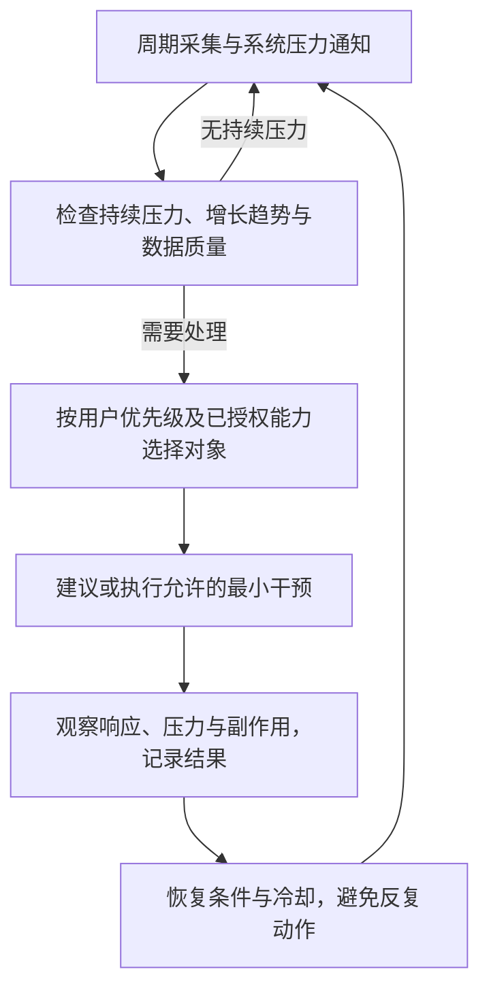

更新日期：2026年11月2日。本文维护实际剩余任务和验收条件，完成经过归开发记录，执行证据归运行记录。登记计划不产生真实操作或发布授权。

# 当前交付状态（优先阅读）
当前重点是第十二章的底层清理策略。分段计时与单次真实G0核验已完成，原生占该次总时长96.52%。360主按钮到逐进程裁剪函数的静态条件链现已连接，下一项优先做P1/P2同目标工作集接口比较的设计与假接入，F1文件缓存后置。P2尚未实现，跨策略真实对照与默认选型未完成，不把已追通调用链当成360更快的性能证明。

网页交互的既有范围见第十、十一章，最新分段实测见 [真实核验记录](<运行记录 Run Record/2026-11-02 真实分段计时与工作集核验.md>)。本轮静态连接已固定哈希的360按钮、委托、组件工厂与清理例程，另确认按软件项条件可进入结束进程分支。未恢复原始源码或验证当前运行实例，没有新增真实采样/清理、修改动效/默认方法或重启服务，未push或发布。

# 一、当前基线与本轮目标
当前候选版本0.3.0，仅本地准备wheel和sdist，未push、打tag、发布Release、部署Pages或上传PyPI。已发布v0.2.0及原提交不变。API_VERSION、tool_schema_version保持1；系统记录schema1、进程schema2和独立批次索引版本1分别管理。

三条主线“清理谁、怎么清理、怎么用得舒服”已完成此前采用的实现、受控验证和本地分发准备。按本次确认，CMD启动的Tk桌面窗口与localhost网页一起纳入第八章体验优化，二者共用Package，桌面窗口不再整体后置。托盘及通知原型仍后置，不因桌面美化自动纳入。网页验收用内置浏览器；桌面先做注入假应用的受控测试，原生窗口视觉检查单列，不占用用户鼠标键盘。Linux、MCP、系统服务、开机任务和AI资源协调不纳入本轮工程完成范围。

# 二、下一步开发任务
按 [第十二章](#十二底层清理策略的下一轮任务) 依次推进三组工作：先按03.3设计并假接入P2，与既有P1在同一目标集上可比较，再补03.1摘要和05.1采集准备，最后在有执行范围时比较G0/P1/P2并决定默认。F1保留已核规格，等工作集比较后再决定是否开发。本轮只完成静态调研与计划，不实施清理代码。工程验收与真实性能结论分别判断。

## REAL-02 真实平台扩展验收
本机全局基本调用已有证据，CPU完整口径、跨版本、定向/批次/Standby真实动作与持续性能收益仍未验收。此前一次真实整理授权已用于该次基本旅程。本轮仅调研文档，后续比较须明确实际路线、次数、环境及观察预算，不依据旧授权重试或扩展范围。

既有只读准备见第五章，跨应用研究建议见第六章。它们不自动全部加入底层速度优化，也不因源码候选存在就启动系统服务、自动规则、竞品或真实维护。

# 三、本轮工程完成映射
下表保留原任务标识以关联已有设计；完成经过归日期记录，不继续列为待办。

| **任务** | **已完成范围** | **证据边界** |
| --- | --- | --- |
| REAL-01、WEB-01 | 正式API/CLI网页装配、模式/能力说明、仅回环服务、会话和单业务工作单元 | 正式工厂和Windows后端以假DLL验证，未运行真实读取 |
| WEB-02/03、EXPERIENCE-01 | 网页绿色主按钮单击执行、高级/批次明确确认、选择、回看及内置浏览器验收 | 合成数据、禁止真实DLL；取消时序由HTTP受控测试验证 |
| SCOPE-01/02 | 搜索、排序、身份多选、串行批次、取消后续项和原记录回看 | 身份和调用次数断言，不冒充全机覆盖 |
| SCOPE-03/04 | 完整程序文件路径分组、路径/实例保护、保存与移除、未保护范围 | 同路径文件组不是完整应用组；全局动作不支持保护 |
| METHOD-01/02 | 默认工作集、高级手动系统Standby；其他区域后置结论 | 采用理由见通用调研第十三章，不为选项数量新增系统调用 |
| METHOD-03 | 默认关闭的定时/持续压力、冷却、固定身份和保护快照、互斥及停止 | 注入时钟/信号验证，阈值不是已验证性能参数 |
| EXPERIENCE-02/03 | 实时轻量显示与平滑过渡、单击工作集、逐项结果、设置恢复、规则状态和显式退出；窄屏、150%缩放、键盘确认 | 页面重开不重放；关闭标签不停止服务；未验收原Tk/托盘原型 |
| EXPERIENCE-04 | 静态合成Demo增加选择、保护、结果、回升和重置 | 本地浏览器与Node验证，未部署 |
| DELIVERY-01 | 0.3.0候选元数据、wheel/sdist及重建、资源校验与隔离安装 | 本地候选产物，未发布，不改变v0.2.0 |

# 四、验证与共同收尾
采用仓库统一执行器与树状测试清单，完成完整离线回归、只读离线准备、Demo的Node检查及隔离安装。实际Run标识、源码指纹、命令、结果与本地产物SHA256见本轮运行记录，不将各计划有重叠的用例相加作唯一用例数。

源码与文档均以本地commit保存。本轮工程完成与REAL-02的真实验收分别判断；本机一次原生成功不能证明持续收益、性能改善、多平台支持或全部产品验收完成。

# 五、只读诊断验收计划
唯一计划正文位于 `tests/manifest.json`：`plans.readonly_offline` 是可执行的离线准备计划，`acceptance_plans.readonly_diagnostics` 是禁用的实机验收草案。后者记录目标、五维、依赖、资源、预算、步骤、预期、证据及离线用例映射，不注册为可运行的 unittest，也不进入 quick、regression 或 `--all` 的执行清单。`--plan readonly_diagnostics` 当前会被拒绝，资源参数不能启用该草案。

## （一）目标与顺序
验收目标为只读数据口径、缺失解释、持久化、界面及生命周期正确性，不判断清理收益。先完成 readonly_offline 和 regression，再在实际执行获明确授权、环境与监管能力齐备后检查实机。维护 API、特权调整、业务进程结束、服务和系统设置变更均不在范围内。实际 GUI 布局可先使用假 Reader，实机只读入口只向 Application 提供 Reader，Maintainer 留空。

| **检查标识** | **定位对象与预期** | **主要证据** | **当前状态** |
| --- | --- | --- | --- |
| ro_default | 默认只读，维护会话和原生维护调用为 0 | 装配、启动参数、运行头与终态 | 未执行 |
| ro_cpu | 首拍未知，后续累计差分正确，处理器组与覆盖不冒充全机 | 时间戳、累计 CPU 时间、处理器信息及参考口径 | 未执行 |
| ro_memory | bytes 与 GiB 一致，物理容量与提交量分开，未知和零可区分 | 同一份原始数据、换算与界面文字 | 未执行 |
| ro_gaps | PDH 预热、不可读项及权限缺口保留原因 | 样本 errors、预热记录和未覆盖条件 | 未执行 |
| ro_processes | top 仅限制排名，CPU 使用全部可读输入，身份与覆盖完整记录 | 进程创建身份、枚举计数及排名 | 未执行 |
| ro_records | 新目录保存，离线回看零系统接入，不完整记录不支持收益 | 样本、运行头、终态、回看退出码 | 未执行 |
| ro_lifecycle | 刷新不重入，取消与关闭以核心收尾为准，关闭后无新派发 | 交互顺序、报告和自身线程收尾 | 未执行 |
| ro_gui | 指标、时间、状态和维护区可辨，缩放与键盘操作可用 | 各缩放配置的图像或人工记录 | 未执行 |
| ro_cost | 记录只读执行的实际墙钟及自身 Job 提交量，不作收益判定 | ms、bytes、方法、样本量和预算状态 | 未执行 |

这些是验收检查标识，未执行项不计入自动化用例通过数。每项映射到已存在的离线回归方法，完整方法 ID 与步骤以清单为准。维护零调用是独立必需条件，读数正常或窗口能打开不能代替该证据。

## （二）环境、数据和预算
原草案采用过 `8c0c154`，该历史基线不再代表当前交付。执行前另行固定实际目标提交、源码指纹、wheel 校验值、Windows 完整构建、Python 版本、体系结构和普通权限上下文，不能复用旧回执冒充当前产物。配置矩阵为 Windows 11 / x64 / Python 3.13 与 Windows 10 / x64 / Python 3.10，当前均未核验。未覆盖配置保留未执行及原因，不能宣称已支持。

只读数据样本固定为 5 拍、1 秒间隔、单工作单元，第一拍保留而不计算不存在的前向差分。跨工具对照记录范围、单位、窗口和读取时差，不给异步瞬时 CPU 百分比编造相等阈值。GUI 的 100%、150%、200% 缩放通过预配置环境或进程内 Tk 缩放检查，不修改系统全局显示设置，每个配置单列结果。

单项按 c2 上限 60 秒 / 2 GiB，每个系统配置整批最多 600 秒，两个配置总预算 1200 秒，并发为 1。准备、采样、保存、收尾和人工交互都计入成本，内存仍为自身测试 Job 的提交量。以上是待落实的执行上限，不是性能合格阈值；控制器和整机内存不在该上限内。监管能力、资源或目标版本未准备好时不能开始实机验收。本轮不新增实机执行器，也不宣称已落实其实机监管。

## （三）证据、判定与阻断
每个配置使用新的独立验证目录，保留实际命令、产物、环境、原始样本、运行头与终态、界面证据、交叉核对口径和未执行原因，沿用统一运行报告的结果字段。功能检查有明确断言才记 passed，成本测量只有有效数据时记 measured，不混入质量通过率。无自然条件触发的读取异常保留未覆盖，离线故障注入结果单列。

任一必需项缺失、失败、超时、预算失控或环境不可用，都不能标记该配置验收通过。支持范围、测量完成和性能达标分别判断，当前没有清理或性能改善阈值。准备计划完成只说明具备进一步验证材料，实机检查仍保持 `not_run`。

# 六、候选研究方向
2026年10月27日讨论形成的候选方向：周期观察应用内存和系统压力，在桌面严重卡顿前尝试干预。该方向用于研究跨应用资源协调，尚未实现，不替换当前一键工作集整理，也不授权启动持续监测、限额、进程终止或权限操作。

## （一）问题、可行范围与系统能力
目标是保护用户当前任务的响应，评估是否能减少持续资源竞争。仅降低内存占用数字不构成成功。Windows 已提供进程内存统计、系统低内存通知和 Job Object 限额等能力，Agent 负责将用户优先级与这些能力结合，不能声称系统没有资源管理。[进程内存指标](https://learn.microsoft.com/en-us/windows/win32/api/psapi/ns-psapi-process_memory_counters_ex)、[压力通知](https://learn.microsoft.com/en-us/windows/win32/api/memoryapi/nf-memoryapi-creatememoryresourcenotification)

周期监测读取的是当前用量与增长趋势，不能知道程序未来全部需求，也不能发现哪些业务对象已无用。拦截每次申请属于另一层能力，不能由普通外部 Agent 的轮询实现。应用可能从已申请的内存池分配对象，外部系统统计不等于逐次业务申请记录。

| **观察范围** | **候选信号** | **限制** |
| --- | --- | --- |
| 系统 | 可用物理内存、提交余量、换页读入及磁盘响应 | 低内存通知只覆盖系统可用物理内存条件，需要其他信号补充，不能保证预测所有卡顿 |
| 应用 | 工作集、私有提交量、增长速度、进程身份与应用分组 | 共享页不能跨进程简单相加，多进程应用需要正确归组。权限不足保留未知 |
| 用户任务 | 前台活动、用户保护名单、可重跑任务与保存状态 | 前台不等于唯一重要任务，后台保存、会议和计算也可能需要保护 |

## （二）候选闭环与动作分级

| **对象或阶段** | **可研究的干预** | **执行前提与代价** |
| --- | --- | --- |
| 通用观察阶段 | 提示压力来源，给出处理建议 | 无自动控制。不能仅凭高占用、低 CPU 或进程名称判断可关闭 |
| 有协作接口的应用 | 请求释放缓存、减少并发、停止接收新任务 | 逐应用核验接口、所有权、共享使用者、状态保存与完成确认 |
| 由 Agent 启动的受管任务 | 启动前设置预算，使用 Job Object 提交内存限额及通知 | 限额约束提交量，不等于物理 RAM 预留。硬上限可导致分配失败，需要应用处理，核验既有 Job、嵌套、子进程和权限 |
| 普通第三方应用 | 先提示，具备可靠接口时请求正常退出 | 无通用外部对象回收接口，不能随意修改堆或强制挂起 |
| 最后手段 | 评估明确授权下终止可重跑的受管任务 | 可能丢失状态，需另行修改并评审项目执行边界。本阶段不实现，不将按内存排名自动杀进程作为默认策略 |

Job Object 提供进程与任务组提交内存上限，另有只通知的阈值能力。硬限额交由系统执行，不能等同 Agent 每轮观察后的建议。[限额合同](https://learn.microsoft.com/en-us/windows/win32/api/winnt/ns-winnt-jobobject_extended_limit_information)、[通知合同](https://learn.microsoft.com/en-us/windows/win32/api/winnt/ns-winnt-jobobject_notification_limit_information_2)

## （三）AI 与执行器的职责
AI 适合解释趋势、梳理用户优先级和提出策略，轻量执行器落实身份、权限、规则、预算与记录。紧急判断不能依赖远程模型及时回复。采样周期、持续窗口和阈值先用合成轨迹校准，不预设通用内存百分比。动作后检查恢复并设置冷却，避免重复裁剪、误杀或规则振荡。

## （四）研究与验证顺序
1. 用合成轨迹验证持续增长、瞬时峰值、数据缺失、PID 复用、应用归组和多个压力来源，初版只输出建议
2. 另获授权后进行有界只读观测，记录监测自身开销、漏报、误报和用户任务响应，不接入真实清理
3. 优先在自有、可重跑的受管任务上比较无干预、规则干预和候选 AI 策略，分别验证预算、异常恢复与实际体验
4. 只有取得应用协作与效果证据后，再评审扩大自动动作范围。没有证据时保留建议模式

持续压力下的任务响应、误干预、动作次数及执行器自身成本共同评价，不能以可用量上升代替收益。内存瞬时暴涨、驱动故障、硬件异常和执行器自身失去调度仍可能造成卡顿，方案不承诺阻止所有死机。上述接口资料于2026年10月27日定向阅读，尚未实机验证。

# 七、网页体验反馈调整
2026年10月31日已采用与原桌面相近的实时显示和直接主按钮流程：可见页面持续轻量读取，主工作集按钮点击即整理一次，无二次弹框；高级/批次保留确认。显示与自动规则分开，整理中继续显示，后台或手动暂停停止刷新，结果区不被刷新覆盖。此轮用合成接口及内置浏览器验收新交互，不再次触发真实全局清理；既有一次真实成功记录保留原代码和范围。

# 八、网页与桌面共同体验优化
2026年10月31日，POLISH-01、POLISH-02、POLISH-03、DESKTOP-01、DESKTOP-02已完成本轮工程实现与受控检查。任务设计、完成映射和取舍归 [开发记录](<开发记录 Development Record/2026-10-31 网页与桌面体验优化.md>)，真实执行范围及证据归 [运行记录](<运行记录 Run Record/2026-10-31 网页与桌面体验优化.md>)。当前只做本地提交，不推送或发布。

## （一）交付状态
两端共用主状态与最近动作结果的业务口径：紧凑主界面、绿色工作集按钮、独立实时刷新、稳定结果、按需详情。网页圆环绑定WEB-02已修复并受控验证。桌面次级内容归并为进程范围、整理设置、运行详情，打开不读取目标，关闭不退出主窗口。CMD保留pythonw入口及参数转发，脚本不复制清理逻辑。

## （二）剩余验收
1. **原生可见窗口**：在允许的窗口验收环境下，核对标准及150%字体下实际视觉、键盘焦点、主窗口与次级窗口开关，以及CMD正常启动无常驻终端。本次仅做隐藏Tk尺寸检查及受控入口测试，不将其冒充可见窗口验收。无需为此再做真实清理。
2. **交付同步**：本地候选包已按当前源码重建；push、PR、合并和新Release按后续实际交付指令执行。本轮没有部署静态Pages或上传PyPI。
3. **真实平台扩展**：沿第二章REAL-02按需要和具体授权安排；一次历史全局成功不覆盖定向、批次、Standby、规则或性能收益。本轮没有新增清理区域、热键、托盘、系统服务或AI资源协调。

工程实施不再保留未完成任务；上述独立视觉及真实平台证据未取得前，相关验收状态保持未验证。研究建议仍见第六章，不自动升级为开发任务。

## （三）试用反馈的后续状态
桌面圆环比例/平滑与主按钮调用后3秒观察已实现，见 [圆环开发记录](<开发记录 Development Record/2026-10-31 桌面圆环比例修正.md>) 和 [观察开发记录](<开发记录 Development Record/2026-10-31 调用后观察与结果时机.md>)。该次完整回归519/520通过的原始超时保留。清单检查现已按多次实际成本校准为c2/3秒，另起完整运行521项全部首次通过，新增的提前完成动效用例再作定向验证；各次执行范围见最新运行记录。原生可见窗口观感及后续真实范围验收仍沿上述限制执行。

## （四）归零动效的当前决定
此前实现和节奏调整保留在日期开发/运行记录及提交中。用户2026年11月1日要求先回到原有功能，明确功能与动效分工。当前撤下接管主仪表及扣住结果的动效，不能继续将“动效0但原始样本未污染”当作完整解耦的验收目标。

# 九、当前优先任务：先恢复功能，再实现独立装饰
## （一）本轮目标与边界
真实读取、一次清理与真实结果是产品主能力。三层结构保留，先依据架构的状态归属及流程合同修正交互映射，再安排实现。当前只读/假接入验证不证明真实清理收益，不执行真实清理，不修改系统命令、观察秒数或权限范围。

此前恢复先在工作区完成，随后按用户要求先修正两份设计与计划。本轮获授权后先提交恢复基线，再确定独立反馈条位置及模块，之后实现和验收，实际经过归日期记录。

## （二）任务拆分、顺序与验收
### PLAN-01 先固定职责和完成条件
- 内容：修正架构中“主仪表由动效接管、回弹后才公布结果”的决定，明确真实读数、业务终态、固定结果和装饰各自拥有的数据
- 依赖：关联DreamSoul架构研究中的状态归属、质量场景和行为合同方法，既有通用调研及用户本轮确认
- 验收：四个主场景可以推导出明确的数据写入者与完成者，架构不包含具体Python实现
- 状态：已落实，职责合同与四个主场景进入两端测试

### STRUCT-01 从架构映射源码和依赖
- 内容：在代码结构设计标出core、Windows接入、HTTP、桌面和网页读数/结果入口，区分恢复范围与后续装饰落点
- 验收：主指标只能由真实读数渲染写入，后台报告发布没有装饰等待；装饰不能持有维护方法或任务终态控制
- 状态：已落实，独立模块及固定资源路由已实现

### RESTORE-01 交付功能基线恢复
- 内容：核对当前工作区的五文件局部恢复，保留后台、保护/规则、桌面尺寸/抗锯齿及已校准的测试预算，逐项检查与cb47a70功能基线的差异
- 验收：假数据下清理期间读数持续变化；每次请求最多一次维护；后台完成后结果正常发布，不等装饰计时；实际回看不再维护
- 状态：已完成，先以fd2a49b本地提交恢复，后续装饰基于该提交，不改核心维护流程

### EFFECT-01 先确定独立装饰的表达，再实现
- 内容：仅在独立区域或装饰环表达归零、等待和回弹，保持主百分比、主实际圆环、实际容量与结果始终可读；先在专项设计写清最终落点，再实现
- 依赖：PLAN-01、STRUCT-01和RESTORE-01成立，界面位置与数据权限明确，不直接重用被撤下的状态门控
- 验收：关闭或移除装饰时仍能完整读取、清理和展示结果；装饰慢/快不改变业务请求次数、快照或结果发布时间
- 状态：已完成，按钮下独立反馈条及开关，主圆环和结果不参与动效；实现提交6c38acc

### VERIFY-01 分开验收并保留证据
- 顺序：先Package/假DLL调用及记录，再网页/桌面持续读数与结果，最后独立装饰开关等价检查
- 验收：真实指标40→35→30时主显示同步；后台先完成立即公布结果；装饰先结束仍按后台忙碌；两端每次最多一次维护；动态预览明确标注合成数据
- 交付：运行记录保存实际命令、模式、调用次数和未验证项，开发记录保存决定和结构变化；源码/资源或入口最终定稿后再核对候选包，按实际授权本地提交或同步
- 状态：已完成工程范围：523项完整离线回归通过，最终62项定向及9项JS通过，内置浏览器和隐藏真实Tk验收开关等价，隔离安装36项通过。真实清理收益和可见原生窗口观感未验收

## （三）交付与剩余边界
本轮五项任务已完成，过程、验证与候选包均本地保存，未push或发布。继续遵守不执行真实清理的限制。可见原生窗口观感及真实效果另行验证，不以假数据或隐藏控件检查替代。

# 十、网页需求重定与实施计划
## （一）确认范围
主圆环三秒匀速归零，业务真正收尾后触发回弹，后台持续读取，真实读数另区显示，结果不等动画。只做网页、内置浏览器与假数据，本地桌面不做，不运行真实清理。

## （二）顺序
1. REQUIRE-01：先更新README需求、架构状态合同和源码映射，区分业务完成、数据更新、动画结束。完成标准是本次系统调用/安全收尾，而非清零或固定等待
2. WEB-01：实现主圆环模式及独立实际读数区，移除独立反馈条方案；保留后台连续读取及一次派发
3. SIGNAL-01：从成功报告通知回弹，撤掉网页固定三秒后续观察参数，使用默认即时前后快照与安全收尾，失败不伪报成功，Package/桌面不变
4. VERIFY-01：可控时钟、HTTP假后端、内置浏览器三层验证，使用推进时间和变化读数，以及慢任务与快任务；保留每次调用数量及原始结果
5. DOC-01：按实际结果更新日期记录与计划，区分假数据通过、真实效果未验收和桌面未变。仅本地commit，不push或发布

## （三）验收
实际读数在过程归零期间持续推进；三秒到了但后台未完不能回弹或显示成功；后台提前完成应立即公布真实结果，随后动效自行归零/回弹；原报告和快照不包含动效零；一次点击一个动作。可见浏览器检查是必要步骤，不能由静态测试替代。本次不要求原生桌面或真实清理验收。

## （四）完成状态与交付边界
REQUIRE-01、WEB-01、SIGNAL-01、VERIFY-01、DOC-01均已完成本轮工程范围。设计先行后实施网页，实际区域持续更新，过程圆环只订阅任务终态。完整离线回归523项通过，网页JS独立11项通过；内置浏览器已覆盖慢任务等待、快任务先发布结果、回弹及关闭动效。每次合成点击仅一次维护，快照与业务报告保留原值。

实际证据见 [运行记录](<运行记录 Run Record/2026-11-01 网页完成信号与主圆环.md>)，调整经过见 [开发记录](<开发记录 Development Record/2026-11-01 网页完成信号与主圆环.md>)。只做本地提交，未push、发布或部署Pages；本轮没有真实采样或真实清理，没有修改或启动原生桌面。真实系统收益和桌面新体验不计为已验收。

# 十一、本机真实工作集基本验收
本次用户另行明确授权真实读取和一次全局工作集整理，不启用自动规则。该授权仅用于本次验收，不将第十章的假数据结果改写为真实验证。

1. 使用当前源码启动独立正式网页服务，核对preview=false、平台为真实系统、规则未武装；不使用18768合成服务或旧代码服务代替
2. 内置浏览器持续读取并保留前置读数，通过绿色按钮只派发一次全局工作集整理；不执行Standby、定向批次或重复清理
3. 核对原生返回、权限恢复、前后原始快照、记录收尾和界面回弹，结果按实际净变化报告；不预设必须降至20%或将动效0%作为证据
4. 一次动作后仅继续短期只读观察，保存截图、时间轨迹和运行记录；若失败，先定位且不自动再次清理。只做本地记录，不push或发布

状态：已完成。本机当前代码2b7ff7e的正式服务preview=false，内置浏览器执行恰好一次全局工作集动作，原生返回0、权限恢复、资源关闭和记录完整，规则始终未武装。即时快照可用量增加5.51 GiB；数秒后实际读数约47%降至20%，随后22–24%。即时报告与后续实时读数按各自时间保留。证据见 [真实运行记录](<运行记录 Run Record/2026-11-01 正式网页真实整理验收.md>)，没有重复清理或运行原生桌面，未push或发布。

# 十二、底层清理策略的下一轮任务
## （一）目标、依据与边界
目标是更快产生可验证的实际内存下降，并明确再次使用应用的代价。依据为 [通用调研第十六章](<通用调研 General Research CPU 内存清理.md#十六底层清理策略的比较与下一轮选择>) 的四款固定源码比较。不能仅凭动作成功、语言差异或内存数字最低值宣布实现更优。

STRAT-01/02及工作集核验已实现，随后另行授权的一次真实G0测量定位到原生调用边界。依据360静态链，已完成P2同目标候选、批次比较摘要及独立观察/负载准备的受控工程范围；另行授权的首次P1/P2真实探索见第六节，未改动效。F1后置，合格起点的配对性能对照、组合及替换默认仍属待测建议。保持保护、权限恢复、单次派发与真实结果口径，不新增结束进程能力。

## （二）先测清原生路径与外层耗时
### STRAT-01 分段计时的合同与实现
- 内容：先在架构和代码结构设计明确各层计时责任，再为准入、前置快照、权限取得、原生调用、权限恢复、后置快照、记录收尾分别计时。HTTP受理到结果及界面显示时刻另记，不混称原生耗时
- 落点：沿用 Package、系统接入和记录通道。Native 时间取调用两侧的单调时钟，UTC用于跨记录定位。整体、嵌套阶段与未测字段区分，避免重叠求和。保留必要持久化和安全恢复，不为缩短计时删掉它们
- 验收：可控时钟与假调用能分别注入慢阶段，缺失时保留未知。计时开关不改变动作次数、原快照和终态，旧记录仍可回看。原有2.549/6.401秒不得补写成已取得的原生独占时间
- 依赖与状态：已完成工程及受控验收，原生、权限、写盘、资源与记录收尾分段分别可见。缺失阶段保持未知，附件写入和UI时间不冒充原生耗时

### STRAT-02 统一比较报告与读数时间轴
- 内容：定义请求开始、原生返回、报告收尾、首次有效读数下降、观察窗口结束五种时刻。报告注明采用即时快照还是后续观察窗口，不等待动画，也不以动效0%计算收益
- 验收：用合成快照重放“调用后仍下降”和“随后回升”，区分窗口内变化、窗口内最低观测值和最终读数。显示采样分辨率，不能把1秒采样写成毫秒级下降证据。现有记录只有两份样本时不补造曲线
- 依赖与状态：已完成纯数据核验与旧记录兼容，复用原报告及独立诊断附件。UI渲染时刻仍未测，不改动效。两份旧记录回读保持原文件不变

## （三）比较既有范围，审查新增方法
### STRAT-03 复用全局与定向两条已有路线
- 内容：G0为现有全局工作集，P1为明确目标身份的现有批次。统一保存目标范围、处理和跳过数量、原生耗时、系统可用量与目标工作集值，分别解释
- 验收：离线检查两条路线至多按各自计划调用，保护对象不派发，定向失败不回退全局。共享页和逐项差额不累加成系统释放量。不新增“自动挑最占内存程序”、并发全局清理或循环清到零
- 依赖与状态：已完成单次全局/目标调用、显式前后工作集观察、创建身份与覆盖缺口及批次比较汇总的受控验证。G0/P1/P2真实比较尚未执行，不能排名。沿用已有能力，不重写定向流程或新造策略框架

#### 03.1 补齐批次比较摘要
- 已实现：复用原批次及逐项Run，汇总选定、确认调用、成功、失败、跳过和结果未知数量，分别呈现原生时间合计、目标核验成本、批次墙钟及系统可用量窗口。不能把子调用耗时和外层重复相加；缺失计时保持未知
- 验收：假数据中目标少、覆盖缺口和共享页场景均保留实际范围，离线回看不重放动作。该摘要用于比较，不新增自动挑选目标或全进程并发池
- 状态：受控验收完成。新增批次诊断附件在原业务收尾后保存，附件失败不改变已发生动作；回看从原子记录重建摘要，旧记录缺失的批次墙钟不补算

#### 03.2 复核360已发现的局部路径
- 已完成静态范围：BtnOneKeyAcce的事件0绑定到窗口处理，CheckClearMem控制内存分支，跨模块同GUID工厂返回CProcMgr，虚表+0x4c进入逐进程SetProcessWorkingSetSize(-1,-1)。另确认有按软件项标志进入TerminateProcess的路径，以及独立容量读数来源。48处指令、字符串、GUID及虚表关联核验通过，见 [调用链记录](<运行记录 Run Record/2026-11-02 360一键加速调用链复核.md>)
- 尚未验证：当前运行实例加载的文件、配置、分支覆盖、每项成功数量和原生耗时。没有真实性能对照，不能将静态链连接写成“360更快已证实”。不把结束进程纳入本项目，不照搬忽略失败的结果语义

#### 03.3 同目标工作集接口候选与假接入
- 已完成设计：在架构明确P2与P1具有相同的显式目标、保护规则及完成合同，再在代码结构设计映射到既有目标会话和批次通道。P1保留EmptyWorkingSet，P2候选使用SetProcessWorkingSetSize(同一目标句柄,-1,-1)，不新造全局策略框架
- 候选边界：以用户明确提供的同一PID/创建身份清单为输入，保留相同身份/路径检查、采样及持久化，不新增自动扫描后全进程清理、并发池、程序终止或长期工作集硬上限。首阶段仅独立实验装配及可注入原生调用，不增加公共API、CLI/Tool或HTTP动作。记录标识在设计中确定，真实证据支持采用后再评估产品入口
- 实现及验收：先核对参数位宽、一次派发、原生返回和同一目标范围，用假DLL证明P1/P2只改变被测原生方法，公共前后快照、保护与记录流程一致。分别记录每项原生时间、公共验证成本及整批墙钟，完整失败项不被吞掉。完成受影响离线与隔离Package验证后，仍只算候选工程完成
- 状态：候选工程及受控验收已完成。通过内部WindowsBackend装配选择方法，动作及意图保存native_method；默认仍为P1，全局绿色按钮仍为G0。假DLL验证当前64位及模拟32位参数、单次调用、错误不回退、身份不符不派发，Package/批次与离线记录贯通。首次真实P2调用和证据限制见第六节；接口目的相近不证明速度相同或不同

### STRAT-04 后续文件缓存候选
- 内容：F1先按公开 SetSystemFileCacheSize 接口核对参数位宽、所需权限、缓存刷新及既有限制保留语义，区分驻留缓存与已可用 Standby。输出可比较规格和受控验证设计，明确数据来源
- 验收：规格能解释 F1单独、G0单独与G0→F1分别验证什么。后续若实现，必须先补对应架构、结构映射和假接口检查，不复制同类的重复 NT/SDK 调用或长期硬上限。真实调用、组合采用和默认启用均不由本任务登记自动触发
- 依赖与状态：源码及接口规格已完成，见 [通用调研第十六章第六节](<通用调研 General Research CPU 内存清理.md#六原生调用瓶颈后的优化取舍>)。实现与受控验证待做，优先级调整到P1/P2比较之后，因为当前追通的360工作集例程没有文件缓存步骤。F1是作用范围不同的候选，不是已确认的G0加速器。Modified、卷缓存刷新、注册表缓存、页合并及全量/低优先级 Standby 不加入首轮默认策略

#### 04.1 先固定设计与独立入口
- 待做：在架构明确 F1 的作用对象、完成条件、临时权限和记录责任，再在代码结构设计映射系统接入、功能及Package入口。沿用现有三层与记录设施，不建立通用策略框架
- 合同：一次 SetSystemFileCacheSize，两个参数为当前进程位宽的 SIZE_T(-1)，Flags=0，临时启用并恢复 SeIncreaseQuotaPrivilege。不重复执行同类 NT 缓存调用，不设长期硬上限，不自动串入绿色按钮、定时规则或全局工作集动作
- 验收：公开入口明确表达文件缓存范围。文件缓存不冒充进程工作集，缺少权限时不派发，不自动提权或切换其他方法。GetSystemFileCacheSize只记录限制及标志，不冒充驻留量

#### 04.2 完成假接口接入与记录闭环
- 待做：Package显式候选调用、系统原生绑定及复用现有分段记录，保存机制、一次动作事实、权限恢复、原始前后快照。默认入口和动效保持现状，CLI/Tool是否增加公开名称在设计中确认，不先改网页主按钮
- 验收：假DLL核对32/64位参数、权限取得/恢复、一次调用及原始错误，重用记录关闭、附件和离线回看检查。读取失败保留未知，不将SystemCache或进程工作集差额作为文件缓存独占释放量。通过受影响离线测试与隔离Package调用后，只记工程完成

## （四）按真实效果决定默认策略
### STRAT-05 固定负载的对照协议
- 内容：先写可复现的负载准备与恢复步骤，分别列不清理对照、G0、P1/P2同目标比较。F1只有在后续决定开发且接口和受控检查成立后才加入，组合在单项证据之后单列，不能用各自不同的初始负载相互排名
- 指标：请求至首次超过对照波动的下降时间、原生调用耗时、固定窗口净可用量、窗口内观测低点、后续回升、再次使用应用的响应与缺页/磁盘活动。明确采样频率、噪声及未知，不将吞吐以外的容量数字当提速证明
- 预算：每条路线先做一次探索性旅程，首10秒原始容量最多每250毫秒读取一次，其后恢复观察最多1秒一次，单条观察目标不超过60秒/241份样本。观察器已约束配置、次数和发起读取窗口，阻塞中的只读回调不能被强制取消，实际间隔和超时保留。该预算不是当前执行指令。探索通过后若需性能结论，再安排至少3组配对重复、变换顺序并重建负载，单次对比不作统计结论
- 验收：执行前一次明确本轮允许的路线、动作次数、环境和观察预算。基线不同、缺少应用恢复测量或结果不足时，只记探索结果，不选出“最快默认”。不自动重试真实动作
- 依赖与状态：比较矩阵及判读顺序如下，独立采集器和固定自有负载入口已通过受控验收；真实执行、应用恢复的缺页/I/O观测及性能结论待做。本轮没有运行360或其他竞品，之前一次G0仅作单次探索证据

#### 05.1 先准备采集与同一口径
- 已实现：独立只读采集器在调用期间继续记录容量，与原生线程分开，仅接收读取回调，不持有维护锁或清理方法。用假时钟和假后端验证调用中仍采样，实际完成偏移、间隔、错误及预算超出如实保存。调用者显式标记动作开始/结束，轨迹与Run关联，不等待动效
- 负载协议：后续在单独测试环境使用固定大小、固定触页方式和相同读回任务的测试进程，记录程序版本、大小、目标身份和恢复步骤。每组重建负载，不在上次已清理状态上连续试其他方法。主机其他应用波动保留为干扰，不能把负载未恢复的记录做排名
- 先执行“仅观察、不清理”取得同窗口波动，固定同一目标清单比较P1/P2，再用G0作全局范围参照。P1/P2的目标身份、可处理数量、公共检查和前后记录口径保持一致，不能把少处理的短耗时算成接口提速。各路线的动作数、负载与观察预算明确后才真实执行，不用已有G0授权扩展。工作集核验默认不放进速度主测，若开启须各组口径一致并单列其成本
- 验收：假数据能识别原生调用中已下降、返回后继续下降、随后回升三种时间轴。按上文250毫秒预算记录实际间隔，首次下降只报告观测时刻，不冒充精确发生时刻。不清理对照用于界定波动，缺少有效阈值时显著下降时刻保持未知
- 状态：采集与负载准备的受控工程完成。内部模块显式接受1..256 MiB、自有缓冲固定触页、read校验读回、quit或EOF自然结束；工程阶段用1 MiB验证，随后128 MiB真实探索见第六节。采样器不自动持久化或选择主机后端，实验调用方负责保存原始轨迹、目标身份和原Run。假数据已覆盖调用中下降、返回后下降及回升，真实无清理观察已取得，合格起点及重复的配对性能证据仍待补

#### 05.2 单项有价值后再比较组合
| **路线** | **要回答的问题** | **采用限制** |
| --- | --- | --- |
| G0 | 现有全局工作集在相同负载下的耗时、下降与恢复代价 | 保留基线，不预设更差 |
| P1 | 明确范围是否能以更少影响完成用户选定对象整理 | 必须列出目标范围，不能用少处理的短耗时宣称全局更快 |
| P2 | 在P1相同目标、身份检查及记录下，两个-1的SetProcessWorkingSetSize是否有实际收益 | 先独立比较原生与整体时间，不以降低覆盖、删除验证或结束应用换取更短数字 |
| F1 | 文件缓存整理本身是否带来额外可用量或更短等待 | 不能声称已清理应用工作集 |
| G0→F1或F1→G0 | 组合的额外容量与首降时机是否值得增加总时长和恢复代价 | 仅在单项证据成立后选择一种顺序做探索，不同时铺开，不预设必须采用 |

逐路线比较请求至首次超过对照波动的观测、原生/总耗时、固定窗口净可用量与回升，以及同一读回任务的响应时间和实际取得的缺页/I/O证据。组合保存步骤间快照，不累加不同窗口差额。若 F1 没有额外价值或明显增加恢复代价，就结束该候选，不为多一个功能而加入默认。若还需解释 G0 内部等待，再单独设计有预算的系统跟踪，不将其设为这轮必做前置。

### STRAT-06 默认行为选型与交付
- 内容：根据对照结果决定保留G0、提供明确的P1快捷范围，或采用证据支持的可选缓存步骤。结果也可以是候选不值得采用，不为扩充功能而强行组合
- 验收：选择必须同时说明下降延时、幅度、覆盖、恢复代价和未覆盖条件。采用变化才更新架构、代码结构设计与默认行为，并完成受影响 Package、CLI/Tool及前端适配验证。动效独立排后，不作为本轮性能任务
- 依赖与状态：依赖 STRAT-05 的有效证据，未开始。无证据前保持当前默认，不宣称达到360同等机制或速度。push、Release及发布仍不在本轮范围

## （五）本轮已完成与后续状态
2026年11月2日追加的一次明确授权G0测量已完成：当前Package只派发一次全局工作集整理，自动规则未启用，动效未改，未执行P1/F1或重试。外层3.444秒，其中原生3.324秒（96.52%），前后只读枚举合计95.862毫秒；748项可匹配身份中747项工作集下降，覆盖partial，系统可用量净增5.191 GiB。原生返回0且权限恢复。证据见 [真实运行记录](<运行记录 Run Record/2026-11-02 真实分段计时与工作集核验.md>)。本次定位到原生调用边界，不能细分其内部瓶颈，也不能替代固定负载对照或判定360差异。

03.2静态按钮关联、03.3内部候选及假接入、03.1批次摘要、05.1采集与自有负载准备均已完成本轮工程范围。设计先行，产品实现固定于0aadbe0，隔离安装发现的子进程测试路径问题已在7b91c74修正。开发经过见 [开发记录](<开发记录 Development Record/2026-11-02 同目标工作集候选与实验准备.md>)，实际执行与未覆盖项见 [运行记录](<运行记录 Run Record/2026-11-02 同目标工作集候选与实验准备.md>)。

工程准备后获准的真实探索与实际结果统一见第六节。后续仍需合格起点和配对重复，进程PageFaultCount不等于硬缺页/I/O，不能据一次容量或恢复耗时选择默认。有效证据后才进入06默认选型，F1继续保留规格，后置决定是否实现。不改变产品G0默认或动效，也不push或发布；静态链、合成测试及不满足可比条件的探索均不冒充真实性能排名。

## （六）本次获准的P1/P2真实探索对照
用户在2026年11月2日另行允许真实读取，P1、P2各一次，不启用规则，不切换绿色按钮或改动效。本轮仅比较自有固定负载目标，不执行G0、F1或其他应用整理，也不因失败自动重试。上节“不运行真实读取/清理”保留前一轮范围，本节明确本次新增执行范围。

- 同一自有测试进程、同一PID/创建身份，每组重新建立128 MiB缓冲，固定每页触写模式及读回校验；分别运行不清理对照、P1、P2。每组在正式观察前执行相同两次读回预热；不直接拿P1裁剪后的未恢复状态测试P2
- 两种方法均走同一Package单目标批次、相同检查/保护配置和记录，候选装配为EmptyWorkingSet或SetProcessWorkingSetSize，不额外提权、并发或全机枚举。记录选定/成功数及原生返回，发生失败或未知则停止，不重试维护
- 每组容量观察最多12秒/49份样本、间隔至少250毫秒，动作前约1秒、动作后约3秒；只读回调的在途阻塞不能硬取消，实际间隔和超预算留证。观察器关闭后执行同一读回，记录响应、工作集恢复及进程PageFaultCount差值；该计数包括软缺页，不冒充硬缺页或磁盘I/O
- 主要指标为原生耗时、批次墙钟、目标前后工作集下降及系统可用量窗口；同时列无清理波动、后续读回代价和准备成本。两组起点工作集若相差超过5%，只记录样本而不作方法速度排名；该容差用于可比性检查，不是产品达标阈值
- 每法一次，仅探索性测量，不作统计显著性或默认选型。记录源码版本、命令、目标身份、负载、时间轴、全部动作原件及离线回看，实际结果归独立运行记录。自有子进程通过quit/EOF自然退出，不结束用户进程；不push或发布

状态：已按授权完成，一次无清理观察、P1/P2各一次，真实返回均成功、同一目标即时工作集均降至0，自有负载自然退出、离线回看一致。原生P1为18.6403 ms、P2为13.1694 ms；实际起点144.4805与130.3281 MiB相差9.80%，超过5%门槛，不作方法速度排名。系统无清理波动约131 MiB，不能将容量净变化归为清理独占收益。结果见 [真实对照运行记录](<运行记录 Run Record/2026-11-02 P1与P2真实同目标对照.md>)。

本次完成探索性调用与恢复代价采集，没有完成足以支持默认选型的配对性能实验。下一次先补完整驻留状态恢复及派发前起点检查，再另行取得真实范围和次数；不足条件时不消耗维护次数。该准备不需要先改产品策略或动效。STRAT-06继续等待证据，F1后置；本次两次动作授权已消耗，不追加真实试跑。

# 十三、按360内存路径收敛产品
用户最新决定以尽量复刻已查明的360内存整理逻辑为目标，不再把性能选型实验作为本轮产品接入的前置。此为机制选择，不是宣称P2性能已经获胜；第十二章的原始测量和限制保留。

1. 系统接入实现一次枚举、逐进程SetProcessWorkingSetSize(-1,-1)、关闭句柄并继续；目标身份从当前句柄取得并核对。无法打开的进程跳过并计数，原生失败保留，不结束进程、不叠加文件缓存/Standby、不循环清到零
2. 在操作系统装配处选择该方法作为正式memory_cleanup的工作集路径，复用Package原前后快照、互斥、一次用户请求、记录及即时结果。网页和桌面原主按钮通过同一Package自然采用该路径，不复制前端实现或改变动效；原全局NT方式仅保留内部显式对照装配
3. 假DLL验证枚举、逐项一次调用、两个指针宽度-1、跳过/失败计数、句柄收尾和离线回看。核对公共API/CLI/Tool不改名，正式装配与按钮链一致，Standby不受影响
4. 完成受影响离线回归、本地包构建/隔离安装及文档一致性检查，中间本地提交；本轮不追加真实读取或清理，不启用规则、不push或发布

状态：本轮工程完成，产品实现固定于9ad215a。正式装配已采用逐进程工作集遍历，原按钮、实时显示、业务结果与动效合同保持。完整离线回归571项、隔离安装93项通过，内置浏览器使用禁止真实DLL的默认装配通过一次点击与结果验收。证据见 [运行记录](<运行记录 Run Record/2026-11-02 360逐进程工作集产品接入.md>)，实现经过见 [开发记录](<开发记录 Development Record/2026-11-02 360逐进程工作集产品接入.md>)。本轮未运行新路径真实采样/清理、未重启旧服务或本地桌面，未push或发布。真实性能实验后置，不另扩展其他策略。

## （一）本次正式网页真实验收
用户追加要求通过Computer Use在内置浏览器使用真实数据测试功能。本次启动固定源码的独立正式服务，确认preview=false、默认后端为逐进程SetProcessWorkingSetSize、自动规则未武装。真实持续读取、点击一次主按钮触发一轮进程整理，保存原生覆盖、逐项返回、前后快照及页面结果，短期只读观察后收尾。实际效果按读数报告，不要求归零到预设百分比，不重复整理或改动效，不运行本地桌面。当前授权与上一轮假接入分别记录，不回签旧证据。

状态：已真实执行一轮，692项成功、10项跳过、7项原生返回5，可用量即时净增约5.91 GiB。共用结果摘要在部分目标失败时隐藏实际容量变化的问题已在188e02a修正；保留原始partial与逐项错误，呈现为“部分完成＋实际变化＋覆盖数量”，已通过该次真实原件离线回看和内置浏览器核对。没有重复清理或改动效，真实及回看服务均已停止。原生覆盖不完整和长期效果仍按实际限制保留，证据见 [真实验收运行记录](<运行记录 Run Record/2026-11-02 正式网页逐进程真实验收.md>)。

## （二）逐进程整理的正常完成反馈
用户试用发现原始calling错误仍被网页直接渲染为“维护或恢复存在错误”。本次修正主流程：已完成遍历、有成功目标、无未知调用且安全收尾完整时，以“已整理＋真实变化＋未处理数量”反馈，已知局部限制放在原报告详情，不弹恢复失败红框。原始partial和原生错误码保留，未知/记录缺口/真实恢复失败仍按错误处理。

共用呈现器给网页提供已核对的局部限制标志，网页统一据此决定通知、结果摘要、按钮流程终态及已有动效完成信号，不各自猜测报告。功能层对确认的逐项失败使用准确的进程整理文案，不误称恢复错误。动画时长和曲线、底层清理方法均不改。用本次用户已产生的三份真实记录只读回看和内置浏览器验收，不追加清理；完成后重启正式服务供用户自行试用，规则关闭。

状态：7f7ca1e已完成修正，136项定向及13项独立网页JS检查通过；内置浏览器回看用户63c7c8真实原件，显示“已整理、可用量增加0.28 GiB”和676成功/15跳过/7未完成，无恢复错误红框。真实清理未追加，正式服务已切换到新代码、真实读数开启、规则关闭，供用户自行点击；最终离线回归与包证据见 [运行记录](<运行记录 Run Record/2026-11-02 逐进程整理完成提示修正.md>)。
