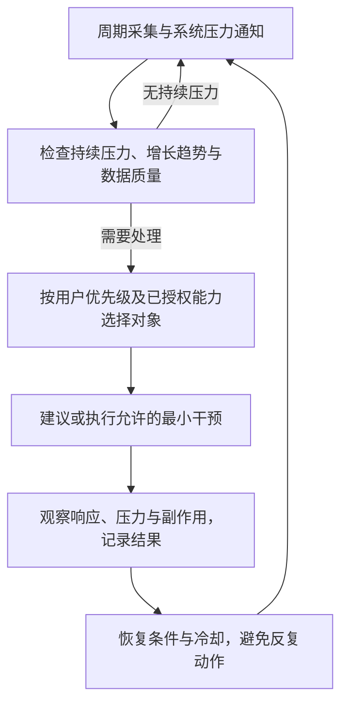

更新日期：2026年10月31日。本文维护本轮待办、依赖与验收条件。本轮已开始范围、批次、规则及桌面接入原型，但尚未完成整轮验收。现暂停原桌面验收路线，优先建设localhost网页入口；登记计划不产生真实操作或发布授权。

# 当前交付缺口（优先阅读）
完整产品目标是“网页 → 本地服务 → Package → 操作系统真实接入”，而不是停留在假数据演示。当前只完成下面标明的阶段，不能将WEB-01至03的受控通过等同于整个开发计划完成。

| **部分** | **目前实际状态** | **尚缺什么** |
| --- | --- | --- |
| Package与CLI | 已有Windows真实后端代码、工作集与单进程入口；本轮通过的是离线/假原生验证 | 真实环境行为及效果仍未验收 |
| localhost网页与服务 | 页面已调用Package，按钮、选择、结果与回看通过假数据验收 | 缺正式真实后端启动入口、明确模式展示及真实链路验收 |
| 范围、保护与规则扩展 | 部分核心原型和受控测试已存在 | 三条主线尚未整体接入网页及验收 |
| 实际产品交付 | 未完成 | 真正接通系统、验证真实行为，再完成采用的功能与分发收尾 |

## REAL-01 补齐正式网页启动与真实后端装配
- **做什么**：提供正式本地网页启动入口，直接装配现有Package操作系统后端；假数据入口独立保留。界面明确区分真实与假数据，显示真实能力及权限状态，不能默认演示数据冒充真实值。
- **依赖**：现有WEB适配与Package；不再重写清理逻辑，不要求通过CLI绕一遍。
- **验收**：正式入口的静态装配与受控测试证明连接真实后端选择路径，所有页面动作到同一Package，模式不能混淆；代码实现与真实执行分别记录。此项尚未实现。

## REAL-02 验收真实网页链路
- **做什么**：在固定版本和明确执行范围下，先验证真实只读指标与目标，再验证指定范围的一次实际维护及原始结果。
- **依赖**：REAL-01完成；真实采样与真实清理仍须有明确执行授权，不能从“应交付真实功能”推定本次可执行维护。
- **验收**：网页、HTTP请求、Package记录和操作系统返回事实对应；真实工作集/可用量与再次访问代价分开，未知和权限不足如实展示。未取得这些证据前，不标记真实产品链路验收完成。

本轮优先REAL-01，再完成三条功能主线和本地交付；REAL-02因当前禁止真实操作保持未执行，不阻断可受控完成的工程任务。此前“本次localhost闭环完成”仅指假数据闭环，保留历史证据，但不作为产品整体完成状态。

# 一、当前基线与本轮目标
Package、CLI/Tool、紧凑桌面及单进程定向整理已实现，主项目PR #11与Knowledge PR #21已合并。既有离线与隔离安装证据见 [上一阶段收尾记录](<运行记录 Run Record/2026-10-30 工具接入与计划收尾.md#六评审与合并收尾>)。用户反馈当前窗口与进程功能可用，这是体验反馈，不代替带环境、版本和操作范围的验收记录。已发布v0.2.0不含单进程能力，当前包元数据仍为0.2.0。

本轮围绕三件事完善现有工具：清理对象选得清楚，清理方式及执行时机合理，操作与结果看得明白。沿用轻量窗口与绿色按钮的产品方向，先完善已有能力，不扩展CPU诊断主界面。原EXP-01/02、DEM-01与PKG-01不再作为四条独立产品主线，分别纳入第三条主线和共同收尾，尚未执行的工作不标记完成。

## 当前执行范围：正式装配与剩余工程交付
先完成REAL-01，再连续完成第二章剩余SCOPE、METHOD、EXPERIENCE及DELIVERY任务。正式入口使用现有真实系统后端，假数据入口独立保留；当前执行只用替身验证装配及行为，不运行真实采样、枚举、权限调整和清理。REAL-02真实平台验收明确保持not_run，不计入工程受控测试通过。

网页优先，原桌面与托盘原型后置保留，当前生命周期交付以显式本地服务启动、规则停用、页面重开及服务退出为准。应用分组按已采用的完整程序文件路径呈现，未知归组独立保留；额外清理区域以METHOD-02采用结论为交付，不要求全部实现。默认关闭的规则在本地服务中调用同一Package和保护范围，不注册系统服务或开机任务。

整轮包括正式CLI网页入口、网页范围/保护/规则设置、受控接口与内置浏览器旅程、同步静态Demo、文档、离线wheel/sdist与隔离安装。本地commit保存完整阶段，最后统一汇报，不push、发布或安装到用户环境。旧WEB-01至03记录保留为之前的假数据阶段证据，不替代本轮功能与正式装配检查。

# 二、下一步开发任务
三条主线是任务分组，下面的小任务是具体实施和验收单位。部分核心已有工作区原型及定向受控测试，未完成项不能据此标记交付。本次本地网页前置任务已完成，其余三条主线继续作为后续待办。任务编号只用于追踪，不代表每完成一项都需要用户确认。

## 前置阶段：本地网页入口（最高优先级）
目标：在内置浏览器中完成点击、交互和验收，避免桌面Computer Use激活窗口或占用用户鼠标键盘。页面由本机服务提供，默认仅绑定127.0.0.1；浏览器通过localhost访问。本地网页是现有Package的交互适配，不是纯静态模拟网站，也不是另一份清理实现。

### WEB-01 建立localhost服务与包适配
- **做什么**：提供显式启动/停止的本地HTTP入口，返回网页及最小JSON接口；将内存状态、目标列表、单次/批次动作、取消与结果查询映射到现有Package。长任务用请求标识与状态查询，页面不阻塞等待，也不因轮询重复派发动作。
- **依赖**：先更新架构与源码映射；复用已写的范围、批次和记录原型，不要求先完成桌面界面。
- **验收**：默认只监听本机回环地址，启动和打开页面均不自动采样或清理；接口核对本地来源和会话，请求不接受任意shell命令或任意文件访问；动作与结果由Package统一处理，关闭服务会停止新请求并收尾已有任务。
- **状态**：已实现并完成HTTP受控测试，见 [localhost接入记录](<运行记录 Run Record/2026-10-31 localhost网页接入.md>)。

### WEB-02 做可点击的本地产品页面
- **做什么**：采用轻量HTML/CSS/JavaScript，先接通绿色主按钮、按需状态读取、进程选择与批次结果；随后承接三条主线的保护、方式和规则设置。首版不为页面另换重型技术栈。
- **依赖**：WEB-01；保持界面明确区分假数据预览与真实接入模式。
- **验收**：在localhost能完成页面→包接口→结果的旅程；处理中有即时反馈，目标范围清晰，结果不被刷新覆盖；当前以假后端运行且真实原生调用为零。浏览器本身不能直接操作系统内存，实际能力仍由本地Package提供。
- **状态**：已实现本次所需的按钮、列表与结果；保护、规则等后续主线尚未接入网页。

### WEB-03 用内置浏览器完成受控验收
- **做什么**：通过内置浏览器的页面控制能力验证本地页面，不激活桌面窗口、不调用Windows Computer Use、不使用用户鼠标键盘。假数据与原生调用禁用检查先于交互。
- **依赖**：WEB-01/02；接口离线测试与浏览器旅程相互补充。
- **验收**：验证状态读取、目标选择、确认、一次动作、批次取消、结果查询及停止服务；保存实际浏览器与接口证据。验收在隐藏标签通过DOM控制执行，不激活桌面窗口。
- **状态**：已完成隐藏内置浏览器验收与服务停止，未调用桌面Computer Use。取消在受控HTTP集成测试验证，不以快速合成动作的浏览器观察冒充取消时序证据。

## （一）清理谁
目标：从“能整理一个PID”，完善为“能选择一组对象，并清楚保护不想处理的应用”。

### SCOPE-01 找到并选择目标
- **做什么**：进程列表增加名称/PID查找、工作集排序与多选；刷新后仅保留身份仍一致的选择，显示选中数量。
- **依赖**：现有目标发现接口，先核对返回字段与窗口选择状态。
- **验收**：假数据中能找到并选中指定目标；排序和刷新不会把选中对象误换成其他进程；不按占用大小自动勾选。

### SCOPE-02 执行一批选中目标
- **做什么**：在Package增加批次请求和逐项结果，CLI/Tool与桌面复用；执行前展示范围，每个目标最多派发一次，支持停止后续未派发项。
- **依赖**：SCOPE-01；先更新动作合同、互斥与批次记录设计。
- **验收**：假接口只收到选中且身份匹配的目标；成功、失败、跳过、尚未执行分别记录；中途停止不重放已发生动作，离线能回看整批事实。

### SCOPE-03 按应用查看与选择
- **做什么**：确定可靠的应用关联依据，增加可展开的分组选择，执行前展示组内具体进程。
- **依赖**：SCOPE-02；补充归组依据调研和系统接入设计，不能仅按同名或父子关系直接认定同一应用。
- **验收**：已确认关联的合成进程可整组选择；同名但不相关对象不会被合并；证据不足时保留独立对象，不冒充完整应用覆盖。

### SCOPE-04 保存保护范围
- **做什么**：支持添加、移除与保存保护规则；提供“整理未保护对象”的明确范围，展示保护命中与将被处理的对象。
- **依赖**：SCOPE-02/03；区分当前进程身份与跨启动的应用匹配规则。
- **验收**：重启后规则保留，旧PID不会误保护新进程；批次实际跳过命中项；全局系统命令不显示为支持保护名单，不能用界面过滤替代实际跳过。

## （二）怎么清理
目标：让用户知道每种方式做什么，以及何时执行；所有执行入口遵守同一范围和保护规则。

### METHOD-01 整理已有清理方式
- **做什么**：核对工作集和Standby现有调用，说明作用对象、所需权限和重新访问代价，设计基本与高级选项的呈现。
- **依赖**：校正通用调研中的旧比较；核对原生入口及现有API兼容要求。
- **验收**：工作集支持的全局/进程范围与Standby系统范围清楚分开；不兼容的范围和方法组合不能执行；新增选项不改变默认绿色按钮的已确认语义。

### METHOD-02 明确其他方式的采用结论
- **做什么**：针对同类项目的文件缓存、Modified及其他区域补读对应源码和系统依据，比较用途、权限、影响与维护成本。
- **依赖**：METHOD-01；复用现有调研，不重新做一轮无目标的竞品清单。
- **验收**：每种候选给出采用、后置或不采用及理由；有依据才进入实现，不以选项数量作为完成标准。本项交付是选择结论，不要求把所有区域都实现。

### METHOD-03 实现默认关闭的规则执行
- **做什么**：先用可注入时钟与合成指标实现定时、持续压力条件、冷却和启停；明确规则使用的范围、方式和授权来源，复用Package执行与互斥。
- **依赖**：SCOPE-04、METHOD-01及规则设计；阈值按信号含义论证，不能照抄竞品数值或宣称能防止死机。
- **验收**：合成轨迹满足持续条件才派发；冷却期不重复触发，与手动动作不并发；保护范围不被绕过；关闭规则后不再派发。默认关闭，不随安装或普通启动启用真实后台任务。

## （三）怎么用得舒服
目标：范围、动作和结果组成一个容易理解的操作流程；本组从假数据观察开始，与前两组同步推进。

### EXPERIENCE-01 建立假数据交互验收
- **做什么**：复用本地网页前端与Package，注入假Reader和Maintainer，准备全局、单目标与批次的可重复场景。
- **依赖**：现有装配；批次场景在SCOPE-02后补入。用户已有体验反馈作为输入，不冒充正式运行证据。
- **验收**：启动、刷新、点击和退出全程不加载真实系统接入；保留页面图像、场景版本及操作记录，不另写一套演示执行器。

### EXPERIENCE-02 完善本地页面与结果
- **做什么**：保留紧凑绿色主入口，将范围、方式与规则设置放在清楚的次级区域；完善处理中反馈、批次结果和必要偏好恢复。
- **依赖**：WEB-02/03、EXPERIENCE-01观察结果及对应范围、方式合同；每项核心能力完成后同步接入。
- **验收**：操作前能看懂影响范围；处理时及时反馈，动画不冒充原生进度；刷新不覆盖本次结果；工作集与系统可用量分开，多进程差额不简单相加称为实际释放；桌面与窄屏视口及150%页面缩放下主要控件可操作，键盘可用。

### EXPERIENCE-03 明确服务与页面生命周期
- **做什么**：提供页面内的本地服务状态、规则停用及显式退出入口；关闭浏览器标签与停止本地服务分别说明。原托盘、原生通知与Tk窗口体验后置，不作为localhost首轮交付的前置条件。
- **依赖**：WEB-01、METHOD-03与EXPERIENCE-02；复用原工作线程与核心收尾逻辑，不新增系统服务或开机启动。
- **验收**：页面重开不重复执行动作；规则默认关闭，恢复页面不代表重新授权；显式退出停止新任务、停用规则并等待当前动作收尾。页面关闭不承诺已经停止本地进程，界面应提供清楚说明。

### EXPERIENCE-04 同步网页演示
- **做什么**：沿用现有demo，以合成数据演示选中对象、保护范围、执行反馈、结果及再次使用后的占用回升。
- **依赖**：EXPERIENCE-02形成稳定交互；按已实现能力制作，不把计划展示成可用功能。
- **验收**：主要旅程可完成与重置；定向演示不改变其他模拟进程；合成数据标识与GitHub入口清楚；键盘和减少动画设置有效，不读取访客设备或调用真实清理接口。

# 三、设计与执行顺序
## （一）先统一调研和设计
实现前校正 [通用调研](<通用调研 General Research CPU 内存清理.md#十二同类源码与包分发方案>) 中仍声称没有单进程能力的旧比较，补齐本轮采用判断所需的固定源码依据。架构维护职责、流程与状态；代码结构设计承接模块、公开合同和持久化映射，不在开发计划里提前规定文件数量。原入口兼容性、工具发现及记录schema分别核对。

## （二）按依赖连续推进
先完成WEB-01 → WEB-02 → WEB-03，得到可在内置浏览器使用的localhost入口，再继续EXPERIENCE-01、METHOD-01及SCOPE-01至04；METHOD-02可并行补查。范围与保护稳定后完成METHOD-03和页面完整交互，随后完成服务生命周期、网页演示及第四章收尾。原桌面Tk与托盘原型保留，不删除、不优先继续扩展；当前不再以桌面Computer Use作为验收手段。每个完整改动同步必要调用方、记录与测试，用本地commit保存，不逐任务要求用户确认。

## （三）保留执行边界
Package是唯一产品执行实现，CLI、桌面和规则调度复用同一合同；Knowledge维护接入说明。当前不运行真实采样、进程枚举、权限调整或清理，不结束业务程序、不更改系统设置、不自动提权。本地网页验收先核对全部系统接入已隔离，遵守 [README运行边界](<../README.md#运行与验证限制>)。真实验收和发布另按实际授权执行。

规则自动化纳入本轮设计和受控实现，真实后台调度保持默认关闭。第六章的跨应用资源协调及AI决策仍是独立候选研究，Linux和MCP不在本轮范围。范围或权限需要变化时只暂停受影响部分，继续不受影响工作。

# 四、验证与共同收尾
## （一）交付检查
每个小任务以第二章验收条件检查，记录实际通过与未覆盖范围，不预设庞大的边缘情况矩阵。Python使用统一执行器与局部清单，按关联资料库测试规范维护元数据；最终运行适用完整离线回归，读取或记录路径改变时复核只读离线计划。公开静态演示用 `node --test tests/demo/app.test.cjs` 独立验证；localhost新增HTTP/Package受控集成测试和内置浏览器旅程，不能以静态演示或假控件测试代替真实页面接入证据。

## （二）DELIVERY-01 准备预览产物
- **做什么**：全部采用能力及主要交互完成后，统一README、调研、设计和接入说明，核对包版本，离线构建wheel、sdist并重建，完成隔离安装。
- **依赖**：三组任务完成；METHOD-02未采用的区域不作为遗漏功能，理由须已记录。
- **验收**：安装产物、工具目录、文档与源码能力一致；用假接口验证调用和离线回看，保留源码指纹及产物校验；0.3.0仅为候选版本，API、工具版本和记录schema不机械同步升级，不改写v0.2.0。

## （三）完成与发布分别判断
所有实施任务验收、离线验证、文档一致与本地产物准备完成且无阻塞缺陷，才记为本轮工程完成。完成摘要归日期开发记录，实际环境、命令和结果归运行记录，活动问题归缺陷记录。整轮结束统一同步与review，按授权范围集成。GitHub Release、tag、Pages部署及PyPI发布分别按实际授权处理，实机效果与第六章研究不混算。

# 五、只读诊断验收计划
唯一计划正文位于 `tests/manifest.json`：`plans.readonly_offline` 是可执行的离线准备计划，`acceptance_plans.readonly_diagnostics` 是禁用的实机验收草案。后者记录目标、五维、依赖、资源、预算、步骤、预期、证据及离线用例映射，不注册为可运行的 unittest，也不进入 quick、regression 或 `--all` 的执行清单。`--plan readonly_diagnostics` 当前会被拒绝，资源参数不能启用该草案。

## （一）目标与顺序
验收目标为只读数据口径、缺失解释、持久化、界面及生命周期正确性，不判断清理收益。先完成 readonly_offline 和 regression，再在实际执行获明确授权、环境与监管能力齐备后检查实机。维护 API、特权调整、业务进程结束、服务和系统设置变更均不在范围内。实际 GUI 布局可先使用假 Reader，实机只读入口只向 Application 提供 Reader，Maintainer 留空。

| **检查标识** | **定位对象与预期** | **主要证据** | **当前状态** |
| --- | --- | --- | --- |
| ro_default | 默认只读，维护会话和原生维护调用为 0 | 装配、启动参数、运行头与终态 | 未执行 |
| ro_cpu | 首拍未知，后续累计差分正确，处理器组与覆盖不冒充全机 | 时间戳、累计 CPU 时间、处理器信息及参考口径 | 未执行 |
| ro_memory | bytes 与 GiB 一致，物理容量与提交量分开，未知和零可区分 | 同一份原始数据、换算与界面文字 | 未执行 |
| ro_gaps | PDH 预热、不可读项及权限缺口保留原因 | 样本 errors、预热记录和未覆盖条件 | 未执行 |
| ro_processes | top 仅限制排名，CPU 使用全部可读输入，身份与覆盖完整记录 | 进程创建身份、枚举计数及排名 | 未执行 |
| ro_records | 新目录保存，离线回看零系统接入，不完整记录不支持收益 | 样本、运行头、终态、回看退出码 | 未执行 |
| ro_lifecycle | 刷新不重入，取消与关闭以核心收尾为准，关闭后无新派发 | 交互顺序、报告和自身线程收尾 | 未执行 |
| ro_gui | 指标、时间、状态和维护区可辨，缩放与键盘操作可用 | 各缩放配置的图像或人工记录 | 未执行 |
| ro_cost | 记录只读执行的实际墙钟及自身 Job 提交量，不作收益判定 | ms、bytes、方法、样本量和预算状态 | 未执行 |

这些是验收检查标识，未执行项不计入自动化用例通过数。每项映射到已存在的离线回归方法，完整方法 ID 与步骤以清单为准。维护零调用是独立必需条件，读数正常或窗口能打开不能代替该证据。

## （二）环境、数据和预算
原草案采用过 `8c0c154`，该历史基线不再代表当前交付。执行前另行固定实际目标提交、源码指纹、wheel 校验值、Windows 完整构建、Python 版本、体系结构和普通权限上下文，不能复用旧回执冒充当前产物。配置矩阵为 Windows 11 / x64 / Python 3.13 与 Windows 10 / x64 / Python 3.10，当前均未核验。未覆盖配置保留未执行及原因，不能宣称已支持。

只读数据样本固定为 5 拍、1 秒间隔、单工作单元，第一拍保留而不计算不存在的前向差分。跨工具对照记录范围、单位、窗口和读取时差，不给异步瞬时 CPU 百分比编造相等阈值。GUI 的 100%、150%、200% 缩放通过预配置环境或进程内 Tk 缩放检查，不修改系统全局显示设置，每个配置单列结果。

单项按 c2 上限 60 秒 / 2 GiB，每个系统配置整批最多 600 秒，两个配置总预算 1200 秒，并发为 1。准备、采样、保存、收尾和人工交互都计入成本，内存仍为自身测试 Job 的提交量。以上是待落实的执行上限，不是性能合格阈值；控制器和整机内存不在该上限内。监管能力、资源或目标版本未准备好时不能开始实机验收。本轮不新增实机执行器，也不宣称已落实其实机监管。

## （三）证据、判定与阻断
每个配置使用新的独立验证目录，保留实际命令、产物、环境、原始样本、运行头与终态、界面证据、交叉核对口径和未执行原因，沿用统一运行报告的结果字段。功能检查有明确断言才记 passed，成本测量只有有效数据时记 measured，不混入质量通过率。无自然条件触发的读取异常保留未覆盖，离线故障注入结果单列。

任一必需项缺失、失败、超时、预算失控或环境不可用，都不能标记该配置验收通过。支持范围、测量完成和性能达标分别判断，当前没有清理或性能改善阈值。准备计划完成只说明具备进一步验证材料，实机检查仍保持 `not_run`。

# 六、候选研究方向
2026年10月27日讨论形成的候选方向：周期观察应用内存和系统压力，在桌面严重卡顿前尝试干预。该方向用于研究跨应用资源协调，尚未实现，不替换当前一键工作集整理，也不授权启动持续监测、限额、进程终止或权限操作。

## （一）问题、可行范围与系统能力
目标是保护用户当前任务的响应，评估是否能减少持续资源竞争。仅降低内存占用数字不构成成功。Windows 已提供进程内存统计、系统低内存通知和 Job Object 限额等能力，Agent 负责将用户优先级与这些能力结合，不能声称系统没有资源管理。[进程内存指标](https://learn.microsoft.com/en-us/windows/win32/api/psapi/ns-psapi-process_memory_counters_ex)、[压力通知](https://learn.microsoft.com/en-us/windows/win32/api/memoryapi/nf-memoryapi-creatememoryresourcenotification)

周期监测读取的是当前用量与增长趋势，不能知道程序未来全部需求，也不能发现哪些业务对象已无用。拦截每次申请属于另一层能力，不能由普通外部 Agent 的轮询实现。应用可能从已申请的内存池分配对象，外部系统统计不等于逐次业务申请记录。

| **观察范围** | **候选信号** | **限制** |
| --- | --- | --- |
| 系统 | 可用物理内存、提交余量、换页读入及磁盘响应 | 低内存通知只覆盖系统可用物理内存条件，需要其他信号补充，不能保证预测所有卡顿 |
| 应用 | 工作集、私有提交量、增长速度、进程身份与应用分组 | 共享页不能跨进程简单相加，多进程应用需要正确归组。权限不足保留未知 |
| 用户任务 | 前台活动、用户保护名单、可重跑任务与保存状态 | 前台不等于唯一重要任务，后台保存、会议和计算也可能需要保护 |

## （二）候选闭环与动作分级

| **对象或阶段** | **可研究的干预** | **执行前提与代价** |
| --- | --- | --- |
| 通用观察阶段 | 提示压力来源，给出处理建议 | 无自动控制。不能仅凭高占用、低 CPU 或进程名称判断可关闭 |
| 有协作接口的应用 | 请求释放缓存、减少并发、停止接收新任务 | 逐应用核验接口、所有权、共享使用者、状态保存与完成确认 |
| 由 Agent 启动的受管任务 | 启动前设置预算，使用 Job Object 提交内存限额及通知 | 限额约束提交量，不等于物理 RAM 预留。硬上限可导致分配失败，需要应用处理，核验既有 Job、嵌套、子进程和权限 |
| 普通第三方应用 | 先提示，具备可靠接口时请求正常退出 | 无通用外部对象回收接口，不能随意修改堆或强制挂起 |
| 最后手段 | 评估明确授权下终止可重跑的受管任务 | 可能丢失状态，需另行修改并评审项目执行边界。本阶段不实现，不将按内存排名自动杀进程作为默认策略 |

Job Object 提供进程与任务组提交内存上限，另有只通知的阈值能力。硬限额交由系统执行，不能等同 Agent 每轮观察后的建议。[限额合同](https://learn.microsoft.com/en-us/windows/win32/api/winnt/ns-winnt-jobobject_extended_limit_information)、[通知合同](https://learn.microsoft.com/en-us/windows/win32/api/winnt/ns-winnt-jobobject_notification_limit_information_2)

## （三）AI 与执行器的职责
AI 适合解释趋势、梳理用户优先级和提出策略，轻量执行器落实身份、权限、规则、预算与记录。紧急判断不能依赖远程模型及时回复。采样周期、持续窗口和阈值先用合成轨迹校准，不预设通用内存百分比。动作后检查恢复并设置冷却，避免重复裁剪、误杀或规则振荡。

## （四）研究与验证顺序
1. 用合成轨迹验证持续增长、瞬时峰值、数据缺失、PID 复用、应用归组和多个压力来源，初版只输出建议
2. 另获授权后进行有界只读观测，记录监测自身开销、漏报、误报和用户任务响应，不接入真实清理
3. 优先在自有、可重跑的受管任务上比较无干预、规则干预和候选 AI 策略，分别验证预算、异常恢复与实际体验
4. 只有取得应用协作与效果证据后，再评审扩大自动动作范围。没有证据时保留建议模式

持续压力下的任务响应、误干预、动作次数及执行器自身成本共同评价，不能以可用量上升代替收益。内存瞬时暴涨、驱动故障、硬件异常和执行器自身失去调度仍可能造成卡顿，方案不承诺阻止所有死机。上述接口资料于2026年10月27日定向阅读，尚未实机验证。
