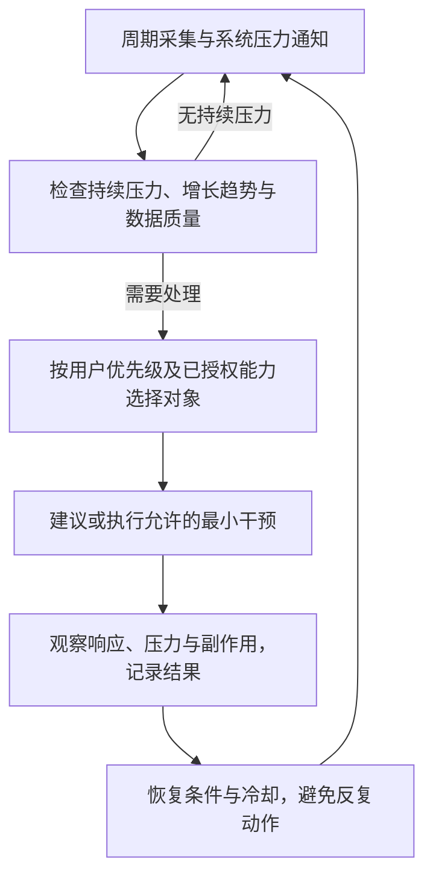

更新日期：2026年11月1日。本文维护实际剩余任务和验收条件，完成经过归开发记录，执行证据归运行记录。登记计划不产生真实操作或发布授权。

# 当前交付状态（优先阅读）
第十章网页交互已完成工程实现与假数据验收，第十一章随后经单独授权完成一次本机真实整理。第九章只保留前轮独立反馈条的工程状态，不作为当前网页方案。真实基本旅程不覆盖完整平台矩阵或持续性能收益。

第九章的功能恢复与独立装饰任务已按计划完成工程实施及假数据验收。恢复提交fd2a49b，独立装饰提交6c38acc，仅本地保存。主指标持续读取，后台终态直接发布，动效开关不改变业务。实际证据及未覆盖范围见 [独立装饰验收](<运行记录 Run Record/2026-11-01 功能恢复与独立装饰验收.md>)。

正式链路已实现：本地网页 → 回环HTTP服务 → 现有Package → 操作系统后端。正式启动使用`python -m cpu_memory_cleanup --web`，假数据脚本独立保留，页面明确展示模式。2026年10月31日补充本机真实读取、一次全局工作集动作及离线回看通过证据；当次原生返回0、权限恢复、记录完整，详见 [真实验收记录](<运行记录 Run Record/2026-10-31 真实网页验收与启动修正.md>)。

此前正式接入阶段的工程任务已完成，REAL-02的本机全局基本旅程已通过，完整平台矩阵及其他范围仍待验收。第八章的历史体验任务已完成当时工程检查，但用户试用否定了归零动效对主仪表和结果的控制，当前以第十章的网页需求和完成信号为准。原生可见窗口验收仍待安排。受控通过不等于实机效果通过。见 [开发记录](<开发记录 Development Record/2026-10-31 正式网页与范围规则.md>) 与 [运行记录](<运行记录 Run Record/2026-10-31 正式网页与范围规则.md>)。

# 一、当前基线与本轮目标
当前候选版本0.3.0，仅本地准备wheel和sdist，未push、打tag、发布Release、部署Pages或上传PyPI。已发布v0.2.0及原提交不变。API_VERSION、tool_schema_version保持1；系统记录schema1、进程schema2和独立批次索引版本1分别管理。

三条主线“清理谁、怎么清理、怎么用得舒服”已完成本轮采用的实现、受控验证和本地分发准备。按本次确认，CMD启动的Tk桌面窗口与localhost网页一起纳入第八章体验优化，二者共用Package，桌面窗口不再整体后置。托盘及通知原型仍后置，不因桌面美化自动纳入。网页验收用内置浏览器；桌面先做注入假应用的受控测试，原生窗口视觉检查单列，不占用用户鼠标键盘。Linux、MCP、系统服务、开机任务和AI资源协调不纳入本轮工程完成范围。

# 二、下一步开发任务
## REAL-02 验收真实网页链路（基本旅程通过，扩展验收待开展）
- **目的**：核对实际平台权限、指标、动作事实及恢复代价，不能只观察内存数字下降。
- **依赖**：明确允许真实只读及指定范围维护；固定提交、安装包校验、系统版本、权限上下文、目标身份与预算。本轮用户已单独授权真实读取和一次全局工作集整理，不启用自动规则；该次动作已完成，不自动重试或视为后续持续授权。
- **顺序**：按第五章准备真实只读验收；再在单独明确维护范围下，核对网页请求、Package原记录和系统返回；工作集与系统可用量、再次访问代价分别观察。
- **验收**：保留原始值、失败、未知、覆盖和未执行项；没有真实证据不标记实机通过，不用假数据或假DLL证明性能收益。
- **状态**：本机Windows 10.0.26200/Python 3.13.9的内存读取、一次全局工作集与离线回看通过。CPU完整口径、跨版本矩阵、定向/批次/Standby真实动作、自动规则真实执行及性能收益均未验收；后续按具体需求与授权再执行，不因候选清单存在就全部运行。

本轮工程完成经过见日期开发记录，第八章仅保留交付状态与剩余验收。网页和桌面证据分别判断，不能仅以网页通过就声明两端视觉通过。后续同步、review、合并、Release、Pages和PyPI属于独立交付动作，当前未执行，不从本轮工程任务自动取得发布授权。候选研究见第六章，不当作已决定开发任务。

# 三、本轮工程完成映射
下表保留原任务标识以关联已有设计；完成经过归日期记录，不继续列为待办。

| **任务** | **已完成范围** | **证据边界** |
| --- | --- | --- |
| REAL-01、WEB-01 | 正式API/CLI网页装配、模式/能力说明、仅回环服务、会话和单业务工作单元 | 正式工厂和Windows后端以假DLL验证，未运行真实读取 |
| WEB-02/03、EXPERIENCE-01 | 网页绿色主按钮单击执行、高级/批次明确确认、选择、回看及内置浏览器验收 | 合成数据、禁止真实DLL；取消时序由HTTP受控测试验证 |
| SCOPE-01/02 | 搜索、排序、身份多选、串行批次、取消后续项和原记录回看 | 身份和调用次数断言，不冒充全机覆盖 |
| SCOPE-03/04 | 完整程序文件路径分组、路径/实例保护、保存与移除、未保护范围 | 同路径文件组不是完整应用组；全局动作不支持保护 |
| METHOD-01/02 | 默认工作集、高级手动系统Standby；其他区域后置结论 | 采用理由见通用调研第十三章，不为选项数量新增系统调用 |
| METHOD-03 | 默认关闭的定时/持续压力、冷却、固定身份和保护快照、互斥及停止 | 注入时钟/信号验证，阈值不是已验证性能参数 |
| EXPERIENCE-02/03 | 实时轻量显示与平滑过渡、单击工作集、逐项结果、设置恢复、规则状态和显式退出；窄屏、150%缩放、键盘确认 | 页面重开不重放；关闭标签不停止服务；未验收原Tk/托盘原型 |
| EXPERIENCE-04 | 静态合成Demo增加选择、保护、结果、回升和重置 | 本地浏览器与Node验证，未部署 |
| DELIVERY-01 | 0.3.0候选元数据、wheel/sdist及重建、资源校验与隔离安装 | 本地候选产物，未发布，不改变v0.2.0 |

# 四、验证与共同收尾
采用仓库统一执行器与树状测试清单，完成完整离线回归、只读离线准备、Demo的Node检查及隔离安装。实际Run标识、源码指纹、命令、结果与本地产物SHA256见本轮运行记录，不将各计划有重叠的用例相加作唯一用例数。

源码与文档均以本地commit保存。本轮工程完成与REAL-02的真实验收分别判断；本机一次原生成功不能证明持续收益、性能改善、多平台支持或全部产品验收完成。

# 五、只读诊断验收计划
唯一计划正文位于 `tests/manifest.json`：`plans.readonly_offline` 是可执行的离线准备计划，`acceptance_plans.readonly_diagnostics` 是禁用的实机验收草案。后者记录目标、五维、依赖、资源、预算、步骤、预期、证据及离线用例映射，不注册为可运行的 unittest，也不进入 quick、regression 或 `--all` 的执行清单。`--plan readonly_diagnostics` 当前会被拒绝，资源参数不能启用该草案。

## （一）目标与顺序
验收目标为只读数据口径、缺失解释、持久化、界面及生命周期正确性，不判断清理收益。先完成 readonly_offline 和 regression，再在实际执行获明确授权、环境与监管能力齐备后检查实机。维护 API、特权调整、业务进程结束、服务和系统设置变更均不在范围内。实际 GUI 布局可先使用假 Reader，实机只读入口只向 Application 提供 Reader，Maintainer 留空。

| **检查标识** | **定位对象与预期** | **主要证据** | **当前状态** |
| --- | --- | --- | --- |
| ro_default | 默认只读，维护会话和原生维护调用为 0 | 装配、启动参数、运行头与终态 | 未执行 |
| ro_cpu | 首拍未知，后续累计差分正确，处理器组与覆盖不冒充全机 | 时间戳、累计 CPU 时间、处理器信息及参考口径 | 未执行 |
| ro_memory | bytes 与 GiB 一致，物理容量与提交量分开，未知和零可区分 | 同一份原始数据、换算与界面文字 | 未执行 |
| ro_gaps | PDH 预热、不可读项及权限缺口保留原因 | 样本 errors、预热记录和未覆盖条件 | 未执行 |
| ro_processes | top 仅限制排名，CPU 使用全部可读输入，身份与覆盖完整记录 | 进程创建身份、枚举计数及排名 | 未执行 |
| ro_records | 新目录保存，离线回看零系统接入，不完整记录不支持收益 | 样本、运行头、终态、回看退出码 | 未执行 |
| ro_lifecycle | 刷新不重入，取消与关闭以核心收尾为准，关闭后无新派发 | 交互顺序、报告和自身线程收尾 | 未执行 |
| ro_gui | 指标、时间、状态和维护区可辨，缩放与键盘操作可用 | 各缩放配置的图像或人工记录 | 未执行 |
| ro_cost | 记录只读执行的实际墙钟及自身 Job 提交量，不作收益判定 | ms、bytes、方法、样本量和预算状态 | 未执行 |

这些是验收检查标识，未执行项不计入自动化用例通过数。每项映射到已存在的离线回归方法，完整方法 ID 与步骤以清单为准。维护零调用是独立必需条件，读数正常或窗口能打开不能代替该证据。

## （二）环境、数据和预算
原草案采用过 `8c0c154`，该历史基线不再代表当前交付。执行前另行固定实际目标提交、源码指纹、wheel 校验值、Windows 完整构建、Python 版本、体系结构和普通权限上下文，不能复用旧回执冒充当前产物。配置矩阵为 Windows 11 / x64 / Python 3.13 与 Windows 10 / x64 / Python 3.10，当前均未核验。未覆盖配置保留未执行及原因，不能宣称已支持。

只读数据样本固定为 5 拍、1 秒间隔、单工作单元，第一拍保留而不计算不存在的前向差分。跨工具对照记录范围、单位、窗口和读取时差，不给异步瞬时 CPU 百分比编造相等阈值。GUI 的 100%、150%、200% 缩放通过预配置环境或进程内 Tk 缩放检查，不修改系统全局显示设置，每个配置单列结果。

单项按 c2 上限 60 秒 / 2 GiB，每个系统配置整批最多 600 秒，两个配置总预算 1200 秒，并发为 1。准备、采样、保存、收尾和人工交互都计入成本，内存仍为自身测试 Job 的提交量。以上是待落实的执行上限，不是性能合格阈值；控制器和整机内存不在该上限内。监管能力、资源或目标版本未准备好时不能开始实机验收。本轮不新增实机执行器，也不宣称已落实其实机监管。

## （三）证据、判定与阻断
每个配置使用新的独立验证目录，保留实际命令、产物、环境、原始样本、运行头与终态、界面证据、交叉核对口径和未执行原因，沿用统一运行报告的结果字段。功能检查有明确断言才记 passed，成本测量只有有效数据时记 measured，不混入质量通过率。无自然条件触发的读取异常保留未覆盖，离线故障注入结果单列。

任一必需项缺失、失败、超时、预算失控或环境不可用，都不能标记该配置验收通过。支持范围、测量完成和性能达标分别判断，当前没有清理或性能改善阈值。准备计划完成只说明具备进一步验证材料，实机检查仍保持 `not_run`。

# 六、候选研究方向
2026年10月27日讨论形成的候选方向：周期观察应用内存和系统压力，在桌面严重卡顿前尝试干预。该方向用于研究跨应用资源协调，尚未实现，不替换当前一键工作集整理，也不授权启动持续监测、限额、进程终止或权限操作。

## （一）问题、可行范围与系统能力
目标是保护用户当前任务的响应，评估是否能减少持续资源竞争。仅降低内存占用数字不构成成功。Windows 已提供进程内存统计、系统低内存通知和 Job Object 限额等能力，Agent 负责将用户优先级与这些能力结合，不能声称系统没有资源管理。[进程内存指标](https://learn.microsoft.com/en-us/windows/win32/api/psapi/ns-psapi-process_memory_counters_ex)、[压力通知](https://learn.microsoft.com/en-us/windows/win32/api/memoryapi/nf-memoryapi-creatememoryresourcenotification)

周期监测读取的是当前用量与增长趋势，不能知道程序未来全部需求，也不能发现哪些业务对象已无用。拦截每次申请属于另一层能力，不能由普通外部 Agent 的轮询实现。应用可能从已申请的内存池分配对象，外部系统统计不等于逐次业务申请记录。

| **观察范围** | **候选信号** | **限制** |
| --- | --- | --- |
| 系统 | 可用物理内存、提交余量、换页读入及磁盘响应 | 低内存通知只覆盖系统可用物理内存条件，需要其他信号补充，不能保证预测所有卡顿 |
| 应用 | 工作集、私有提交量、增长速度、进程身份与应用分组 | 共享页不能跨进程简单相加，多进程应用需要正确归组。权限不足保留未知 |
| 用户任务 | 前台活动、用户保护名单、可重跑任务与保存状态 | 前台不等于唯一重要任务，后台保存、会议和计算也可能需要保护 |

## （二）候选闭环与动作分级

| **对象或阶段** | **可研究的干预** | **执行前提与代价** |
| --- | --- | --- |
| 通用观察阶段 | 提示压力来源，给出处理建议 | 无自动控制。不能仅凭高占用、低 CPU 或进程名称判断可关闭 |
| 有协作接口的应用 | 请求释放缓存、减少并发、停止接收新任务 | 逐应用核验接口、所有权、共享使用者、状态保存与完成确认 |
| 由 Agent 启动的受管任务 | 启动前设置预算，使用 Job Object 提交内存限额及通知 | 限额约束提交量，不等于物理 RAM 预留。硬上限可导致分配失败，需要应用处理，核验既有 Job、嵌套、子进程和权限 |
| 普通第三方应用 | 先提示，具备可靠接口时请求正常退出 | 无通用外部对象回收接口，不能随意修改堆或强制挂起 |
| 最后手段 | 评估明确授权下终止可重跑的受管任务 | 可能丢失状态，需另行修改并评审项目执行边界。本阶段不实现，不将按内存排名自动杀进程作为默认策略 |

Job Object 提供进程与任务组提交内存上限，另有只通知的阈值能力。硬限额交由系统执行，不能等同 Agent 每轮观察后的建议。[限额合同](https://learn.microsoft.com/en-us/windows/win32/api/winnt/ns-winnt-jobobject_extended_limit_information)、[通知合同](https://learn.microsoft.com/en-us/windows/win32/api/winnt/ns-winnt-jobobject_notification_limit_information_2)

## （三）AI 与执行器的职责
AI 适合解释趋势、梳理用户优先级和提出策略，轻量执行器落实身份、权限、规则、预算与记录。紧急判断不能依赖远程模型及时回复。采样周期、持续窗口和阈值先用合成轨迹校准，不预设通用内存百分比。动作后检查恢复并设置冷却，避免重复裁剪、误杀或规则振荡。

## （四）研究与验证顺序
1. 用合成轨迹验证持续增长、瞬时峰值、数据缺失、PID 复用、应用归组和多个压力来源，初版只输出建议
2. 另获授权后进行有界只读观测，记录监测自身开销、漏报、误报和用户任务响应，不接入真实清理
3. 优先在自有、可重跑的受管任务上比较无干预、规则干预和候选 AI 策略，分别验证预算、异常恢复与实际体验
4. 只有取得应用协作与效果证据后，再评审扩大自动动作范围。没有证据时保留建议模式

持续压力下的任务响应、误干预、动作次数及执行器自身成本共同评价，不能以可用量上升代替收益。内存瞬时暴涨、驱动故障、硬件异常和执行器自身失去调度仍可能造成卡顿，方案不承诺阻止所有死机。上述接口资料于2026年10月27日定向阅读，尚未实机验证。

# 七、网页体验反馈调整
2026年10月31日已采用与原桌面相近的实时显示和直接主按钮流程：可见页面持续轻量读取，主工作集按钮点击即整理一次，无二次弹框；高级/批次保留确认。显示与自动规则分开，整理中继续显示，后台或手动暂停停止刷新，结果区不被刷新覆盖。此轮用合成接口及内置浏览器验收新交互，不再次触发真实全局清理；既有一次真实成功记录保留原代码和范围。

# 八、网页与桌面共同体验优化
2026年10月31日，POLISH-01、POLISH-02、POLISH-03、DESKTOP-01、DESKTOP-02已完成本轮工程实现与受控检查。任务设计、完成映射和取舍归 [开发记录](<开发记录 Development Record/2026-10-31 网页与桌面体验优化.md>)，真实执行范围及证据归 [运行记录](<运行记录 Run Record/2026-10-31 网页与桌面体验优化.md>)。当前只做本地提交，不推送或发布。

## （一）交付状态
两端共用主状态与最近动作结果的业务口径：紧凑主界面、绿色工作集按钮、独立实时刷新、稳定结果、按需详情。网页圆环绑定WEB-02已修复并受控验证。桌面次级内容归并为进程范围、整理设置、运行详情，打开不读取目标，关闭不退出主窗口。CMD保留pythonw入口及参数转发，脚本不复制清理逻辑。

## （二）剩余验收
1. **原生可见窗口**：在允许的窗口验收环境下，核对标准及150%字体下实际视觉、键盘焦点、主窗口与次级窗口开关，以及CMD正常启动无常驻终端。本次仅做隐藏Tk尺寸检查及受控入口测试，不将其冒充可见窗口验收。无需为此再做真实清理。
2. **交付同步**：本地候选包已按当前源码重建；push、PR、合并和新Release按后续实际交付指令执行。本轮没有部署静态Pages或上传PyPI。
3. **真实平台扩展**：沿第二章REAL-02按需要和具体授权安排；一次历史全局成功不覆盖定向、批次、Standby、规则或性能收益。本轮没有新增清理区域、热键、托盘、系统服务或AI资源协调。

工程实施不再保留未完成任务；上述独立视觉及真实平台证据未取得前，相关验收状态保持未验证。研究建议仍见第六章，不自动升级为开发任务。

## （三）试用反馈的后续状态
桌面圆环比例/平滑与主按钮调用后3秒观察已实现，见 [圆环开发记录](<开发记录 Development Record/2026-10-31 桌面圆环比例修正.md>) 和 [观察开发记录](<开发记录 Development Record/2026-10-31 调用后观察与结果时机.md>)。该次完整回归519/520通过的原始超时保留。清单检查现已按多次实际成本校准为c2/3秒，另起完整运行521项全部首次通过，新增的提前完成动效用例再作定向验证；各次执行范围见最新运行记录。原生可见窗口观感及后续真实范围验收仍沿上述限制执行。

## （四）归零动效的当前决定
此前实现和节奏调整保留在日期开发/运行记录及提交中。用户2026年11月1日要求先回到原有功能，明确功能与动效分工。当前撤下接管主仪表及扣住结果的动效，不能继续将“动效0但原始样本未污染”当作完整解耦的验收目标。

# 九、当前优先任务：先恢复功能，再实现独立装饰
## （一）本轮目标与边界
真实读取、一次清理与真实结果是产品主能力。三层结构保留，先依据架构的状态归属及流程合同修正交互映射，再安排实现。当前只读/假接入验证不证明真实清理收益，不执行真实清理，不修改系统命令、观察秒数或权限范围。

此前恢复先在工作区完成，随后按用户要求先修正两份设计与计划。本轮获授权后先提交恢复基线，再确定独立反馈条位置及模块，之后实现和验收，实际经过归日期记录。

## （二）任务拆分、顺序与验收
### PLAN-01 先固定职责和完成条件
- 内容：修正架构中“主仪表由动效接管、回弹后才公布结果”的决定，明确真实读数、业务终态、固定结果和装饰各自拥有的数据
- 依赖：关联DreamSoul架构研究中的状态归属、质量场景和行为合同方法，既有通用调研及用户本轮确认
- 验收：四个主场景可以推导出明确的数据写入者与完成者，架构不包含具体Python实现
- 状态：已落实，职责合同与四个主场景进入两端测试

### STRUCT-01 从架构映射源码和依赖
- 内容：在代码结构设计标出core、Windows接入、HTTP、桌面和网页读数/结果入口，区分恢复范围与后续装饰落点
- 验收：主指标只能由真实读数渲染写入，后台报告发布没有装饰等待；装饰不能持有维护方法或任务终态控制
- 状态：已落实，独立模块及固定资源路由已实现

### RESTORE-01 交付功能基线恢复
- 内容：核对当前工作区的五文件局部恢复，保留后台、保护/规则、桌面尺寸/抗锯齿及已校准的测试预算，逐项检查与cb47a70功能基线的差异
- 验收：假数据下清理期间读数持续变化；每次请求最多一次维护；后台完成后结果正常发布，不等装饰计时；实际回看不再维护
- 状态：已完成，先以fd2a49b本地提交恢复，后续装饰基于该提交，不改核心维护流程

### EFFECT-01 先确定独立装饰的表达，再实现
- 内容：仅在独立区域或装饰环表达归零、等待和回弹，保持主百分比、主实际圆环、实际容量与结果始终可读；先在专项设计写清最终落点，再实现
- 依赖：PLAN-01、STRUCT-01和RESTORE-01成立，界面位置与数据权限明确，不直接重用被撤下的状态门控
- 验收：关闭或移除装饰时仍能完整读取、清理和展示结果；装饰慢/快不改变业务请求次数、快照或结果发布时间
- 状态：已完成，按钮下独立反馈条及开关，主圆环和结果不参与动效；实现提交6c38acc

### VERIFY-01 分开验收并保留证据
- 顺序：先Package/假DLL调用及记录，再网页/桌面持续读数与结果，最后独立装饰开关等价检查
- 验收：真实指标40→35→30时主显示同步；后台先完成立即公布结果；装饰先结束仍按后台忙碌；两端每次最多一次维护；动态预览明确标注合成数据
- 交付：运行记录保存实际命令、模式、调用次数和未验证项，开发记录保存决定和结构变化；源码/资源或入口最终定稿后再核对候选包，按实际授权本地提交或同步
- 状态：已完成工程范围：523项完整离线回归通过，最终62项定向及9项JS通过，内置浏览器和隐藏真实Tk验收开关等价，隔离安装36项通过。真实清理收益和可见原生窗口观感未验收

## （三）交付与剩余边界
本轮五项任务已完成，过程、验证与候选包均本地保存，未push或发布。继续遵守不执行真实清理的限制。可见原生窗口观感及真实效果另行验证，不以假数据或隐藏控件检查替代。

# 十、网页需求重定与实施计划
## （一）确认范围
主圆环三秒匀速归零，业务真正收尾后触发回弹，后台持续读取，真实读数另区显示，结果不等动画。只做网页、内置浏览器与假数据，本地桌面不做，不运行真实清理。

## （二）顺序
1. REQUIRE-01：先更新README需求、架构状态合同和源码映射，区分业务完成、数据更新、动画结束。完成标准是本次系统调用/安全收尾，而非清零或固定等待
2. WEB-01：实现主圆环模式及独立实际读数区，移除独立反馈条方案；保留后台连续读取及一次派发
3. SIGNAL-01：从成功报告通知回弹，撤掉网页固定三秒后续观察参数，使用默认即时前后快照与安全收尾，失败不伪报成功，Package/桌面不变
4. VERIFY-01：可控时钟、HTTP假后端、内置浏览器三层验证，使用推进时间和变化读数，以及慢任务与快任务；保留每次调用数量及原始结果
5. DOC-01：按实际结果更新日期记录与计划，区分假数据通过、真实效果未验收和桌面未变。仅本地commit，不push或发布

## （三）验收
实际读数在过程归零期间持续推进；三秒到了但后台未完不能回弹或显示成功；后台提前完成应立即公布真实结果，随后动效自行归零/回弹；原报告和快照不包含动效零；一次点击一个动作。可见浏览器检查是必要步骤，不能由静态测试替代。本次不要求原生桌面或真实清理验收。

## （四）完成状态与交付边界
REQUIRE-01、WEB-01、SIGNAL-01、VERIFY-01、DOC-01均已完成本轮工程范围。设计先行后实施网页，实际区域持续更新，过程圆环只订阅任务终态。完整离线回归523项通过，网页JS独立11项通过；内置浏览器已覆盖慢任务等待、快任务先发布结果、回弹及关闭动效。每次合成点击仅一次维护，快照与业务报告保留原值。

实际证据见 [运行记录](<运行记录 Run Record/2026-11-01 网页完成信号与主圆环.md>)，调整经过见 [开发记录](<开发记录 Development Record/2026-11-01 网页完成信号与主圆环.md>)。只做本地提交，未push、发布或部署Pages；本轮没有真实采样或真实清理，没有修改或启动原生桌面。真实系统收益和桌面新体验不计为已验收。

# 十一、本机真实工作集基本验收
本次用户另行明确授权真实读取和一次全局工作集整理，不启用自动规则。该授权仅用于本次验收，不将第十章的假数据结果改写为真实验证。

1. 使用当前源码启动独立正式网页服务，核对preview=false、平台为真实系统、规则未武装；不使用18768合成服务或旧代码服务代替
2. 内置浏览器持续读取并保留前置读数，通过绿色按钮只派发一次全局工作集整理；不执行Standby、定向批次或重复清理
3. 核对原生返回、权限恢复、前后原始快照、记录收尾和界面回弹，结果按实际净变化报告；不预设必须降至20%或将动效0%作为证据
4. 一次动作后仅继续短期只读观察，保存截图、时间轨迹和运行记录；若失败，先定位且不自动再次清理。只做本地记录，不push或发布

状态：已完成。本机当前代码2b7ff7e的正式服务preview=false，内置浏览器执行恰好一次全局工作集动作，原生返回0、权限恢复、资源关闭和记录完整，规则始终未武装。即时快照可用量增加5.51 GiB；数秒后实际读数约47%降至20%，随后22–24%。即时报告与后续实时读数按各自时间保留。证据见 [真实运行记录](<运行记录 Run Record/2026-11-01 正式网页真实整理验收.md>)，没有重复清理或运行原生桌面，未push或发布。
