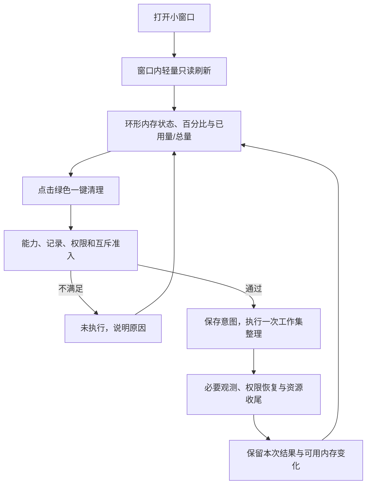
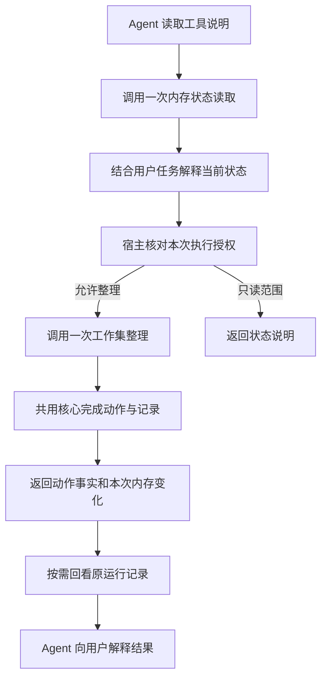

整理日期：2026年10月30日。以下归档原开发计划中的已交付阶段、产品决策与当时合同，保留原章节标题便于追溯。AGT-01 至 AGT-04 已完成离线验收，实机、MCP 和持续 Agent 仍未完成，原文提及的后续条件不是完成声明。当前待办只在 [开发计划](<../开发计划 Development Plan CPU 内存清理.md>) 维护，验证见 [包与工具接入记录](<../运行记录 Run Record/2026-10-30 包与工具接入.md>)。

# 二、已有优化工作的计划基线
下表提取原计划的工作目标与验收条件，不重复其完成清单、执行次数和测试通过数。原计划后续按已复现故障扩大了边界检查，实际采用与完成情况以开发记录及测试回执为准。

| **任务** | **对应职责与范围** | **验收条件** | **完成证据入口** |
| --- | --- | --- | --- |
| DEV-01 测试工作进程收尾 | 测试执行器及其自身工作进程，不属于产品运行模块 | 收尾失败保留原结果并阻断放行，中断与超时不丢证据，不影响无关进程 | [运行记录 Run Record：任务一](<../运行记录 Run Record/2026-10-23 测试与构建.md#任务一测试工作进程收尾>) |
| DEV-02 取消终态与回看归属 | AR-02 流程协调、AR-05 记录访问 | 终态封存后不再接纳无法兑现的取消，记录归属与顺序一致，未知不重放 | [运行记录 Run Record：任务二](<../运行记录 Run Record/2026-10-23 测试与构建.md#任务二取消终态与回看归属>) |
| DEV-03 指标质量与比较口径 | AR-03 分析解释、AR-04 系统接入 | 未知首拍与持续缺口分别保留，单位与窗口一致，证据缺失不支持收益 | [运行记录 Run Record：任务三](<../运行记录 Run Record/2026-10-23 测试与构建.md#任务三指标质量与比较口径>) |
| DEV-04 命令行缺口呈现 | AR-01 用户交互 | 文本与结构化结果均能定位样本时刻、序号及读取原因 | [运行记录 Run Record：任务四](<../运行记录 Run Record/2026-10-23 测试与构建.md#任务四cli-缺口呈现>) |

# 六、2026年10月26日的一致性整理
本轮依据已同步的飞书通用测试规范及本地代码、文档规范开展，不新增通用规范副本。持久目标跟踪文档、源码、测试与脚本的一致性，实际完成与验证另记对应日期记录。

| **阶段** | **处理范围** | **完成条件** |
| --- | --- | --- |
| 文档与合同 | 核对所有现行 Markdown 及历史记录边界，完善架构到源码、测试与脚本的映射 | 当前文档可沿职责追溯到实现与验证；历史事实不被冒充为本次执行 |
| 产品源码 | 核对既有三层模块、分析模块命名、公共入口和副作用边界 | 仅修复确有调用或契约依据的问题，不新增无需求的抽象 |
| 测试结构 | 将共享离线装配集中在 `tests/fixtures.py`，更新使用方 | 镜像目录只放对应测试，辅助职责明确，配置与实际方法一致 |
| 脚本 | 收敛为桌面启动和测试执行两个入口，核对转发、输出位置说明及测试运行入口 | 不复制产品业务逻辑，脚本契约与文档一致，离线验证可定位 |
| 集成验证 | 执行完整离线计划、只读准备计划和干净安装包检查 | 结果、环境、指纹与产物关联，失败保留；真实采样、GUI、清理和权限操作不执行 |

本轮阶段落实情况见 [开发记录 Development Record](<2026-10-26 测试结构.md>)，执行证据见 [运行记录 Run Record](<../运行记录 Run Record/2026-10-26 测试结构与文档对齐.md>)。只读实机验收继续待授权与环境准备。

按后续确认，测试和脚本精简完成后暂停实施，先重新规划产品方向。当前变更与验证见 [测试与脚本精简记录](<../运行记录 Run Record/2026-10-26 测试与脚本精简.md>)，本计划不自动授权继续界面开发或实机验证。

后续单独授权的配置树试验及其等价性验证见 [测试配置树记录](<../运行记录 Run Record/2026-10-26 测试配置树.md>)；该试验不扩展产品界面开发或实机执行范围，完成后继续等待重新规划。

# 七、内存清理插件的产品基线
2026年10月26日纠正方向：产品目标回归历史提交中的360加速球式一键内存释放小工具。现有历史证据对应独立桌面小窗口，尚没有特定浏览器、编辑器或其他宿主的插件协议。本阶段按此小窗口形态实施，不宣称已有宿主集成。

## （一）核心任务
用户打开后看内存占用，点击绿色“一键清理”，随后在同一窗口看到本次可用内存变化。首屏以环形状态、主按钮和结果反馈组织，提交量和技术信息按需展开。CPU 看板、占用排名、先诊断再选方案不进入主窗口。

| **功能** | **当前行为** | **边界** |
| --- | --- | --- |
| 内存状态 | 环形仪表、大字号物理占用百分比、已用量与总量 | 仪表表达内存占用，百分比按物理总量与可用量计算，未知不补零 |
| 一键清理 | 绿色主按钮固定提交一次系统工作集整理 | 点击就是该次明确执行请求，不清 Standby、不结束进程、不自动提权 |
| 结果反馈 | 本次可用内存增加、减少或不变，动作与整体完成度 | 从动作前后原始快照计算；实时刷新不覆盖本次结果，不把差额称为永久释放或提速 |
| 可展开详情 | 提交量及前后明细、更新时间、机制说明、记录、刷新与取消 | 辅助内容按需查看；忙时不排队，关闭时等待必要收尾 |

窗口打开期间约每500毫秒尝试轻量读取内存显示，清理中继续更新，关闭后停止。不建立窗口之外的后台任务，不自动清理。用户不需要先运行诊断、选进程或进入方案页。主窗口不进行进程排名采集。保留的命令行与历史分析工具是辅助能力，不作为使用清理按钮的前置任务。

记录默认保存在当前用户主目录下的 `.cpu-memory-cleanup/runs/`，可由已有启动参数指定其他位置。单次清理在其下创建独立运行目录，记录不可写则核心阻止动作。仅打开窗口不创建维护记录或修改系统设置。

## （二）操作流程

第一版固定工作集方式，实际系统不支持时禁用清理按钮并解释，不自动切换其他机制。清理中的重复点击、刷新和新维护均拒绝，不维护待执行队列。派发前取消可阻止动作，派发后不承诺撤销或回滚。

## （三）历史依据与旧方向处理
`fc26a00` 记录360式一键内存释放目标，`571d29b` 和 `74284f9` 提供小窗口、绿色主操作及内存显示，`00dbcb2` 明确打开只读、点击才释放。此次回到这个用户任务，保留目前核心的事实记录及安全收尾，不以旧提交覆盖当前工作区。

此前以 CPU、内存诊断面板为主的方案已经被本次用户纠正取代。其研究证据和执行记录按原日期保留，不再作为本阶段产品目标。

## （四）实现机制与用户反馈的对应
2026年10月27日补充。当前按钮使用一次系统工作集整理，改变部分页面的驻留状态。内存占用按物理总量与可用量计算，提交量在详情单列。详细调用链、页面状态图和证据限制统一见 [通用调研 General Research 第四章第五节](<../通用调研 General Research CPU 内存清理.md#五本项目绿色按钮如何改变内存显示>)，本节将其转成开发目标。

| **环节** | **当前实现** | **下一步反馈与验收要求** |
| --- | --- | --- |
| 打开窗口 | 轻量只读刷新，不创建清理记录 | 用户一眼区分当前占用、可用量与上次清理结果，未知与过期读数不能冒充当前值 |
| 点击按钮 | 记录、权限、互斥准入，保存前快照与意图，至多一次调用 | 忙时明确等待，不排队。准入失败显示未执行及原因 |
| 调用与恢复 | 当前 Windows 接入使用信息类80、命令2，并核对临时特权恢复 | 调用成功、整体收尾完成、恢复未确认分别呈现，未知不能自动重试 |
| 展示结果 | 本次结果区与实时内存状态分开，详情保留前后值 | 首屏明确呈现可用内存增加、减少或不变，结果来自原始快照，后续读数不覆盖本次结果 |
| 解释效果 | 结果附简短机制解释，详情保留提交量、缺页、I/O 和技术说明 | 用户能理解“程序仍在运行，再次使用时占用可能回升”，不将差额当作永久释放或提速证明 |
| 持续显示 | 显示线程与动作独立，数值缓动，关闭后收尾 | 结果区保留动作快照，实时区继续显示当前状态，动画不能充当动作进度或成功证据 |

开发不以强制压低数字为目标，不增加自动循环整理。用户反馈占用下降属于用户观察，本轮不将其升级为有原始回执的清理效果验证。全局工作集路线也没有逐业务进程排除保证，兼容性和恢复代价仍须独立验收。

# 八、当前实现与后续安排
当前选定方向是紧凑主窗口：环形内存状态、绿色主按钮与本次结果构成连续主流程，辅助内容放入详情。数值与仪表在实际读数间缓动约400毫秒，未知读数立即显示未知。显示只读线程与单次清理执行分离，均在关闭时收尾。此轮变更集中于正常主流程及产品效果，不扩展系统动作或异常处理范围；实现、测试与实际呈现分别按运行记录确认。

桌面沿用 `.pyw` 无控制台入口与 CMD 兼容启动。先用假数据核对紧凑窗口的环形仪表、按钮、忙碌到完成反馈、本次结果与详情布局，再按单独明确指令安排真实读取或清理。是否进一步做托盘、悬浮球、快捷键或宿主插件，需要围绕实际使用形态确定，不先增加这些功能。测试配置树仅服务必要验证，不作为产品主线继续扩建。

## （一）紧凑窗口的实施顺序与完成条件
| **顺序** | **工作项** | **完成条件与边界** |
| --- | --- | --- |
| 1 | 落实紧凑窗口与主流程 | 环形状态、绿色主操作、忙碌与完成反馈、独立本次结果和可展开详情保持一致；不新增维护机制 |
| 2 | 用合成数据核对正常操作效果 | 核对初始状态、点击后反馈、完成结果和再次刷新；结果快照不被实时读数覆盖，详情可以展开和收起。原窗口查看仅作历史依据，不代替此轮呈现验证 |
| 3 | 同步必要测试与文档 | 按飞书测试规范在现有镜像测试中验证仪表口径、动作快照差额、结果保留及详情交互，已有安全回归继续保留；记录实际环境和结果，不以合成数据声称实机效果 |
| 4 | 分开安排真实只读验收和清理效果验证 | 执行前取得本次明确授权并固定提交、环境、预算与步骤。清理实验比较同负载、不清理对照及恢复窗口，同时记录响应、缺页和 I/O，不能只凭占用下降判定提速 |

紧凑窗口的实现与合成呈现证据见 [紧凑内存窗口运行记录](<../运行记录 Run Record/2026-10-29 紧凑内存窗口.md>)，此前基础窗口查看及网页演示的证据继续保留原日期。第十一章在此窗口基础上接入公共包能力，网页演示仍独立，不以网页完成代替桌面验证。异常处理扩展、托盘或悬浮球、多平台和持续资源管理 Agent 仍不进入当前实施范围。

# 十、网页演示的范围
GitHub Pages 仅发布 `demo/` 中的静态交互演示，使用合成数据展示绿色按钮、工作集整理与再次访问后的占用回升。页面明确标注演示，浏览器不读取访客进程、不调用操作系统维护，也不宣称性能收益。Agent 计划以文字说明，不能把模拟按钮当成已实现的跨应用智能管理。

实现采用无第三方依赖的 HTML、CSS 与 JavaScript，保留键盘操作、窄屏布局与减少动态效果支持。演示源码随项目提交，发布副本放在独立 Pages 分支，不发布研究与运行记录，不启用项目自动测试工作流。验证按钮单次运行、防重入、复位、数值换算、页面机制说明和实际浏览器布局后再核对公开链接。

## （一）Future Work 的跨平台比较
演示页明确展示 Windows、Linux 与 Agent 三方面的候选方向，不表述为“Linux 能管理而 Windows 不能”。Windows 的进程统计、压力通知与 Job Object 可支撑策略执行。Linux 的 cgroup v2 将任务组与资源控制关联，`memory.high` 在超过边界时施加节流与回收压力，`memory.max` 在达到且无法回收时可能触发组内 OOM。两种限额的行为和 Windows 提交量限额不可直接等同。[cgroup v2](https://docs.kernel.org/admin-guide/cgroup-v2.html)

Linux PSI 提供 CPU、内存与 I/O 竞争造成的任务停顿信息，可作为压力依据。配置与系统支持满足条件时，systemd-oomd 可基于 PSI 和任务组选择提前终止对象。它并非所有 Linux 的默认行为，也不保证在突发压力下及时响应，强制终止仍会损失状态。[PSI](https://docs.kernel.org/accounting/psi.html)、[systemd-oomd](https://www.freedesktop.org/software/systemd/man/latest/systemd-oomd.service.html)

这些资料于2026年10月27日定向读取相关章节，属于接口与机制证据，未执行 Linux 接入或平台实验。跨平台实现应先定义共同观察与动作语义，再按实际能力适配，不为了表面统一强行映射阈值或终止策略。路线仍为合成策略、平台只读、受管任务控制三阶段，按任务响应、误干预与恢复成本评价。网页卡片展示方向，开发计划保留实施条件。

# 十一、Agent 工具化开发计划
## （一）产品目标与首期范围
产品首先是一个可复用的 Python package：其他程序可以直接 import 并调用内存能力，不需要先构造命令行参数或打开界面。在这个包上提供薄 CLI，供跨进程 Agent 作为 tool 调用，随后接入面向用户的前端。包拥有核心能力和结构化结果，外层负责输入、序列化和呈现。

首期以本地包调用为基础，只提供下列三个内存专用能力。公共创建入口为 `cpu_memory_cleanup.api.create_application`，返回已有功能核心，由它提供同名方法。包 API 版本为 `API_VERSION = 1`，工具 JSON 版本为独立的 `tool_schema_version = 1`，两者均不替代运行记录格式版本。

| **包能力与工具语义** | **输入与主要输出** | **能力边界** |
| --- | --- | --- |
| `memory_status()` 读取内存 | 返回 `RunReport`，含一次带时区时间、物理总量与可用量 bytes、提交已用与上限 bytes，以及 `metadata.capabilities` | 只读、单次、内存专用，不启动 GUI，不枚举进程或建立 CPU 看板。已用量与百分比由消费方按总量和可用量计算 |
| `memory_cleanup(output_dir, *, confirmed=False, confirmation_source="", cancel_event=None)` 整理内存 | 宿主显式提供确认、授权来源与记录基目录，取消事件为可选关键字参数。返回动作事实、前后内存快照、运行标识和记录位置 | 首期固定 `working-set`，与绿色按钮同义。可用量差额由前后快照计算，不开放任意机制或进程控制 |
| `memory_result(path)` 回看结果 | 接入方给定已取得的运行记录位置；返回该次状态、动作事实和快照 | 复用离线回看，不重新采样、不重新清理 |

先交付可直接 import 的包及“读状态 → 整理一次 → 回看同一记录”正常链路，再用薄 CLI 复现相同结果，最后让前端消费这些结果。持续监控和自动干预属于第九章的另一条探索路线，不作为工具化前提，也不因工具存在而启用。首期不增加后台服务、远程 API、Linux 实现、模型调用或托盘功能。

## （二）当前实现与验收重点
| **现有入口或实现** | **已接入能力** | **验收重点** |
| --- | --- | --- |
| `api.create_application` | 统一装配功能核心、平台能力、记录与运行支撑，可注入合成能力 | 导入和创建不采样、不打开界面，`offline=True` 不选择实时接入，隔离安装后从源码目录外可用 |
| `__main__.py` | 选择入口并复用包公共装配 | 旧 CLI 参数兼容，静态 `--tool-info` 在创建应用前返回，离线工具不加载实时接入 |
| `--tool-info` 与三个 `--tool` 命令 | 静态目录、输入 schema、命令模板、JSON 与退出状态 | Agent 从目录完成状态→整理→离线回看，JSON 与包对象表达相同事实 |
| `Application.memory_status()` | 复用 `memory_snapshot()` 的一次内存专用读取 | 无 CPU/进程采集，无维护，失败保留错误和未知，支持桌面清理期间刷新 |
| `Application.memory_cleanup()` | 复用轻量维护与既有单次控制，固定工作集 | 与桌面使用相同前后内存范围，明确宿主授权，保留真实动作与记录事实 |
| `Application.memory_result()` | 复用离线回看 | 回看请求身份与原清理身份分别可定位，不重新采样或维护 |
| `RunReport`、`Sample`、`ActionRequest` | 共用对象合同、时间、容量、动作及完成状态 | 包 API、工具 JSON 和运行记录分别版本化，外层不改写原始值 |

上述是当前源码状态，完整通过与否以 [包与工具接入运行记录](<../运行记录 Run Record/2026-10-30 包与工具接入.md>) 的实际回执为准。工作区包含此前紧凑窗口改动，验证须固定提交基线及未提交源码指纹，不能只引用旧 master 解释当前能力。

## （三）接入路线与结果合同
**实施顺序为 Package → CLI/Tool → 前端。**先提供包公共入口和按需装配，直接调用返回数据对象，不以打印 JSON、退出进程或命令行字符串作为包的合同。业务状态继续由现有核心唯一管理，不另造 SDK 状态或执行引擎。

CLI 是包上的薄适配，只负责参数、JSON 序列化与退出码；同进程 Agent 可直接调用包，跨进程 Agent 可使用 CLI。前端同样消费包能力；当前桌面无需先启动 CLI 子进程。前端接入和 CLI 接入在依赖关系上并列，实施先后由本计划安排。未来若出现跨进程前端，再按实际需要选择 CLI 或其他适配，不预建网络服务。

`--tool-info` 描述何时调用、参数、命令模板与副作用。`--tool memory_status`、`--tool memory_cleanup --confirm --output-dir …` 和 `--tool memory_result --run-dir …` 是薄适配，保留既有命令兼容。包合同中的容量、时间、动作事实与完成状态是外层的共同依据，JSON 只是其中一种传输表示。

包 API 与工具说明共同回答“何时调用、输入什么、返回什么、是否有系统副作用”。以现有 `Sample`、`RunReport` 为事实来源，首期只固定与内存任务相关的结果：

| **合同内容** | **要求** |
| --- | --- |
| 版本与调用关联 | 维护独立的工具契约版本，保留工具名及实际 `run_id`；版本字段不与历史记录格式混用 |
| 内存观测 | 时间带时区，容量保留 bytes。已用量为总量减可用量，占用百分比为已用量除总量；换算属于消费方，不向原始样本补派生字段 |
| 完成与动作 | `completion` 与 `action.attempted / call_outcome / privilege_restored` 分别表示，不用单个 success 布尔值替代 |
| 本次变化 | 由本次前后 available 快照计算，可正、负或零；不是永久释放量，也不等于实际提速 |
| 记录回看 | 执行结果返回 `output_dir`。回看顶层 `run_id` 标识当前回看请求，`metadata.header.run_id` 和样本保留原清理身份，不创建另一轮清理 |
| 包与外层表示 | 包返回数据对象，不打印或退出进程；CLI 转为可解析 JSON 与退出码，前端转为展示，结果含义一致 |

MCP 为后续适配选项。官方规范将工具描述、输入/输出 schema 与调用消息分开；stdio 使用由客户端启动的子进程，并要求 stdout 只承载协议消息。因此普通 CLI 的 JSON 输出不等于已实现 MCP。若目标 Agent 仅能注册 MCP，再评估在同一包 API 上增加薄适配，不另建执行引擎或先开启 HTTP 服务。参考范围为固定的2025-06-18版 [MCP Tools](https://modelcontextprotocol.io/specification/2025-06-18/server/tools) 与 [MCP Transports](https://modelcontextprotocol.io/specification/2025-06-18/basic/transports) 的工具定义、调用和 stdio 条款，实施 MCP 前另行核对目标宿主及采用版本，不声称所有 Agent 均可直接接入。

## （四）正常调用流程与执行边界

授权由可信调用宿主落实：在只读范围内不开放清理调用，有单次确认或用户明确授予的限定执行规则时才传递维护请求。当前 CLI 的 `--release` 会构造 `confirmed=True`；它和模型自行填写的布尔值都不能证明宿主已取得真实授权。此处规划调用责任，不新增账户、令牌服务或复杂审批系统。

一次工具请求至多一次原生调用，复用现有记录、准入、互斥和收尾。超时或结果未知不自动重放清理，先查原记录；本次不规划跨进程幂等服务。人类按钮与机器入口遵守同样的系统操作边界，工具化不扩大权限，不将占用回升当成必须连续清理的信号。

## （五）实施顺序与验收
| **阶段** | **实施内容与依赖** | **完成判据** | **状态** |
| --- | --- | --- | --- |
| AGT-01 固定包公共合同 | 明确三个能力、输入输出和生命周期，将装配从 CLI 启动职责中分离；同步架构复用边界与源码映射 | 其他 Python 程序可以按最小示例直接使用，无需了解平台对象或 CLI 参数；现有与目标能力分开 | 已实现，已通过对应离线验收，见本轮运行记录 |
| AGT-02 完成可用 Package | 提供公开创建入口，复用既有核心及内存专用路径，保留安装和模块边界 | 包导入不打开界面或读取系统；隔离安装后可从源码目录外直接调用，假接入走通状态→单次整理→回看；返回对象不依赖命令行输出 | 已实现，已通过对应离线验收，见本轮运行记录 |
| AGT-03 薄 CLI 与 Agent Tool | CLI 转调包 API，补工具说明与调用示例，不复制业务逻辑 | 相同合成输入下，CLI JSON 与包返回对象含义一致；模拟 Agent 完成读取→整理→回看，维护恰好一次、回看零系统接入 | 已实现，已通过对应离线验收，见本轮运行记录 |
| AGT-04 前端接入 | 复用已有紧凑窗口，让前端消费包能力及同一结果，不重新设计一套清理流程 | 保持绿色按钮和环形反馈，界面显示可追溯到包返回值，GUI 与 CLI 对同一次结果解释一致 | 已实现，已通过对应离线验收，见本轮运行记录 |
| AGT-05 目标宿主适配 | 在具体宿主需求明确后决定是否做 MCP，单独评估依赖与配置 | 宿主能发现并调用同一包能力，明确授权与本地执行位置，不只证明服务能启动 | 条件性后续，不阻塞包与 CLI |
| AGT-06 分开实机验收 | 固定包、CLI 和前端版本，取得明确运行授权 | 先验收只读入口，再单独验证一次真实动作与回看；是否有收益需另做对照 | 当前不执行 |

按飞书测试规范先验证包公共 API 的正常链路，再验证 CLI 对象到 JSON 的一致性，最后检查前端消费结果；测试按源码入口就近映射，复用统一测试入口和已有参数清单，不另建测试框架。首期重点是能力调用与结果可用性，不扩展边缘情况矩阵。未授权维护零调用、一次请求至多一次动作和未知不重放继续属于既有核心合同，不能因本轮聚焦产品能力而删掉。

## （六）本轮交付与下一步
AGT-01 至 AGT-04 已落实源码与对应离线测试，已通过完整离线回归、隔离构建安装、源码目录外包调用与合成 Agent 链路验收。当前未增加运行依赖或系统执行权限，实际完成范围与未覆盖项见 [包与工具接入运行记录](<../运行记录 Run Record/2026-10-30 包与工具接入.md>)。后续只在具体宿主需要时评估 MCP，真实采样、真实清理、实机 GUI 和发布继续单独安排，不由工具化能力自动启用。

# 十二、整理依据与结果
补充两个同类项目的固定源码比较，将下一阶段从重复列举完成事项改为发布与接入准备。当前结论和引用见 [通用调研](<../通用调研 General Research CPU 内存清理.md#十二同类源码与包分发方案>)，实际阅读和检查范围见 [运行记录](<../运行记录 Run Record/2026-10-30 同类源码与后续计划.md>)。未修改产品代码或运行真实采样、清理。
