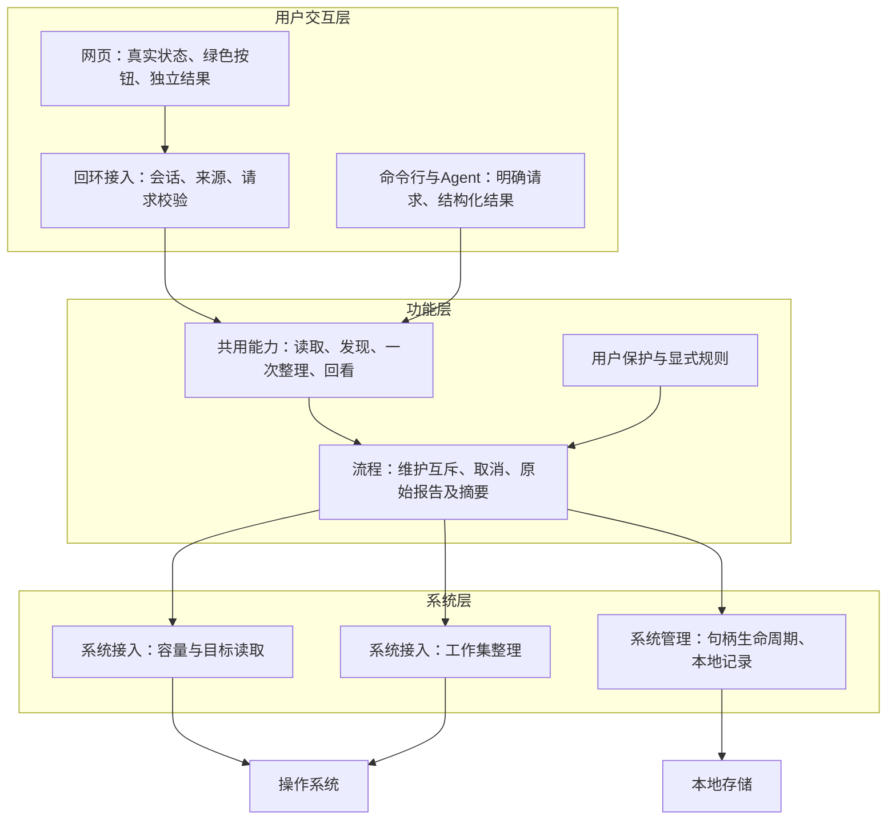
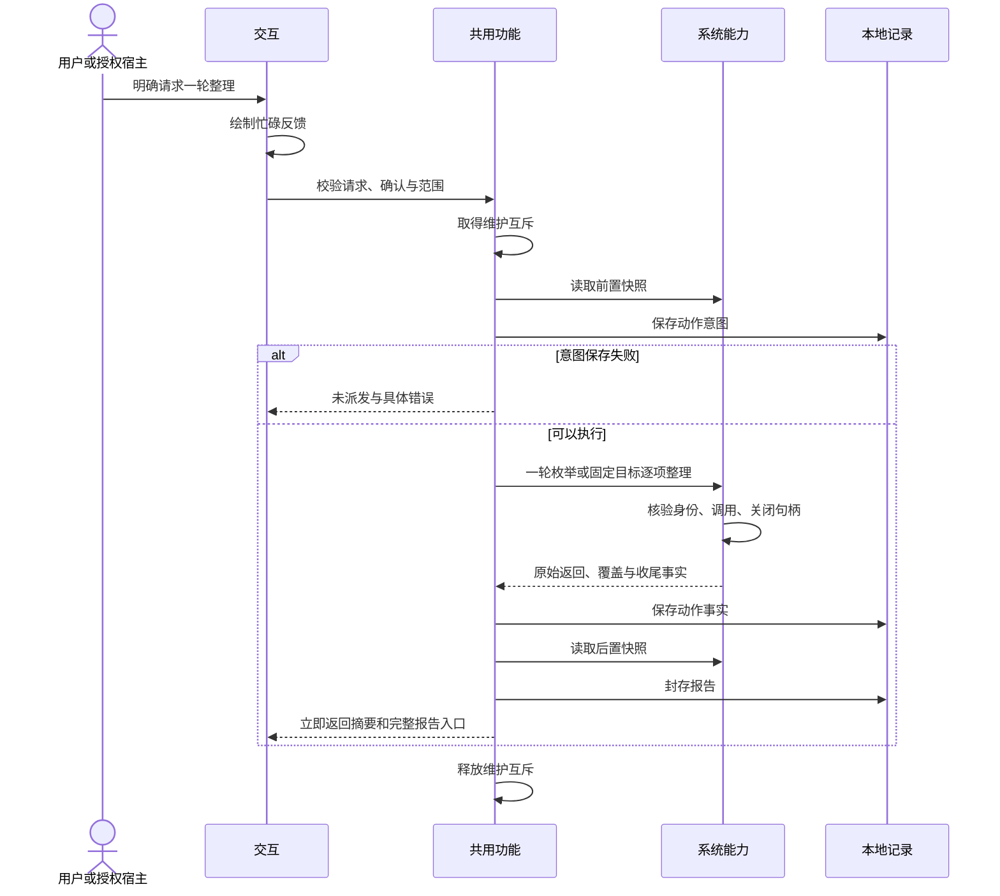
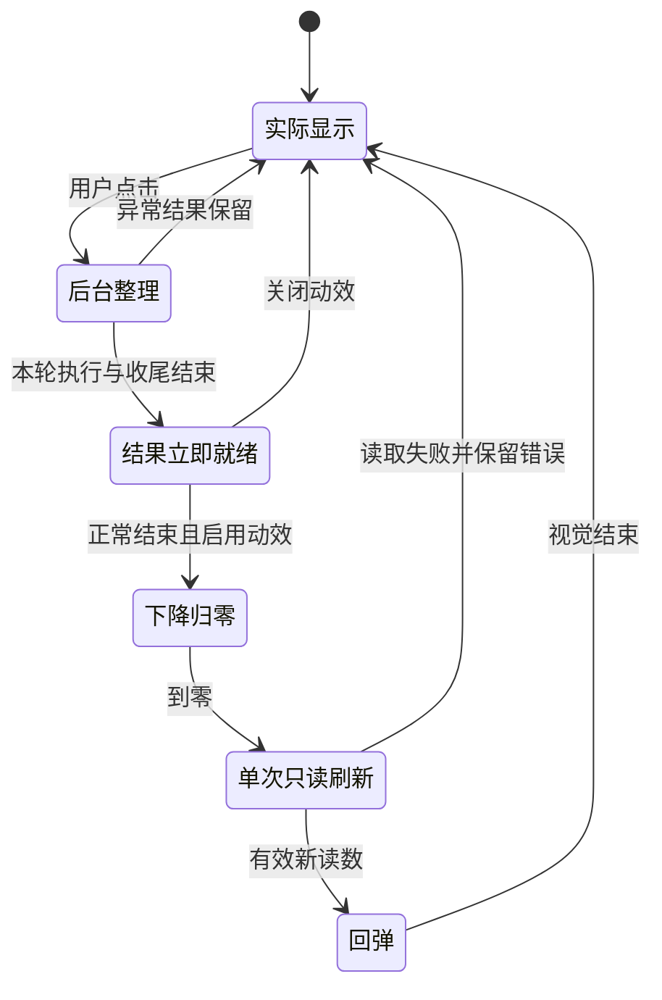
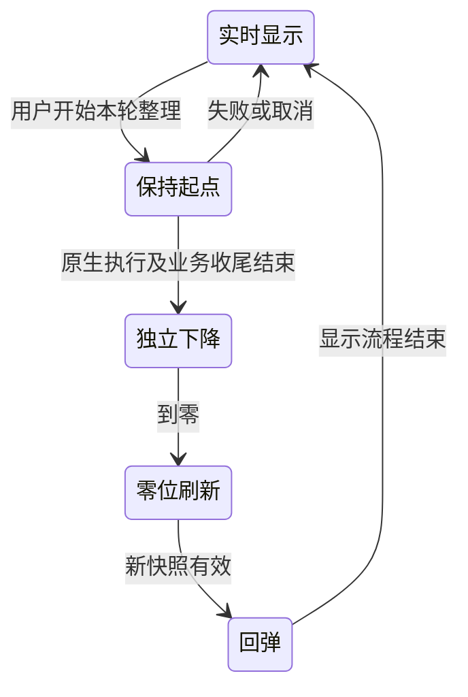
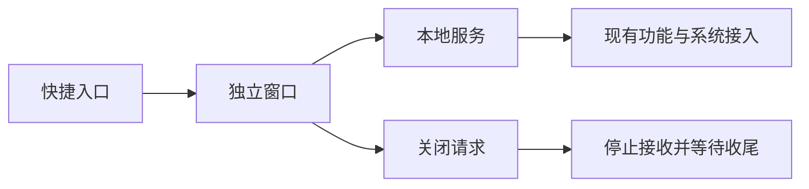

更新日期：2026年11月3日。本文为当前选定架构，保持与实现语言无关。源码映射见 [代码结构设计](<代码结构设计 Code Structure Design CPU 内存清理.md>)，机制依据见 [通用调研](<通用调研 General Research CPU 内存清理.md>)，执行证据见 [运行记录](<运行记录 Run Record/README.md>)。

# 一、需求与架构目标

用户需要查看真实内存、明确请求一次工作集整理并核对本次变化。主线参考360的软件小助手；不强制先诊断、不结束应用、不以动画替代实际清理。人和Agent共用同一能力。优先保证真实事实、单次派发、界面可响应和资源收尾，再缩小主通道开销。

当前交付是单机回环工作台与命令工具，不建设云服务、插件平台或通用任务总线。操作系统能力由实际接入报告；当前已实现一个平台，其他平台明确不支持，不能补合成值。历史独立窗口及辅助分析不属于当前正式入口。

# 二、结构视图

三层是职责，不要求分成服务。交互只提交请求、展示结果，不实现清理；功能层决定顺序、终态和记录时机；系统层报告原始调用与资源事实，不决定业务成功或直接改界面。共享合同不是第四层。

| 标识 | 职责与状态所有者 | 约束与源码映射 |
| --- | --- | --- |
| AR-01 | 输入与交互状态 | 选择、会话和待提交请求属于交互；见结构设计AR-01 |
| AR-02 | 业务流程与维护互斥 | 同实例至多一个维护流程，不自动重放；见AR-02 |
| AR-03 | 系统只读与真实数据 | 读数与进程身份来源可定位，失败不补零；见AR-03 |
| AR-04 | 工作集调用与资源生命周期 | 一轮逐项处理，原生失败、跳过和关闭状态保留；见AR-04 |
| AR-05 | 记录与只读回看 | 先保存意图，再保存动作事实，封存后回看；见AR-05 |
| AR-06 | 容量解释与呈现 | 原始结果不改写，摘要与完整事实同一身份；见AR-06 |
| AR-07 | 实时显示与独立动效 | 显示状态不决定业务完成或维护次数；见AR-07 |

# 三、真实整理流程

一轮整理包含多个可访问目标的原生调用，不是反复清到某个占用百分比。全局逐项路径不应用保护名单；选定批次使用固定身份及保护快照。取消只阻止尚未派发的后续项，不撤销当前系统调用；调用未知、资源关闭未确认时停止，不重试或换策略。当前没有跨进程全机互斥，只保证本实例内串行；CLI与网页两个独立实例不得由宿主并发发维护。

# 四、读取、结果与动效的三个状态

1. **实时状态**：页面可见时周期只读，维护期间仍可独立请求；实际容量、提交量与时间更新。隐藏或暂停只影响显示请求，不撤销业务。
2. **本次结果**：业务前后真实快照、逐项目标返回及记录状态。一旦就绪立即呈现，不被后续实时读数覆盖，也不等动画结束。
3. **视觉状态**：业务正常结束后下降归零，到零请求一次新读数，得到有效值后回弹，再接回实时显示。无额外趋稳等待；失败保留最后有效值及错误，不补零或重派发维护。新一轮请求取消旧视觉周期，旧刷新不能完成新动画。

动效阶段名不是内存清理进度。业务按钮由任务互斥控制，视觉流程不延长业务忙碌。摘要主通道省略逐项大明细，用户展开原始报告时才读取和格式化完整事实，二者不能各算一份收益。

# 五、部署、规则与质量边界

同一原生程序提供库、命令和回环服务。网页静态资源随程序交付；服务不调用另一份解释器或清理子进程。服务启动、静态工具发现及库构造不采样，只有明确读取或维护请求访问系统。会话令牌、同源校验、回环监听和请求预算限制入口；它们不代替宿主授权。

自动规则为显式可选能力，默认关闭，重启不自动启用。启用时固定目标与保护，持续压力/冷却限制派发；非完整结果停用而不重试。本轮真实验收不启用规则，不能用隔离测试声称实机规则效果。

结果必须分开表达成功、局部限制、失败、未知和取消。完整遍历有成功目标、无未知、资源关闭且两份快照齐备时，可在主区显示“已整理＋真实容量变化”，已知未处理项进入详情；原始partial和错误码不改写。记录缺口、读取缺口、未知或收尾问题仍显著呈现。

# 六、验证关联

AR-02/05用隔离系统实现核对单次调用、记录顺序、回看零调用；AR-01/03用HTTP合同核对启动零采样、会话以及维护中实时读取；AR-06/07用网页状态测试和真实内置浏览器核对即时结果、按需详情和动效隔离。本轮显示与计时补充见 [流畅显示与计时验收](<运行记录 Run Record/2026-11-02 流畅显示与计时验收.md>)。此前实际命令、平台、测量和未覆盖项在 [Rust原生网页验收](<运行记录 Run Record/2026-11-02 Rust原生网页验收.md>)。一次容量下降不证明长期收益、其他平台支持或360同速。

# 七、本轮显示与计时职责调整
本节承接开发计划UX-01/02与NATIVE-01，设计先行，本轮已完成实现、隔离检查和真实只读页面验收。本节保持正式默认串行方法不变，最小权限候选的后续设计与实现见第八章，两路并发未采用。

## （一）单一显示驱动
原始快照、业务报告、显示比例分别拥有独立状态。真实读取采用可见页面约250毫秒的轻量请求，至多一份在途，记录实际请求起点间隔和往返耗时，不因系统繁忙补发积压。原始实际百分比、容量与样本时间立即采用最新有效快照，业务结果继续只用本次原始前后样本。

圆环、大号百分比与细条由一个显示驱动、一个绘制循环控制。通常按实际时间连续追向最新真实目标，不每次从零速度重启固定缓动。整理结束后显示驱动按原下降、刷新、动态目标回弹流程播放，后台阶段保持圆环起点、后台读数只更新真实目标，回弹阶段按第十一章采用更低有效样本调整目标与步长。回弹结束从已画位置连续接回最新真实值，不直接跳值。隐藏或暂停停止绘制/读取，重新显示从最后显示位置续接。减少动态效果偏好下直接显示真实值。

主操作只更新忙碌状态和必要控件。进程列表不因主操作开始/结束重建，列表重建由发现、筛选、排序、分组或保护变化触发。业务报告一旦就绪立即呈现，不等视觉结束。

## （二）分段测量与完整结果
系统管理记录枚举、打开、身份/路径核验、原生调用、选定目标工作集核验、关闭与其余记账时长；逐项调用分布覆盖全部尝试，明细截断不能默认为完整分布。功能层记录前后快照、意图/动作/最终报告保存等时段。嵌套时段明确包含关系，不相加当墙钟。

报告先记录封存前计时，最终报告写入完成后取得完整业务墙钟及最终写入时间，以同一运行身份的独立计时附件保存，解决记录不能包含自身最终写入耗时的问题。附件失败单列诊断错误，保留既有动作与报告，不重试维护。回看只合并身份和版本相符的计时附件；旧记录可从有界逐项事实计算已覆盖分布，缺失阶段保持未知，不能补零冒充实测。

本轮以隔离系统调用、既有真实原件回放和内置浏览器真实只读状态验收。没有新的真实整理证据，不据本轮界面流畅度或离线计时宣称底层清理已提速。

# 八、全局最小权限候选的职责合同
本节承接 NATIVE-02。正式默认路径保留身份查询，候选仅在开发装配中显式选择，不接入绿色按钮、命令参数或自动规则。两条路径共用一次枚举、串行处理、返回值核对和资源收尾，比较时必须保留各自的覆盖与身份条件。

| 范围 | 默认与候选的要求 | 证据边界 |
| --- | --- | --- |
| 全局默认 | 取得操作和查询权限，核验创建身份后整理 | 保留当前行为 |
| 全局候选 | 仅取得工作集操作权限，同一个已取得的句柄完成一次整理和关闭，不查询创建时间、路径或逐项工作集 | PID 只属于本轮枚举与打开时的关联，不声称核验了枚举时的进程身份，也不能跨轮关联同号 PID |
| 明确目标 | 两种装配均取得查询和操作权限，核验创建身份及可选路径，保留工作集前后值 | 候选不能减弱定向、批次或保护核验 |

系统接入将平台调用与串行调度分开，使权限选择、同一句柄调用、取消和收尾可在隔离接入中验证。打开失败仍跳过，原生返回失败仍记录失败，关闭不确定仍停止并保留未知，不因查询缺失自动补身份、重试或换策略。候选逐项身份明确为空，计时注明采用的策略和身份覆盖。

候选合同、隔离实现和构建已完成，真实探索也已执行但覆盖不足以采用，见 [候选验收](<运行记录 Run Record/2026-11-02 最小权限串行候选验收.md>)。缺少同范围实机比较时，不采用候选为默认，不承诺提速。两路并发仍为条件研究，不在本次实现范围。

# 九、开发对照的范围与证据
本轮对照准备已实现并完成隔离验证，已完成真实探索对照，受限覆盖不足以决定采用，见 [准备验收](<运行记录 Run Record/2026-11-03 性能对照准备验收.md>)。对照入口独立于正式用户入口，复用功能层和系统层。会话固定本次目标清单，记录负载预算。仅自有进程对照用于比较相同存活目标，不能解释全局长尾。全局固定清单不会加入后来启动的进程，也不能恢复其他应用的初始负载。

每次动作先恢复并读取自有负载，保存执行前观测，再经共用流程保存意图、执行一次、封存事实，之后记录负载读回与内容校验。默认与候选的区别保持在系统访问权限和身份查询。定向用户接口的身份合同不变，开发用固定全局清单不冒充该接口。

会话中每种方法至多一次，逐次确认，不默认连跑两轮，不因部分失败或记录失败重试。离线比较只读取证据，缺失、覆盖差异、负载起点差异和身份限制作为判读结果，不补造字段或自动选胜者。清理阶段与读回成本分开，不把读取导致的重新驻留算成清理未完成。

# 十、主圆环的流程所有权校准
状态：2026年11月3日针对用户反馈的修正已实现，并完成本机一次真实网页验收，优先于后续性能实验。此前第七章实时追踪规则在主操作期间由本节细化，后台数据与真实结果的合同保持。

后台持续采样是数据职责，不意味着主圆环在每个阶段都必须追踪读数。点击后保存当前显示起点，主圆环在本轮后台执行期间保持该起点，容量与小号实际读数继续更新。后台结束立即显示真实结果，从保存起点进行独立下降，到零申请新快照，回弹再交回实时显示。失败、取消与关闭动效时恢复最新真实值，不重派发动作。

采样层只更新最新原始快照，动作层只拥有本轮请求与结果，显示流程拥有阶段和显示权，绘制层只画传入比例。主操作期间不得先让真实曲线带动圆环下降，再接装饰下降。容量和结果仍不从显示值计算。

零位与周期读取共享单一在途入口，以样本时间及接收序号判旧。回弹记录来源样本、目标及最新实际值，采用第十一章的低目标与步进合同，不再按固定截止时刻重算速度。绘制、显示流程、原始读数与业务结果分别拥有状态，旧回复不能接管新周期，动作仍只派发一次。

# 十一、回弹按360已核实方法收敛
本节维护当前回弹合同，历史固定截止方案已停用。下降仍750毫秒。视觉周期从下降开始保存单周期目标，期间只按更低的有效样本下调，原始实际数据继续上下更新。回弹使用20毫秒名义步进，每步目标的1/15，更新目标时更新步长和下一次名义步进时点，不通过剩余时间反推速度。下一步到达或超过目标即结束，解除视觉低目标约束，连续恢复实际读数。后台功能与原始结果不改，不以视觉目标宣称当前实际占用。

实现仍集中CleanupFlow，MemoryDisplay只绘制。时间线记录目标样本、步长及阶段，测试覆盖早中晚改目标、回升不抬视觉目标、下一步钳位、单周期重置和真实数据保持。阶段文字按用户要求暂留。浏览器RAF为绘制调度，与原生消息定时器不承诺逐帧相同，长停顿不补发无限积压。

# 历史方案定位
原章节和旧执行约定归档到 [Rust迁移前架构基线](<开发记录 Development Record/2026-11-02 Rust迁移前架构基线.md>)。历史记录中的提交、路径和验收状态保留原义。

<!-- 历史章节锚点仅供旧记录定位，不表示旧合同继续适用。 -->

# 十二、本地部署身份与验证流程

库、工具入口与本地服务共享部署身份：产品版本表示兼容版本，构建标识区分同一版本的源码变更。网页启动只能复用同一构建的正式服务；发现旧服务时保留原进程并明确报告冲突。身份核对不取代会话授权，也不改变系统操作权限。

本地验证依次执行行为检查、正式构建和源码包自足构建。失败阻断后续阶段，记录结果与产物标识。验证产物与正在运行的服务分目录，安装、部署、发布及真实整理不由验证流程隐式触发。

# 十三、安装入口与平台能力演进
当前用户安装与便携运行共用功能库及网页，安装层只部署程序、快捷入口和卸载登记，安装不采样或清理。安装后运行记录放到用户数据目录，与程序文件分开，卸载保留记录。更新前由用户停止旧服务，不能强制终止在途业务。

首个安装版本沿用默认浏览器，独立小窗口仍待原型比较。平台能力须分别报告读取、目标发现及维护，不以一个总开关暗示全部能力相同。Linux开发检查可用WSL，正式独立Linux与macOS环境另记证据。

# 十四、首个Linux接入限定为只读
Linux读取实际/proc容量及目标身份，先不实现主动回收。会话分别表达读取可用与维护不可用，网页禁用全局、定向、批次和规则入口，CLI维护返回明确未派发。保留后台读取和记录回看，Windows默认策略不变。Linux身份由启动标识及本轮读取的进程启动tick组成，避免跨启动的同号PID混淆。

# 十五、小窗口原型的职责与生命周期

独立窗口只承载现有用户交互页面，仍经同一回环服务进入功能层，不复制系统维护实现。窗口生命周期与业务生命周期分离：打开不维护，关闭先阻止新任务和后续动作，当前原生调用及记录收尾后退出。外部网址不在拥有系统权限的内嵌窗口继续导航。原型不默认替换浏览器入口，实际依赖及可运行证据决定采用。

# 十六、跨平台读数的含义与缺失

读取结果分别表达测得值、估算口径和当前平台不提供的指标。共同容量视图不要求各系统内部机制相同；提交统计不适用时保留空值，页面明确说明，不能补零或由别的统计猜测。Mac首轮可用量为“空闲与非活跃页之和”的估算，不宣称等同操作系统内存压力；压缩驻留量单列。

进程身份、驻留及路径属于同一实例的读取快照，前后启动身份不同则不组装为一个目标。读取支持与维护能力独立，Mac首轮只读，不产生跨应用整理、自动规则或动效清理结果。原生资源在每次读取后释放，避免持续显示导致系统句柄累积。
