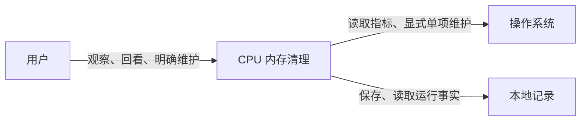
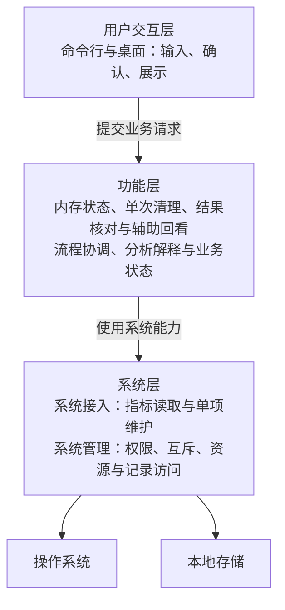
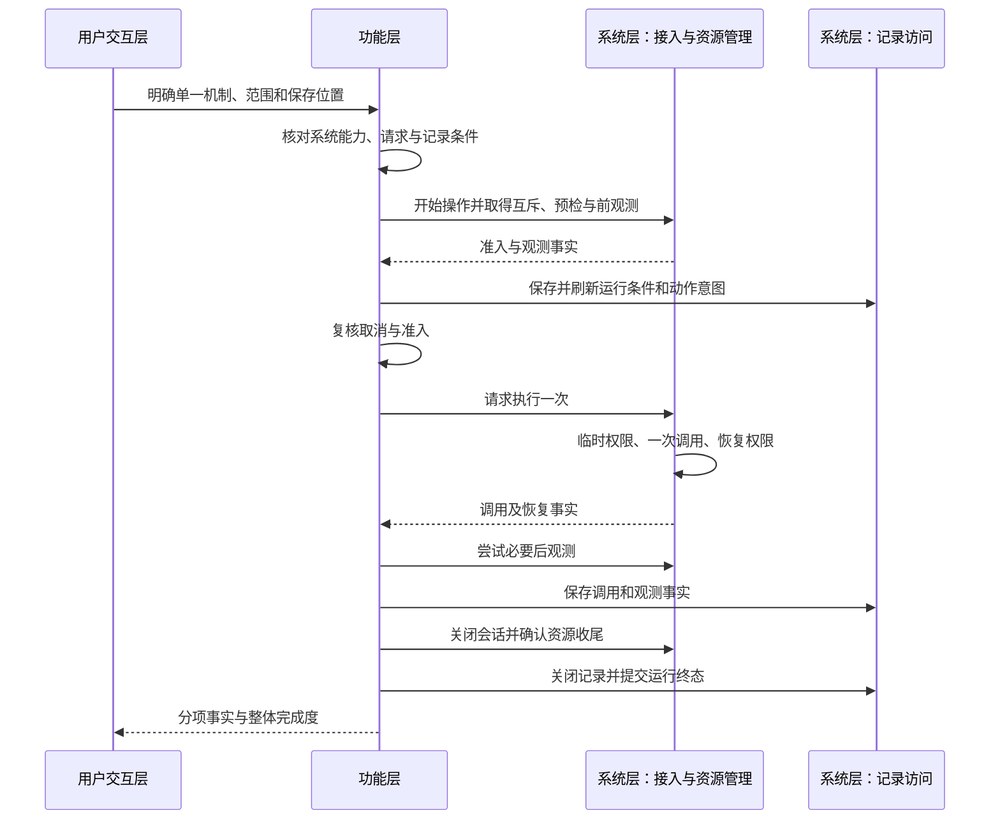
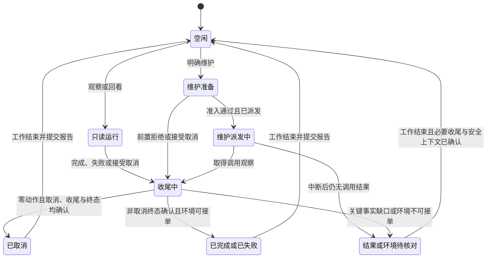
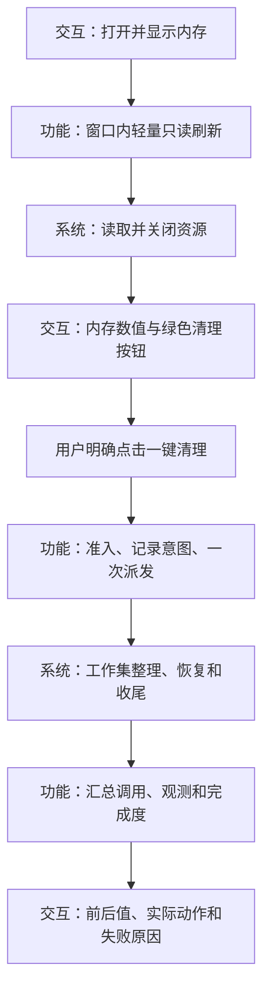

更新日期：2026年10月26日。状态：围绕一键内存清理重写交互范围，主窗口不以 CPU 诊断为入口。实际效果和平台呈现仍须分别验证。本文描述系统职责、协作、状态、部署和质量约束，不指定编程语言、目录、源文件、类型名称或开发库。实现映射见 [代码结构设计 Code Structure Design](<代码结构设计 Code Structure Design CPU 内存清理.md>)，机制与产品对照证据见 [通用调研](<通用调研 CPU 内存清理.md>)，计划与判定规则见 [通用测试规范 Test Specification](https://dreamsoul.feishu.cn/docx/KE4IdW6EWoKdvExSkdvcjTJFnsf)，实际验证证据见 [运行记录](<运行记录/README.md>)。

# 一、架构驱动力、范围与选择
## （一）用户目标与系统边界
用户打开小窗口查看内存，点击绿色主按钮明确请求一次清理，随后核对结果。打开窗口只读，点击清理才取得维护能力。CPU 看板、进程排名和先诊断再选择方案不属于首版主交互。

图中箭头表示系统与外部对象的交互，返回信息省略。360 是产品参考，操作系统与本地存储是外部依赖。架构面向操作系统能力，平台差异由系统层适配。工具宿主回收、云端服务、任意进程终止、服务控制和系统配置管理不进入首版范围。主窗口固定内存工作集整理，不把 CPU 分析作为首版主任务。按钮明确提交一次约定机制，辅助命令的其他机制也必须单次明确选择。
## （二）质量目标推导职责边界
优先保证动作可控、结果真实、历史可解释，再考虑交互响应和改动范围。以下是架构验收条件，实际结果以验证证据为准。

| **场景** | **触发与预期响应** | **架构决定** | **验收信号** |
| --- | --- | --- | --- |
| Q01 默认只读 | 观察或回看时不能触发维护 | 读取能力与维护能力分开，回看不连接当前系统 | 维护次数为0，离线回看系统读取次数为0 |
| Q02 结果真实 | 系统调用后，观测、恢复或保存失败 | 调用事实与整体完成度分别记录，由流程协调统一汇总 | 每次请求最多一次调用，已知事实保留，整体不伪报成功 |
| Q03 可追溯 | 中断或版本变化后回看 | 保存原条件、版本、观察与完成状态，未知动作不重放 | 能定位证据缺口，缺少必要证据时不判定收益 |
| Q04 可修改 | 更换系统采集方式 | 分析和流程依赖稳定的能力合同，平台细节由接入封装 | 合同语义不变时，交互和分析无需理解新的平台细节 |
| Q05 可取消且界面可响应 | 观察中关闭窗口，或维护前取消 | 交互与执行分离，同实例串行运行，取消有明确生效边界 | 派发前接受取消则零动作，派发后仍完成必要收尾 |
| Q06 操作可发现且含义清楚 | 用户首次打开、点击清理或处理失败 | 首屏有绿色清理主操作，打开只读、点击明确执行，未支持能力给出原因 | 无需 CPU 诊断或方案页即可找到清理按钮，未点击零动作，范围和代价可见 |

响应时间、采样开销和效果阈值需要目标设备与负载数据，当前不承诺固定加速幅度或立即取消。能力语义发生变化时，应重新评审合同，不能把任何接入都视为可直接替换。
## （三）架构选择及推导顺序
采用单机、单进程的三层应用，从上到下为用户交互层、功能层、系统层。用户交互负责人与工具之间的沟通，功能层围绕内存读取、一次清理和结果核对协作，保留辅助历史回看，系统层提供系统接入和系统管理。流程协调与分析解释属于功能层内部职责，不再与三层并列。

架构使用两个互补视图：结构视图说明三层职责、能力关系与状态归属，流程视图说明一次任务如何跨层执行、失败、取消和收尾。流程与结构是观察同一系统的两个角度，不增加新的层。设计从使用场景和质量目标推导这两个视图，再由代码结构设计确定实现映射。

当前需求不要求独立服务、通用插件、事件总线、通用任务平台或自动实验编排。增加机制时应说明解决的实际场景、维护代价与升级条件，按奥卡姆剃刀选择能够满足约束的较小方案。

## （四）从用户任务确定功能范围
产品定位与使用流程见 [开发计划](<开发计划 Development Plan CPU 内存清理.md#七内存清理插件的产品基线>)。首版只有内存状态、一次清理和结果核对三个主要任务，辅助刷新、取消和详情围绕它们服务。

绿色按钮的明确点击形成当前一次工作集整理请求，交互不自动调用，也不要求 CPU 诊断作为前置。功能层依然核对能力、记录、权限和互斥。实际系统不支持时拒绝，不转用其他机制，不增加进程关闭、服务控制或系统设置修改。

# 二、结构视图：三层职责与能力关系
## （一）三层划分
| **层次** | **负责什么** | **内部职责** | **边界** |
| --- | --- | --- | --- |
| 用户交互层 | 接收输入与明确确认，呈现进度、缺口和结果 | 命令行交互、桌面交互、请求提交与展示 | 通过功能层完成业务，不直接读取或维护系统，不另判最终结果 |
| 功能层 | 组织内存状态、一次清理、结果核对及辅助回看 | 流程协调、准入和取消、分析解释、记录内容与顺序、最终报告 | 统一决定业务状态，通过能力合同使用系统层，不处理平台细节 |
| 系统层 | 提供本机能力和运行支撑 | 系统接入负责指标读取及单项维护，系统管理负责权限、互斥、资源生命周期、记录访问与诊断支撑 | 报告原始事实与失败，不决定用户意图、业务终态或性能收益 |

系统管理面向本工具使用的资源与支撑能力，不扩展为结束其他进程、停服务或更改系统设置。业务运行处于什么阶段、取消是否生效由功能层决定，查询资源是否关闭、临时权限是否恢复由系统层报告。用户交互层只保留用户选择、待提交请求与展示状态。

共享信息与能力合同是层间约定，不构成第四层。三层表示逻辑责任，不要求三个独立进程、三个服务或某种编程语言。
## （二）结构与依赖关系

这是结构视图，三层按用户交互、功能、系统自上而下排列。箭头指向所使用的能力，返回结果沿调用关系向上传递。图中位置表达责任关系，不表示完整执行时序，也不表示每个方框必须独立实现。系统层内部的接入与管理可共同封装一个受控会话，避免增加通用管理中心。

层间约束为用户交互使用功能，功能按合同使用系统能力，系统能力不反向决定业务或直接更新界面。结果按请求关系返回。功能层内部的分析只处理显式数据，不进行系统访问或记录读写。系统层中的实时读取、维护和记录访问保持独立，离线回看仅使用记录访问能力。

记录内容、版本规则、保存时机与最终完成度由功能层决定，系统层完成具体存储访问并报告读写事实。记录仍是应用内部能力，不建设独立存储服务。具体实现映射与当前差距由代码结构设计维护。
## （三）业务入口与信息合同
| **业务入口** | **输入** | **输出与副作用边界** |
| --- | --- | --- |
| 只读观察 | 指标范围、样本次数、间隔和可选保存要求 | 观测与解释报告，只读系统，按要求保存 |
| 离线回看 | 已存运行及明确的重算或比较要求 | 原结论或标注新条件的分析，不读取当前系统、不维护 |
| 单次维护 | 用户确认的单一机制、实际范围和保存位置 | 调用、恢复、观测与记录的综合报告，至多一次维护调用 |

观测信息保存运行归属、序号、时刻、单位、原始指标、CPU 覆盖及缺失原因，必要时包含稳定进程身份。维护请求保存机制、范围与确认来源，分析结论不能自动成为确认。运行报告分别呈现观测、解释、调用事实、权限恢复、资源关闭、记录状态及整体完成度。

保留的辅助 CPU 分析需要一致的处理器范围、时间间隔和累计量。首拍、非正间隔、身份变化、计数倒退、覆盖未知或变化时保留缺口。进程展示排名不能提前截断 CPU 分析所需的完整可读输入。计量定义和证据边界见通用调研第三章。
## （四）读取与维护的不同合同
| **合同项** | **读取能力** | **维护能力** |
| --- | --- | --- |
| 允许输入 | 明确的主机和进程指标范围 | 已确认的单一机制与实际范围 |
| 提供操作 | 开始观察、读取样本、关闭会话 | 开始操作、只读预检、执行一次、关闭会话 |
| 返回信息 | 观测、覆盖与读取错误 | 是否进入调用、原始结果、恢复和关闭事实 |
| 资源责任 | 接入取得并关闭查询资源，流程协调决定节拍 | 接入持有限定范围互斥，管理临时权限及恢复 |
| 并发与重复 | 按流程顺序读取，不保证原子全机快照 | 每个操作会话至多一次调用，争抢时拒绝而不排队 |
| 取消 | 停止后续读取并关闭会话 | 派发前接受取消则零动作，进入后不承诺强停或回滚 |
| 失败 | 不可读保留未知与原因 | 缺权限或不支持则拒绝，不自动提权、不重试、不换机制 |

只读流程只需要读取能力。维护流程才同时需要读取和维护能力。替代实现应满足输入、结果、资源和失败语义，名称一致不足以证明可替换。逻辑分隔用于限制职责，不能代替操作系统权限隔离。

## （五）操作系统适配与能力边界
系统层按当前操作系统选择对应接入，向功能层提供统一语义的读取、维护、资源管理和记录访问能力。接入选择属于启动连接，用户交互与功能规则不直接依赖某个操作系统的专有接口。新增接入应满足能力合同，不要求所有平台提供相同机制。

| **差异** | **系统层责任** | **功能与交互的处理** |
| --- | --- | --- |
| 指标取得方式不同 | 转换单位，明确原始含义、时刻、范围、覆盖和缺失原因 | 只对语义一致的数据使用通用分析，平台专属指标保留适用范围，不按名称强行等同 |
| 部分读取能力缺失 | 分项报告支持、不支持、权限不足或未知 | 展示可取得的数据与缺口，不以零补缺，不让可选指标缺失阻断全部观察 |
| 维护机制或权限模型不同 | 说明机制、范围、前提、副作用及恢复责任，保留平台原始结果并映射通用调用事实 | 仅呈现当前支持的机制，执行前复核能力与本次确认；不支持则拒绝，不自动换用其他动作 |
| 缺少当前操作系统接入 | 明确报告实时能力不可用，不加载其他平台的专属能力 | 实时观察和维护明确不可用，独立的离线回看与分析仍应可用 |
| 记录来自其他操作系统 | 保留来源操作系统、版本、指标语义与能力信息 | 可读取的历史数据仍保留原条件，跨平台指标与收益不自动视为可比较 |

能力信息在进入流程前取得，具体请求派发前仍需复核权限、范围和可用性。检测到操作系统名称不等于全部能力可用。兼容性按操作系统版本、能力、权限及场景分别验证，不能由一个平台的结果推定其他平台已经支持。
## （六）运行与部署边界
| **运行位置** | **承担内容** | **约束** |
| --- | --- | --- |
| 一台目标操作系统主机、一个应用进程 | 三层应用及其内部能力 | 本地运行，无独立网络服务 |
| 界面交互执行单元 | 用户输入和展示更新 | 不等待耗时系统操作，不直接修改业务终态 |
| 有界业务执行单元 | 一次观察、回看或维护 | 同实例至多一个活动业务流程，不建立通用任务队列 |
| 显示读取执行单元 | 轻量只读内存显示 | 至多一个在途查询，不排队，可与清理并行，关闭后停止并等待已启动读取结束 |
| 操作系统与本地存储 | 原生能力、实际安全上下文与运行记录 | 权限来自当前环境，逻辑边界不产生额外权限 |

桌面窗口存活期间使用轻量只读通道刷新内存，清理期间仍可显示真实变化。显示读取不创建维护请求、不修改业务终态、不保存为清理证据，也不清除安全阻断。安全上下文未知时拒绝新的显示读取，已经启动的读取在返回前复核有效性。用户点击清理后，核心重新核对能力、记录、权限和互斥。业务忙时禁用新的业务提交，不排队。关闭后停止显示刷新与动画，等待读取及业务执行均完成必要收尾，再销毁界面。

首版不自动提权或安装服务，缺少必要权限即拒绝维护。只有确需普通权限界面完成高权限任务时，才重新设计受限帮助进程、通信合同和权限隔离。

## （七）架构职责索引
以下标识用于连接架构职责与实现映射，不增加逻辑层或独立服务。职责与质量要求以本文为准，具体目录、文件、入口与测试映射统一见 [代码结构设计的职责映射 Code Structure Design](<代码结构设计 Code Structure Design CPU 内存清理.md#二架构职责到源码的映射>)。

| **职责标识** | **架构职责** | **状态与能力边界** | **相关质量场景** |
| --- | --- | --- | --- |
| AR-01 用户交互 | 接收输入、明确确认、呈现进度和结果 | 交互持有待提交请求与展示状态，业务终态来自功能层 | Q01 默认只读、Q05 可取消且可响应、Q06 操作可发现 |
| AR-02 流程协调 | 组织内存读取、回看与单次清理，管理准入、派发、取消和完成度 | 同实例业务状态唯一归属，系统返回事实不自行宣布业务成功 | Q01、Q02 结果真实、Q03 可追溯、Q05、Q06 |
| AR-03 分析解释 | 解释 CPU、内存、历史窗口和对照证据 | 只处理显式输入，保留缺失、单位与覆盖，不生成维护确认 | Q02、Q03 |
| AR-04 系统接入 | 提供当前操作系统可用的读取和维护能力 | 接入拥有原生资源、权限与互斥，明确支持范围及未知结果 | Q01、Q02、Q04 可修改 |
| AR-05 记录访问 | 访问运行条件、观测、动作和结束记录 | 系统层报告存储事实，记录内容、版本解释及顺序由功能层决定 | Q02、Q03 |
| AR-06 运行支撑 | 提供运行环境、版本身份和诊断输出 | 支撑能力不拥有业务终态，诊断失败不抹去业务事实 | Q02、Q03 |
| AR-07 启动连接与共同约定 | 连接本次所需能力，保持层间信息语义一致 | 属于三层之间的连接约定，离线任务不取得实时能力 | Q01、Q04 |

职责标识在架构与代码结构设计中保持一致。职责发生变化时先更新本表及对应结构、流程或质量场景，再核对实现映射。仅移动文件或调整命名时，更新代码结构设计和开发记录，职责标识保持不变。

# 三、流程视图：业务运行与状态
## （一）三条跨层业务流程
| **流程** | **用户交互层** | **功能层** | **系统层及返回路径** |
| --- | --- | --- | --- |
| 只读观察 | 提交观察范围，显示进度和结果 | 检查次数与间隔，组织采样、解释和可选保存，汇总完成度 | 读取指标并关闭资源，按要求保存记录，事实返回功能层形成报告，再由交互呈现 |
| 离线回看 | 选择历史运行及重算或对照要求 | 检查历史条件，保留原结论或形成明确标注的新分析 | 只读取已存记录，不读取当前机器指标、不取得维护能力，结果经功能层返回交互 |
| 单次维护 | 明确确认机制、范围与保存位置 | 核对当前操作系统能力并完成准入，控制一次派发、观测和收尾顺序，汇总分项事实 | 提供预检、维护、权限恢复、资源关闭与记录访问，事实经功能层形成最终报告 |

流程描述跨层的先后关系。三条流程使用同一套结构，只有所需能力不同。

## （二）单次维护的详细流程
单次维护依次完成请求校验、只读预检、前观测、意图保存、派发前复核、一次调用、后观测及必要收尾。

图示为满足前提的主路径。必要条件未知、记录不可写、权限启用失败或派发前已接受取消时，维护调用为零。互斥覆盖必要后观测及动作记录尝试，随后释放资源并将收尾结果纳入终态。系统动作与记录无法构成统一事务，中断后可能留下待核对状态。
## （三）状态与取消边界

功能层的流程协调是唯一业务运行状态权威。派发到系统接入不代表已经进入实际维护调用，权限启用仍可能失败。进入派发阶段后收到取消，保留取消请求并完成可做的收尾，不能显示为动作已撤销。

待核对状态不代表原生调用已停止。工作仍在执行或资源关闭、权限恢复未确认时，继续阻断新的系统流程。返回空闲必须先确认工作结束和环境可接单，首版没有自动解除安全阻断的流程。历史记录中的未知状态不恢复为活动任务，不自动重放动作。

| **已知情况** | **报告含义** |
| --- | --- |
| 请求、记录、预检或权限启用失败 | 明确未进入维护调用，并说明失败阶段 |
| 确认进入实际调用 | 保留已执行事实和原始结果，不重复维护 |
| 只有调用前意图，缺少调用确认 | 动作未知，不能改写为已执行或零动作 |
| 调用成功，恢复、必要观测或保存失败 | 调用成功事实保留，整体可能不完整或待核对 |
| 已有调用结果，缺运行终态 | 调用结果仍有效，整体完成状态未确认 |

完成度、调用结果和性能收益是三个维度。流程完整不等于用户任务变快。实例间协调只覆盖明确范围内的本项目运行，用户会话内互斥不能宣称已协调其他用户、会话或外部清理器。跨会话协调与自动重复维护不属于当前方案。

## （四）内存清理的用户流程

打开窗口没有维护请求。按钮点击不绕过核心准入，忙时拒绝，未知不重放。交互只展示结果，不根据百分比下降自行宣布实际提速。

# 四、输入、记录与恢复
## （一）记录的逻辑组成
功能层定义记录的业务内容、版本与顺序，系统层提供记录访问并报告读写结果。每次保存的运行具有独立身份与存储位置，观察记录和动作记录可以关联。只读运行没有维护动作时，不制造空动作证据。运行记录服务于回看与核对，诊断日志服务于排错，二者责任不同。

| **记录内容** | **必须能够解释什么** |
| --- | --- |
| 运行条件 | 程序与规则版本、构建、来源操作系统及版本、能力与指标语义、有效参数、预期次数和间隔 |
| 观测 | 运行归属、时刻、序号、原始指标、单位、覆盖与缺失原因 |
| 维护意图与结果 | 用户确认、单一机制、实际范围、调用与恢复事实 |
| 分析结论 | 使用的规则、条件、证据缺口和结论范围 |
| 运行结束 | 完成、取消、异常、实际次数和收尾状态 |

动作意图在调用前可靠记录，确认的结果随后保存，终态在必要收尾后提交。没有终态不能由样本数量推定完成。系统调用和记录提交之间没有统一事务，不承诺崩溃后恰好一次或断电后全部记录必然保存。

回看保留原参数、版本及结论。按新规则重算时另记新条件和结果，不覆盖历史事实。缺元数据、时刻、动作证据或必要指标时明确不完整，矛盾的动作事实拒绝接受。恢复只识别已完成、未完成和待核对部分，不重放维护。

必要业务记录不可写时阻止动作，普通排错日志失败不能抹去业务事实。保存位置、容量、保留期、访问权限和清理责任在运行计划中明确，不重建已删除的历史日志。日志关联时间、运行、版本、阶段和错误，排除凭据、命令载荷及不必要的个人信息。
## （二）输入与信任边界
用户参数、外部文件和系统返回值都检查必要的结构、版本、有限数值、单位、范围、来源以及大小和数量上限。错误能够定位到字段或记录位置，不把布尔值当作数值，不把读取失败补为零。

缺样、重复序号、混合运行、不兼容覆盖和损坏记录分别暴露，不能拼接为连续有效窗口。离线回看不能静默丢弃损坏后宣称数据完整。具体存储格式和校验实现由代码结构设计及实现维护。

# 五、技术方法与效果验证
## （一）能力选择
| **对象与方法** | **架构定位** | **限制与代价** |
| --- | --- | --- |
| CPU 消耗归因与工作量建议 | 只读诊断与分析 | 不以高低占用直接决定能否关闭应用 |
| 工作集整理 | 仅在提供对应能力的操作系统上作为单项候选 | 改变驻留，提交量不保证下降，后续可能发生缺页与回写 |
| Standby 维护 | 仅在具备该内存分类与维护语义的操作系统上作为候选 | Standby 已计入可用内存，空闲量上升不等于新增收益 |
| 应用释放、正常退出、调度或配额控制 | 待研究能力 | 需先取得实际对象的工作、保存及恢复契约，不进入首版执行范围 |

这些机制是能力候选，不是每个操作系统必须提供的统一实现。每次维护必须明确当前支持的一种机制、实际范围和保存位置，不合并机制，不因一种机制失败而自动尝试另一种。CPU 尚无可安全接管的应用工作及保存恢复契约，因此首版不自动干预外部应用。

技术机制、360 产品对照与历史限制集中见通用调研，具体操作方式见 [README](<../README.md>)。
## （二）效果与证据门槛
普通运行展示可取得的前后变化。收益判断还需要同负载对照、有效吞吐或响应、CPU 时间、提交与驻留、缺页、输入输出代价和恢复窗口。缺少关键指标时，数值变化仍可呈现，收益结论保留证据不足。

真实验证前固定负载、构建、权限、机制、观察窗口、阈值、重复和恢复条件，再安排同条件基线与对照。实验复用相同的观察、维护与分析能力，不增加自动维护入口。动作失败或未知、权限未恢复、样本不足、混合运行或缺校准时，停止后续实验并保留原因。历史提案和缺少原始记录的结果不能代替新校准。

# 六、质量场景与验收设计
## （一）按职责验证行为
| **验证对象** | **关键场景** | **必须观察到的结果** |
| --- | --- | --- |
| 用户交互 | 首屏清理按钮、默认打开、只读更新、重复提交、关闭和输入错误 | 打开与内存刷新均零维护，实验状态明确，主操作可发现，关闭后不再更新已销毁界面 |
| CPU 分析 | 首拍、非正间隔、身份复用、计数倒退、多处理器组或覆盖变化 | 未知保留，单核、组内与全机口径区分 |
| 内存分析 | 共享页、提交增长、Standby 较大、缺指标、阈值边界 | 解释驻留与提交差别，不把残差当可回收量 |
| 对照分析 | 驻留下降但提交不变、占用下降但吞吐下降、少样本或缺校准 | 保留数值与代价，证据不足不支持收益 |
| 只读流程 | 有界观察、取消、采集异常、保存失败、损坏记录 | 维护次数始终为0，资源收尾与缺口可见 |
| 维护准入 | 缺确认、范围不符、互斥忙、预检未知、权限启用失败 | 零维护调用，不回退或换机制 |
| 维护后置失败 | 调用失败或未知、恢复失败、后读取或保存失败 | 至多一次调用，已发生事实保留，整体不伪报成功 |
| 记录与恢复 | 中断、容量不足、版本变化、缺终态或矛盾事实 | 原条件可识别，不完整不判收益，未知不重放 |
| 系统接入 | 操作系统未适配、部分指标不可读、维护能力缺失或调用结果未知 | 保留覆盖、原始事实与错误，业务终态交由功能层汇总 |
| 系统管理 | 资源关闭、原有权限、协调范围、记录读写失败 | 恢复与关闭事实明确，存储错误可见，不扩大系统控制范围 |

以上场景分别检查职责、能力合同及完整用户旅程。替代接入与合成数据可以验证流程和故障语义，不能证明真实平台兼容、界面呈现或维护效果。
## （二）区分验证层次
结构验证检查三层职责、状态归属和层间能力关系，确认交互没有直接访问系统的旁路。流程验证检查观察、回看和维护是否经过既定准入、派发与收尾阶段。合同验证检查真实与替代接入的行为语义。场景验证贯通外部输入、处理、记录及用户可见结果。平台验证检查实际环境的读取、权限、资源释放与显示。效果实验另评估真实负载下的收益和代价。

图形能够解析、结构符合设计、替代接入通过、真实平台通过和收益成立分别记录，不能互相代替。具体实现检查、测试位置与操作清单在代码结构设计和测试规范中维护。
## （三）验证计划与结果约束
验证按层级、关注类型、成本、结果形式及优先级选择，先低成本关键检查，再扩展必要范围。计划固定实际版本、环境矩阵、资源要求、必需项、依赖顺序、单项与整批预算、并发及停止条件。缺少必要监管能力时阻断相应执行，不能以事后计时冒充限制。

逐项保存实际结果与证据，报告可以从已保存数据重建。未执行、缺结果、超时、异常与质量失败分开记录，测量完成不等于质量通过。必需项失败、缺证据或不允许的跳过均阻断放行。具体计划、元数据格式和执行工具见测试规范，实际执行回执见运行记录，本文不复制实现配置。
## （四）只读诊断验收边界
只读验收应覆盖默认零维护、CPU 差分和范围、内存单位、指标与权限缺口、进程身份、保存回看、刷新取消与关闭、实际呈现以及执行成本。验收环境仅提供读取能力，不提供维护能力。

界面先使用合成数据核对显示与交互，实机验收另需明确授权、固定目标版本及资源预算。界面展示核心指标、采样时刻、覆盖和缺失原因，将只读操作与单项维护分区，不自行生成可清理量或加速分数。具体清单和未执行原因见开发计划的只读诊断验收计划与运行记录。

# 七、架构取舍与演进
## （一）关键决定
| **背景** | **采用的方案** | **代价与重新评审条件** |
| --- | --- | --- |
| 小型本地工具，无独立服务需求 | 单进程模块化应用 | 缺权限即拒绝，需要跨权限隔离时重审部署 |
| 双入口共享行为，且需离线验证副作用 | 共用流程，通过能力合同连接系统接入 | 维护少量合同，新增能力改变语义时重审边界 |
| 系统动作与记录没有统一事务 | 先保存意图，保留调用与终态，未知不重放 | 中断后可能需要人工核对，具备可靠可查询或幂等条件后才研究自动恢复 |
| 机制和实验范围有限 | 单机制请求，分析与执行分离，实验复用既有能力 | 多个实际扩展形成稳定共同需求时再增加独立职责 |

每增加一个逻辑层、能力合同、执行单元或服务，都应给出具体场景和持续成本。没有真实频率和工时证据时，不估算技术债金额或升级收益。
## （二）实施与验证状态
三层职责已完成实现映射，实际存储访问与运行支撑已从功能编排中分离。观察、回看、维护共用业务状态管理，取消与关闭事实纳入相应报告。具体映射、剩余限制由代码结构设计维护，实际离线验证结果由 [运行记录](<运行记录/README.md>) 中的回执确认。各目标操作系统的数据覆盖、能力差异、权限恢复、资源关闭、界面显示和维护收益仍需分别补齐证据。当前实现仅有一个操作系统接入，具体支持状态见代码结构设计，不宣称多平台已实现。

近期先完成只读诊断的离线准备，再在明确授权下进行只读平台验收，随后才评审是否进入维护平台与效果验证。任何阶段都不能把文档命令、历史实验或替代接入通过视为真实采样和维护授权。
## （三）交付约束
验证与实际变更、版本和交付目标关联，本地结果、自动流水线与发布验收分别说明。交付应具备产物身份、目标平台启动和核心旅程证据，尚未配置或执行的流水线与发布不能宣称通过。具体工具和执行方式由项目交付说明维护，不由架构指定。

# 八、设计依据与文档分工
本设计使用项目已关联 DreamSoul 文档库的本地成果。2026年10月22日已阅读架构通用调研与端侧案例的相关内容。2026年10月26日重读通用调研中视图分工、从需求推导架构及质量场景章节，复核端侧案例的状态归属与取消范围，并按本项目规模裁剪。没有逐条重读这些资料引用的全部原始标准，不宣称条款合规。

| **资料** | **采用内容** | **证据范围** |
| --- | --- | --- |
| 软件架构设计 Software Architecture Design 通用调研 | 从需求与质量目标推导职责，区分逻辑协作、运行部署与实现映射，按成本裁剪 | 本地研究整理，来源版本和深度以其来源索引为准，不宣称标准逐条符合 |
| 软件架构设计 Software Architecture Design 端侧智能体案例 | 状态唯一归属、取消边界、未知事实与恢复不重放 | 借鉴职责和失败语义，不照搬其产品范围或规模 |
| 软件架构设计 Software Architecture Design 来源索引 | 核对标准、方法和案例的原始来源及阅读限制 | 索引不代替原文阅读 |

资料位于实际关联文档库的软件开发研究主题，定位方式与完整规范分享链接见 [项目协作约定](<../AGENTS.md>)。既有方法来源与 CPU、内存机制分别维护于通用调研，未核验云端最新修订。

本文以结构视图维护用户交互、功能、系统三层的职责、能力关系和部署，以流程视图维护跨层运行、状态、取消和失败语义，并统一约定质量目标。代码结构设计通过 AR-01 至 AR-07 与本文建立双向职责映射，并关联 Q01 至 Q06 和跨层业务流程，维护源码内的实现映射与依赖约束。README 提供使用说明和外围目录导航，通用测试规范提供规则，开发计划与实际测试配置维护项目计划和执行条件，运行记录按日期维护执行证据及未验证项。架构变化应沿这些映射检查影响，避免在多份文档中重复固定文件结构。

显示数值在实际读数之间平滑过渡，动画只属于呈现，原始观测与动作证据不被插值替代。桌面清理使用内存专用前后快照，其范围随运行条件保存，不据此声称具有完整输入输出或性能收益证据。
