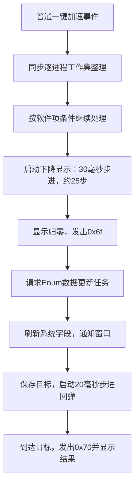

2026年11月2日，用户要求继续查看已解包360的实际实现，重点解释零位停留、回弹触发及与清理完成的关系。仓库起点 a8f9ff6，仅静态分析副本，不运行360，不读取或整理真实内存，不修改产品、动效或正式服务。

# 一、对象与实际执行
沿用 SoftMgrLite.exe 3.1.0.2511 和 SMLCore.dll 3.1.0.2120 副本。EXE SHA256 为 `2af1249990fc59e34bff6fce6850a45aec2f23101bfe3df3ad6aeef2748baef8`，DLL 为 `ef6d8ba78cfee6d424d35d34ef67536e79050a87e64cf66e24ceb401c67800f6`，本轮重新读取验证一致。不能据磁盘副本证明用户当前窗口加载相同模块。

复用既有 Capstone 5.0.6、LIEF 建立的本地反汇编索引，使用 `D:/anaconda3/python.exe -X utf8` 执行原 `query.py`、`rtti.py` 及本轮 `.test-results/360-animation-verify.py`。后者直接读取原字节，独立重新解码49处关键指令并与索引匹配，核对虚表、导入及三处浮点常量，全部通过。没有安装依赖、执行目标机器码或附加进程。证据目录 `.test-results/360-animation-20261102/` 包含 `verification.json` 与六段按 RVA 保存的汇编片段，二进制和反汇编留在本机忽略目录。

# 二、从整理到下降，再到回弹
下表均为文件 RVA，职责描述是分析命名，控件与类名来自资源及 RTTI。

| **阶段** | **直接证据** | **判读** |
| --- | --- | --- |
| 控件与窗口关联 | EXE 0xd8a9a查找 `ProgressSrc`，0xd8ad3写入窗口+0x11c，XML类型为 `CXProgressCtrlAC`，RTTI亦对应 | 被追的是资源占用进度控件，不是系统实际占用字段 |
| 本次整理先执行 | 普通按钮处理0xd787d调用管理器+0x4c，随后0xd7882处理软件项，0xd7891才调用0xdcf80 | 这条路径先调用整理，再启动下降。另一 `OnOnekeyAcce` 分支0xda22a→0xda22f→0xda23e亦为此顺序，不将其顺序推广到所有游戏加速分支 |
| 下降启动 | 0xdcf84起复制当前显示值，0xdcf9c除以常量25，0xdcfa4传30、0xdcfa6传定时器1，0xdcfc8调用 `SetTimer` | 每步减去起始值的1/25，名义约25步、750毫秒，受浮点边界和消息调度影响 |
| 到零 | 0xdd1f0处理定时器1，0xdd205减步长，达到零则写零、停止定时器并清除下降标志，0xdd24e发事件0x6f | 零是人为显示状态，不是测得物理内存为零 |
| 零位触发数据更新 | 0xd8d3c等将0x6f绑定至同一窗口委托，0xd7653匹配0x6f，0xd7665调用管理器+0x2c，DLL虚表指向0x89ef0 | 该方法以名称 `Enum` 请求任务。任务入口0x8a970对名称匹配后调用0x8ab50，后者起点0x8ab87更新系统字段 |
| 更新回调 | DLL 0x8b325调用 `GlobalMemoryStatusEx`，`Enum` 完成通知遍历注册观察者并调用+4。窗口观察者虚表首两项为0xd7030、0xd7060，两条回调均依次调用0xd9760、0xd9800 | 窗口用更新后的字段重算容量和显示比例。仅核对提交任务与完成通知路径，没有声称取得调度器内部实时延迟 |
| 启动回弹 | EXE 0xd9900检查下降标志，已结束时0xd990f保存目标，0xd9918以常量15计算步长，0xd9920传20、0xd9922传定时器2，0xd993a调用 `SetTimer` | 更新回调允许回弹，没有额外三秒或八秒读数趋缓门槛。步长由窗口比例计算路径决定，不把20毫秒解释成整个回弹只需20毫秒 |
| 回弹结束 | 0xdd25e处理定时器2，0xdd269加步长，0xdd27b读取目标，到达则停止定时器、清除标志并发0x70，0xdd2dd更新显示 | 回弹沿保存目标推进。窗口0xd7676、0xd767d处理后续结果提示。目标读取分支不会在已启动的这一段内按我们当前方式持续重定向 |

定时器消息0x113至0xdd1f0的绑定也已核对。常量存储位置 EXE RVA 0x33c730、0x33c740、0x33c750 分别为 double 15、25、100。`SetTimer` 及时间单位、消息队列的含义通过 [Microsoft 官方文档](https://learn.microsoft.com/en-us/windows/win32/api/winuser/nf-winuser-settimer)核对，名义间隔不等于帧的真实到达时间。

# 三、与本项目的差别及结论边界
当前网页点击即开始三秒下降，清理并行执行，业务结束后另外观察3～8秒的连续实际读数，再用1.2秒回弹。所追360普通分支的关键差异是下降启动位置、下降节奏、零位刷新回调和回弹门槛，并非已经发现一种瞬时清空物理内存的新接口。

已追通的360路径没有等待“内存占用不再变化”或清到某个物理比例才回弹。零位短暂停留不能用作全部清理耗时，因为本次整理调用已经先于下降动效发生。其原生仍是逐进程 `SetProcessWorkingSetSize(-1,-1)`，条件性软件退出另计，本项目不采用结束进程路径。

本轮静态链足以否定“为了贴近这个360路径必须额外等待三份稳定读数”的设计依据，不能证明所有360版本均采用同一流程，也不能证明用户当前实例实际耗时或 C++ 相比 Python 的收益。没有测量360，没有执行产品回归、重新运行真实清理、修改当前交互或推送发布。调研摘要与建议分别更新到通用调研和开发计划，现行架构与代码合同暂不改成未实现状态。
