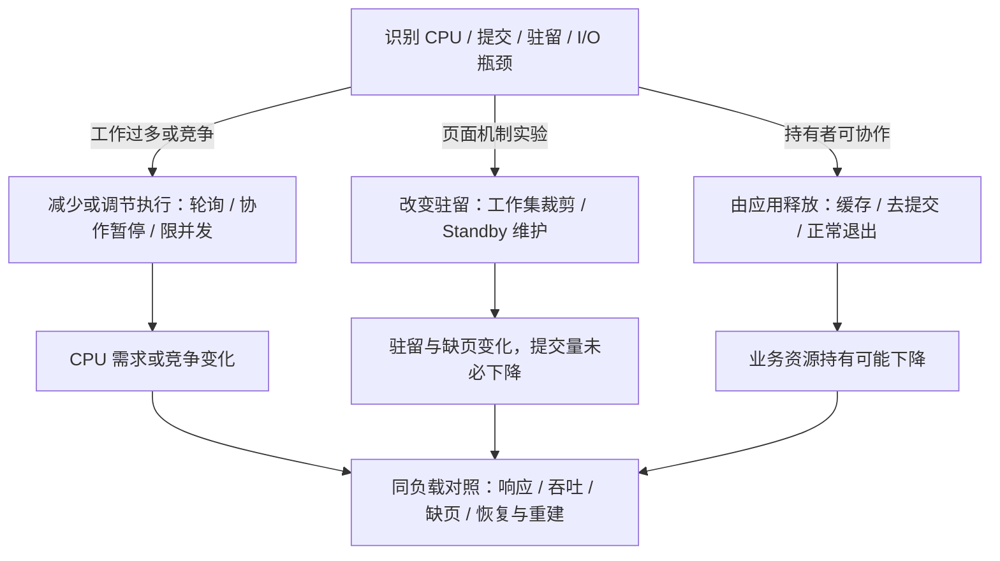
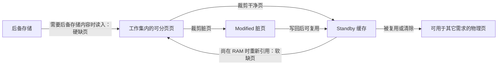
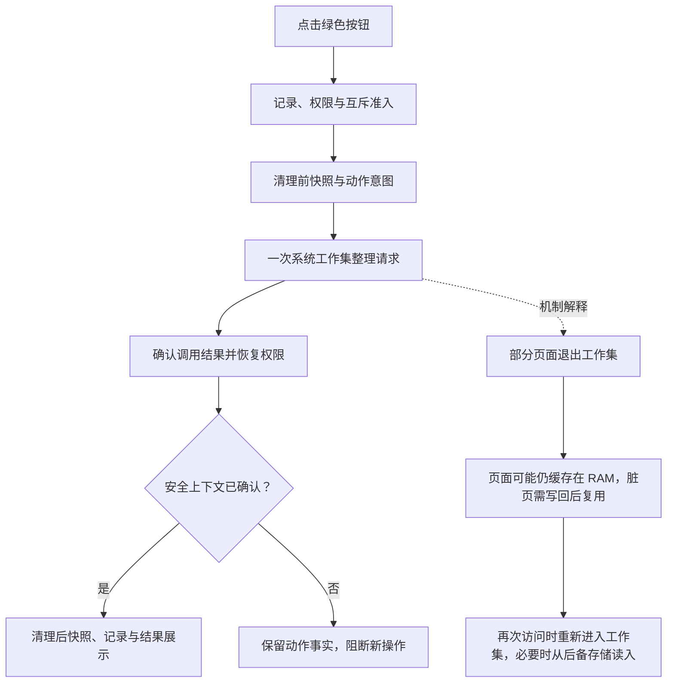
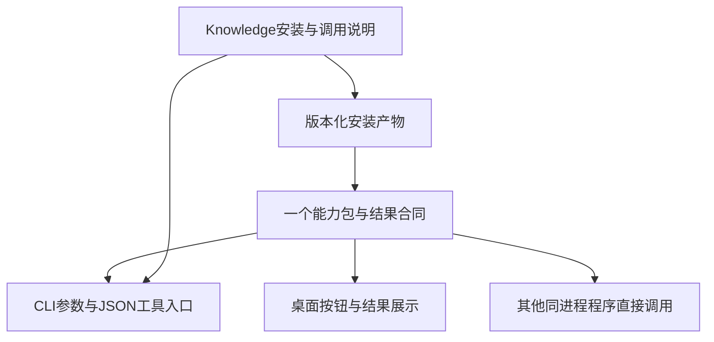
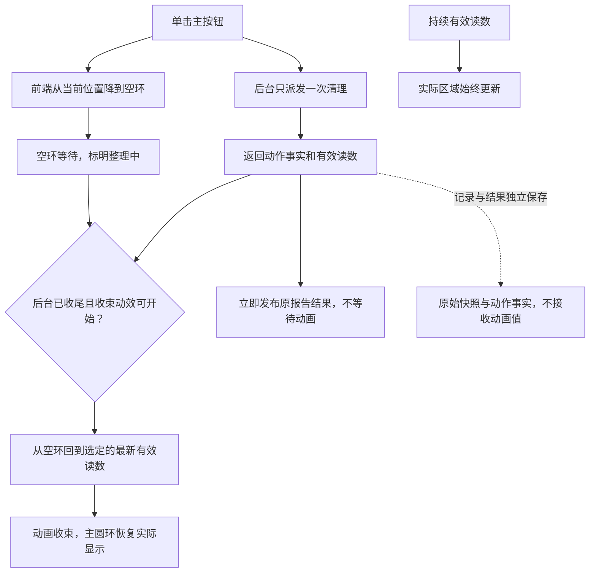
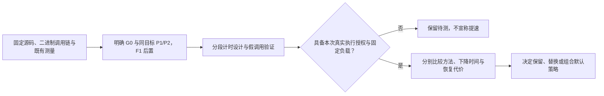
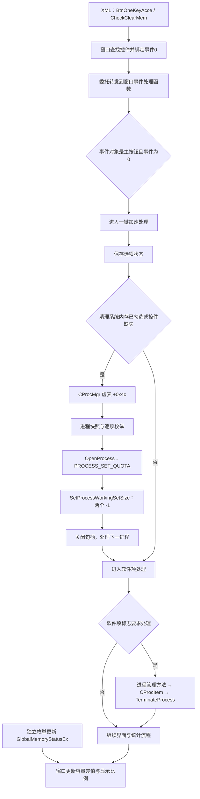

当前重点为 Rust 整理的原生长尾与网页百分比流畅度，现行判断见第十八章。运行时边界见第十七章，360 及同类固定源码证据见第十二至十六章。具体执行过程归日期记录。当前架构和实施分别见 [架构设计](<架构设计 Architecture Design CPU 内存清理.md>)、[开发计划](<开发计划 Development Plan CPU 内存清理.md>)，资料入口见 [项目协作约定](../AGENTS.md)。

# 一、研究目标、范围与技术全景
## （一）核心问题
本项目研究 Windows 上如何诊断并减少 CPU 与内存带来的资源压力。360 安全卫士 PC 端加速球和优化加速是主要产品对照，Windows 官方机制与可读开源实现用于解释技术路线。读者是项目开发者和使用者，输出用于选择方法、设计模块和确定验证方式。

| **问题** | **需要回答** | **主要证据** |
| --- | --- | --- |
| Q1 360 做了什么 | 展示、分类、程序关闭、启动管理分别怎样作用，哪些内部细节未知 | 360 官方产品页、2025隐私政策、历史官方产品说明 |
| Q2 CPU 怎样治理 | 如何采样归因，减工作量、优先级、EcoQoS、配额分别解决什么 | Microsoft CPU/调度文档及公开应用生命周期机制 |
| Q3 内存怎样清理 | 应用释放、工作集、Standby、Modified、提交量的区别和代价 | Microsoft 文档与固定提交的开源动作实现 |
| Q4 方法如何用于本项目 | 各路线需要哪些输入、能力与安全条件，哪些结论仍缺验证 | 接口契约、固定提交源码、历史缺陷与验证限制 |
| Q5 怎样评估 | 指标下降是否改善响应，怎样对照、恢复、测试和阻断不完整结果 | 历史 A/A、A/B，计数器定义与研发规范 |

平台为 Windows 10/11 PC。CPU 研究包含负载治理，不将 CPU 硬件缓存作为清理对象。内存研究包含物理驻留与提交。磁盘垃圾、自启动、服务和应用关闭用于解释竞品及候选技术，本轮不扩展执行能力，不安装运行 360，不采样主机、不结束进程、不变更系统设置。
## （二）技术全景与主要结论

图1：依据第二至五章一手来源绘制的分析示意，Mermaid 源码直接维护于本文。箭头表示方法到资源变化及复测的关系，逻辑框不代表独立进程，也不代表 360 的内部实现。

CPU 治理应先识别谁在持续执行什么，再减少不必要工作或调整竞争。内存页维护主要改变驻留，应用协作释放有机会减少业务持有资源。360 提供的是多类优化组合，不能仅用“清空 Standby”解释整个产品。本项目优先采用 CPU 归因与内存观察，页面维护按单一机制、明确确认和独立效果验证处理。方法适用条件见第六章。

收益必须同时看响应、吞吐、恢复和副作用。工作集下降、Free 上升、综合分下降或 CPU 百分比降低，单独都不足以证明用户任务更快。

# 二、360 的产品行为与可确认机制
## （一）产品与版本边界
产品资料的研究对象是 PC 端 360 安全卫士的加速球及优化加速。另按用户指认检查本机“360软件小助手”安装文件，静态范围见第十六章第七节，不能直接等同于安全卫士加速球的全部当前行为。安全浏览器、极速浏览器和手机卫士分别是其它产品，下载目录名称也不能用来确定研究对象。公开页面按自己的版本与日期使用。

| **产品能力** | **直接来源确认的行为** | **技术含义与未知** |
| --- | --- | --- |
| 资源看板 | 产品页展示 CPU、内存、温度与网速，极速版2022主帖描述看板和入口改版 | 是观察与交互，不直接证明使用某个清页 API。[360 清理加速产品页](https://weishi.360.cn/clear/)、[极速版加速球说明](https://bbs.360.cn/thread-16074034-1-1.html) |
| 智能显示值 | 12.0说明将 CPU、内存、I/O、网络按场景组合，可切换内存值 | 2018历史显示契约，权重未公开，不等于内存占用百分比。[12.0 智能数值说明](https://bbs.360.cn/thread-15621325-1-1.html) |
| 清理运行软件 | 2025政策说明加速球可关闭不用的进程，2019教程说明用户选择待结束程序 | 减少后台工作与资源持有；实际关闭 API、是否优雅退出未知。[360 安全卫士隐私政策](https://weishi.360.cn/privacy.html)、[电脑卡慢优化方案](https://www.360.cn/n/10778.html) |
| 启动与持续负载管理 | 公开列有软件、自启、服务等管理及优化恢复记录 | 针对后续启动和常驻工作，不是一次页面整理。[360 清理加速产品页](https://weishi.360.cn/clear/)、[360 安全卫士隐私政策](https://weishi.360.cn/privacy.html) |
| 页面整理细节 | 上述来源未披露完整算法和调用路径 | 不把 EmptyWorkingSet、全局 NT 命令、申请大块内存等猜测写成 360 已确认实现 |

直接依据：[产品页](https://weishi.360.cn/clear/)、[2025隐私政策第7节](https://weishi.360.cn/privacy.html)、[2019优化教程](https://www.360.cn/n/10778.html)、[12.0智能值说明](https://bbs.360.cn/thread-15621325-1-1.html)、[极速版看板说明](https://bbs.360.cn/thread-16074034-1-1.html)。
## （二）从行为理解实现路径

图2：根据官方公开行为绘制的产品流程示意，覆盖范围分别由 360 产品页、隐私政策、优化教程和12.0智能值说明（链接见本章） 支撑，未复原内部分类算法、结束方式、时序或清页实现。减少后台工作可能降低 CPU，进程退出可能释放其私有资源，具体变化须按负载测量。

2025年隐私政策记载优化功能会读取并上传部分启动、服务和任务信息，因此不能笼统沿用旧资料的“所有优化都仅在本地”结论。PC 当前保护白名单、自动选择规则、清页算法和各模式收益仍待版本核验。手机清理忽略名单不能填补 PC 证据缺口。[政策第7节](https://weishi.360.cn/privacy.html)
## （三）本项目可采用的产品思路
采用独立可见指标、诊断说明、候选方案、用户选择、实际结果和复测的闭环。每种动作明确作用范围、前提、权限、可逆性和预期信号。综合评分若无公开规则和校准就不加入首版。程序关闭、启动项、服务变更均保留为技术比较，当前项目不据此执行或新增通用进程清理器。

## （三）2026年10月26日的产品交互复核
### 1. 本次实际读取的来源
| **来源与范围** | **可确认内容** | **本项目采用方式** |
| --- | --- | --- |
| [360 清理加速产品页](https://weishi.360.cn/clear/) 的优化加速、悬浮加速球章节 | 页面说明资源监控、进程分类、方案入口，以及启动和服务等管理范围 | 借鉴状态、来源和快捷操作的组织，不推断内部清页算法 |
| [360 安全卫士隐私政策](https://weishi.360.cn/privacy.html) 的日期及第7节 | 页面标注2025年9月8日，说明优化条目、记录恢复及加速球关闭进程等产品行为 | 进程关闭和系统配置管理与页面整理是不同路线，首版不提供前两类执行 |
| [本仓库绿色按钮版本](https://github.com/DreamSoul-AI/cpu-memory-cleanup/blob/571d29b7b3216edf2c8b6209cad055c28a8a8782/cpu_memory_cleanup/desktop_ui.py) | 源码定义大字号内存值、进度条、绿色“一键加速”按钮和前后结果，按钮调用工作集整理 | 恢复醒目主操作和结果反馈，不恢复该版本直接调用、无确认的行为 |
| [后续平滑显示版本](https://github.com/DreamSoul-AI/cpu-memory-cleanup/blob/74284f94129b559516a5ef987f1ce63e493772a1/cpu_memory_cleanup/desktop_ui.py) | 源码按物理总量与可用量推导占用百分比，并加入缓动 | 数值口径可复用，动画只影响展示，不能制造观测变化 |
| 本轮重写前的桌面源码 | 有诊断刷新、取消和维护按钮，以及三张指标卡，但维护方式默认选中、操作与目录选择合并，缺少诊断到方案的呈现 | 现状用于识别交互差距，不据现有控件反推产品范围 |

访问日期均为2026年10月26日。360 公开页为 HTML 正文阅读，产品页带历史版权和版本素材，不能据此确认当前安装包的精确布局、按钮颜色或行为细节。仓库历史与当前界面为源码阅读，没有启动历史版本、当前产品或360，也没有取得真实屏幕截图。

### 2. 回到一键内存释放的产品目标
历史提交 `fc26a00` 的目标说明明确为360加速球式一键内存释放，`571d29b` 和 `74284f9` 实现内存小窗口，`00dbcb2` 保持打开只读、点击按钮才释放。它们共同说明主要用户任务是查看内存、执行一次整理、查看前后数值。上一轮将 CPU 诊断、排名和方案选择提升为主流程，偏离了这个目标，本轮予以取代。

当前产品采用紧凑内存窗口、绿色主操作和直接结果反馈。CPU 机制研究与历史分析作为辅助资料保留，不作为使用主按钮的前置。主按钮固定工作集方式，打开只读，点击形成一次明确请求，底层继续保留记录、准入、权限恢复、互斥、取消和未知不重放。

这种交互定位不改变机制证据：工作集整理不保证降低提交量或改善任务速度，360 的进程关闭等能力也没有在本项目实现。首版不结束进程、不修改服务或系统设置，不将尚未定义的宿主插件协议声称为已实现集成。当前范围见 [开发计划](<开发记录 Development Record/2026-10-30 阶段完成与计划整理.md#七内存清理插件的产品基线>)。

# 三、CPU 负载治理的方法与实现
## （一）先测量和归因
CPU 是单位时间内执行工作的能力。治理对象是计算需求、唤醒与调度竞争，没有一个对应 RAM 缓存页列表的“CPU 可清空容量”。进程占用先按稳定身份进行同窗测量：两次 `GetProcessTimes` 的内核加用户累计时间差，除以实际间隔。所有线程累计时间可以大于墙钟时间，需分别标注单逻辑处理器等价值和全机归一百分比。首拍、非正间隔、身份变化及读取失败保留未知。[GetProcessTimes](https://learn.microsoft.com/en-us/windows/win32/api/processthreadsapi/nf-processthreadsapi-getprocesstimes)

系统 `GetSystemTimes` 的 Kernel 包含 Idle，忙碌比例使用同窗增量 `(ΔKernel + ΔUser - ΔIdle) / (ΔKernel + ΔUser)`，时间单位相同且分母须大于0。超过64逻辑处理器时该 API 只覆盖调用线程所在的主处理器组，未确认覆盖范围不能标为全机。PID 加创建时间避免复用，同名进程不合并为单个所有者。[GetSystemTimes](https://learn.microsoft.com/en-us/windows/win32/api/processthreadsapi/nf-processthreadsapi-getsystemtimes)

CPU 排名提供消耗线索。热点、调用栈、Ready 等待、DPC/ISR 和用户关键路径需要 WPR/WPA 等进一步归因。高占用可能是有用计算，低 CPU 也可能正在等待 I/O，是否需要处理取决于任务和体验。[CPU Analysis](https://learn.microsoft.com/en-us/windows-hardware/test/wpt/cpu-analysis)
## （二）方法比较
| **方法** | **如何实现** | **目标与代价** | **本项目定位** |
| --- | --- | --- | --- |
| 减少实际工作 | 降低无必要轮询、减少重复计算 | 可减少计算需求，但可能影响时效或增加缓存 | 首要诊断与建议路线，应用决定业务取舍 |
| 限制并发与工作节奏 | 减少同时执行任务数、分批调度 | 平滑资源竞争与峰值，不保证总计算量下降 | 应用协作的节奏控制，需复测完成时间 |
| 应用协作暂停/正常退出 | 持有者在可保存、可恢复边界停任务或释放实例 | 同时影响 CPU 与内存，需完整状态契约 | 取得受支持接口前为仅建议 |
| 调低优先级 | SetPriorityClass 改变相对调度顺序 | 可缓解前台竞争，空闲时仍可持续占用 CPU | 可研究的调度选项，不等于减少总工作 |
| EcoQoS | ProcessPowerThrottling 提示非关键工作按节能策略执行 | 影响选核与频率，可能延长后台任务 | Windows 11 的 EcoQoS 需版本准入，函数的 Windows 8 支持不能代替该能力支持 |
| Job CPU 配额 | 受管理 Job 的权重或 CPU 硬上限 | 上限可限制调度时间，代价是吞吐或延迟；既有 Job/嵌套关系要核对 | 只适合项目拥有的受管理任务，不接管任意业务进程 |
| 外部强制挂起 | SuspendThread 停止线程执行 | 可能停在持锁和未保存状态，官方主要定位调试器 | 不作为本项目通用优化路线 |

接口依据：[优先级](https://learn.microsoft.com/en-us/windows/win32/api/processthreadsapi/nf-processthreadsapi-setpriorityclass)、[EcoQoS及版本](https://learn.microsoft.com/en-us/windows/win32/api/processthreadsapi/nf-processthreadsapi-setprocessinformation)、[Job配额](https://learn.microsoft.com/en-us/windows/win32/api/winnt/ns-winnt-jobobject_cpu_rate_control_information)、[线程挂起](https://learn.microsoft.com/en-us/windows/win32/procthread/suspending-thread-execution)。这些方法未在当前项目实现或执行。
## （三）公开应用协作实例
Chromium 页面生命周期将冻结与丢弃分开。冻结限制可冻结队列中的定时器和回调工作，丢弃卸载页面，回来时需要恢复或重新加载。两者分别说明减少工作与释放资源的不同路径，页面持有者必须准备状态。这是公开技术实例，不能据此宣称 360 使用相同策略或当前浏览器工具连接可直接丢弃。[Page Lifecycle API](https://developer.chrome.com/docs/web-platform/page-lifecycle-api)

# 四、内存清理的对象、方法与代价
## （一）指标与机制
`PhysicalAvailable` 为可立即复用的 standby、free、zero 页之和。`CommitTotal` 在提交时变化，驻留与提交分开。容量字段按页大小换算，复合系统缓存不能重复相加。[Microsoft 指标定义](https://learn.microsoft.com/en-us/windows/win32/api/psapi/ns-psapi-performance_information)

工作集描述当前驻留的可分页页。共享页面不能跨进程简单求和。移出工作集后的页面可能继续缓存在 RAM，脏页在复用前要回写。重新访问是否需要读盘取决于页面状态。[Microsoft 工作集说明](https://learn.microsoft.com/en-us/windows/win32/memory/working-set)

| **路线** | **公开契约与操作范围** | **代价及采用条件** |
| --- | --- | --- |
| PSAPI/PDH 只读观察 | 读取主机容量与速率，可作为只读观察路线 | 有采样时差与读取缺口，不提供工具所有权 |
| `EmptyWorkingSet` | 有公开文档，指定进程句柄需要查询权限与 `PROCESS_SET_QUOTA` | 是独立的逐进程路线，不能用它证明全局 NT 命令的权限或支持范围。本项目已有显式目标整理，当前采用判断见第十六章 |
| 全局内存列表命令 | 可见实现使用类80及命令2、4，需要按构建和特权验证 | 对整个系统页面列表生效，没有业务进程排除保证，当前为显式全局后端，其速度与收益仍待比较 |
| 宿主正常释放连接 | 根据业务引用和正常关闭契约回收工具 | 需要宿主证据及接口，不由 Windows 内存列表代替 |

`NtSetSystemInformation` 函数本身存在 Microsoft 官方说明。该说明没有给出 `SystemMemoryListInformation=80`、命令2和4的稳定支持契约，因此准确边界是“函数有文档，当前内存列表信息类与命令不具备该页给出的 SDK 支持保证”。不能笼统称整个函数完全未文档化，也不能将代码注释中的“publicly documented commands”作为 ABI 依据。[函数说明](https://learn.microsoft.com/en-us/windows/win32/sysinfo/ntsetsysteminformation)、[逐进程接口](https://learn.microsoft.com/en-us/windows/win32/api/psapi/nf-psapi-emptyworkingset)
## （二）应用释放与页面维护的差异
应用知道对象、任务和缓存是否还会使用。释放应用对象后，分配器可能保留内存池，因此系统提交量不保证立即下降。持有者调用 `VirtualFree(MEM_DECOMMIT)` 可明确把指定已提交页面变回保留状态，原数据丢失，访问前需重新提交。它不是外部工具扫描到一个 PID 后就能安全替应用执行的通用清理。[VirtualFree](https://learn.microsoft.com/en-us/windows/win32/api/memoryapi/nf-memoryapi-virtualfree)

以下是依据 Microsoft 页面状态说明绘制的分析示意，表示保留内容页从所有工作集移出后的典型简化路径。共享页仅从一个工作集移出时，可能仍驻留在其它工作集。箭头是状态变化，不是独立进程，也不代表 360 内部调用：

`Available` 已包括 Standby、Free 和 Zero。修剪会改变驻留状态，提交与地址空间另有状态体系，不能叠画为“释放同一种内存”。Standby 转成 Free 时，可用内存通常不会按 Free 的增量同幅增加。Modified 写回会产生 I/O，之后重新访问也可能付出缺页成本。[工作集](https://learn.microsoft.com/en-us/windows/win32/memory/working-set)、[容量口径](https://learn.microsoft.com/en-us/windows/win32/api/psapi/ns-psapi-performance_information)
## （三）权限与并发
`AdjustTokenPrivileges` 只能调整令牌已持有的特权，BOOL 非零仍须检查 `ERROR_NOT_ALL_ASSIGNED`，原状态可通过 `PreviousState` 保存并恢复。[官方返回与恢复语义](https://learn.microsoft.com/en-us/windows/win32/api/securitybaseapi/nf-securitybaseapi-adjusttokenprivileges)

该权限语义要求在启用失败时停止动作，临时调整后核对原状态，恢复结果与动作结果分别保留。互斥还需明确进程、用户会话与跨会话范围，不能从某个命名空间推定已经覆盖全部实例。[对象命名空间](https://learn.microsoft.com/en-us/windows/win32/termserv/kernel-object-namespaces)、[CreateMutexW](https://learn.microsoft.com/en-us/windows/win32/api/synchapi/nf-synchapi-createmutexw)。具体实现和验证状态由代码结构设计及测试规范维护。
## （四）计数器、因果与收益
PDH 速率通常需要至少两次采集，首拍未知不能补0，记录实际间隔。进程实例名可能变化，当前逐进程 CPU 比较使用 PID 与创建时间，名称用于展示。[采集流程](https://learn.microsoft.com/en-us/windows/win32/perfctrs/collecting-performance-data)

`Page Reads/sec` 为满足硬缺页的读操作数，`Pages Input/sec` 为读入页数。全盘读写还包含普通文件及程序活动，无法单独归因到清理。旧比较器的0.5 GiB、1.5倍和绝对底数均是本项目提案，不是 Windows 的普适性能阈值。[计数器定义](https://learn.microsoft.com/en-us/biztalk/technical-guides/system-level-bottlenecks)、[磁盘计数器定义](https://learn.microsoft.com/en-us/previous-versions/aa394308(v=vs.85))

收益验证应采用同负载 A/A 噪声参照、分机制 A/B、恢复窗口及应用吞吐/延迟，保留每次动作与窗口完整性。仅 standby→free、瞬时容量变高、或全盘 I/O 变化均不足以证明加速。未测业务指标时结论收窄到主机侧观察。

## （五）本项目绿色按钮如何改变内存显示
2026年10月27日针对合并提交 `fe12a73` 读取桌面交互、功能协调及 Windows 接入的相关源码，并重新阅读 Microsoft 的工作集、容量字段和系统信息设置接口正文。以下区分源码行为与机制解释，没有执行真实清理或验证当前主机收益。

当前桌面固定提交 `working-set` 请求。功能层先准备记录，检查能力、权限与互斥，读取清理前快照并保存意图。Windows 接入在当前令牌持有条件满足时临时启用所需特权，向 `NtSetSystemInformation` 传入信息类 `80` 和命令 `2`，至多调用一次，然后恢复并核对原特权状态。功能层保存动作结果，安全上下文确认后读取清理后快照并完成收尾。源码定位为 `interaction/desktop.py` 的 `maintain`、`application/core.py` 的 `maintain` 和 `system/platforms/windows.py` 的 `_Operation.perform_once`，均相对于 `src/cpu_memory_cleanup/`。这些是当前程序的调用事实，类与命令的兼容性仍需按操作系统构建验证。[接口文档及支持范围](https://learn.microsoft.com/en-us/windows/win32/sysinfo/ntsetsysteminformation)

页面变化是工作集机制的简化解释，不表示当前调用必然裁剪全部页面或产生固定容量变化。应用的逻辑分配与驻留分别管理，工作集裁剪不能证明应用已释放对象或提交量。再次访问可能发生软缺页或需要读后备存储的硬缺页，响应可能受影响。[工作集与缺页机制](https://learn.microsoft.com/en-us/windows/win32/memory/working-set)

| **用户看到的现象** | **机制解释** | **结论边界** |
| --- | --- | --- |
| 占用下降、可用量增加 | 显示按 `(PhysicalTotal − PhysicalAvailable) / PhysicalTotal` 计算，页面状态和并发系统活动都会改变数值 | 瞬时差额不能全部归因于工具或称为永久释放量 |
| 提交量基本不变 | 驻留改变后，应用仍可持有逻辑分配 | 不能据此认定失败，也不能声称回收了应用泄漏 |
| 随后占用回升 | 页面被再次访问或程序产生新分配 | 不能只因回升判定失败，不自动反复清理来维持低占用 |
| 调用成功但数值变化小 | 成功返回与容量收益分别判断 | 如实显示前后值，不补造释放量 |
| 清理后短时变慢 | 页面重新装入、写回或并发负载是候选原因 | 没有缺页和任务测量时不作因果定案 |

`PhysicalAvailable` 包含 Standby、Free 和 Zero，转入 Standby 的页面仍可能保有内容且计入可用量。因此界面上的占用减少不能理解为内容消失。[容量字段定义](https://learn.microsoft.com/en-us/windows/win32/api/psapi/ns-psapi-performance_information)

桌面独立使用 `GetPerformanceInfo` 只读刷新，并在读数间缓动。动作结果使用记录中的前后快照，动画值不进入记录，实时变化本身不能证明清理成功。360 是产品对照，软件小助手已取得局部静态工作集路径，但用户当前按钮的实际调用与动效关系仍未确认，本项目的 NT 路线不能用作 360 实现的证据。交互反馈与验收安排见 [产品反馈决策记录](<开发记录 Development Record/2026-10-30 阶段完成与计划整理.md#四实现机制与用户反馈的对应>)。

# 五、现有工具与可见实现比较
## （一）按同一任务比较
| **对象** | **主路径与接口可见性** | **可借鉴内容** | **采用限制** |
| --- | --- | --- | --- |
| Windows 自身内存管理 | 根据页面访问与压力管理工作集和缓存，机制文档公开 | 保留正常管理作为对照，先确认是否真有压力 | 无需默认增加定时清空操作 |
| 360 安全卫士 PC | 监测、分类、选择运行软件、启动管理，具体底层未公开 | 产品闭环、作用对象、记录与恢复呈现 | 不推断同一清页 API，不直接复制关闭/系统设置功能 |
| Mem Reduct | 固定源码可见多种页面维护动作及自动选择规则 | 机制分开、按选项调用、记录调用失败状态 | NT 路线须独立核验，不复制自动或高权限路径 |
| System Informer | 固定源码将工作集、Modified、Standby等作为独立操作 | 原始状态码与不同动作边界 | 不照搬服务提权回退，工具实现不等于稳定系统契约 |
| 应用自身生命周期 | 正常退出、缓存释放、冻结/丢弃等由持有者协调 | 业务状态、所有权和可恢复性 | 接口与版本逐应用核查，不能由外部低 CPU 推断 |

本表比较职责和技术路径，不对未经同机同负载实测的产品排列性能名次。
## （二）开源程序大概怎样做
Mem Reduct 在 `_app_memoryclean` 中先按清理选项和运行模式筛选，再分别准备信息结构或枚举值，调用对应系统接口并处理状态。工作集、文件缓存、Modified、Standby、低优先级 Standby 和内存合并是独立分支。其自动模式默认剔除源码标记易产生停顿的 Standby/Modified 动作，用户可通过 `IsAllowStandbyListCleanup` 显式允许，不把所有选项无条件打包。实际阅读定位为固定提交 `04402de` 的315至319、390至466行。[源码](https://github.com/henrypp/memreduct/blob/04402de8b6a8ff9d1c5517c675d87c346655323c/src/main.c#L315)

System Informer 用统一的小函数传入不同内存列表命令，封装工作集、Modified、Standby和低优先级 Standby，分别呈现 NTSTATUS。其源码还包含提权服务回退，本项目不采用。实际阅读定位为提交 `2e1349b` 的196至299行。[源码](https://github.com/winsiderss/systeminformer/blob/2e1349b065e5cf187db390697062fc95c846de33/SystemInformer/memlists.c#L196)

这些源码解释了常见“内存整理”工具如何落到系统调用，但不能证明 360 采用相同实现。依照产品资料，本项目先把“减少后台工作”“持有者释放”“改变页面驻留”建成不同的诊断与方案类型，再决定是否有足够能力执行。

# 六、项目适用性与验证要求
## （一）从机制研究得到的工程要求
CPU 诊断需要稳定进程身份、一致采样窗口、明确覆盖和缺失原因。内存观察应分别记录提交、驻留、可用物理量和缺页代价。维护动作要求明确确认、单一机制、前置能力检查，并分开保存调用事实、恢复状态与整体完成度。

历史实现的缺陷说明，缺字段、非有限指标、组合动作和后置失败都可能破坏解释或执行语义。具体复现与处理见 [缺陷记录 Bug Report](<运行记录 Run Record/2026-10-21 重构前缺陷.md>)。这些证据用于推导输入校验和事实保留要求，不替代当前版本验证。

模块职责与协作由 [架构设计 Architecture Design](<架构设计 Architecture Design CPU 内存清理.md>) 维护，当前源码映射由 [代码结构设计 Code Structure Design](<代码结构设计 Code Structure Design CPU 内存清理.md>) 维护，重构前后结构及实施过程见 [开发记录 Development Record](<开发记录 Development Record/README.md>)。实机验收计划、离线验证和未执行项见 [通用测试规范 Test Specification](https://dreamsoul.feishu.cn/docx/KE4IdW6EWoKdvExSkdvcjTJFnsf)。
## （二）测量、动作与诊断的记录语义
日志规范要求正常日志有运行和来源字段，未知可选字段省略，结果确认后再记录，敏感内容在源头排除。日志写不出不能改变已发生业务事实。[日志规范](https://dreamsoul.feishu.cn/docx/RBlFdcSSBo93q9x6p8kcdU6wnYb)

因此三种文件不混用：测量数据保存未知指标和采样缺口，动作记录保存意图及真实执行结果，诊断日志解释事件。前两者是业务数据，其关键持久化失败可阻止后续动作。普通诊断 sink 故障采取应急说明与受限退化，但不能把已完成 NT 调用改成“未执行”。详细数据协议见架构设计的记录与结果章节。

# 七、历史证据对方案选择的限制
[运行记录 Run Record](<运行记录 Run Record/README.md>) 保存2026年10月17日至20日的主机观察和 A/A、A/B 摘要。原始 `logs/` 已删除，现存文字无法直接复算，也不代表当前主机或当前程序状态。

| **历史证据支持的认识** | **对方案选择的影响** | **证据限制** |
| --- | --- | --- |
| 自然波动可触发原比较规则的代价判定 | 先用同负载 A/A 估计噪声，再做分机制 A/B 并观察恢复窗口 | 旧阈值和旧校准不直接迁移到新版本、新设备或新负载 |
| 页面维护后容量数字改善可同时伴随缺页与 I/O 代价 | 保留提交、缺页、读写与任务响应等独立指标 | 历史桌面实验未证明持续净收益，也不能证明所有场景都无收益 |
| 进程数量、年龄和短窗 CPU 不能解释完整生命周期 | 应用协作回收需要所有权、活动任务及可恢复性证据 | 缺少连接和消费者信息时，不据此关闭实例 |
| 提交残差和进程排名只提供观测线索 | 保留未知归属，避免把残差或排名换算成可清理量 | 原始样本缺失，原因和归属无法由现存摘要补证 |

具体日期、样本窗口、数值、中断及权限路径限制见运行记录。本文仅使用这些认识约束研究结论与后续验证方法。

# 八、应用协作回收案例：Codex 工具实例
## （一）已有证据能证明什么
DreamSoul《Codex 闲置工具进程安全回收调研》研究日期为2026年10月19日，桌面版本26.1013.40934、构建20770。它定位了部分 OS 进程身份、父链、桌面退订器、执行记录与强制中断代码，未验证本版 app-server 的 Rust transport 析构实现。报告的逻辑位置与阅读范围见第十一章的《Codex 闲置工具进程安全回收调研》条目。

历史资料能够匹配部分进程身份和生命周期事件，但连接、消费者、在途工作及正常释放入口仍缺证据。具体计数与历史复核范围见 [运行记录 Run Record 中的宿主研究证据](<运行记录 Run Record/2026-10-17至21 主机观察.md#二引用的宿主研究证据>)。

| **证据** | **可支持** | **不能支持** |
| --- | --- | --- |
| PID＋精确创建时间＋有效父链 | 匹配采样对象与宿主身份 | 当前存活、独占、无使用者 |
| 同一 PID 的短窗 CPU 差为0 | 当时短窗未观察到累计 CPU 增长 | 工具闲置、无等待或可关闭 |
| `active_execs` 正向匹配 | 部分执行与进程标识关联 | 空目录代表全部请求为空 |
| 退订事件和 `turn/completed` | 对应聊天或回合的生命周期事实 | 指定连接已关闭、业务状态已保存 |
| 文件已落盘 | 该文件的持久化事实 | JS 堆、Promise、浏览器控制权与下载过程均可恢复 |

## （二）公开协议的适用边界
21日重新针对性阅读 OpenAI 官方 App Server：`thread/unsubscribe` 作用于当前连接订阅，最后订阅者离开后经过无订阅且无活动的宽限期可卸载聊天。`mcpServerStatus/list` 可带 `threadId` 复用聊天连接。这些是聊天与状态读取契约，不能推导为任意工具 PID 的正常退出接口。[官方协议](https://learn.chatgpt.com/docs/app-server)

配置参考中的 `startup_timeout_sec` 与 `tool_timeout_sec` 分别限定启动与单次调用，不能解释为空闲 TTL。其是否适用于内置运行时需要单独核验。[配置参考](https://learn.chatgpt.com/docs/config-file/config-reference)

历史桌面3小时退订选择条件与服务端宽限期处于不同状态层。公开滚动协议与旧安装包实现分别成立，不能相加承诺某进程固定退出时间。没有取得本机构建的完整连接级受支持释放能力时，保持“证据不足，保留实例”。
## （三）目标契约及研究停止点
宿主应提供实例 ID、代次、PID 与创建时间、全部消费者、活跃/排队/挂起/待返回集合、保存状态和正常关闭确认。释放由同一个连接所有者在停止接入的协调范围内复核，共享实例只能释放当前使用者引用。

这是基于缺口的目标要求，不是假定已存在的 API。缺少能力时不实现外部注册表来猜所有权，不伪造通知、不调用强制中断，也不把自建假宿主测试称为真实 E2E。下一步首先是核对接口与版本，不是选择历史 PID 做试验。

# 九、方案取舍与后续验证
## （一）架构输入
| **决策** | **依据** | **目标与验收信号** |
| --- | --- | --- |
| D01 从驱动力推导最少边界 | Q4、产品行为、软件架构设计通用调研、端侧智能体案例及来源索引（定位见第十一章） | 质量场景对应状态权威、黑盒合同与可检查源码依赖，旧代码框架不约束设计 |
| D02 唯一动作入口保留事实 | [动作与后置失败缺陷](<运行记录 Run Record/2026-10-21 重构前缺陷.md>)、权限契约 | 前置失败零动作，首错停止，后置失败不抹调用结果 |
| D03 三类记录语义分别管理 | 日志规范 | 测量与动作由流程保存，诊断复用 logging，区分权威与失败语义，不各建存储子系统 |
| D04 对照数据先准入 | Q5、[非有限数缺陷](<运行记录 Run Record/2026-10-21 重构前缺陷.md>)、[历史窗口](<运行记录 Run Record/README.md>) | 少拍、混 run、部分成功和未校准不支持收益 |
| D05 测试跟随模块与旅程 | 测试规范、现有 fake | CPU/策略/共享入口优先覆盖，元数据与逐项结果可定位 |
| D06 本地验证先行 | CI/CD规范 | 关联实际提交和产物，必需项未完成阻断 |
| D07 应用协作能力核验 | Q2/Q3、Codex证据缺口 | 无受支持接口不关闭实例，保留共享引用和状态 |
| D08 CPU 与内存规则分开 | Q2/Q3及机制比较 | 同一分析模块内部按问题处理，CPU 问题不自动触发清页，方法能力状态可见 |
| D09 以360产品闭环作主要对照 | Q1、第二章的360产品资料 | 观察、解释、选择、结果与效果可追溯，不把每个步骤都提升为独立模块，内部未知不补造 |

## （二）待验证事项
360 当前构建的进程关闭方式、内存整理 API、保护名单、综合评分权重和净收益尚未知。若继续做版本验证，应先固定产品、构建、模式和受控无业务状态环境，区分“只整理页面”和“确实退出进程”，记录 CPU 时间、Commit、工作集、Available、缺页及任务响应。当前没有安装或执行授权，本研究不启动该实验。

Windows 内部内存列表命令兼容性、真实权限恢复、跨会话协调、CPU 处理器组覆盖和应用动作接口仍待实机或接口核验。历史 A/B 无原始 logs，不能复算。应用协作治理和真实收益仍缺证据，实现进展见开发记录及代码结构设计。后续验证须分别覆盖平台调用合同、资源恢复和同负载用户任务表现。

## （三）软件架构方法的采用
2026年10月21日读取项目关联DreamSoul文档库的软件架构设计课题。将其方法用于这个小型工具，而不把案例中的智能体运行时、模型路由或服务拆分带入产品。

| **资料方法与定位** | **本项目采用** | **检查方式** |
| --- | --- | --- |
| 主调研第十一章：从场景和质量目标出发 | 默认只读、结果真实、离线回看、接入替换和取消五个场景 | 对应架构Q01至Q05，不以笼统质量口号验收 |
| 第三、十三章：黑盒与行为合同 | 明确用例状态权威、Reader/Maintainer范围、错误、并发和资源责任 | 核对真实与假实现是否满足同一语义 |
| 第四、十四章：多视图分工 | 上下文、源码依赖、运行时序/状态和简短部署视图 | 不把运行箭头当import，不把模块当进程或权限沙箱 |
| 第十五章及案例第四至八章：设计到验证 | 目标代码集合、依赖规则和关键异常/变更场景 | 分开图语法、源码结构、合同及场景验证 |
| 第十七、十八章：简约和债务 | 本文保留少量决定、代价与升级触发条件 | 无工时/频率证据不计算虚假技术债，不以模块数量评价架构 |

这些是对本地研究的裁剪应用，不能称为重新精读全部原始标准或完成正式方法评估。具体来源与阅读范围见软件架构设计通用调研、端侧智能体案例及来源索引（定位见第十一章），行为与约束维护于架构设计，文件落位维护于 [代码结构设计 Code Structure Design CPU 内存清理](<代码结构设计 Code Structure Design CPU 内存清理.md>)。

# 十、依据、方法与证据分级
## （一）规范基线
下表为2026年10月21日研究时保留的阅读状态。2026年10月25日整理另行读取本地通用调研规范的范围、分类、引用与证据管理条款，以及飞书文档规范的命名、层级和表格要求，未回读云端或重新核验其他来源。
从当前项目关联的 DreamSoul 文档库读取实际文件，再沿其既有分享链接核对。路径相对于实际定位的文档库，不固定个人机器目录。

| **依据** | **读取范围与状态** | **用于本研究的要求** |
| --- | --- | --- |
| 通用调研规范 | 本地全文，飞书修订号2正文已读取 | 问题先行、直接来源、阅读深度、版本、比较轴和验证边界 |
| 飞书文档规范 | 本地全文，飞书修订号38正文已读取 | 中文混排、正文一级章节、表头加粗、就近引用、删除聊天痕迹 |
| 代码规范 | 本地与飞书修订号3全文 | 复用现有层次、最小防御、输入与持久化边界、清晰失败 |
| 测试规范 代码 | 本地921行全文，云端修订号53目录核对，未逐字比较云地全文 | 五维、目录镜像、稳定用例 ID、计划、状态协议、结果持久化 |
| CI CD 执行规范 | 本地全文，云端修订号30目录核对，未逐字比较云地全文 | 验证与提交/产物关联，必需项放行，允许本地验证策略 |
| 日志规范 | 本地全文，云端链接由现行总索引核对，未重新读完整云端正文 | 日志不作业务权威、未知可选字段省略、结果确认后记录、隐私与故障隔离 |

规范正文与入口见参考资料 第十一章的通用调研、飞书文档、代码、测试、CI/CD 和日志规范条目。目录核对不代表云地内容完全一致，也不代表当前程序已符合规范。
## （二）研究方法与停止条件
按“对象和状态 → 读取或调用路径 → 完成与异常 → 可观察证据 → 架构及测试约束”分析。先读取 DreamSoul 相关成果和本仓库历史研究，再按产品行为、CPU、内存及开源实现分别核查 360、Microsoft、Chromium 与固定提交源码。Codex 回收作为应用协作的一个案例。直接来源未覆盖的部分保留未知。

阅读与验证深度分为：公开文档规定、当前源码行为、历史实测摘要、离线假调用复核、工程建议。网页为滚动版本时记录访问日，不用抓取日冒充发布日期。主机和宿主构建未重新采集，历史版本均带日期。

同类实现按产品治理、页面维护、应用协作三条路线比较，以 360 为主要产品对照，以固定提交的 Mem Reduct 和 System Informer 解释可见实现。核心机制、失败路径和工程约束已足以支持设计时停止补查。宿主所有权与真实收益缺口需要新的受支持接口或另获授权的实验，不能靠增加阅读数量补齐。

# 十一、参考资料与定位
下表沿用2026年10月21日研究的外部访问与阅读范围，2026年10月25日未重新访问这些外部来源。2026年10月27日仅定向复读 Working Set、PERFORMANCE_INFORMATION 和 NtSetSystemInformation 正文，其他来源沿用原访问状态。Microsoft、OpenAI 及仓库滚动分支未固定文档提交，不能保证后续不变。规范和 DreamSoul 资料从项目关联文档库按名称及下列逻辑位置定位，避免个人盘符成为共享依赖。

| **来源及定位** | **版本/日期、阅读范围与用途** |
| --- | --- |
| DreamSoul文档库 `研发/研究/软件开发 Software Engineering/软件架构设计 Software Architecture Design/软件架构设计 Software Architecture Design 通用调研.md` | 2026年10月21日，本地主报告正文，重点第三至六、十一至十五、十七至十八章；驱动力、多视图、合同、验证与简约 |
| 同目录 `软件架构设计 Software Architecture Design 端侧智能体案例.md` | 同日，本地案例正文，重点第四至九章；状态、取消/恢复、部署与决策，非本项目实现证据 |
| 同目录 `软件架构设计 Software Architecture Design 来源索引.md`及`通用调研 大纲.md` | 同日，核对分类与相关条目阅读范围；原标准/论文未在本轮逐项重读 |
| [通用调研规范](https://dreamsoul.feishu.cn/docx/YcWIdE4INoLqoLxR5O8cbl7hnTf) | 修订号2，本地与云端全文，问题定义、来源、比较及验证边界 |
| [飞书文档规范](https://dreamsoul.feishu.cn/docx/DdmxdrNvBo9AMXxkAYmc4EJ6nwe) | 修订号38，本地与云端全文，正式文档结构与引用 |
| [代码规范](https://dreamsoul.feishu.cn/docx/FKrsdHO9bolq4YxV2KAcosghnme) | 修订号3，本地与云端全文，简单结构、输入和持久化边界 |
| [测试规范 代码](https://dreamsoul.feishu.cn/docx/KE4IdW6EWoKdvExSkdvcjTJFnsf) | 本地全文，云端目录修订号53。重点第一至五章，含执行和状态协议 |
| [CI CD 执行规范](https://dreamsoul.feishu.cn/docx/NrJ4d0WVGo9t4uxAVwScFTBVnRb) | 本地全文，云端目录修订号30。重点总体流程、验证与产物追溯 |
| [日志规范](https://dreamsoul.feishu.cn/docx/RBlFdcSSBo93q9x6p8kcdU6wnYb) | 本地全文、现行索引链接核对，重点字段、结果事实、隐私与故障隔离 |
| DreamSoul 文档库 `研发/研究/软件开发 Software Engineering/Codex 闲置工具进程安全回收调研.md` | 19日研究，21日相关章节复读。代码清单、台账及元数据按报告原相对链接定位 |
| DreamSoul 文档库 `tmp/node-runtime-audit-20261019/` 的 `candidate-direct-evidence-20261019-014800.json`、`host-lifecycle-metadata-20261019-014500.json` | 历史身份与限定事件，不代表当前状态。已核对其字段和计数 |
| [PERFORMANCE_INFORMATION](https://learn.microsoft.com/en-us/windows/win32/api/psapi/ns-psapi-performance_information) | 页面更新2024年2月22日，容量成员与换算 |
| [Working Set](https://learn.microsoft.com/en-us/windows/win32/memory/working-set) | 页面更新2021年6月4日，驻留、共享、软硬缺页及脏页路径 |
| [EmptyWorkingSet](https://learn.microsoft.com/en-us/windows/win32/api/psapi/nf-psapi-emptyworkingset) | 页面更新2022年8月23日，参数、权限与返回值 |
| [NtSetSystemInformation](https://learn.microsoft.com/en-us/windows/win32/sysinfo/ntsetsysteminformation) | 页面更新2023年2月16日，函数级契约与信息类子集限制 |
| [AdjustTokenPrivileges](https://learn.microsoft.com/en-us/windows/win32/api/securitybaseapi/nf-securitybaseapi-adjusttokenprivileges) | 页面更新2021年10月13日，BOOL 与 LastError、持有范围及 PreviousState |
| [Collecting Performance Data](https://learn.microsoft.com/en-us/windows/win32/perfctrs/collecting-performance-data) | 页面更新2025年7月14日，两次采集及进程实例警告 |
| [System-Level Bottlenecks](https://learn.microsoft.com/en-us/biztalk/technical-guides/system-level-bottlenecks)、[PhysicalDisk 定义](https://learn.microsoft.com/en-us/previous-versions/aa394308(v=vs.85)) | 针对性读计数器定义，未采用其业务特定阈值 |
| [Kernel object namespaces](https://learn.microsoft.com/en-us/windows/win32/termserv/kernel-object-namespaces)、[CreateMutexW](https://learn.microsoft.com/en-us/windows/win32/api/synchapi/nf-synchapi-createmutexw) | 针对性读会话与全局命名空间、互斥创建和访问规则；不能用用户本地状态承诺跨用户冷却 |
| [OpenAI App Server](https://learn.chatgpt.com/docs/app-server)、[配置参考](https://learn.chatgpt.com/docs/config-file/config-reference) | 滚动文档，仅读订阅、MCP 状态及启动/调用超时相关条款，不证明本机构建内部实现 |
| [Python 3.10 unittest](https://docs.python.org/3.10/library/unittest.html) | TestResult 与 addSubTest，采用已在项目最低版本存在的能力，不升级依赖 |
| [重构前核验源码](https://github.com/DreamSoul-AI/cpu-memory-cleanup/tree/a0afe76168d2d649b44d13e0cc74a02358c3c9c3)、[重构前合并基线6938f10](https://github.com/DreamSoul-AI/cpu-memory-cleanup/tree/6938f10447b250958856a845fc5448aa1185b52d) | 21日旧源码与测试静态分析、P01 至 P04 离线复核。两者运行逻辑相同，属于本轮重构之前的证据，真实系统边界全部使用假调用 |
| [旧验证正文](https://github.com/DreamSoul-AI/cpu-memory-cleanup/blob/00dbcb20f78fe9895121b25450b0c411527dbdc1/docs/validation.md) | 旧 Git 提交可复查文字，原始 logs 已删除，不代表可复算实验 |

开源来源现已固定到下列提交，针对性读取动作及自动筛选实现。未审查完整程序、完整许可证链、构建或驱动，不复制代码或服务提权路径。公开源码不能证明 Windows 内部 ABI 稳定，也不能反推 360 内部实现。

| **来源及定位** | **日期、阅读范围与证据边界** |
| --- | --- |
| [360 清理加速产品页](https://weishi.360.cn/clear/) | 访问2026年10月21日，产品功能段全文，页面未标具体构建号，不用宣传文案作性能测量 |
| [360 安全卫士隐私政策](https://weishi.360.cn/privacy.html) | 更新/生效2025年9月8日，针对性读第3、5、7节，确认进程关闭、启动项管理与数据处理范围 |
| [电脑卡慢优化方案](https://www.360.cn/n/10778.html) | 2019年7月23日，针对性读程序选择、进程结束和自启段落，属于历史产品说明 |
| [12.0 智能数值说明](https://bbs.360.cn/thread-15621325-1-1.html) | 2018年11月12日，编辑11月30日，主帖全文，确认指标组成，不提供算法权重 |
| [极速版加速球说明](https://bbs.360.cn/thread-16074034-1-1.html) | 2022年12月23日，主帖全文，界面与看板变化，不提供底层动作证据 |
| [Mem Reduct main.c](https://github.com/henrypp/memreduct/blob/04402de8b6a8ff9d1c5517c675d87c346655323c/src/main.c#L270) | 提交04402de，2026年10月7日，读取270至466行相关动作/筛选及 [main.h](https://github.com/henrypp/memreduct/blob/04402de8b6a8ff9d1c5517c675d87c346655323c/src/main.h)，未构建或运行 |
| [System Informer memlists.c](https://github.com/winsiderss/systeminformer/blob/2e1349b065e5cf187db390697062fc95c846de33/SystemInformer/memlists.c#L196) | 提交2e1349b，2026年10月20日，读取196至299行系统调用和包装，未构建或运行 |
| [GetProcessTimes](https://learn.microsoft.com/en-us/windows/win32/api/processthreadsapi/nf-processthreadsapi-getprocesstimes) | 更新2022年11月1日，累计线程时间、创建时间和多核口径 |
| [GetSystemTimes](https://learn.microsoft.com/en-us/windows/win32/api/processthreadsapi/nf-processthreadsapi-getsystemtimes) | 更新2025年8月15日，Kernel 含 Idle 及处理器组限制 |
| [CPU Analysis](https://learn.microsoft.com/en-us/windows-hardware/test/wpt/cpu-analysis) | 更新2021年3月25日，CPU 热点、关键路径、Ready 与归因方法 |
| [SetPriorityClass](https://learn.microsoft.com/en-us/windows/win32/api/processthreadsapi/nf-processthreadsapi-setpriorityclass) | 更新2022年11月1日，相对优先级、后台模式及访问边界 |
| [SetProcessInformation](https://learn.microsoft.com/en-us/windows/win32/api/processthreadsapi/nf-processthreadsapi-setprocessinformation) | 更新2024年10月31日，ProcessPowerThrottling 与 EcoQoS 版本边界 |
| [Job CPU rate control](https://learn.microsoft.com/en-us/windows/win32/api/winnt/ns-winnt-jobobject_cpu_rate_control_information) | 更新2021年4月2日，权重、硬上限、版本和 DFSS 限制 |
| [Suspending Thread Execution](https://learn.microsoft.com/en-us/windows/win32/procthread/suspending-thread-execution) | 更新2025年7月14日，挂起用途及同步风险 |
| [Page Lifecycle API](https://developer.chrome.com/docs/web-platform/page-lifecycle-api) | 页面更新2026年10月16日，针对性读 freeze/discard/恢复，不代表 360 实现 |
| [VirtualFree](https://learn.microsoft.com/en-us/windows/win32/api/memoryapi/nf-memoryapi-virtualfree) | 更新2024年2月5日，去提交、释放地址空间、数据与再访问边界 |

# 十二、同类源码与包分发方案
## （一）问题与研究范围
2026年10月30日补查，回答同类项目怎样组织能力、CLI 与界面，以及本项目怎样便于其他程序和 Agent 复用。原调研已包含360产品、Mem Reduct 和 System Informer 的机制分析，本章补充此前不足的库与外层接入比较，不将“没有竞品”作为发布理由。

本次定向读取两个公开仓库的固定提交及相关入口，没有构建或执行外部程序，没有验证其性能、完整调用链、安全性或实际安装体验。没有穷尽 GitHub 或 PyPI，不能据此声称不存在同类 Python 包。源码只作理解与设计参考，没有复制代码，也未完成各项目完整许可证链审查。

## （二）同类实现与源码依据
| **项目与固定版本** | **实际阅读范围与发现** | **对本项目的意义** |
| --- | --- | --- |
| [Mem Reduct](https://github.com/henrypp/memreduct/blob/04402de8b6a8ff9d1c5517c675d87c346655323c/src/main.c#L270) | 沿用第十一章固定提交与阅读范围，原调研已经分析动作和自动筛选。此次没有重新审查全部源码 | 已有同类产品，清理机制本身不是独有能力，不用再次阅读冒充新发现 |
| [System Informer](https://github.com/winsiderss/systeminformer/blob/2e1349b065e5cf187db390697062fc95c846de33/SystemInformer/memlists.c#L196) | 沿用既有系统调用与包装证据，是系统工具中的维护能力对照 | 帮助解释接口，不直接作为本项目包分发模板 |
| [WinMemoryCleaner](https://github.com/IgorMundstein/WinMemoryCleaner/tree/a19f25719c9b9a58a0acea99cb8adb4737d2d318) | 读取 README、工程元数据、App装配、IMemoryService、ComputerService、MainViewModel 与 Memory模型。界面命令通过服务执行，服务按内存区域分别记录处理信息 | 借鉴交互与能力分离、忙碌反馈和动作后重新读取，不照搬托盘、计划清理、优先级或服务能力 |
| [WinMemClean](https://github.com/nusu-github/WinMemClean/tree/36729828ed032b6fd6dc08b0c0788a125f9bd28d) | 读取 README、workspace配置、core/lib.rs、CLI/main.rs和privilege.rs。workspace将core、CLI、service及bindings生成分开，CLI直接引用核心库 | 明确存在“核心库＋CLI”的同类源码组织。当前 Python 包与 CLI 方向有参考依据，不需要为了 Tool 再造执行器 |

### 1. 界面、动作与结果的关系
[WinMemoryCleaner MainViewModel 的 Optimize](https://github.com/IgorMundstein/WinMemoryCleaner/blob/a19f25719c9b9a58a0acea99cb8adb4737d2d318/src/ViewModel/MainViewModel.cs#L1749) 在锁内设置忙碌状态、保存前置可用量、调用服务，再更新内存信息。[ComputerService.Optimize](https://github.com/IgorMundstein/WinMemoryCleaner/blob/a19f25719c9b9a58a0acea99cb8adb4737d2d318/src/Service/ComputerService.cs#L147) 按选中的区域执行并收集信息或错误。以上证明职责与呈现路径，不能证明执行没有代价。

该 ViewModel 在通知中对前后可用量取绝对差。对本项目不采用这一结果表达：可用量减少必须保留负方向，增加、减少与不变分别解释，不把任意波动都显示为“释放”。本项目已有带方向差额与独立结果区，继续保留，不为模仿外观改写事实。

### 2. 核心库与 CLI 的关系
[WinMemClean core/lib.rs](https://github.com/nusu-github/WinMemClean/blob/36729828ed032b6fd6dc08b0c0788a125f9bd28d/crates/winmemclean-core/src/lib.rs#L361) 的 `optimize_with_options` 读取 before，逐区域保存结果，再读取 after，返回结构化 OptimizationReport。[CLI入口](https://github.com/nusu-github/WinMemClean/blob/36729828ed032b6fd6dc08b0c0788a125f9bd28d/crates/winmemclean-cli/src/main.rs#L15) 从 core 引入快照、选项和动作函数，负责命令参数与输出。该证据支持库拥有能力、CLI消费结果的划分，不代表已经提供本项目采用的 JSON Tool 合同。

同一核心 [WorkingSet 分支](https://github.com/nusu-github/WinMemClean/blob/36729828ed032b6fd6dc08b0c0788a125f9bd28d/crates/winmemclean-core/src/lib.rs#L443) 在存在排除项时走进程工作集路线，否则走 EmptyWorkingSets。由此不能把“有排除名单”直接移植到本项目的全局工作集方式。本轮据此采用独立逐进程批次及保护规则，全局方式仍不能排除对象，具体采用状态见第十三章。

## （三）采用方向与分发方式

当前判断：继续采用现有 Package、CLI、前端并列复用结构，发布价值是容易安装、结果可解释和可被程序调用，不是宣称内存机制创新。没有竞品不是发布前提，有开源实现也不代表可直接替代本项目的包合同、记录回看或授权边界。

Knowledge 本地 README 与通知工具指南只证明该仓库能承载独立工具与文档，不证明已有统一 Tool 注册协议。建议 Knowledge 维护安装来源、版本和调用指引，必要时放薄入口，产品源码与测试继续留在本仓库，避免两个副本分别维护。具体Agent宿主没有确定前不增加MCP或宿主专有安装器。本地网页HTTP服务是当前已采用的产品入口，不等于跨机器Agent服务。

0.2.0的MIT许可、项目地址和预览分发已在本次源码补查之后完成，GitHub Release包含wheel、源码包和校验文件，实际结果见 [发布运行记录](<运行记录 Run Record/2026-10-30 MIT 与 GitHub Release.md>)。这完成了原先的分发准备建议，不证明清理效果或宿主接入。PyPI未发布，包名可用性及上传权限没有核验。后续采用判断以第十三章和当前开发计划为准，旧发布状态不能代表本地新增能力。

本章结论进入 [当前开发计划](<开发计划 Development Plan CPU 内存清理.md#二下一步开发任务>)。本次阅读支持职责与分发选择，不支持真实清理收益、自动化干预有效性或多平台兼容性。

## （四）清理功能与使用体验的源码差异
本节当前比较已于2026年10月31日更新，保留固定源码证据。关注有实际用途的清理范围与使用体验。复读本章固定提交的 WinMemoryCleaner ComputerService（含OptimizeWorkingSet）、MainViewModel，WinMemClean core/lib.rs、process.rs、nt.rs及CLI入口，并对照本项目WindowsBackend、ActionRequest、包公共入口和桌面。原先“结果报告为主”的建议被本节取代，其过程保留在日期开发记录。以下为源码分析与方案建议，未运行外部程序或实机实验。

| **维度** | **同类源码怎么做** | **我们目前怎样** | **下一轮采用判断** |
| --- | --- | --- | --- |
| 清理范围 | 两个项目都在存在排除名单时改为枚举进程、逐个整理工作集；没有排除项则可走全局路线 | memory_cleanup保留全局；Package、CLI与正式网页支持明确身份批次和路径/实例保护 | 已采用用户选择的固定目标，逐项验证和记录；不持续全机遍历或自动选择高占用对象 |
| 清理区域 | WinMemClean的MemoryArea覆盖工作集、Standby、文件缓存等，调用由nt.rs分开；WinMemoryCleaner同样按区域执行 | 系统接入已有working-set和standby；网页将后者置于高级手动系统范围 | 不把已有Standby当成未实现的新功能，不将更多区域或一键全部清理作为优先目标 |
| 自动化 | WinMemClean有冷却、压力与低优先级Standby条件；WinMemoryCleaner有定时和低内存触发 | 可见网页持续轻量显示；独立确认才启用默认关闭的定时或持续压力整理规则 | 采用可配置持续窗口、冷却、固定保护快照与显式停止，不照搬竞品阈值；当前只有合成验证 |
| 使用体验 | ViewModel以忙碌状态阻止重入，清理后更新内存和通知；排除列表用于表达用户不想处理哪些对象 | 已有绿色按钮、范围选择、逐项结果、保护设置与规则状态 | 当前主入口为localhost网页，旧桌面兼容保留，不引入CPU诊断前置步骤 |
| 结果解释 | before/after与区域结果集中返回，界面据此通知 | 已有RunReport和动作记录，部分差额在桌面计算，轻量流程仍输出通用诊断 | 结果统一作为定向功能配套，不再独占下一轮主线 |

### 1. 为什么范围控制需要不同实现
[WinMemoryCleaner OptimizeWorkingSet](https://github.com/IgorMundstein/WinMemoryCleaner/blob/a19f25719c9b9a58a0acea99cb8adb4737d2d318/src/Service/ComputerService.cs#L710) 在排除名单不为空时筛选进程并调用EmptyWorkingSet，否则走系统工作集命令。[WinMemClean process.rs](https://github.com/nusu-github/WinMemClean/blob/36729828ed032b6fd6dc08b0c0788a125f9bd28d/crates/winmemclean-core/src/process.rs#L61) 同样枚举、排除、OpenProcess、EmptyWorkingSet，其OpenProcess/EmptyWorkingSet路径见133行起。本项目不能继续调用全局NT命令，再在界面画一个排除列表，就宣称已保护应用。

Microsoft [EmptyWorkingSet](https://learn.microsoft.com/en-us/windows/win32/api/psapi/nf-psapi-emptyworkingset) 明确针对指定进程的工作集，句柄需要查询权限及PROCESS_SET_QUOTA。它改变驻留，不是结束进程或释放其业务对象。官方资料本次定向核对参数、权限及返回值，未调用API。能否打开具体目标、实际回收量和后续恢复成本仍未验证。

同类逐进程实现按名称排除，且部分访问拒绝被忽略。因此不能把其成功返回直接解释为所有进程均已整理。本项目只借鉴“范围决定调用路径”，不复制其名字匹配、静默忽略或全机批量处理逻辑。

### 2. 推荐的最小功能增量
已采用的基础增量保留现有默认全局工作集按钮，提供独立、明确的可选动作：“只整理选中的进程”。选择与展示使用名称及稳定身份，执行前核对目标，调用一次目标工作集整理。一个程序可能有多个进程，首版必须明确只处理选中的进程，不声称覆盖整个应用组，也不承诺零共享页影响或完全不卡顿。

这与同类排除名单不是完全相同的功能，而是从其范围控制机制推导的更小增量：由用户决定处理谁，本轮再扩展固定批次、同一程序文件分组与保护；文件组不能代表整个多程序应用。首次使用不要求配置清单。目标列表按需读取，不在主窗口持续枚举或排名，不根据内存大小自动选择执行对象。

此能力已在当前开发工作区按独立process合同实现并完成离线验证，未包含在已发布v0.2.0中，真实效果仍未知。旧system合同保留，新目标由PID与创建身份绑定，新process记录采用schema2，不得将旧system事实改名冒充进程能力。Package拥有执行逻辑，CLI与桌面只作适配。仅用合成进程和假DLL验证，真实采样与清理另行授权。

### 3. 选择依据与限制
定向整理用于目标范围控制，是否适合作为更快的默认方式仍待第十六章的比较，不保证比全局方式释放更多内存或更快。确定性规则已按第十三章采用，系统文件缓存现列为新增比较候选，其他缓存区域、原生托盘和进一步宿主分发仍后置。若后续设计发现进程身份或权限不能可靠落实，停在方案评审，不退回只改报表并声称已完成清理功能。

# 十三、范围、方法与常驻的采用判断
当前已完成正式网页、批次保护、方式与规则的工程实现及受控验证，并有本机全局工作集基本旅程证据。以下维护已采用范围，底层候选的当前比较与默认策略选型统一见第十六章。基本调用成功不等于性能、恢复代价或完整平台矩阵已验收。

复用第十二章固定提交的WinMemoryCleaner OptimizeWorkingSet与WinMemClean核心：有排除时逐进程处理，没有排除时可能全局处理。WinMemClean CLI自动模式默认筛除完整 Standby 和 Modified，不能泛化为所有模式或其他项目的默认行为。本项目采用显式目标批次与路径保护，不复制名称排除、静默跳过或清理阈值，也未运行竞品。

| 候选 | 本轮判断 | 原因与证据边界 |
| --- | --- | --- |
| 工作集 | 保留当前默认及已实现目标批次，默认选型待比较 | 复用既有EmptyWorkingSet与全局后端，驻留变化不等于对象释放 |
| Standby | 仅保留系统范围的明确高级手动入口 | 现有后端已实现；不能提供进程排除，也不作为自动规则动作 |
| 系统文件缓存 | 首个新增比较候选，尚未实现 | 先核对公开接口和单项证据，详见第十六章，不直接加入默认按钮 |
| Modified、低优先级Standby、合并页及其他缓存刷新 | 后置，不新增默认调用 | 当前没有本机恢复代价与速度收益证据，不复制同类整套默认掩码 |
| 应用归组 | 同一完整程序文件路径组 | 官方QueryFullProcessImageNameW给出句柄对应映像路径；路径不能证明整个应用组或发布者，不按同名及父子关系猜测 |
| 规则自动化 | 默认关闭，先合成信号验证 | 定时与持续压力用于触发而非收益判定；只使用受保护的目标快照，不自动全局清页 |
| 托盘与通知 | 原型保留后置，本轮采用显式本地网页服务生命周期 | Shell_NotifyIconW的机制阅读不等于原型已完成验收，不以桌面Computer Use占用输入设备 |

本次读取Microsoft [QueryFullProcessImageNameW](https://learn.microsoft.com/en-us/windows/win32/api/winbase/nf-winbase-queryfullprocessimagenamew)的路径、权限和返回值，以及[Shell_NotifyIconW](https://learn.microsoft.com/en-us/windows/win32/api/shellapi/nf-shellapi-shell_notifyiconw)的图标生命周期与返回值。未调用真实接口。界面归组与调度方案是本项目设计推导，不是Microsoft推荐策略。跨应用AI研究与Linux仍不纳入当前工程。

工程采用情况见 [本轮开发记录](<开发记录 Development Record/2026-10-31 正式网页与范围规则.md>)，实际受控执行见 [本轮运行记录](<运行记录 Run Record/2026-10-31 正式网页与范围规则.md>)。未运行竞品、真实系统采样或清理，不能比较实际性能。

## 本机机制验证的证据边界
2026年10月31日，经用户授权从正式网页执行一次系统工作集整理，原生返回0、权限恢复；同一运行的系统可用量从17,542,221,824增至24,391,077,888 bytes（约16.34→22.72 GiB）。这支持当前机器上正式调用链能够执行和保存原始事实，不能把并发变化全部归因为清理收益，也不证明永久释放、再次访问成本或360内部实现。只执行一次，不作为性能实验，见 [真实验收记录](<运行记录 Run Record/2026-10-31 真实网页验收与启动修正.md>)。

# 十四、当前网页体验的源码复核与优化建议
2026年10月31日，针对实时显示和单击工作集已实现后的下一轮取舍，复读既有固定提交缓存，核对SHA256与原sources.json一致。在线固定链接此次返回Cache miss，未据此声称复核远端最新版本；本节来源是此前固定提交源码，不是竞品运行体验或性能测试。未运行竞品、主机采样或清理。

## （一）复核来源与当前判断
| **源码证据** | **读到的机制** | **本项目采用判断** |
| --- | --- | --- |
| [WinMemoryCleaner MainViewModel CompactMode](https://github.com/IgorMundstein/WinMemoryCleaner/blob/a19f25719c9b9a58a0acea99cb8adb4737d2d318/src/ViewModel/MainViewModel.cs#L350) | 紧凑模式独立保存；CanOptimize核对动作选择及是否执行中，见274行 | 主界面优先状态、主按钮、最近一次结果；进程、保护和规则按需展开。是本项目界面建议，不复制其窗口实现 |
| [同一文件 MonitorComputer](https://github.com/IgorMundstein/WinMemoryCleaner/blob/a19f25719c9b9a58a0acea99cb8adb4737d2d318/src/ViewModel/MainViewModel.cs#L1698)及Optimize 1749行 | 监测循环约5秒读取且忙时跳过；动作有忙碌标记，完成后更新内存与命令状态 | 不照搬其间隔或忙时停止显示。本项目继续独立轻量显示，补齐数字、圆环、按钮及结果的一致状态 |
| [WinMemClean OptimizationReport](https://github.com/nusu-github/WinMemClean/blob/36729828ed032b6fd6dc08b0c0788a125f9bd28d/crates/winmemclean-core/src/lib.rs#L142)与optimize_with_options 361行 | 核心返回before、after及逐区域结果，外层消费 | 将当前实时占用与最近动作的固定结果分开：主反馈用普通语言概括时间、范围与前后变化，原始报告继续折叠 |
| [WinMemoryCleaner动作耗时](https://github.com/IgorMundstein/WinMemoryCleaner/blob/a19f25719c9b9a58a0acea99cb8adb4737d2d318/src/Service/ComputerService.cs#L147) | 按区域Stopwatch计时，成功及错误分别记录 | 有真实计时依据时显示本次处理用时，不把快照时间差冒充原生API独占耗时，不为结果卡额外清理 |

## （二）发现的具体实现差距
复核时发现的WEB-02来自兄弟元素之间的错误状态绑定：app.js把占用角度与working类写到横条，而圆环自身消费相应样式。当前已将状态绑定实际圆环，25%/75%受控JS回归及内置浏览器检查有证据，见 [体验优化运行记录](<运行记录 Run Record/2026-10-31 网页与桌面体验优化.md>)。这也说明HTTP测试只能证明接口行为，不能代替可见控件及动画检查。

## （三）建议顺序与不采用项
优先三个小范围任务：一是修正可见状态绑定并验证；二是主界面收紧为紧凑使用、详情按需展开；三是把最近结果放在主按钮附近，以实际时间、范围及带方向变化说明这次发生了什么。三者仍复用现有Package、动作与记录，不改变清理机制。

更多清理区域、热键、托盘、开机启动和更激进的自动化暂不作为优先增量；同类存在这些功能不等于当前产品需要。WinMemoryCleaner对差额取绝对值的做法继续不采用，变化方向、非永久释放及未验证提速的边界保留。上述三项及桌面入口整合已按开发计划实施，原生可见窗口验收单列待验证。机制结论不因界面优化扩展为性能收益；工程过程归日期开发记录。

# 十五、归零再回升：显示动效与内存机制的区分
## （一）问题、范围与结论
2026年10月31日，针对加速球从约40下降至0、等待后回到当前占用值的描述，复核360公开说明、此前固定提交的同类清理源码及本仓库19bfdea。此处同时分析“真实驻留变化”和“独立过程动效”两种解释，未运行360、同类程序或本机清理，也未修改产品界面。用户描述作为待解释现象，未取得具体360版本、显示模式、逐帧视频和同步系统原始读数，不能将其补写为本轮实测。

当前可支持的判断：
- **前端动效解释在实现上成立**：显示位置可独立从旧位置降到0，后台只调用一次清理，调用收尾后再回到最新有效读数。中途的0是过程表现，不要求物理内存真的为0，也不证明换用了更强清理API。这是工程推导，不是取得了360动画源码
- **同类工具已经分开动作反馈与实际占用**：WinMemoryCleaner将真实内存条、从0开始的步骤进度及忙碌图标分别维护。所读路径没有显示将实际内存使用率主动置零再回弹的正常流程，不能把其进度0当内存0，也不能据此证明整个仓库任何位置都没有其它动画
- **本项目的全局工作集路线并非独有弱化方案**：Mem Reduct、WinMemClean、System Informer和WinMemoryCleaner无排除名单分支都可见同一类内存列表命令。组合区域、排除范围、系统版本和权限仍有区别，同类路径不能证明与360内部实现一致
- **尚不能定案360采用哪种解释**：官方资料说明其部分版本有智能数值与内存数值两种模式，但未披露这里描述的归零动画、时间曲线或完整清理算法。搜索没有找到可直接核验该动画的360官方源码或时序说明。不能把“未找到”写成“不存在”，也不能反过来断言它一定只是动画

## （二）同类源码的具体证据
复用此前固定提交，不按仓库最新版本泛化。WinMemoryCleaner为a19f25719c9b9a58a0acea99cb8adb4737d2d318，WinMemClean为36729828ed032b6fd6dc08b0c0788a125f9bd28d，Mem Reduct为04402de8b6a8ff9d1c5517c675d87c346655323c，System Informer为2e1349b065e5cf187db390697062fc95c846de33。

| **对象与位置** | **实际读到的行为** | **对归零现象的意义** |
| --- | --- | --- |
| [WinMemoryCleaner MainWindow.xaml 647行](https://github.com/IgorMundstein/WinMemoryCleaner/blob/a19f25719c9b9a58a0acea99cb8adb4737d2d318/src/View/Window/MainWindow.xaml#L647)及865行 | 内存条绑定Computer.Memory.Physical.Used.Percentage，另一条进度绑定OptimizationProgressValue，最大值为步骤总数 | 两条百分比用途不同，不能因步骤进度从0开始就认定系统占用归零 |
| [MainViewModel OptimizeAsync 1817行](https://github.com/IgorMundstein/WinMemoryCleaner/blob/a19f25719c9b9a58a0acea99cb8adb4737d2d318/src/ViewModel/MainViewModel.cs#L1817)及Optimize 1749行 | 派发前将步骤进度置0，后台执行选定区域，之后重新取内存并在finally结束忙碌状态 | 完成依据后台任务收尾，不等待内存自然回到原水平 |
| [ComputerService Optimize 147行](https://github.com/IgorMundstein/WinMemoryCleaner/blob/a19f25719c9b9a58a0acea99cb8adb4737d2d318/src/Service/ComputerService.cs#L147)及MainViewModel 1738行 | 每个区域开始时上报步骤编号，进度百分比由步骤编号/总数计算 | 这是区域步骤反馈，不是原生清页字节进度或驻留量变化曲线 |
| [NotificationService 565行](https://github.com/IgorMundstein/WinMemoryCleaner/blob/a19f25719c9b9a58a0acea99cb8adb4737d2d318/src/Service/NotificationService.cs#L565)及522行 | 忙碌图标用200毫秒计时器每次旋转90度。数值图标绘制读取memory.Physical.Used.Percentage，见327行 | 动效时间轴可以独立于系统指标，这个已见实例是图标旋转，不是360归零动画 |
| [ComputerService OptimizeWorkingSet 710行](https://github.com/IgorMundstein/WinMemoryCleaner/blob/a19f25719c9b9a58a0acea99cb8adb4737d2d318/src/Service/ComputerService.cs#L710)和[Constants 166行](https://github.com/IgorMundstein/WinMemoryCleaner/blob/a19f25719c9b9a58a0acea99cb8adb4737d2d318/src/Core/Constants.cs#L166) | 有进程排除时逐项EmptyWorkingSet，无排除时NtSetSystemInformation的信息类80及MemoryEmptyWorkingSets=2 | 无排除分支与本项目全局主按钮机制同类，视觉差别不能直接推出调用不同 |
| [Mem Reduct main.c 388行](https://github.com/henrypp/memreduct/blob/04402de8b6a8ff9d1c5517c675d87c346655323c/src/main.c#L388)及471行 | 前置读数、选定区域调用、后置读数。Working Set分支使用MemoryEmptyWorkingSets；结果差额无减少时截为0 | 此处0是本次差额，不是整机占用为0，没有读到本路径等待占用回升趋稳后才完成 |
| [WinMemClean lib.rs 361行](https://github.com/nusu-github/WinMemClean/blob/36729828ed032b6fd6dc08b0c0788a125f9bd28d/crates/winmemclean-core/src/lib.rs#L361)及450行 | before快照、依次执行所选区域、after快照，WorkingSet使用EmptyWorkingSets枚举2，nt.rs的信息类为80 | 核心报告保留前后值，不提供把内存曲线压到0的保证 |
| [System Informer memlists.c 196行](https://github.com/winsiderss/systeminformer/blob/2e1349b065e5cf187db390697062fc95c846de33/SystemInformer/memlists.c#L196)及244行 | 统一调用内存列表命令，工作集动作传MemoryEmptyWorkingSets，按状态码返回结果 | 说明同一动作路径的另一实现，不证明其UI或360具有相同动画；其提权服务回退不在本项目采用范围 |

WinMemoryCleaner的内存对象也有初始化0值，Memory getter错误处理与初始值不能当作设计好的清理动画证据。本章只分析已读的取值、优化、绑定、进度及通知路径，不将字符串检索到的每个0都解释为同一种行为。具体阅读范围和校验回执见 [源码复核记录](<运行记录 Run Record/2026-10-31 归零回升动效源码复核.md>)。

## （三）360公开资料与仍然缺失的证据
360在2018年的[12.0智能数值说明](https://bbs.360.cn/thread-15621325-1-1.html)中解释，智能值组合内存、CPU、I/O及网络指标，且可切回内存数值。当前[清理加速产品页](https://weishi.360.cn/clear/)也介绍智能数值及多类加速功能，但没有给出本问题的逐帧轨迹或算法。历史功能说明不能直接指定用户当前安装的版本、模式和归零原因。

因此保留三种候选解释：①界面主动播放过程动效，②显示值是综合指标、进度或其它口径，③真实可分页工作集被裁剪后重新装入，且显示/采样没有捕获完整轨迹。这些解释可能同时存在。操作系统工作集包含可分页驻留，进程再次访问缺失页面时可经缺页处理重新加入；这能解释某些回升，但不支持整机所有物理内存都能被工具清到0。[Microsoft工作集定义](https://learn.microsoft.com/en-us/windows/win32/memory/working-set)

后续若要对360本体定案，应固定版本和显示模式，关联屏幕轨迹与同时间轴的系统指标。没有这组证据时，回弹“看起来像真实内存”或“看起来像动效”都不足以确定实现。本轮不启动该实验，也不安装、反编译或操作360。

## （四）与本项目调研基线机制对照
| **维度** | **本项目19bfdea** | **判断** |
| --- | --- | --- |
| 系统动作 | Windows接入的系统范围working-set以信息类80、命令2至多调用一次，并核对权限恢复 | 与上述同类的全局工作集分支同类，不等于与全部区域组合或360相同 |
| 实际读数 | GetPerformanceInfo返回PhysicalTotal及PhysicalAvailable，界面计算总量减可用量后的比例 | 这是整机物理量口径，不是360综合分值。Available包含Standby、Free及Zero，页面内容不一定消失。[字段定义](https://learn.microsoft.com/en-us/windows/win32/api/psapi/ns-psapi-performance_information) |
| 普通显示 | 桌面约0.5秒、可见网页约1秒刷新，均将前后读数在约0.4秒内平滑插值 | 若真实读取只得到40和20，就只会显示40到20，中间帧由插值产生。不会自动经过0，也可能漏过短于采样间隔的低谷 |
| 当前清理流程 | 主按钮要求3秒后续观察，保存前置、即时后置及三个后续样本，仍只调用一次 | 这是新增的采样窗口，不是归零/回弹动效，不证明360也观察3秒或等待稳定 |
| 当前结果 | 取同一运行前后样本的净差额，动画值不入报告 | 净变化和动画到达0没有数值上的必然关系。不能以动画最低点计算真实释放量 |
| 当前完成 | 观察窗口完成后返回报告，界面展示观察结束；普通0.4秒插值可能仍在播放 | 动作收尾、采样完成、动画播放结束是不同事件，当前尚无独立的“清理归零—回弹”交互状态机 |

我此前将“必须等内存回升趋稳才完成”作为对该现象的解释，证据不足。它不能从用户描述或这些同类源码推出，不应据此直接增加持续监测、稳定阈值或更激进的清理。3秒观察也只能表示当前实现选定的窗口，不能反向证明该设计是360机制要求。

## （五）过程动效方案与采用范围
用户描述可以转化为一个独立的呈现方案，保留真实指标与动作事实：

例如旧占用40%、后台读到32%时，呈现可走“40→0→32”，系统真实记录仍是40和32。此例只是状态与数值说明，不是360实测曲线，也不要求把真实内存清到0。网页requestAnimationFrame可按时间戳推进绘制，动画完成事件可独立等待，桌面已有定时绘制能力，不需要为此更换清理API。[动画帧机制](https://developer.mozilla.org/en-US/docs/Web/API/Window/requestAnimationFrame)、[动画完成事件](https://developer.mozilla.org/en-US/docs/Web/API/Animation/finished)

归零阶段应明确标为“整理中”，可让圆环/水位归零而暂不把中心数字标成“物理占用0%”。真实容量及报告继续保留其含义。后台提前完成时结果立即发布，只有视觉自行收束；后台未返回不能仅因动效播放完就显示成功。回弹的终点可以固定为开始回弹时取得的有效快照，后台实时读取与实际区域始终继续，动画收束后主圆环再恢复实际显示，不必无限追逐变化中的系统占用直到所谓“完全回升”。失败则按实际结果退出忙碌状态，不播放成功结论。

当前网页按后续静态证据与用户确认，改为本次真实整理、快照及安全收尾完成后才下降归零，到零请求一份新读数并回弹。实际区域持续更新，结果不等动效，不再增加3～8秒趋缓观察。所分析360版本的定时器与零位事件已有直接机器码依据，详见第十六章第七节。静态流程不证明当前运行实例的精确耗时，750毫秒下降与300毫秒回弹是本项目采用的显示参数。桌面保持原状，职责合同见 [架构设计](<架构设计 Architecture Design CPU 内存清理.md#十三网页交互的需求与状态合同>)，实际执行见 [运行记录](<运行记录 Run Record/2026-11-02 完成后归零与真实验收.md>)。

# 十六、底层清理策略的比较与下一轮选择
## （一）问题与当前判断
本节回答默认按钮能否更快产生实际内存下降，以及应比较哪些底层路线。阅读范围为此前固定提交的四款同类项目、相关 Microsoft 接口正文和本仓库当前调用链。源码复核阶段没有真实操作，随后另行授权取得一次本机G0分段测量，见本节证据摘要；没有运行竞品或调整动效。

当前默认按钮在前置检查后一次调用全局工作集命令，实际页面处理交给操作系统，不按动画帧逐页删除。该路线有同类源码依据，但只实现一个基础动作，不能据调用成功认定清理策略已经达到目标体验。现阶段有三项决定：

1. 保留全局工作集作为比较基线，同时复用已有定向批次作为范围可控的比较对象，不预设后者更快或释放更多
2. 新取得的360静态调用链指向逐进程工作集裁剪。优先比较同一目标集上的既有EmptyWorkingSet与SetProcessWorkingSetSize候选，系统文件缓存保持后续独立候选，不把多个动作无条件串入主按钮
3. 先建立底层耗时与真实读数的证据，再选择默认策略。动效只负责呈现，本轮保持不变。360 同版本、同负载的同步对照仍缺失，不声称已经解释其速度优势

## （二）同类源码实际采用了什么
固定提交完整标识沿用第十五章。下表为针对性路径阅读，不表示运行过这些项目、核验其当前最新版本或测得性能。

| **对象与直接来源** | **范围、分支及执行方式** | **对本项目的意义** |
| --- | --- | --- |
| [Mem Reduct 默认掩码，main.h 61行](https://github.com/henrypp/memreduct/blob/04402de8b6a8ff9d1c5517c675d87c346655323c/src/main.h#L61)及[动作路径 main.c 315行起](https://github.com/henrypp/memreduct/blob/04402de8b6a8ff9d1c5517c675d87c346655323c/src/main.c#L315) | 未指定掩码时读取配置或源码默认值。该固定版本默认包含工作集、系统文件缓存、低优先级 Standby、注册表缓存、页面合并和卷缓存刷新。完整 Standby 与 Modified 不在此默认掩码中，自动模式还会按配置移除标记为易停顿的两项。实际动作按条件顺序执行，全局工作集仍是同类 NT 命令 | 证明我们默认范围更窄，不能证明其默认组合在本机更快。低优先级 Standby 与完整 Standby 不能混称为同一默认选择 |
| [WinMemoryCleaner ComputerService.Optimize 147行](https://github.com/IgorMundstein/WinMemoryCleaner/blob/a19f25719c9b9a58a0acea99cb8adb4737d2d318/src/Service/ComputerService.cs#L147)、[工作集 710行](https://github.com/IgorMundstein/WinMemoryCleaner/blob/a19f25719c9b9a58a0acea99cb8adb4737d2d318/src/Service/ComputerService.cs#L710) | 按传入区域顺序处理，逐区域用 Stopwatch 记录成功或失败耗时。有排除项时枚举进程并逐个 EmptyWorkingSet，无排除时使用全局工作集命令。读取的枚举循环没有并行清理。本次未核实其持久化设置的初始区域组合 | 借鉴范围分支与逐区域计时，不把名称排除、忽略部分错误或权限持有方式直接复制为本项目规则。定向价值是控制处理对象，速度仍需测量 |
| [WinMemClean core lib.rs 361行](https://github.com/nusu-github/WinMemClean/blob/36729828ed032b6fd6dc08b0c0788a125f9bd28d/crates/winmemclean-core/src/lib.rs#L361)、[process.rs 61行](https://github.com/nusu-github/WinMemClean/blob/36729828ed032b6fd6dc08b0c0788a125f9bd28d/crates/winmemclean-core/src/process.rs#L61)及[CLI 30行起](https://github.com/nusu-github/WinMemClean/blob/36729828ed032b6fd6dc08b0c0788a125f9bd28d/crates/winmemclean-cli/src/main.rs#L30) | 区域迭代器有固定顺序，逐区域调用并保存结果。有排除时逐进程，否则全局。CLI 未选择区域时只显示统计。核心 OptimizeOptions 的 allow_freeze_prone_areas 默认 true，CLI 自动模式才默认设为 false，过滤完整 Standby 和 Modified | 修正“所有模式默认排除易停顿区域”的泛化。借鉴明确的有效区域与逐项结果，不把手动与自动策略合并，也不因 Rust 实现推断一定更快 |
| [System Informer memlists.c 196行起](https://github.com/winsiderss/systeminformer/blob/2e1349b065e5cf187db390697062fc95c846de33/SystemInformer/memlists.c#L196) | 统一包装不同内存列表命令，工作集、Modified、Standby、低优先级 Standby 分别执行和报告。源码还有权限不足时连接提权服务的路径 | 支持将机制分开比较，而不是视作一个万能清理算法。本项目不采用其服务提权回退 |

这些实现揭示的主要差异是选中区域、目标范围、权限和报告方式。在已读路径中，没有发现一种能保证相同全局工作集请求按固定速率下降、立即降到20%或天然优于当前 NT 调用的替代实现。

## （三）哪些底层候选值得比较
工作集移除是驻留状态变化。干净页面可能留在缓存中，脏页复用前可能需要写回，后续访问又可使页面回到工作集。原生返回、可用量变化与应用再次响应应分别观察。[Microsoft 工作集说明](https://learn.microsoft.com/en-us/windows/win32/memory/working-set)

| **候选** | **作用对象与机制依据** | **当前取舍** |
| --- | --- | --- |
| G0 全局工作集 | 当前信息类80、命令2路径，处理系统范围的可分页工作集，没有应用排除保证 | 保留基线，先量清其原生调用与外层成本，不按慢一次就判定路线错误 |
| P1 明确目标的工作集批次 | 既有目标句柄调用 EmptyWorkingSet，系统尽可能移出该进程工作集中的页面。逐项处理增加枚举、打开和身份核验成本，也可能因范围缩小减少工作量 | 复用现有能力比较，保留 PID 与创建身份、路径保护及逐项结果。不新增自动挑选“可删进程”的规则，不预设比 G0 更快。[接口契约](https://learn.microsoft.com/en-us/windows/win32/api/psapi/nf-psapi-emptyworkingset) |
| F1 系统文件缓存工作集裁剪 | 同类有独立系统文件缓存分支。Microsoft 的 SetSystemFileCacheSize 允许以两个 SIZE_T(-1) 请求刷新缓存，要求启用 SeIncreaseQuotaPrivilege，Flags=0保留既有限制设置 | 公开接口规格已核对，优先级位于同目标工作集比较之后。以后先比较 F1 单独与 G0，再考虑组合。不是磁盘垃圾文件删除，也不改变长期缓存上限。WinMemoryCleaner 同时调用 NT 与公开接口的写法，不证明两次调用都必要。[公开接口及影响](https://learn.microsoft.com/en-us/windows/win32/api/memoryapi/nf-memoryapi-setsystemfilecachesize)、[同类分支](https://github.com/IgorMundstein/WinMemoryCleaner/blob/a19f25719c9b9a58a0acea99cb8adb4737d2d318/src/Service/ComputerService.cs#L662) |
| 完整或低优先级 Standby | 清除的是已可复用的缓存页。当前占用按 Total−Available 计算，而 Available 已包含 Standby、Free 和 Zero | 保留现有高级入口。不能把 Standby→Free 的全部变化算成占用下降，不把它作为默认“更快降数字”的补丁。[容量口径](https://learn.microsoft.com/en-us/windows/win32/api/psapi/ns-psapi-performance_information) |
| Modified、卷缓存刷新、注册表缓存和页合并 | 同类的不同动作，不是工作集命令的速度参数。写回涉及 I/O，页面合并也不等同于强制压缩全部应用内存 | 本轮后置。没有本机收益、耗时和恢复代价证据前，不复制整套默认掩码，不并发全局清理或循环清到零 |

系统缓存复合计数包含 Standby，不能看到 SystemCache 较大就认为全部都是额外可裁剪的占用。未来比较 F1 应区分系统缓存驻留部分与 Standby，不重复累计。同理，进程工作集可能共享页面，批次各进程差额不能相加宣称整机释放量。[字段定义](https://learn.microsoft.com/en-us/windows/win32/api/psapi/ns-psapi-performance_information)

本项目的全局 NT 路线有可读实现及本机调用证据，但 Microsoft 的 NtSetSystemInformation 页面没有为上述具体信息类与命令提供稳定 SDK 支持保证。新增缓存候选优先核对公开接口，不据多个项目都调用就忽略版本、位宽和权限差异。[官方范围](https://learn.microsoft.com/en-us/windows/win32/sysinfo/ntsetsysteminformation)

## （四）已有证据能解释什么
回读已有全局工作集记录：整段流程约2.549秒和6.401秒，原生调用均返回成功，即时可用量净变化分别约5.512 GiB和7.471 GiB。它们初始负载不同，也没有不清理对照，不能比较谁更高效，不能把6.401秒全部记为原生 API 独占耗时。具体 Run、时间及原始文件见 [本轮只读复核记录](<运行记录 Run Record/2026-11-02 底层清理策略源码复核.md>)。

原有记录缺口包括：原生调用自身耗时、权限与持久化成本、首次明显下降的时刻、同负载下不同范围的差别，以及再次使用应用的恢复代价。已有1秒显示刷新不适合证明亚秒级先后关系。两份即时快照也不能复原最低点或下降曲线。分段计时、可选前后工作集观察和纯数据核验已通过 [受控验证及旧记录回读](<运行记录 Run Record/2026-11-02 分段计时与工作集核验.md>)，不回填旧记录。

2026年11月2日另行授权的 [单次真实G0测量](<运行记录 Run Record/2026-11-02 真实分段计时与工作集核验.md>)显示：Package总计3.444秒，其中原生调用3.324秒，占96.52%；前后只读进程核验合计95.862毫秒。748项可匹配身份中747项工作集下降，可用物理内存净增5.191 GiB；仍有不可读对象，覆盖为partial。该次主要等待位于系统调用边界，不能归因于Python逐进程清理或动效。尚未细分原生内部工作，也没有连续容量曲线、固定负载对照或应用恢复代价；不能据此解释360速度、选择最快策略或宣布性能改善。

本机360软件小助手已取得安装文件指纹及局部逐进程工作集裁剪路径，见本章第七节。但实际界面所用版本/模块、数值模式、按钮调用链及相同负载下的同步时间轴仍未核对。不能将上述任一开源组合直接命名为“360同款底层”，也不能把它更快的主观观感归结为驱动、语言或特殊压缩算法。

## （五）采用建议与实施边界
分段计时已实现，并取得一次G0测量。下一轮优先把360已连接的逐进程路径转换为可控的同目标接口比较：P1沿用EmptyWorkingSet，P2候选使用SetProcessWorkingSetSize的两个-1参数，先设计及假接入，再于执行范围明确时比较G0/P1/P2。F1保留已核规格，后置于工作集路线比较。计时用于选型，不把增加报告字段或换接口名本身当成性能改善。

G0/P1已有实现，分段计时与工作集证据核验已完成受控实现，F1尚未实现，组合策略尚未选定。默认按钮暂时维持现状，不自动从定向失败回退为全局操作，也不通过放宽保护、重复派发或改变动效来制造“更快”的结果。具体任务、依赖与验收见 [开发计划第十二章](<开发计划 Development Plan CPU 内存清理.md#十二底层清理策略的下一轮任务>)。

## （六）原生调用瓶颈后的优化取舍
### 1. 现有命令是否有更快的调用方式
四款固定版本的全局工作集分支均发送一个 MemoryEmptyWorkingSets 命令。WinMemClean 明确传入32位命令及其长度，本仓库同样发送信息类80、命令2、4字节载荷。在已读调用中没有“清理速度”或“强度”参数，也没有依靠重复派发、逐页延时或并发全局调用加速的证据。[WinMemClean 命令封装](https://github.com/nusu-github/WinMemClean/blob/36729828ed032b6fd6dc08b0c0788a125f9bd28d/crates/winmemclean-core/src/nt.rs#L140)、[本仓库原生派发](<../legacy/python/src/cpu_memory_cleanup/system/platforms/windows.py>)

System Informer 将选中的多种命令交给工作线程，但线程内部仍逐项调用回调。这解决界面等待问题，不证明一个全局命令变快。WinMemoryCleaner 与 WinMemClean 在配置排除项时才枚举并逐进程整理，是处理范围变化，不是同一全局算法的加速参数。[System Informer 命令线程](https://github.com/winsiderss/systeminformer/blob/2e1349b065e5cf187db390697062fc95c846de33/SystemInformer/memlists.c#L478)、[WinMemoryCleaner 范围分支](https://github.com/IgorMundstein/WinMemoryCleaner/blob/a19f25719c9b9a58a0acea99cb8adb4737d2d318/src/Service/ComputerService.cs#L710)、[WinMemClean 逐进程循环](https://github.com/nusu-github/WinMemClean/blob/36729828ed032b6fd6dc08b0c0788a125f9bd28d/crates/winmemclean-core/src/process.rs#L61)

Microsoft 另提供 SetProcessWorkingSetSizeEx 的两个 SIZE_T(-1) 参数来尽可能移出指定进程工作集中的页，EmptyWorkingSet 也可完成这一目的。文档没有给出前者更快的保证，不因换函数名就建立一条新的优先路线。[Microsoft 目标工作集接口](https://learn.microsoft.com/en-us/windows/win32/api/memoryapi/nf-memoryapi-setprocessworkingsetsizeex)

结合本次3.324秒原生、3.444秒总计的单次证据，推断只优化原生之外的全部开销，理论上也只涉及约0.120秒，且其中含本次显式核验。故暂不重写语言、删除写盘或常驻特权来处理这个瓶颈。这个边界只针对该次测量，不是所有负载的性能上限。

### 2. 文件缓存作为后续独立候选
同类真正扩大的处理对象是系统文件缓存等区域。Mem Reduct 在工作集后单独裁剪文件缓存，WinMemoryCleaner 的文件缓存分支先调用 NT 接口，再调用公开接口。源码说明存在这种组合，不证明重复调用必要，也不证明组合总耗时更短。[Mem Reduct 两个独立分支](https://github.com/henrypp/memreduct/blob/04402de8b6a8ff9d1c5517c675d87c346655323c/src/main.c#L390)、[WinMemoryCleaner 缓存分支](https://github.com/IgorMundstein/WinMemoryCleaner/blob/a19f25719c9b9a58a0acea99cb8adb4737d2d318/src/Service/ComputerService.cs#L662)

F1 的候选规格采用公开 SetSystemFileCacheSize：两个参数按当前进程指针宽度传 SIZE_T(-1)，Flags=0，请求一次缓存整理。只临时启用调用所需的 SeIncreaseQuotaPrivilege 并恢复。不得将 Flags=0解释为主动关闭缓存限制，也不写长期硬上限，不先后调用 NT 与公开接口来重复完成同一候选。[Microsoft 文件缓存接口](https://learn.microsoft.com/en-us/windows/win32/api/memoryapi/nf-memoryapi-setsystemfilecachesize)

F1 单独处理系统文件缓存，不能标成已整理所有应用工作集。它是补充作用范围的候选，不是已找到的 G0 加速器。先比较 F1 单独与既有 G0、P1，只有单项有价值才登记 G0→F1 或 F1→G0 的组合实验。将 F1 提前可能改变首次下降时机，但仍需等待后续 G0，不能据此宣称总耗时降低。组合必须有中间快照和逐步骤计时，不把多个非同步差额相加。

缓存测量要区分实际驻留与容量限制。GetSystemFileCacheSize 返回最小/最大限制及启用标志，不返回当前实际驻留字节。PERFORMANCE_INFORMATION.SystemCache 又含 Standby，不能直接当成额外可释放容量。先保留前后系统可用量及缓存字段的原义，尚无可靠驻留口径时将“文件缓存独占释放量”保留未知，不靠相减拼出指标。[Microsoft 缓存限制查询](https://learn.microsoft.com/en-us/windows/win32/api/memoryapi/nf-memoryapi-getsystemfilecachesize)、[Microsoft 系统计数定义](https://learn.microsoft.com/en-us/windows/win32/api/psapi/ns-psapi-performance_information)

System Informer 的文件缓存成功消息使用调用前取得的 cacheInfo.CurrentSize，没有在该函数内用调用后驻留量求差。本项目不将这样的调用前容量直接显示为实际释放量，只复用可核实的动作与测量职责。[System Informer 缓存消息路径](https://github.com/winsiderss/systeminformer/blob/2e1349b065e5cf187db390697062fc95c846de33/SystemInformer/memlists.c#L386)

### 3. 采用顺序与判断标准
接下来先将P1/P2同目标比较做成独立、显式候选，完成设计及假接口验证，保留当前G0默认。F1后置。并行整理全部进程、循环全局整理、清除完整Standby、强制写回Modified或长期压低缓存上限均不作为本轮默认提速方案。Standby已计入Available，仅把它转成Free不构成按Total−Available计算的占用下降。

P1 继续服务明确选中的程序，比较时列出目标数量、覆盖及跳过，不用较小范围的短耗时声称完成与 G0 相同的工作。真实比较要同时检查首次观测下降、动作总时长、固定窗口净变化和应用恢复响应。单次容量增加不等于提速。未来若仍需解释 G0 内部等待，再单独设计系统跟踪，不能从3.324秒反推出磁盘写回、锁或驱动的具体占比。

## （七）本机360软件小助手的静态提取与清理线索
### 1. 资源确实可以解包
本机外层 SoftManagerLite.exe 的版本资源为“360软件小助手”3, 1, 0, 1075。其可见字符串指向 SML 模块，沿已定位安装目录找到子目录中的 SoftMgrLite.exe、SMLCore.dll、SMLHelper64.exe 及五份 .uiz 皮肤包。后五包是可直接读取的标准 ZIP，已校验CRC并提取1,212份文件。两份默认皮肤的 OnekeyAcce/OneKeyAcce.xml 包含 BtnOneKeyAcce 与 CheckClearMem，分别对应“一键加速”和“清理系统内存”。这证明存在相关界面资源，不证明当前窗口采用哪份皮肤。

五份被检查PE合计提取66份图标、对话框、菜单、版本及清单等资源，并保存节区与字符串。没有从PE中识别出可还原代码的ZIP或UPX载荷，不能把节区提取说成已脱壳。皮肤解包成功也不等于恢复原始C++源码。原文件和提取文件均仅保留本机忽略目录，不复制到产品或上传仓库。

### 2. 找到一条逐进程裁剪工作集路径
新增检查的 SMLCore.dll 中存在 SetProcessWorkingSetSize 静态导入。将导入表地址与局部机器码交叉核对后，发现同一片段按顺序调用 Process32FirstW、OpenProcess、SetProcessWorkingSetSize、CloseHandle、Process32NextW，并回跳循环。工作集调用的两个大小参数均为-1，句柄来自该轮 OpenProcess，调用RVA为0x8a52a。这是比单纯字符串更强的静态实现证据，具体字节位置、文件指纹与校验见 [静态解包记录](<运行记录 Run Record/2026-11-02 360软件小助手静态解包.md>)。

按公开接口契约，两个 SIZE_T(-1) 请求尽可能移出指定进程的工作集页，并非将进程数据做通用压缩。该路径在作用对象上更接近本仓库P1定向工作集路线，和G0单条全局命令的范围组织不同。不能因此推断逐进程必然更快或当前按钮一定使用这段例程。[Microsoft SetProcessWorkingSetSize](https://learn.microsoft.com/en-us/windows/win32/api/memoryapi/nf-memoryapi-setprocessworkingsetsize)

SoftMgrLite.exe 中的九处已找到的同接口静态引用，均具有先取得 GetCurrentProcess 再以两个-1调用的字节序列，属于自身工作集裁剪线索，不能混称为九次全机整理。SMLCore.dll 中上述一处已找到的引用则来自逐进程枚举片段。它们都是静态引用数量，不是本轮实际执行次数。

### 3. 一键加速到清理函数的静态条件调用链
现已连接按钮绑定、事件处理、组件工厂和实际工作集例程，限于已固定哈希的SoftMgrLite.exe 3.1.0.2511与SMLCore.dll 3.1.0.2120。界面类名COneKeyAcceWnd、进程管理类名CProcMgr来自RTTI，以下职责名称是分析标注，不冒充恢复的原始函数名。完整RVA、导入/虚表及48处指令核验见 [调用链运行记录](<运行记录 Run Record/2026-11-02 360一键加速调用链复核.md>)。

跨模块关联不是仅凭相同虚表偏移猜测：窗口经提供器取得对象，提供器请求的GUID与SMLCore中的CProcMgr工厂常量相同。工厂构造函数安装已定位的CProcMgr虚表，其+0x4c确指向工作集循环。主按钮处理在检查CheckClearMem后调用该槽位，过程中没有等待动效结束的调用门控。此为静态条件链，不证明当前正在运行的360实例加载了同一文件、使用了相同配置或执行了该分支。

工作集循环逐进程打开配额权限句柄，不调整长期工作集上限，不在这段例程中调用全局NT命令或文件缓存整理。打开失败则跳到下一项，SetProcessWorkingSetSize的返回值在该例程中未逐项检查，枚举走完返回1。因此“该方法返回”不等于全机每个进程整理成功，也不应复制这种结果口径。

一键加速处理随后按软件项标志调用另一条管理路径，可追到CProcItem及TerminateProcess。该动作会结束程序，与工作集裁剪有本质区别，不能把其容量变化一起归功于裁剪算法。未核验当前界面选择和实际对象类型，不声称每次点击均结束程序。本仓库继续遵守不结束进程的约定，不采用此分支。

### 4. 归零与回弹已有更直接的静态证据
继续检查同一组已固定哈希的文件，现已连接 `ProgressSrc` 控件、`CXProgressCtrlAC` 定时器、窗口事件与枚举更新回调。普通一键分支先调用工作集整理和条件性软件处理，再启动下降动效。下降每30毫秒减去起点的1/25，名义约0.75秒到零，零位发出事件0x6f，请求进程管理器的 `Enum` 更新。枚举更新回调读取显示比例，在下降标志已清除时启动20毫秒步进的回弹定时器，达到保存目标后发出0x70并退出动画。

这条已追通路径没有本项目“整理返回后至少观察三秒、等待三份读数趋缓、最多八秒”的门槛。零位等待主要连接到数据更新回调，不是等待物理内存稳定。下降动效开始前已经调用本次工作集整理，因此零位停留短也不能证明全部原生整理只花了这段零位时间。当前回弹段以保存目标推进，并非按我们的实时重定向方案逐帧追踪实际值。系统字段刷新、动画显示和实际清理应分别理解。

名义节奏来自静态常量和步进，不是对运行中360的实测。`SetTimer` 的间隔以毫秒计，依赖消息分派，不能保证每帧准时。[Microsoft SetTimer](https://learn.microsoft.com/en-us/windows/win32/api/winuser/nf-winuser-settimer)。具体版本、49处原始指令重新解码、事件链及限制见 [动效静态追踪记录](<运行记录 Run Record/2026-11-02 360归零与回弹静态追踪.md>)。没有运行360或追加真实清理，没有恢复其原始 C++ 源码。该结果足以解释本项目额外等待与360所见路径的差别，仍不能证明两者相同负载下谁的原生执行更快。

### 5. 与本项目相比，哪些差异可能解释更快的感受
| **比较点** | **360本机静态路径** | **本项目当前实现与判读** |
| --- | --- | --- |
| 主内存动作 | 枚举进程并逐项SetProcessWorkingSetSize(-1,-1) | 原G0为一次全局NT工作集命令；当前按用户决定采用逐进程方式。此前G0测量不代表新默认的全机性能，静态代码不能证明哪条更快 |
| 同类定向接口 | 指定句柄的工作集裁剪 | P1已有EmptyWorkingSet及固定目标批次。官方将两个接口列为可完成工作集移页的方式，没有给出速度排名。[接口关系](https://learn.microsoft.com/en-us/windows/win32/api/memoryapi/nf-memoryapi-setprocessworkingsetsize) |
| 附带作用 | 按软件项条件可进入结束进程路径 | 本项目不结束进程。若实际使用中该分支生效，下降幅度就不能与纯工作集整理作同等比较，是否生效尚未实测 |
| 覆盖与成本 | 只按PID打开配额句柄，失败继续，无逐项返回检查 | P1按创建身份/路径核验，逐项留记录。更少检查可能减少外层工作或隐藏覆盖缺口，但不能解释已测G0中3.324秒的原生内部时间 |
| 读数与结果 | 独立GlobalMemoryStatusEx更新字段，窗口再计算容量变化和显示比例 | 当前真实读数也独立更新，Run结果固定于前后快照。两者显示与统计时刻不同，单看圆环收束速度不足以比较清理完成时间 |
| 已有性能证据 | 本轮未运行360，无本机原生耗时或配对负载结果 | G0有一次原生3.324秒、总计3.444秒测量；P1/P2单目标探索见下节，范围及实际起点差异不能与360主观速度直接构成对照 |

已确认原G0与360所见机制不同，且“一键加速”可能包含不同动作，尚不能给出“360在相同工作量下更快”的因果结论。P1/P2探索结果如下，分别保留原生时间、整批时间、覆盖与后续响应，不以减少核验、结束应用或提前宣告成功制造性能结论。文件缓存候选并未在所追工作集函数中出现，当前不扩展F1。

### 6. 当前工程准备与证据界限
P2已作为内部可装配候选接入与P1相同的目标/批次流程，保留创建身份、路径核验、保护和原记录。假DLL覆盖当前64位与模拟32位参数、原生错误及单次派发；批次摘要分开保存原生、核验及整批成本。独立只读观察器可在动作期间取样，自有负载入口提供固定触页与读回。实现与受控证据见 [运行记录](<运行记录 Run Record/2026-11-02 同目标工作集候选与实验准备.md>)，实验顺序见 [开发计划](<开发计划 Development Plan CPU 内存清理.md#四按真实效果决定默认策略>)。

经单独授权的 [一次真实同目标探索](<运行记录 Run Record/2026-11-02 P1与P2真实同目标对照.md>)使用同一自有进程，每组重建128 MiB数据，P1/P2各一次原生调用成功，工作集即时分别144.48/130.33 MiB降至0，读回后恢复约129.92 MiB，PrivateUsage保持138.11 MiB。原生耗时18.64/13.17 ms，但实际起点差9.80%超过预设5%容差，且无清理系统可用量也波动约131 MiB，不能认定P2更快、全机下降更多或计算独占释放量。读回约34.38/28.96 ms，对照2.49 ms，证明驻留恢复有实际代价；缺页计数不能替代硬缺页或磁盘证据。

该次探索增加了单目标真实功能及恢复代价证据，尚缺完整起点恢复、顺序平衡及配对重复，不能支持性能排名或360速度归因。用户随后明确选择尽量复刻360内存逻辑；当前正式装配已接入一轮逐进程SetProcessWorkingSetSize，保留身份核验、错误和覆盖计数，不采用终止程序分支或叠加其他缓存动作。选择依据是产品目标，不把未满足可比条件的探索说成胜出证据。实现与受控证据见 [产品接入记录](<运行记录 Run Record/2026-11-02 360逐进程工作集产品接入.md>)，动效未改。

随后单独授权的 [正式网页真实验收](<运行记录 Run Record/2026-11-02 正式网页逐进程真实验收.md>)在内置浏览器实际触发一轮709项遍历，692成功、10打不开而跳过、7原生返回5，未知0、资源关闭确认；原生调用合计5.534秒，Package约5.645秒。系统可用量即时14.17→20.08 GiB，约39秒后的独立显示为25.46 GiB；不同时间点分列，不把后续全部净变化当作独占收益。原结果partial，不等于一轮没有作用或全部成功。该证据确认当前主路径真实生效，不能与原G0在不同负载下排名或证明达到360相同速度，也不证明长期收益。

静态反汇编采用临时目录隔离的Capstone 5.0.6，没有运行目标程序或恢复原始源码。资源解析仍使用LIEF 0.16.4，结构依据 [Microsoft PE格式](https://learn.microsoft.com/en-us/windows/win32/debug/pe-format)、[LIEF资源说明](https://lief.re/doc/latest/tutorials/07_pe_resource.html) 和 [Capstone Python用法](https://www.capstone-engine.org/lang_python.html)。动态模块替换、不同版本、未追踪分支和当前屏幕的实际动效仍未验收。

### 7. 核心语言、逐段差异与按键卡顿的证据
同一副本的 EXE 与 DLL 均为 I386 原生映像，链接器版本字段为14.16。窗口及进度控件分别具有 `COneKeyAcceWnd`、`CXProgressCtrlAC` 的 C++ RTTI，管理模块具有 `CProcMgr`，结合已核对虚表可确认这条核心链使用编译后的 C++ 类，具有 MSVC 兼容工具链特征。不能据此认定整个产品只有一种语言、精确编译器版本或已恢复原始 `.cpp`。[Microsoft RTTI说明](https://learn.microsoft.com/en-us/cpp/build/reference/gr-enable-run-time-type-information?view=msvc-170)

逐段比较确认：360普通按钮直接进入本地调用，进程快照采用 Toolhelp，只申请 SET_QUOTA，逐项整理后关闭句柄。迁移前实现是浏览器JS、HTTP和Python工作线程，采用 EnumProcesses，增加 QUERY 权限、两次创建身份读取及动作计时。核心裁剪接口相同。业务已在线程中执行，DLL用 WinDLL 装载，该调用会释放 Python GIL，不能将两秒原生调用说成Python在前端主线程中执行。[Python3.13 WinDLL文档](https://docs.python.org/3.13/library/ctypes.html#ctypes.WinDLL)

已有真实Run 88d38249的2649.665毫秒中，原生调用区间2581.800毫秒，身份核验13.829毫秒、打开16.279毫秒、枚举0.609毫秒。原生区间包含跨语言调用与系统等待，不能用该比例推算重写C++的收益或与360排名。该轮报告有2908项阶段，HTTP报告本体按现行序列化为741247字节，浏览器二空格格式化后为1203373字节，页面在结果返回时立即格式化并写入折叠报告。这是可确认的呈现负担，其帧耗时未测，不能当成按下瞬间卡顿的已证实原因。

全局遍历也会处理可访问的运行服务自身，记录中服务PID对应目标成功。裁剪后再次使用页面可能产生缺页及重新驻留，这是机制上的解释候选，而非本轮采到的卡顿因果，不能据此擅自增加排除项或复制360的软件退出分支。[Microsoft工作集与缺页说明](https://learn.microsoft.com/en-us/windows/win32/memory/working-set)。完整对照、RVA、源码入口与未测范围见 [按键静态复核](<运行记录 Run Record/2026-11-02 360语言与按键链路对照.md>)。下一步优先量清点击反馈和结果呈现各自时段，不继续用动效参数掩盖等待或在证据不足时换语言。

# 十七、原生运行时与当前清理成本

用户已明确选择Rust正式运行时。当前产品不再依赖Python，Package、CLI、回环HTTP和Windows接入由Rust实现，浏览器仍是网页。源码入口为 [功能流程](../src/application/service.rs)、[系统接入](../src/system/windows.rs)、[网页适配](../src/interaction/web.rs) 和 [显示协调](../src/interaction/web_assets/app.js)。旧实现保存在legacy/python，前文Python调用链比较按原版本理解。

语言变化没有改变操作系统的工作集语义：仍是一次枚举，对可访问进程调用SetProcessWorkingSetSize(-1,-1)，关闭句柄。它不删除应用数据、不等私有提交清零、不承诺永久释放；继续使用应用会重新驻留。360静态链确认C++类和相同核心裁剪接口，但没有恢复全部原始源码或取得同负载动态性能对照，不能据语言推断快慢。[Microsoft接口说明](https://learn.microsoft.com/en-us/windows/win32/api/memoryapi/nf-memoryapi-setprocessworkingsetsize)、[工作集](https://learn.microsoft.com/en-us/windows/win32/memory/working-set)

当前Rust实现比迁移前主通道更小：按原生绑定调用，目标创建身份在同一句柄核验，全局不额外读取逐目标工作集；主页面先获取摘要，完整事实展开后再取，点击先绘制忙碌反馈。上述是可从源码核对的实现差异，不自动等于测得响应收益。

本次正式内置浏览器一次真实整理覆盖691个枚举目标，679成功、10跳过、2失败，资源关闭且未知0。前后可用量19.77→28.06 GiB，业务3231.06毫秒，其中原生调用3211.37毫秒，约99.39%；这提示当前该次等待主要位于操作系统调用区间。原生区间也包含调用和调度成本，不能据此断言每个进程的磁盘等待或全部卡顿原因。不同负载的旧Python记录不能作为配对语言基准，不能声称Rust必然比Python/360快。

浏览器该轮点击后21.7毫秒提交，26.0毫秒受理，3360.1毫秒呈现结果；随后归零，到零刷新约4.1毫秒返回，回弹结束4441.2毫秒。动效不决定后台动作和结果；它没有把系统内存真正清到0。详细时序、原件和限制见 [Rust原生网页验收](<运行记录 Run Record/2026-11-02 Rust原生网页验收.md>)。

当前采用判断：保留真实整理及独立动效，Rust作为用户指定的运行路线；不增加并行裁剪、NT全局切换、结束应用或循环重试来追求预设占用值。若后续仍需比较360速度，应先固定负载、目标、读数窗口及恢复条件再设计明确对照。本轮未启用自动规则，未增加第二次清理或进行竞品实机测试。

# 十八、三秒整理与百分比顿挫的分开定位

## （一）问题、范围与证据
本节回答两个问题：已经采用 Rust，3.23 秒主要花在哪里；百分比为何仍显得停顿、跳变。依据为当前提交155c210的源码、既有真实 Run ed4c5691、已校验的360副本和同类固定源码。只做静态复核、原记录统计和官方文档阅读，没有再次采样、执行真实清理或修改服务。完整定位和原件见 [速度与显示复核记录](<运行记录 Run Record/2026-11-02 Rust速度与百分比复核.md>)。

## （二）三秒主要由少数较慢的原生调用累加
既有 Run 的681次原生调用合计3211.37毫秒，业务3231.06毫秒。原生以外约19.69毫秒，占0.61%。中位单项只有0.405毫秒，P95约20.46毫秒、P99约66.99毫秒、最大267.66毫秒。最慢10项合计1126.95毫秒，占原生35.09%；最慢20项1549.62毫秒，占48.25%。这是一轮串行处理的长尾，不是每个进程都慢，也不是已测得 Rust 本身循环耗时三秒。[真实 Run 与离线统计](<运行记录 Run Record/2026-11-02 Rust速度与百分比复核.md#二原生时长分布>)

计时字段在最终报告写入前取值，服务任务就绪计时3232.42毫秒还包括其后的封存及少量接入开销，合计非原生约21.05毫秒。在原生时长和目标集合不变的前提下，移除这些开销仍只能省约20毫秒，不能省几秒。当前逐项目标没有记录当时的工作集、应用名称或缺页/I/O证据，不能从耗时给慢 PID 猜程序或归因磁盘、锁竞争、杀软。也不应拿现在同号 PID 补历史身份。裁剪后再次访问会发生缺页是官方机制，但尚不能证明本次顿挫来自硬缺页。[Microsoft Working Set](https://learn.microsoft.com/en-us/windows/win32/memory/working-set)

## （三）360 的核心路径相近，速度差尚缺同条件证据
复核 SoftMgrLite.exe 3.1.0.2511、SMLCore.dll 3.1.0.2120，哈希与原静态记录一致。DLL RVA 0x8a480至0x8a574为串行遍历：Toolhelp快照→OpenProcess(0x100)→SetProcessWorkingSetSize(-1,-1)→CloseHandle→下一项。这段没有线程池、每项固定等待或另一种瞬时清空全部物理内存的接口。[360静态调用链](<运行记录 Run Record/2026-11-02 360语言与按键链路对照.md#二逐段对照>)

| 环节 | 360 已追到的实现 | 当前 Rust | 对下一步的含义 |
| --- | --- | --- | --- |
| 枚举 | Toolhelp进程快照 | EnumProcesses | 不能凭接口名认定快慢，该轮全部非原生开销仅约20毫秒 |
| 目标访问 | 仅PROCESS_SET_QUOTA | QUERY_LIMITED_INFORMATION加SET_QUOTA，读取一次创建身份 | 全局最小权限是可研究的贴齐方向；定向/保护仍必须保留身份与路径核验 |
| 实际裁剪 | 串行SetProcessWorkingSetSize，两个-1 | 相同方法、相同参数，串行 | 语言已变，操作系统执行的主要工作没有变 |
| 结果核对 | 该循环未检查每项裁剪BOOL，枚举完成可返回1 | 保存成功/失败/跳过/关闭与前后快照 | 不能用对方函数“返回完成”证明覆盖和效果相同，也不删本项目错误事实制造快感 |
| 显示 | 整理后下降，到零请求更新，保存目标后回弹 | 主要顺序相同，浏览器另外持续显示读数 | 零位停留不能代表360全部整理耗时 |

最小权限与裁剪参数由 [Microsoft SetProcessWorkingSetSize](https://learn.microsoft.com/en-us/windows/win32/api/memoryapi/nf-memoryapi-setprocessworkingsetsize) 核对。用户提供的360结果截图显示关闭0个程序，不能把该次更快感受归因于结束应用。当前缺少同负载、同目标覆盖、相同起点的360计时，尚不能断言它用相同工作量比本工具少几秒。

同类源码也不能提供“换 Rust 即瞬间完成”的证据。固定 WinMemClean 的进程分支也是逐项EmptyWorkingSet；没有排除时转全局NT工作集命令。固定 WinMemoryCleaner 同样区分逐进程排除与全局NT两条路径。这些是权限、范围和核验合同不同的策略，不能把一个全局调用或较少目标当同工作量对照，也不作为当前绿色按钮替换决定。[WinMemClean进程实现](https://github.com/nusu-github/WinMemClean/blob/36729828ed032b6fd6dc08b0c0788a125f9bd28d/crates/winmemclean-core/src/process.rs)、[WinMemClean策略分支](https://github.com/nusu-github/WinMemClean/blob/36729828ed032b6fd6dc08b0c0788a125f9bd28d/crates/winmemclean-core/src/lib.rs)、[WinMemoryCleaner策略实现](https://github.com/IgorMundstein/WinMemoryCleaner/blob/a19f25719c9b9a58a0acea99cb8adb4737d2d318/src/Service/ComputerService.cs)

## （四）百分比不流畅有独立的源码原因
当前 [app.js](../src/interaction/web_assets/app.js) 与 [styles.css](../src/interaction/web_assets/styles.css) 的可确认行为如下。它们支持定位候选，不把静态分析写成已测得的全部主观体验原因。

1. 读取完成后再等1000毫秒，插值仅400毫秒。不同读数之间有约600毫秒加请求时间的静止段，每次过渡又从零速度起步。使用RAF不等于整体节奏连续，正常变成“动一小段、停一段”
2. JS每帧修改进度条width，CSS又给width加0.4秒transition，形成二次追赶。圆环、数字和细条没有完全相同的显示响应
3. 动效stop时取消当前插值并直接paintMemory(latestMemory)。回弹期间如果新实际值已变化，回弹到保存目标后可能立即跳到最新值，再进入下一次过渡。固定回弹目标本身符合已追360逻辑，问题是接回实时显示的衔接
4. 百分比只显示整数。以回弹终点38%、时长300毫秒为例，理想60帧时每帧约跨2.1个百分点，即使不掉帧，数字也会明显跳。这是量化和显示速度，不等于系统没有读取或没有清理
5. run开始、finally结束都会无条件renderRows，即使进程详情折叠也重建已读列表。真实发现曾有693项目，完整列表时的开始反馈和结束绘制成本尚未测。主操作不应先付这笔无关列表重建成本

圆环每帧改conic-gradient、数字每帧写DOM、细条width与脉冲阴影属于还需测量的绘制负担，不能因存在就宣称GPU或浏览器必然卡住。官方建议检查样式对布局、绘制的实际影响，优先优化确有成本的路径，不盲加图层或改渲染框架。[MDN requestAnimationFrame](https://developer.mozilla.org/en-US/docs/Web/API/Window/requestAnimationFrame)、[web.dev动画性能指南](https://web.dev/articles/animations-guide)

旧浏览器记录最大动画帧间隔18.6毫秒，只说明那次受监控RAF片段没有长停顿，不能否定停走节奏、整数跳变、列表展开时的另一条路径或用户当前反馈。该轮点击至报告约3.36秒，视觉结束约4.44秒。“3.23秒后台”和“4.44秒视觉全部收束”需要分开。报告120毫秒轮询对应的约0.10秒残差包含受理时点差、轮询、传输与调度，未测为纯网络耗时。

## （五）采用判断与优化顺序
优先改可确认的显示节奏和点击路径：一个显示驱动统一圆环、数字和细条，去掉重复过渡，缩短真实读取间隔并取消每次从头起步的插值，回弹到实时值连续交接，主操作不重建折叠列表。后台仍真实读取、只整理一次，结果立即显示，不用增加零位等待掩盖业务耗时。

原生侧先补完整的逐阶段与长尾摘要，再设计贴近360的全局最小权限串行候选。它可能减少查询和访问差异，但不承诺把3秒变成1秒；定向身份和保护不能削弱。若同范围原生调用仍占主要耗时，才评估内部最多2项并发的受控对照准备，保留串行为基线。360已追循环本身没有并发，不能把此候选称为复原360。并发的原生时间合计与墙钟必须分开，可能受系统争用和重新驻留影响，未经真实对照不进入默认按钮。

当前不转NT全局清理，不减少覆盖、跳过慢目标、结束应用、提前报完成或循环重试。后续真实对照须另有执行范围；本轮只有调研与计划，实施任务见 [开发计划](<开发计划 Development Plan CPU 内存清理.md#三下一轮先把百分比和点击做顺>)。

本节来源访问日期为2026年11月2日。GitHub采用既有固定提交缓存并复核哈希，不声称读取远端最新版本；360为静态机器码与资源证据，未运行对方程序；Microsoft、MDN和web.dev为本轮阅读的官方/维护方文档，滚动页面无本轮源码性能实测含义。
